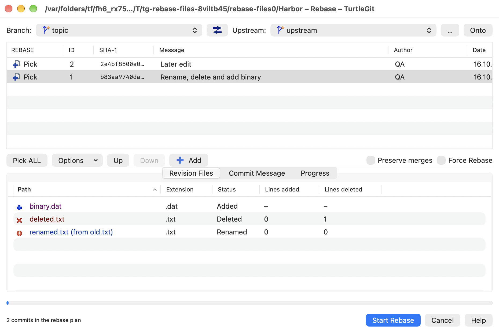
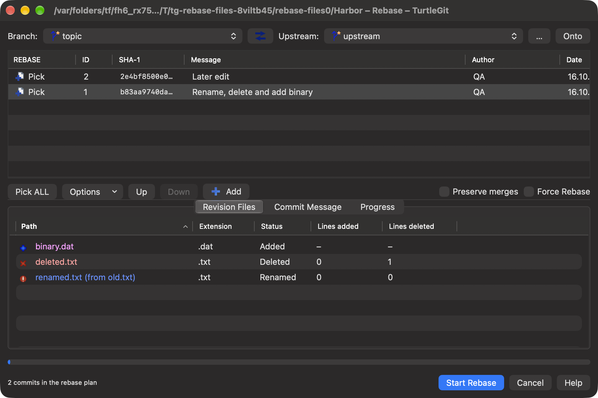
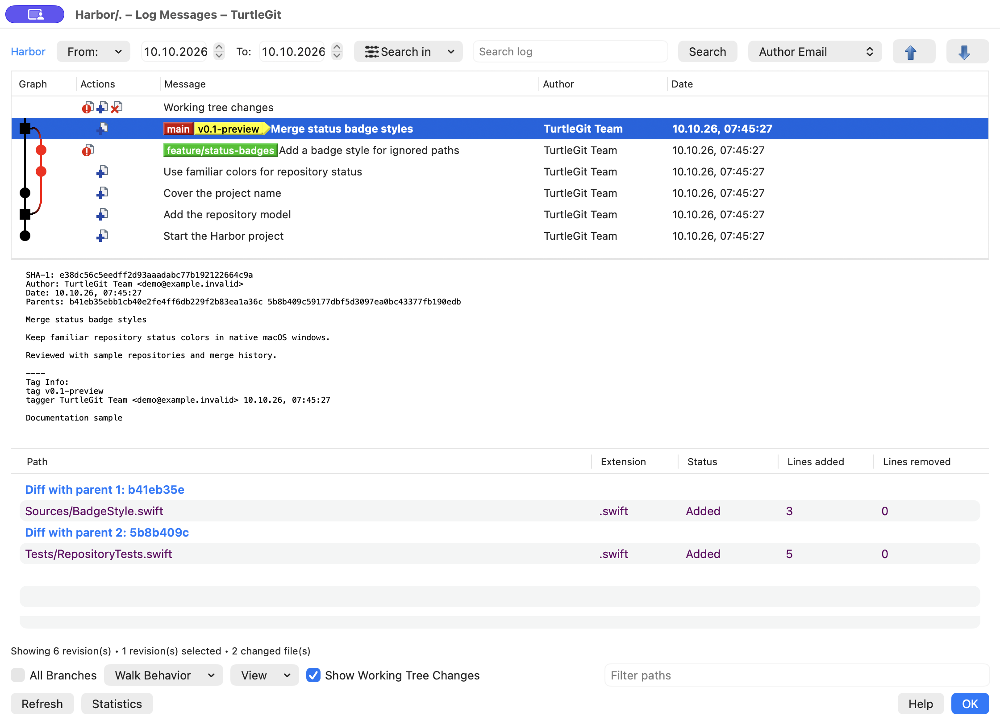

# TurtleGit for Mac


*A macOS fork of TortoiseGit*

A native macOS port in progress, based on the workflows and source of
[TortoiseGit](https://github.com/TortoiseGit/TortoiseGit). This is an independent,
unofficial project. **The complete application has not been ported yet.**

The goal is the same functionality, recognizable dialog layouts and context
menus, with native macOS windows and Finder integration. SwiftUI and AppKit
replace Windows/MFC. Git operations use argument arrays, literal pathspecs, a
serial repository actor and owned child processes. Minimum deployment target:
macOS 13.

## Current capabilities and limits

Log revision menus adapt to root, merge, multi-selection, working-tree and bare
contexts; see [popup behavior and remaining acceptance](docs/LOG-POPUP-VARIANTS.md).

| Area | Native implementation | Remaining acceptance work |
| --- | --- | --- |
| Commit | Independently selected source checkbox index engine and clean filters; source checkbox index preparation and optional unchecked add/delete/rename restoration; Checked-file commits, optional staging, byte-preserving UTF-8/legacy-text partial staging in a right-hand window, same-repository file/folder drops, amend, author/date controls, Commit / ReCommit / Commit & Push | Complete upstream controls, hook/editor/signing interactions and physical UI acceptance across all routes |
| History | Log with source command rows and integrated native filtering, incremental Git record ingestion, live read count and rows shown as metadata batches finish, revision graph before the list, revision/file menus, Blame with symbolic-link attribution, opt-in author images, native property-value Copy/descriptions and saved docked/tabbed/floating panes, Reflog, Browse References, references containing a commit, four Log ordering modes, notes, statistics, SVN-aware columns, saved revision/changed-file layouts and parent-group file sorting | Complete upstream views, menus and behavior; see individual parity documents |
| Repository Browser | Pinned tree/blob browsing, captured GetOneFile filters for historical Open/Save/drag, submodule handoffs, retained folder navigation, multi-file Revert, owned cancellation, saved native columns and multiple historical file/folder promises | Physical drag interoperability and complete physical/signed acceptance; [source audit](docs/REPOSITORY-BROWSER-PARITY.md) |
| Repository workflows | Clone/Create Repository, status, branch/tag, Switch, Fetch/Pull/Push, merge, Rebase, Stash, reset, patches, export, Submodule Add/Update/Sync, worktrees, and Resolve review/direct Silent commands | Each workflow has remaining source/UI/sandbox checks; a working Git operation alone does not establish parity |
| Git LFS | Locked-file list, checked-file Unlock/Force, captured Lock/Unlock menus, source-style command/file/error progress, file actions and sorting, result review with retained completed effects after interrupted replies, and saved action logs | Authenticated server and full physical/signed acceptance remain open; [guide](docs/LFS.md) |
| Languages | English and 37 bundled source label catalogs; shared Settings/First Start choice, Apply/Cancel and restart persistence, translated file-status cells, built-in groups, selection counters and clipboard headings | Partial translations; Mac-specific/dynamic wording and full RTL/physical acceptance remain open; [guide](docs/LANGUAGES.md) |
| Problem reports | Local launch discovery with Review/Dismiss and handled-report suppression, manual Apple report import, explicit inclusion, Copy/Save and a separate blank issue form | Direct Windows DrDump collection/submission and solution lookup remain unported; [scope](docs/CRASH-REPORTING-PARITY.md) |
| Working Tree | Scoped status, saved columns and source filter choices, F5, retained selection, cancellable refresh/Stage/Unstage/index flags/diff preparation, captured history/Blame/Open/editor/export/delete menus, shared status/changelist groups, separate parent/child submodule history and retired-window protection | Remaining menus and physical/signed acceptance; [source audit](docs/STATUS-PARITY.md) |
| Issue tracker integration | Native association list/editor with Enable/Add/Edit/Copy/Remove, project fallback, embedded searchable issue catalog and Commit message/ID selection, validation and completion interfaces | Windows COM providers require native vendor implementations; external discovery/network-backed providers and physical/signed acceptance remain open; [guide](docs/ISSUE-PROVIDERS.md), [source audit](docs/NATIVE-ISSUE-PROVIDER-PARITY.md) |
| Synchronization | Outgoing/incoming graph and files, reference changes, Pull/Fetch/Push variants, separate checkout/merge progress, Fetch & Rebase choices, owned Shift full options, a six-column Compare Tags tab with tag actions and Submodule Update/Init/Sync and Stash Save/Pop/Apply split commands; Manage opens Remote settings and refreshes results on dismissal; local/remote branch browse buttons use scoped native pickers | Direct Push/tags/notes and full-dialog hooks are implemented; remaining controls, complete visual and signed acceptance; [source audit](docs/SYNCHRONIZATION-PARITY.md) |
| Remote settings | Native remote list, URL/Push URL, Rename/Add New-Save/Remove, tag policy, Push Default and three-state Prune; source prompts and Browse References/Sync Manage entries | Native key selection and Clone/Fetch/Pull/Push auto-load exist; remaining SSH consumers, real authentication, complete settings tree and physical/signed acceptance; legacy PuTTY keys are preserved for Windows interoperability |
| Comparison | Source image/Merge/tool selection with captured Shift, explicit viewer isolation and reload ownership; native customizable Compare/Merge command toolbars with original artwork and saved layouts; standalone Load Images, colored unified diff, Subversion-backed two-file text comparison with [native editor menus and pane shortcuts](docs/MERGE-COMMAND-MENUS-PARITY.md), [input exchange, saved view controls and split restoration](docs/MERGE-VIEW-CONTROLS-PARITY.md), [moved-block detection and margin navigation](docs/MERGE-MOVED-BLOCKS-PARITY.md), and shared in-process inline matching/navigation with source repeated-token ties, [named ECMAScript regex filters with the shipped GUID preset and INI import/export](docs/MERGE-FILTERS.md), native image panes with DIB/CUR/SVGZ decoding, zoom/linked pan/alpha and XOR overlay, frame/page controls and playback, configurable transparency backgrounds and local Dark Mode, three-pane image conflict selection with undecodable-side and empty-Base choices, and Subversion-backed three-pane text conflict editor with regex filters, ignored-conflict choices and Undo/Redo, standalone one/two/three-file Open, and native pane-local Find/Replace with Count and modified-line filtering | Full upstream formats, complete conflict segmentation acceptance, format-specific animation and broader conflict controls, encodings, commands and layout parity |
| Bundled binary/notebook comparisons | Source-style binary byte/version reports with PE and native Mach-O reading; private exact-byte Mathematica comparison notebook handoff; shared defaults and Shift behavior | Real Mathematica execution, full version metadata and signed receiver acceptance remain open; [guide and light/dark captures](docs/BUNDLED-COMPARISONS.md) |
| LibreOffice documents | Source UNO tracked-change comparison and mine/theirs merge, private profile/copies, Save As and explicit resolution | Requires installed LibreOffice with Python; live/runtime/signed acceptance remain open; [guide](docs/LIBREOFFICE-COMPARISON.md) |
| Excel workbook comparison | Full/fast modes, source-style conditional value rules, protected-sheet warnings, private copies and Automation ownership | Requires Excel; live workbook rendering, locale/protection and signed acceptance remain open; [guide](docs/EXCEL-COMPARISON.md) |
| PowerPoint presentation comparison | Native colored slide review, change/move navigation, paired/overlay/difference views, text/notes and report export | Requires PowerPoint; source shape-level accept/reject and live/signed acceptance remain open; [guide](docs/POWERPOINT-COMPARISON.md) |
| Word document merge | Source-style three-way Word preparation, editable private stage copies, Save As instructions, explicit Mark Resolved/No and worker ownership | Live Word output/security/Save As and signed acceptance remain open; [guide](docs/WORD-MERGE.md) |
| Word document comparison | Formatting-aware new Word result, exact private document copies, descriptor-based path arguments, permission/failure ownership and shared Settings defaults | Requires separately installed Word; actual Word/TCC/format and signed acceptance remain open; [guide](docs/WORD-COMPARISON.md) |
| ZIP comparison | Bundled read-only archive names/date/size comparison, ZIP64 and Unicode names, Advanced Restore Defaults and raw Shift bypass | Metadata only; other Windows document scripts and physical/signed acceptance remain open; [guide](docs/ZIP-COMPARISON.md) |
| Appearance and icons | Light/dark palettes, original upstream artwork in native menus and status lists | All-dialog visual comparison and signed Finder rendering; [packaged app/document artwork](docs/APPLICATION-IDENTITY.md) |
| Dock progress | Native running/waiting/error progress for transport, Commit, replay and local Git commands, with concurrent-operation ownership and reduced motion | Physical Dock/VoiceOver and all consumers remain open; [scope](docs/DOCK-PROGRESS.md) |
| Single-patch review | Native before/after review, checked-file application, edited saves, exact-byte clipboard copy/review and confirmed target matching against plain directories or Git subfolders; app/Finder entry | Full TortoiseGitMerge behavior, broader formats and physical/signed clipboard acceptance; [source audit](docs/REVIEW-PATCH-PARITY.md) |
| SVN integration | DCommit choices/stash flow, Fetch comparisons, fetch-then-Rebase and Ignore destinations; private universal Perl/Subversion runtime; native credentials, explicit certificate trust, dual fingerprints/native certificate inspection and public DER/PEM export, and private client-certificate selection | Public server/TLS, signed Keychain/grants, physical UI and distribution acceptance; [guide](docs/SVN-AUTHENTICATION.md), [source audit](docs/SVN-PARITY.md) |
| Git daemon | Native warning/progress, server URLs, owned cancellation and app/Finder entry | Signed sandbox, firewall and LAN/IPv6 acceptance; [source audit](docs/DAEMON-PARITY.md) |
| Moving and copying | Guarded Move/Rename, native Copy/Add, captured clipboard transfers and direct Finder Transfer with native destination/history; workspace/Working Tree drops share source choices and owned preparation/progress/recovery | Physical/signed permission acceptance; exact Finder right-drag interception has no public FinderSync hook; [guide](docs/MOVING-AND-COPYING.md), [source audit](docs/FINDER-SOURCE-TRANSFER-PARITY.md) |
| Repository folder access | Saved workspace folder/metadata grants, automatic linked-worktree/submodule/shared-object discovery, native access manager with renewal, replacement and confirmed removal | Signed sandbox/powerbox and Finder-service acceptance; [guide](docs/REPOSITORY-FOLDER-ACCESS.md) |
| Cache menu | Optional independent menu-bar icon, live counts, fifteen-line activity, Enable/Disable and awaited Exit | Signed service and physical menu-bar acceptance remain open; [guide](docs/CACHE-MENU.md) |
| Finder | Embedded Finder Sync extension, status snapshot/badges, selection-based context-menu routing, event-driven active-workspace refresh and watched-repository service; [CacheSave](docs/FINDER-CACHE-PERSISTENCE.md) separates optional warm persistence from live process sessions and preserves other active publishers during shutdown | An older development-signed candidate passed installed activation, live badges and one file-context Show Log; complete current-command and distribution/App Store acceptance remain open |

[Getting started](docs/GETTING-STARTED.md) explains the first workflows, including
how checked-file commits differ from staging mode. The checkbox is named
**Staging support (EXPERIMENTAL)**. Enabling it keeps the file list and changes
its checkbox semantics; the partial-staging patch window opens to the right.

Dialog Help buttons and the Help menu now use [the bundled Mac help book](docs/HELP.md),
with an offline browser fallback. [The documentation index](docs/README.md) links the workflow guides, source
comparisons, dated verification records and remaining work. Older development
updates are retained in [historical implementation notes](docs/IMPLEMENTATION-NOTES.md).
Local build and receiver results do not establish signed sandbox behavior, full
physical UI acceptance or passing hosted GitHub CI.

[Regional patch text](docs/RAW-PATCH-CODECS.md) covers captured code pages across
Original Patch, serial previews, partial staging and editable unified diffs,
including exact-byte exports. [Byte-backed unified-diff editing](docs/UNIFIED-DIFF-BYTE-EDITING.md)
retains mixed encodings and opaque bytes through edits, Save/Save As and Undo.
[Patch filename handling](docs/PATCH-PATH-IDENTITY.md) covers renamed-file recovery,
exact Unicode metadata and serial-import drop ordering/duplicate rules.

[Command and progress diagnostics](docs/PROGRESS-DIAGNOSTICS.md) explains named
failures, bounded output and retained raw recovery results.

[Primary dialog command bands](docs/PRIMARY-COMMAND-BANDS.md) covers retained
field focus, wrapping controls and accessible Log footer diagnostics.

[URL/path word navigation](docs/INPUT-WORD-NAVIGATION.md) connects native input
commands with the source Advanced setting and retained editing/Undo.

## Build and run

Requires Xcode with its macOS SDK and command-line tools, Python 3, CMake and Git.
The generated Xcode project is checked in; XcodeGen is optional unless changing
`project.yml`.

```sh
python3 scripts/build-git-runtime.py
python3 scripts/build-merge-diff-runtime.py
python3 scripts/build-editorconfig-runtime.py
python3 scripts/build-issue-regex-runtime.py
python3 scripts/build-lexilla-runtime.py
python3 scripts/build-graph-layout-runtime.py
python3 scripts/build-metafile-runtime.py
python3 scripts/build-openssh-runtime.py
TURTLEGIT_CORE_ONLY=1 swift test
./scripts/build.sh
open build/Build/Products/Debug/TurtleGitMac.app
```

The Core test mode keeps the same tests, resources and revision utility while skipping a duplicate SwiftPM build of the app. The full app and Finder extension are built separately by `build.sh`; ordinary `swift run TurtleGitMac` remains available without that environment variable.

The build script prepares the editor, regex, graph, metafile, SSH and PuTTY key-conversion helpers, plus the merge
adapter when the Git/SVN runtime is present, before building the unsigned Debug
app. The explicit commands above prepare the dependencies for the preceding
tests. The initial pinned Git/SVN build can take substantially longer than app
builds; it caches its components. Build its universal SVN payload on Apple Silicon
with Rosetta, or restore the universal payload produced by CI.
`swift run TurtleGitMac` is an alternative development launch; it does not embed
the Finder extension or the EditorConfig, issue-matching, graph-layout, metafile and OpenSSH helpers.

See [testing](docs/TESTING.md) for scoped checks, native receivers, compatibility
coverage and process cleanup. Close app instances after manual testing.
An unsigned build verifies compilation and bundle structure, not distribution
acceptance.

## Local preview package

To produce a universal Release preview from this checkout:

```sh
python3 scripts/build-distribution.py --configuration Release
python3 scripts/package-local-preview.py --audit build-distribution/distribution-audit.json --output build/local-preview
```

The fresh output directory contains the app, a ZIP, checksum, license notices and
installation notes. Packaging preserves the audited build and finalized runtime
payloads, seals a separate copy ad hoc, and does not install, launch or upload it.
The preview is not notarized or App Store signed. Its ad-hoc signature cannot
authorize Finder status sharing. See [trying the local preview](docs/LOCAL-PREVIEW.md)
and the [release blockers](docs/RELEASE-BLOCKERS.md) for the signed channel and
remaining acceptance work.

## Finder integration

Watched Repositories includes a separate Background status column, publication
times, failure details and a retry action for the embedded cache service.
[Service setup and current limits](docs/FINDER-SERVICE-DEPLOYMENT.md).

Configure your signing team in `TurtleGitMac.xcodeproj`. Register an App Group
supported by your team and, if necessary, replace `group.org.turtlegit.macos` in
both entitlements and `FinderIntegration.group`. The app and extension need
matching group access. Build and launch the app, enable **TurtleGit Finder** in
System Settings' extension controls, then open a repository in the app to
register its monitored folder. The settings location depends on macOS version.

Settings → General → **Context Menu** controls which commands appear directly
in Finder's menu. **Context Menu 2** chooses commands that require Shift.
The first page also supports path exclusions and hiding outside-repository menus.
Unavailable commands remain disabled. See the
[source comparison and validation](docs/CONTEXT-MENU-SETTINGS-PARITY.md).

Initialized LFS repositories have a nested **LFS** menu for locked-file lists and
file Lock/Unlock operations. **Send Mail…** opens the native patch composer for
Finder files, including files outside a repository; opening it does not send mail.
See the [LFS/mail handoff notes](docs/FINDER-LFS-MAIL-PARITY.md) for permissions
and remaining acceptance work.

SMTP delivery offers a native certificate check before authentication or upload,
with default Cancel, exact temporary acceptance, a read-only inspector and public
DER/PEM export. See [SMTP certificate review](docs/SMTP-CERTIFICATE-REVIEW.md).

[Optional libgit2 index and transport filters](docs/LIBGIT2-TRANSPORT.md) connects Add, Clone, Fetch,
Sync Fetch, remote-reference listings and remote tag/branch deletions to the
pinned engine, source-style native credentials and actual HTTPS certificate review.
Temporary certificate acceptance carries across calls in the running app, scoped
to the exact host, port and certificate. Source defaults use libgit2 for Add and
historical file output, with Git commands for Clone and Fetch. Optional source
branches also cover [Reset and Log commit reversion](docs/RESET-REVERT-BACKEND-PARITY.md)
and [unified patches and history file lists](docs/DIFF-BACKEND-PARITY.md), with
captured preferences and separate engine caches. The [local reference family](docs/LOCAL-REFERENCE-ENGINE-PARITY.md)
connects unfiltered catalogs, revision completion, containing-reference lookup
and checked local deletion to their distinct source gates. Add uses configured
one-shot clean filters and owned progress, including Commit and Rebase file menus.
The [Replay/Merge/Resolve inspection family](docs/REPLAY-INSPECTION-PARITY.md)
connects common-ancestor decisions, source clean-worktree policy, index conflict
presence and requested Mine/Theirs stages across Rebase, Fetch, Sync and SVN.
Already-resolved files are reported as Skip; changed conflict stages still stop
the operation before mutation. Current resolution retains its separate Git path.
For an ordinary Edit continuation, staged-only changes use normal amendment;
unstaged changes open the checked-file Commit dialog. Empty-Squash recovery keeps
its approved Skip intent if an index lock interrupts the operation.
The [single-commit detail family](docs/SINGLE-COMMIT-DETAILS-PARITY.md) connects
source-selected commit metadata to amendment, replay messages, containing
references, comparison endpoints and parent captions, preserving declared
encodings, raw identities and accepted backend ownership.
The [history inspection continuation](docs/HISTORY-INSPECTION-PARITY.md) connects
fast-forward navigation, branch warnings, child submodule classification and
Combine readiness to their source engine choices and native ownership.

An [older development-signed candidate](docs/qa/finder-installed-2026-10-17.json)
passed installed activation, live ignored/modified/normal badges, repository access,
service registration, background refresh with the app quit, and a file-context
Show Log. Current-source multi-selection/modifier commands, additional metadata
grants and distribution/App Store acceptance remain open. Finder Sync controls
badge placement and menu insertion for registered repository folders. Watched
repositories, FSEvents invalidation and the independent cache service maintain the
snapshots; a cached badge alone is not evidence of current state. Selections spanning repositories are
rejected before an operation runs. See the [service deployment audit](docs/FINDER-SERVICE-DEPLOYMENT.md).

See the [Finder parity documents](docs/README.md#finder-integration) for menu,
selection, icon and routing comparisons.

## App Store preparation

The `TurtleGitAppStore` scheme uses the separate sandboxed `AppStore`
configuration. It requires the pinned bundled Git runtime and refuses system-Git
fallback. Follow the complete helper/runtime build instructions in
[distribution engineering](docs/DISTRIBUTION.md); see also [privacy](docs/PRIVACY.md).
The [Finder cache agent](docs/FINDER-SERVICE-DEPLOYMENT.md) is embedded and
managed from Watched Repositories. Enabling background refresh requires a signed
build and macOS approval; unsigned development builds fail closed.
The unsigned universal build/audit command is `python3 scripts/build-distribution.py --configuration AppStore --derived-data build-store` after preparing the pinned runtimes. See [distribution instructions](docs/DISTRIBUTION.md) for its architecture/hash report and remaining acceptance work.

Signed sandbox acceptance and distribution clearance remain open. **This is not
an App Store-ready release.**

## Port tracking

The source baseline is `7338078f8ddd924b8cddee35f512f2286072136d`.
The [file inventory](docs/upstream-files.csv) tracks all 3,277 upstream entries,
with blob hashes and review status; the [dialog inventory](docs/upstream-dialogs.csv)
tracks resource dialogs. An inventoried file or dialog is not necessarily ported.

[Port tracking](docs/PORTING.md) explains replacements and inventory maintenance.
The [complete dialog audit](docs/DIALOG-COVERAGE.md) separates partial family
reviews from unmapped controls and links recorded parity evidence.
[UI parity](docs/UI-PARITY.md) records required source, layout and behavior
comparisons. These documents and individual workflow audits track the full-port
work that remains.

## Screenshots and website

The [Rebase execution recovery review](docs/REBASE-EXECUTION-RECOVERY-PARITY.md)
tracks failed-Pick Skip/Retry/Cancel, per-replay remembered Skip, cleanup retry,
and the checks that prevent applying a changed occurrence.

The [Rebase action-control review](docs/REBASE-ACTION-CONTROLS.md) includes native
light/dark captures of the remembered bulk split action and Edit/Split footer.

Rebase's Revision Files tab now includes historical file actions and shared
native column controls. See the [implementation and limits](docs/REBASE-REVISION-FILES.md).




Notes, Merge and Rebase now share Commit's source-style issue/URL links and
message formatting, preserving plain-text drafts and Undo. Reviewed Notes
[light](docs/site/assets/notes-message-styles-light.png) /
[dark](docs/site/assets/notes-message-styles-dark.png) captures show the native
form with private font preferences. [Scope and limits](docs/SHARED-MESSAGE-STYLES.md).

Image comparison and conflict selection now use native source-ordered toolbars
with original artwork and common menu/keyboard guards. Reviewed
[comparison light](docs/site/assets/image-toolbar-comparison-light.png) /
[dark](docs/site/assets/image-toolbar-comparison-dark.png) and
[selection light](docs/site/assets/image-toolbar-selection-light.png) /
[dark](docs/site/assets/image-toolbar-selection-dark.png) captures show the current
windows. [Source scope and remaining limits](docs/IMAGE-COMMAND-PARITY.md).

Blame embedded-language fonts and line-tail fills now retain the source style
intervals. Reviewed [light](docs/site/assets/blame-embedded-light.png) /
[dark](docs/site/assets/blame-embedded-dark.png) captures and
[acceptance limits](docs/BLAME-EMBEDDED-STYLES.md) describe this batch.

Blame syntax coloring now uses the pinned upstream Lexilla engines and keyword
lists. Reviewed [light](docs/site/assets/blame-lexilla-light.png) /
[dark](docs/site/assets/blame-lexilla-dark.png) captures and
[batch evidence](docs/qa/blame-lexilla-2026-10-13.json) include remaining limits.

Blame now has a continuous native source editor with multi-line selection,
synchronized annotations and the source View switches. Actual
[light](docs/site/assets/blame-source-editor-light.png) /
[dark](docs/site/assets/blame-source-editor-dark.png) captures and
[verification limits](docs/qa/blame-source-editor-2026-10-13.json) document the
October 13 batch. Full Blame layout/menu and signed acceptance remain open.

[Project website](https://jfk-solutions.github.io/turtle-git-mac/).



The Log and Commit [light](docs/site/assets/commit-light.png) /
[dark](docs/site/assets/commit-dark.png) captures were refreshed on 10 October
2026 using disposable sample data. See the
[capture record](docs/qa/dialog-captures-2026-10-10.json) for scope and limitations.
[Earlier Commit controls](docs/site/assets/commit-controls.png) and
[partial staging](docs/site/assets/partial-staging.png) document previous
checkpoints. Screenshots do not establish parity for every dialog.

The new Issue Tracker Config [light](docs/site/assets/issue-tracker-config-light.png) /
[dark](docs/site/assets/issue-tracker-config-dark.png) page and Regex Tester
[light](docs/site/assets/issue-regex-tester-light.png) /
[dark](docs/site/assets/issue-regex-tester-dark.png) captures use dedicated private
native hosts. See [their source comparison and capture scope](docs/qa/issue-tracker-captures-2026-10-12.json).
The Settings page capture includes its shared footer, not the full navigation tree.

The native [Autotext Tester](docs/AUTOTEXT-TESTER-PARITY.md) now provides the
source content/regex/Scan/results/timing workflow through File and Commit settings.
Full visual and signed acceptance remain open.

The native [Hook Scripts settings and runtime](docs/CLIENT-HOOKS-PARITY.md) now
connect the six Commit/Push/Rebase hook points, including repository approval and
owned background execution. Alternate routes and visual/signed acceptance remain
open.

Reviewed native [Hook Scripts](docs/site/assets/hook-settings-dark.png),
[Configure Hook Scripts](docs/site/assets/hook-config-dark.png) and
[Autotext Tester](docs/site/assets/autotext-tester-dark.png) screenshots now include
both themes. See [their source comparison and scope](docs/qa/utility-captures-2026-10-12.json).

The static site source is `docs/site`; `python3 scripts/build-site.py` builds
`build/site`. See [website and screenshot maintenance](docs/WEBSITE.md).

## License

GPL v2, matching upstream TortoiseGit; see [LICENSE](LICENSE) and [NOTICE](NOTICE).
Native builds use Apple's frameworks and embed the pinned EditorConfig,
issue-matching, OGDF graph-layout, OpenSSH and PuTTY key-conversion helpers. Development builds can use installed Git; the Store
configuration embeds its pinned Git runtime. Bundled dependencies and original
artwork are documented in NOTICE and the bundle's license resources.
Distribution clearance remains incomplete; see [distribution requirements](docs/DISTRIBUTION.md).

The native [Revision Graph](docs/REVISION-GRAPH.md) now has a separate colored
reference-box canvas and source-style Filter sheet. It follows the shared Log
commit ordering and font family, with graph zoom sizing and matching export fonts. See the
[light/dark graph and filter captures](docs/site/index.html) and
[remaining parity work](docs/REVISION-GRAPH-PARITY.md).

The [working-copy revision utility](docs/WORKING-COPY-REVISION.md) generates version
files from TortoiseGit-style templates and exposes repository status as JSON for
macOS build scripts. Build it with `swift build --product TurtleGitWCRev`.

Compare and Review source panes support Save As to a new working file, including
subsequent Save and Reload. See [Save As behavior and limitations](docs/SAVE-AS-TARGETS.md).

Conflict editors and external merge tools share [operation-aware side identities](docs/CONFLICT-IDENTITIES.md),
including merge/rebase branch names and the Advanced branch-guessing preference.

Existing Advanced settings now control [Fetch verbosity and native progress animation](docs/TRANSPORT-PRESENTATION.md),
with captured request policy and shared bounded visible-output settings.

Finder context now shares normalized selections, nearest repository ownership and
explicit ignore inheritance; see [selection context](docs/FINDER-SELECTION-CONTEXT.md).

[Git Properties](docs/GIT-PROPERTIES-PARITY.md) exposes repository metadata and
index flags, including live registered-parent/submodule pages and captured
Log/Settings actions. Last Modified uses bounded history object queries while
retaining the source's mode-only and merge-parent rules.

Standalone [Unified Diff documents](docs/UNIFIED-DIFF-VIEWER-PARITY.md#editable-documents-file-actions-and-source-find--october-15-2026)
support native editing/Undo, Open, Save/Save As, unsaved-change decisions and the
source-style bottom Find bar. Editing a patch document does not stage or apply
its changes to a repository.

Unified Diff's Apply Patch command opens TurtleGitMerge review for the saved
patch or loaded generated comparison; unsaved editor text is excluded until
saved. Its Settings command opens the UDiff page directly. Comparison replacement
keeps the document and its labels/paths together through unsaved-change decisions.


External Unified Diff viewers accept app bundles or executables and `%1`/`%title`
argument templates. Alternative Editor also supports executable tools, with one
literal filename argument. See [external tool configuration](docs/UNIFIED-DIFF-VIEWER-PARITY.md#external-viewer-arguments-and-executable-tools--october-15-2026).

Compare/Merge menus restore their commands after application-menu rebuilding and
defer structural changes during menu tracking. Source block-choice and navigation
shortcuts are available alongside macOS bindings; see [command menus](docs/MERGE-COMMAND-MENUS-PARITY.md#rebuilt-menus-and-source-accelerators--october-16-2026).

Compare/Merge also provide Insert/Overwrite, current-line ending cycling and
source block-mark shortcuts, with Unicode-aware typing and Undo. See
[typing behavior](docs/MERGE-TYPING-PARITY.md).

Compare/Merge support [14 selected legacy text encodings](docs/LEGACY-TEXT-FORMATS.md) alongside Unicode, with retained pane codecs and lossless-save checks. [Patch file recovery](docs/PATCH-CODEC-WORKFLOWS.md) carries the same captured policy through file previews, automatic merges and explicit output-format recovery.

Patch review has a [native file panel](docs/PATCH-FILE-PANEL-PARITY.md) with separate
highlight/preview actions, multiple-selection context commands and a Hide/Show
file-list menu. Per-file application retains individual success/error results.

[Recorded-base patch recovery](docs/PATCH-RECOVERY-PARITY.md) provides initial
file states, embedded three-pane conflict review and clean three-way continuation
for Patch all/selected while preserving captured Save checks.

Binary, symbolic-link and deletion conflicts use [explicit patch recovery choices](docs/PATCH-SPECIAL-RECOVERY-PARITY.md).

Signed development builds and actual sandbox checks are described in the
[Finder development guide](docs/SIGNED-FINDER-DEVELOPMENT.md).

Primary TortoiseProc-style [command-line entry](docs/COMMAND-LINE.md) opens native Commit, Working Tree, Log, Diff, Revert and Resolve dialogs, including editable message/history presets and explicit repository/file authorization. Clone, transport and reference launches also support source presets and multi-repository transport options. Blame, Previous Diff, Add, Rename and Remove/keep also use source-style entry behavior; file-only Add stages the authorized selection immediately. Create Repository, Cleanup and Ignore entry also retain their native options, authorization and review steps. Other legacy commands and automation switches remain open.

Standalone Git comparison/merge entry is available through the waiting
[`turtlegit-merge` wrapper](scripts/turtlegit-merge). See
[Git difftool/mergetool setup](docs/MERGE-TOOL.md) for native file comparison,
separate merged output, source arguments and sandbox authorization.

Connected workflow audits cover [Stash preparation and completion](docs/STASH-OPERATION-PARITY.md),
[Submodule Add recovery](docs/SUBMODULE-ADD-RECOVERY-PARITY.md), and
[Submodule Update/Sync partial results](docs/SUBMODULE-UPDATE-RECOVERY-PARITY.md).
These are partial source-family audits; remaining physical, visual and signed
acceptance is tracked alongside each workflow.

[Switch](docs/SWITCH-OPERATION-PARITY.md), [Reset](docs/RESET-OPERATION-PARITY.md)
and [Bisect](docs/BISECT-OPERATION-PARITY.md) also retain explicit source mappings,
operation/recovery behavior and remaining acceptance records.

Windows metafile comparison uses the [bundled renderer](docs/METAFILE-RUNTIME.md)
for WMF, EMF and EMF+, including [custom pen caps](docs/METAFILE-CUSTOM-CAP-PARITY.md),
native comparison, dropped previews and conflict
panes. [Compressed paths](docs/METAFILE-PATH-PARITY.md) share bounded decoding
across drawing, clipping, regions, custom caps and accepted gradient boundaries. Embedded EMF+ bitmap images and textures include indexed palettes and
16-bit RGB555/RGB565/ARGB1555. [Formatted EMF+ text](docs/METAFILE-TEXT-PARITY.md)
uses native glyph outlines for wrapping, direction, tabs, spacing and trimming.
[Classic EMF clipping](docs/METAFILE-CLASSIC-CLIP-PARITY.md) includes region
Boolean combinations, clip offsets and independent metaregions.
[EMF+ pen strokes](docs/METAFILE-PEN-PARITY.md) include linear nib transforms,
compound bands, independent caps, joins, dashes and Center/Inset positioning.
[Supported drawing behavior and remaining limits](docs/IMAGE-METAFILE-PARITY.md)
remain explicit; rendering does not rewrite the original files.
