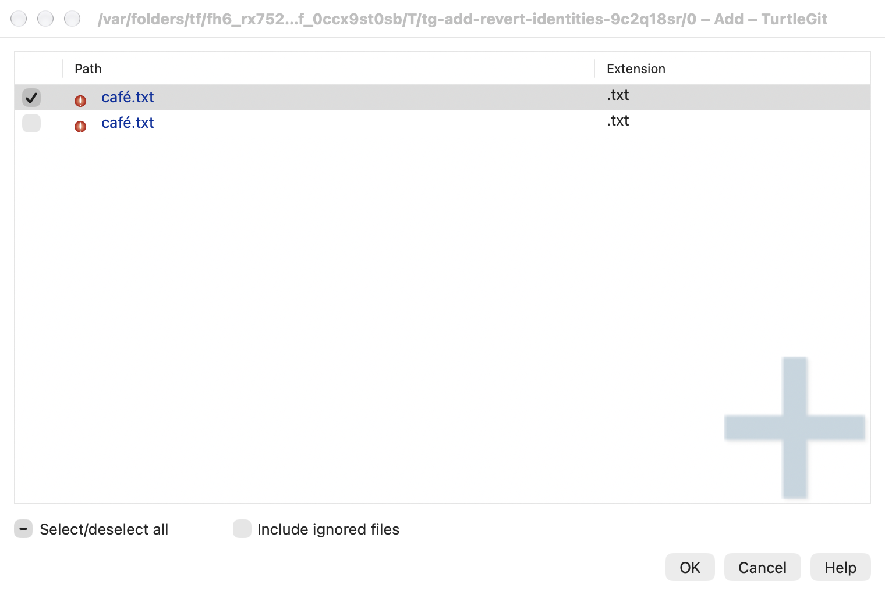
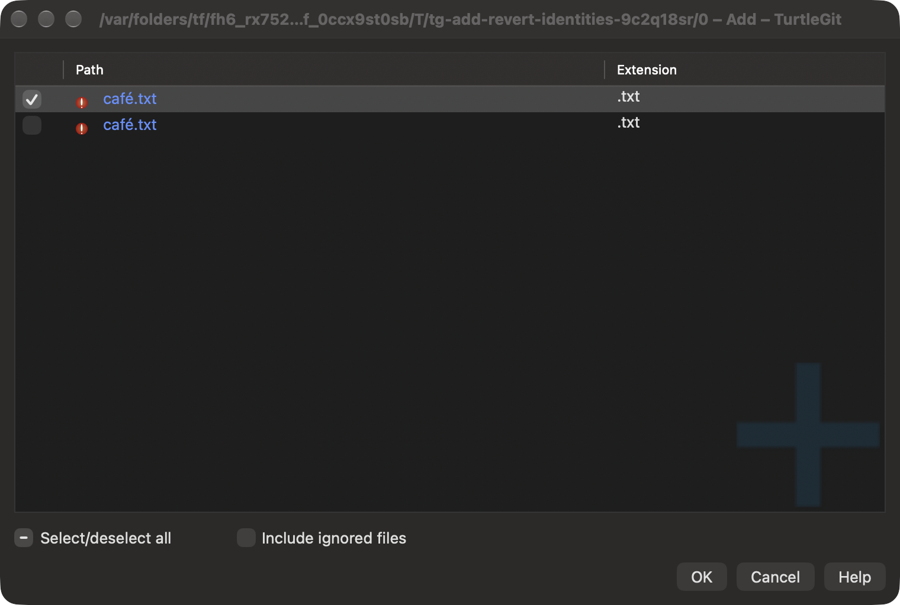
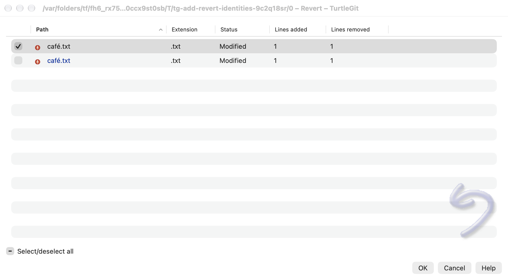
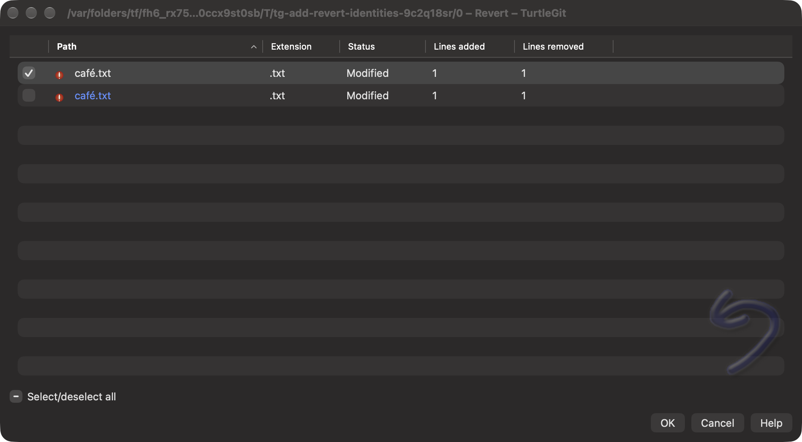

# Add and working-file Revert selection identity

Reference: TortoiseGit `7338078f8ddd924b8cddee35f512f2286072136d`,
`AddDlg.cpp`, `RevertDlg.cpp`, `GitStatusListCtrl.cpp::OnLvnItemchanged`,
`AddProgressCommand.cpp` and `RevertProgressCommand.cpp`.

The source keeps checked files separate from highlighted rows and writes the
checked names into the operation path list. A checkbox on a highlighted file
applies its new state to the highlighted files; an unhighlighted checkbox changes
only its own file. Path identity must survive every boundary. Swift String sets
and dictionaries otherwise merge canonically equivalent Unicode names that Git
can keep as distinct index entries.

## Connected implementation

Add's scope reader and initial checks use exact valid UTF-8 keys, including direct
clean/modified files and directory boundaries. Native Add keeps exact checked and
highlighted sets, marked-row matching, refresh intersection, restoration-copy
keys, flag/LFS/unified-diff target lookup and drop membership. Its AppKit table
uses exact checkbox identifiers and stable byte ordering when the displayed
localized names compare equal. Original Path/Extension layout, optional columns,
status/menu artwork, watermark, saved settings and separate highlight remain.

Each Add context leaf retains a command, original enum/string payload and model
epoch. The native dispatcher accepts the captured invocation once while its
selection/mark/data/layout/sort/busy epoch remains current. Canonical-only changes
and selection-away/return invalidate it. Direct keyboard actions remain current
selection actions. Capturing the receipt leaves source icons, nested menus,
represented payloads, visibility and command guards intact.

Revert's outer planning model now retains exact checks, highlights, queued/drop
checks, rename updates and row metadata. The native SwiftUI table encodes raw
path bytes only at the ID boundary and keeps raw path captions/arguments. Its
binary AppKit checkbox implements the source highlighted-row rule. Focus retains
exact spelling and invalidates captured file menus when its mark changes.
Refresh uses the shared native clear/select replacement adapter and preserves
checked/highlighted independence. Core Revert progress row lookup also retains
exact step/path keys, so two Git names cannot share one progress result row.

Reviewed Add and mode post-actions retain exact selection, send NUL path packets
to Git and update modes with NUL index-info records. Mode reads disable argv
precomposition for that command only. Staged blob IDs, unrelated index entries,
disk bytes and persistent Git configuration are preserved by mode post-actions.
The existing locked private-index transaction and cancellation boundaries remain.

Revert and Retry use exact requested/current/represented/tracked maps and sets.
Revert sends bounded NUL-delimited removal/restore batches against its private
index. Submodule reverse moves retain literal arguments with command-local
precomposition disabled. Existing preflight, Trash recovery, cancellation,
private-index publication, amendment and submodule behavior remain connected.

## Evidence and acceptance limits

See [the batch record](qa/add-revert-identities-2026-10-17.json) for actual build,
Core/native results, initial failures, process cleanup and validation boundaries.
The initial compile caught two replacement typos. The repaired Core checkpoint
passed 43 relevant tests, including real paired index names, exact direct/directory
scope, staged-mode preservation, reviewed Add and selective Revert/Retry without
changing the canonical neighbor's staged blob. These tests are not a full suite
or complete hosted CI claim. Twelve distinct final native case/engine combinations
pass with system and bundled Git, covering the new identity family plus retained
Add list/dialog, Revert planning/progress and shared refresh families. All recorded
owned receivers/helpers were reaped and independently absent. The retained Add
fixture needed private preferences, its source column order and an explicit
unchecked selection mark; its behavioral assertions remain. The known AppKit
Revert reentrancy warning also appears in earlier retained logs and remains open.

The native identity case checks both dialogs' actual checkbox/highlight/bulk rules,
Add's real captured dispatcher (including one-shot and stale selection rejection),
Revert focus/menu generation, selected-row/check refresh and retired callbacks.
Its repository retains HEAD, stage records and working bytes. The paired Git
index names can refer to the same physical disk file on macOS; the fixture does
not claim independent filesystem storage for those names.

Both raw light/dark captures were reviewed individually for each dialog. The
paired rows, single checked/highlighted row, original colored icons, watermark,
columns and footer fit. Windows are inactive and use the system gray highlight.
Physical input, VoiceOver, every source menu/state combination, invalid UTF-8 Git
names, filesystem case/normalization aliases and signed Finder/App Store
acceptance remain open. Wider Log/LFS ownership/Finder state identity migration
and complete file-panel/external-application lifetime acceptance, displayed-sort acceptance order and the existing Revert table delegate
reentrancy warning remain open.

The [file-command continuation](ADD-REVERT-FILE-FLOW-PARITY.md) supersedes the
pending checked acceptance-order and picker lifetime entries above. Reinspection
confirmed that the source sorts checked pathnames after collecting rows; it does
not launch in arbitrary displayed sort order. Locale/physical/signed limits and
the existing Revert table delegate warning remain open.
