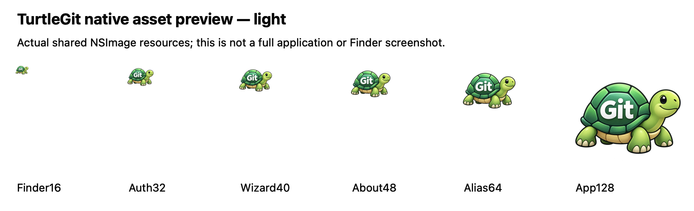
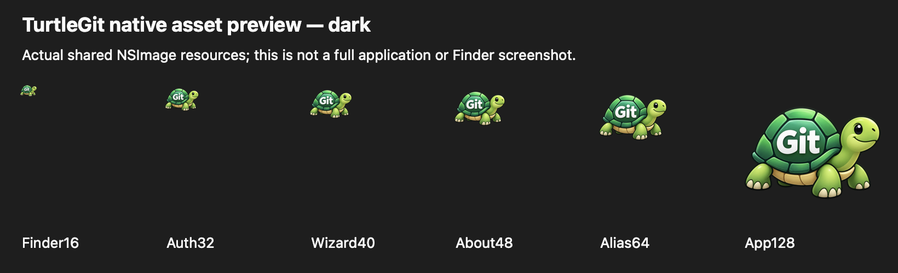

# Application and patch-document identity

TurtleGit for Mac uses its own green turtle with **Git** on its shell. The
unmodified generated source is `Branding/TurtleGitIconSource.png` (1254×1254,
RGBA). Its [generation record](../Sources/TurtleGitMac/Resources/Branding/TurtleGitIconSource.provenance.json)
retains the exact prompt, built-in imagegen generator, actual dimensions and
SHA-256. It is new project artwork; no earlier custom source could be recovered
from this checkout or its Git history. Upstream resource copies remain separately
identified for provenance and the original command/status artwork.

`swift scripts/build-application-icons.swift "$PWD"` derives the 1024-pixel
application PNG, all ten macOS AppIcon catalog slots, the 512-pixel shared menu
image, patch/diff ICNS, 256-pixel website header and 32-pixel favicon from that
source. It preserves transparency and records output hashes. The original generated source is never
overwritten by resizing. The patch-document icon shares the fork's mascot rather
than the former upstream UDiff image; handler registration remains alternate.

First Start, About and the Merge/Blame/Image/Unified Diff About pages, launch
introduction, cache menu, Finder root entries and standalone authentication
prompts use this common identity. The legacy `TortoiseSmall` lookup routes to the
same shared PNG. Original command glyphs and Finder status overlays retain their
separate pinned provenance and colors. Source attribution and component licenses
remain available through LICENSE, NOTICE and the vendored resources.

Xcode Debug and AppStore configurations share the compiled catalog and document
icon. SwiftPM development launches set their application image from the bundled
PNG; SwiftPM does not create an installable application bundle. Updating these
assets does not install a Finder extension or reset the user's Launch Services
cache/default file associations.

## Current branding evidence

[Batch evidence](qa/custom-branding-2026-10-19.json) records asset derivation,
source/bundle identity checks, app build and native consumer checks. Light/dark
native icon plates are artwork previews, not full dialog screenshots or physical
Finder/Dock acceptance. Existing dated screenshots retain the artwork actually
present at their capture date. Signed deployment and App Store submission remain
separate acceptance requirements.

The current Debug build and packaged identity audit passed. One native receiver
verified colored shared resources and the legacy alias at seven sizes in both
appearances, the real Finder root menu and icon preference, all five About
artwork routes and native headers/banners, and the actual authentication header.
First Start and launch introduction constructed against private preferences.
Both native component previews were individually reviewed. The receiver closed
its owned windows, drained work and was reaped. No repository operation or
standalone authentication/Finder application was launched. No Core suite or
new unsigned AppStore build was required for this asset/UI branding change.

## Finder file-open route

The bundle declares `.patch` and `.diff` as an **alternate** editor for its
existing `org.turtlegit.unified-diff` type, with filename/MIME tags and a document
icon. This supplies an Open With candidate; TurtleGit does not set the user's
default handler. Its existing SwiftUI file-URL event now opens an independent
native Unified Diff document. A repository is not required for opening/reading
that document, and the main workspace is not switched or blocked by the document.
Repository mutations remain behind the separate Apply Patch workflow.

Each exact file path owns a document window. Reopening focuses an existing
window and preserves its edits/Undo rather than replacing it. Save As changes
which filename focuses that window; reopening its old filename creates a separate
document without replacing the renamed window. Different documents
open independently. Initial reads use the existing cancellable, size-bounded,
scoped file reader, keep the file lease for Save, set the represented URL and
retain global Quit ownership through completion. Failed initial reads can be
retried by reopening the file. Forced close cancels and refuses delayed contents.
Unsupported file types do not enter the editor; a pending Quit refuses new opens.

Save, Save As, original encoding/bytes, native Undo/Redo, Find and dirty-close
questions use the shared standalone document session. It remains isolated from
index/HEAD/working-tree changes. Opening a patch through Finder is distinct from
automatically applying it.

## Historical identity acceptance — October 16, 2026

The following checkpoint used the preceding upstream-derived icons.
Debug and unsigned AppStore builds and both identity audits passed. The initial
native case required the existing post-Save native input-readiness wait before
Undo; the original assertions were retained. Six grouped native cases then
passed across system/bundled Git (file-open, retained document and Dock families).
Final source review found Save As needed current-file identity lookup; the UUID
ownership correction was rebuilt in both configurations and its two affected
native engine cases passed. The four unaffected document/Dock cases were not
repeated. All nine attempted receivers were reaped and independently absent.
No Core suite was rerun. Xcode's anomalous exit-zero/no-output diagnostics are
recorded in the [dated evidence](qa/application-identity-2026-10-16.json), together
with eight inspected native Dock renders and the original-resolution limit.
Physical Finder/Open With/proxy-icon
interoperability, Launch Services cache refresh across installs, all default-app
combinations, true signed sandbox file grants, App Store submission and complete
application parity remain open. Unsigned AppStore packaging is not signed runtime
or App Store approval. That older source ICO had a 256-pixel resolution limit; the current custom source
is recorded above.

## Historical shared branding, 17 October 2026

The shared TurtleGit branding image now uses the same complete turtle with Git
on its shell as `Branding/ApplicationIcon.png`. First Start, application About,
Finder toolbar and submenu, cache menu and standalone Git/SSH authentication
prompts use that shared image. The legacy `TortoiseSmall` lookup routes through
the same branding loader; the vendored original ICO remains unchanged for
attribution. Ordinary command icons and status overlays retain their own artwork.
The generator publishes the shared PNG and its SHA-256 alongside the application
assets. Small application catalog slots now use the full turtle too. This is
consistent selection of existing artwork, not a newly drawn independent logo.

The dedicated icon checks and packaged identity audit cover resource decoding,
rendering and bundle equality. Physical Finder/Dock/Launch Services cache refresh
and signed/App Store deployment of this revision remain open.

## Native launch explanation

Source `RTFMCommand.h` now has an explicit no-Git `rtfm` route. Its native window
explains File/Finder repository entry and retains Help and OK actions. Help opens
the manual overview; OK opens Documents in Finder, matching the source's personal
folder action. A failed launch remains visible. Repeated entry reuses the window;
closure retires its callbacks. Ordinary native startup still opens the workspace.
This is the macOS client adaptation of a Windows shell-extension explanation.

At that October 18 checkpoint, the shared upstream-derived application artwork
was reused. The current custom source and exact generation record are described
above. See [service command evidence](qa/service-commands-2026-10-18.json) for
local checks and outstanding physical Help/Finder, rendered/keyboard and signed
acceptance.

## Attribution command artwork

The [native form continuation](SOURCE-FORM-CONTROLS-PARITY.md#blame-branding-continuation)
replaces the remaining Blame command mascot with a deterministic variant of the
custom TurtleGit source, retaining Git lettering and a magnifier cue. App and
Finder resource aliases share `TurtleGitBlame.png`; original upstream resources
remain separately attributed.
