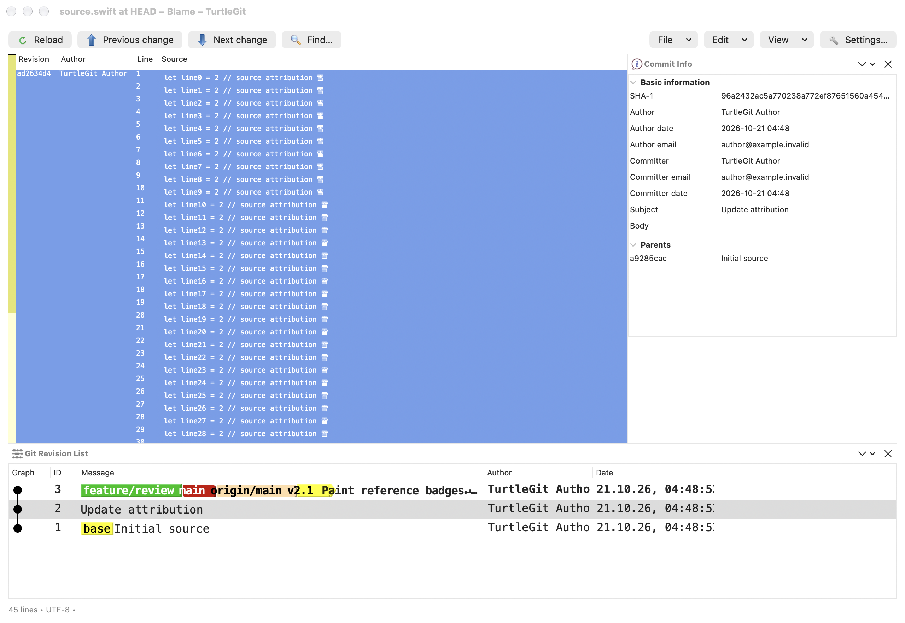
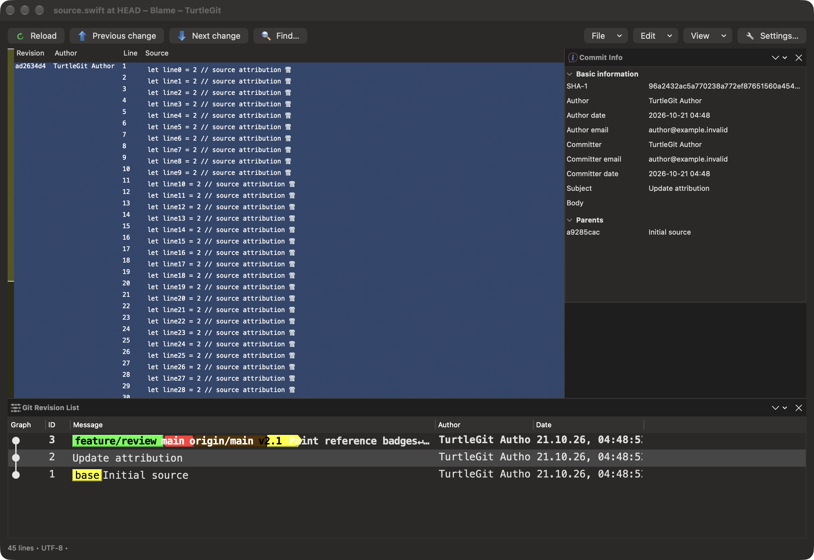

# Blame embedded Log presentation and interactions

This family follows pinned TortoiseGit
`7338078f8ddd924b8cddee35f512f2286072136d`. It connects captured reference
metadata, native row presentation, column persistence/reset and action ownership
in the existing Blame Log pane. The existing Previous Blame, parent comparison,
unified diff, rename and clipboard actions remain the consumers of those rows.

## Pinned source behavior

`TortoiseGitBlame/OutputWnd.cpp` 118–139 loads either the complete path history
or the attributed hash set. `GitLogListBase.cpp` 2572–2627 calls `ReloadHashMap`
from both `FillGitLog` overloads. `GitLogListBase.h` 487–507 obtains all reference
names, the current branch and HEAD, plus remote/tracking context. Decoration must
not change the path-filtered visible commit set. Annotated tag objects and their
peeled commit targets remain distinct.

`GitLogListBase.cpp` 294–310 uses the configured Log font only when
`LogFontForLogCtrl` is enabled and derives a bold version of the same font.
Custom drawing highlights HEAD (1097–1104) and renders the source reference
labels (1168 onward). The native message cells reuse the main Log's reference
styles, source colors, tracking marker and pointed annotated-tag drawing.
Native row height and fitting measure the selected font and its bold variant.

`ColumnManager.h` 163–175 starts the visibility menu at column one: Graph is
not a user toggle. Message has no corresponding mandatory-column rule.
`ColumnManager.cpp` 240–263 fits strings with margins and header width for
default sizing; `ResetColumns` 395–413 restores default visibility/order and
resets widths for content fitting. The native adaptation retains separate
Blame preferences, keeps Graph constrained by complete-log/follow-renames mode,
and measures decorated Message contents when fitting.

`GitLogListBase.cpp` 2494–2509 selects the first selected revision for Compare
with Previous, even with multiple selected rows. Return (2721 onward, excluding
Control) and double-click (2760 onward) use the same preference-controlled route.
The native callback captures the event's alternate-tool state before parent
preparation and retains its exact originating model/document and first revision.

## Native ownership and display

History preparation attaches references, current-branch and HEAD state to the
loaded entries and retains reference/tracking context. Tooltip-only origin
commits remain separate. Reference changes after loading do not retarget a
displayed row; Reload obtains a new snapshot.

Blame's table uses the existing native source graph and a shared decorated
message cell. Caption escaping prevents line separators or tabs from changing
row geometry; raw field values remain available in tooltips and copying.
Configured font, HEAD emphasis, reference labels and tag shapes participate in
row sizing and content fitting. Selection remains the native table selection.

Header actions retain a document/layout receipt. Replacement, reset, relevant
layout/state changes and retirement invalidate old actions. Reset owns its
confirmation and rejects late answers for a changed document or retired owner.
Dismantling detaches the table's delegate, datasource, target, header/menu and
keyboard/context callbacks. A retained old table cannot operate the replacement
document. Accepted comparisons still use the existing captured parent-action
pipeline and cancellation rules.

## Checkpoint and remaining acceptance

The [October 21 checkpoint](qa/blame-history-presentation-2026-10-21.json) passes
25 focused Core methods, the Debug app build, four functional native case/engine
pairs and the deliberate native capture case. System and bundled Git both pass
the presentation and ownership cases; Core was run once with system Git.

Native checks cover actual reference cells/colors/tracking/HEAD fonts, raw
tooltips, one-line captions, live preference-driven font/row updates, saved v6
layout migration and v7 persistence, Message visibility, fitted Reset No/Yes,
first-selected Return/Shift and Control-Return, actual File Open replacement,
old table/header retirement and a held Reset force-close with duplicate late Yes.
Core adds all-ref, peeled-tag, exact Unicode-ref, detached/unborn/bare, captured
lifetime and real reference-read cancellation coverage alongside existing Blame
history, encoding and parent-read checks.

Two initial native fixture defects were retained: an incomplete old column order
triggered the established introduction of missing Bug/SVN columns, and a directly
mutated order contained duplicate IDs and caused an AppKit layout trap. A complete
saved order and normal `BlameHistoryColumns` construction repaired those fixtures;
production was unchanged. Only failed/unrun native cases continued. The first
capture showed a partially clipped third row and was excluded. Only the capture
case was repeated with actual roomier native dividers and a complete-row assertion.
All eight owned receivers, including failed attempts, are independently absent.

These complete WindowServer captures show a deliberate Message-first saved layout,
Menlo 16, all three history rows, populated Properties and enlarged pane dividers.
Long metadata fields use normal native truncation/tooltips. The inactive app's
chrome/selection remains visible; these are not default-width or full physical
interaction certification.

Physical pointer/header/modifier behavior, VoiceOver, all font families and
minimum-version/Intel rendering, full Blame source/menu parity and installed
signed Finder/App Store handoffs remain separate requirements. A row or provider
check cannot certify a complete window or the entire port.
