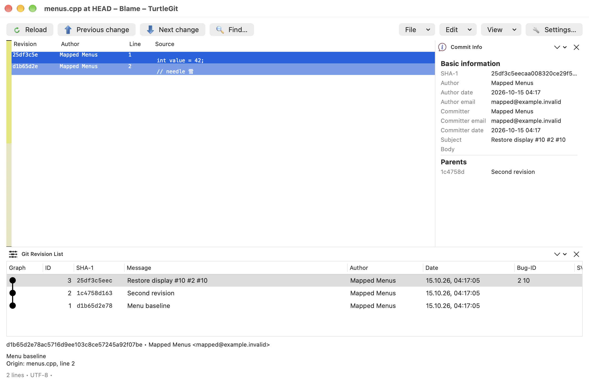
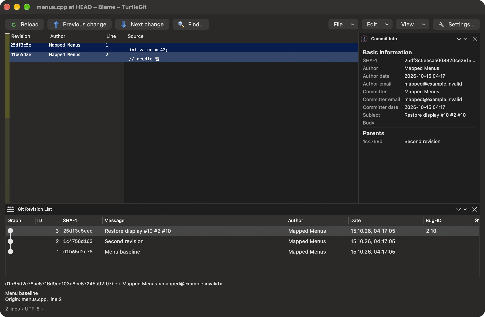

# Blame parity

Target: the native equivalent of TortoiseGitBlame, including its annotated source
layout, colors, navigation, context menus and settings. A first native historical
viewer is available from the Log changed-file context menu. Full parity is pending.

## Baseline

Upstream source baseline: `7338078f8ddd924b8cddee35f512f2286072136d`.

- [TortoiseGit Blame manual](https://tortoisegit.org/docs/tortoisegit/tgit-dug-blame.html).
- `src/TortoiseGitBlame/TortoiseGitBlameData.cpp`: annotation parsing, origin paths
  and line numbers, encoding conversion and search behavior.
- `test/UnitTests/TortoiseGitBlameDataTest.cpp`: empty files, BOM, trailing blank
  lines, UTF-16 and legacy encoding cases.
- [Git blame manual](https://git-scm.com/docs/git-blame): line porcelain, whitespace,
  moved/copied line detection and automatic whole-file rename following.

These files have been reviewed for the data reader; their complete behavior has
not been ported. The macOS reader uses `--line-porcelain`, repeating metadata on
all lines, rather than caching metadata from upstream's ordinary porcelain mode.

## Implemented data behavior

`Sources/TurtleGitCore/GitBlame.swift` reads a regular historical UTF-8 file at a
resolved commit. It now also decodes UTF-16 LE/BE as described below. It retains
the pinned revision and raw file contents, and returns
revision, author/email, timestamp/timezone, summary, boundary flag, origin path,
origin line number, current line number and source for each annotated line.

Git runs with argument arrays and literal pathspecs. Quoted origin filenames are
decoded from Git's byte escapes, preserving Unicode, tabs and newlines. Optional
ignore-whitespace, moved-line and copied-line detection use Git's `-w`, `-M` and
single `-C` switches. Whole-file rename following is Git's automatic behavior.

Every returned source line is checked against the pinned blob bytes. CR, tabs,
UTF-8 BOM, blank lines and missing final LF are retained in the data layer. The
future display must remove encoding/line-ending markers for presentation without
changing those bytes. Empty files return no annotations. Malformed, truncated or
unsupported output fails rather than displaying misleading attribution.

Six focused tests cover parser metadata and invalid input; real Git renames with
literal pathspec-looking Unicode/newline paths; two authors; exact source bytes;
whitespace-only attribution; moved/copied origins; empty files; and unsupported,
missing or escaping paths. The rename test verifies unchanged HEAD, index and
working file contents after historical annotation.

Validation for this milestone: all 266 core tests passed, unsigned Debug and
AppStore builds succeeded, and both bundle checks passed. The AppStore audit also
runs historical line-porcelain Blame with `-w`, `-M` and `-C` against its packaged
Git 2.55.0, checking attribution and unchanged HEAD/index/working contents. This
checks the local packaged runtime, not signed sandbox or App Store acceptance.
The documentation site build passed. No app process was launched for these checks.

## Native historical viewer

`Sources/TurtleGitMac/BlameWindow.swift` uses an AppKit annotation table in a
resizable native window. Revision, author, localized date and line number precede
monospaced source. Horizontal/vertical scrolling retain source order. Find searches
revision, author and source with optional case sensitivity and wraps in either
direction; Go To Line selects and scrolls to a valid source line. This is native
navigation, not a source-line filter. Tooltips and the selection footer show the
origin filename/line and commit summary.

Ignore whitespace, moved-line and copied-line options reload at the already pinned
commit. Colorize by age uses the original light/dark palette endpoints and upstream
integer history-rank interpolation. Ranks currently come from Git's `--follow`
file history; merge ordering and copied origins outside that history still need
comparison against the upstream log list. The source display removes a leading BOM
and trailing CR markers while the underlying snapshot preserves all bytes.

The line menu has original Log/Copy icons, Show log, Copy revision and Copy source
line. Show log and double-click use the line's origin filename and commit rather
than the current filename. The Log Blame item uses the unchanged original
`TortoiseGitBlame.ico` application artwork with verified Git blob identity and
SHA-256 provenance; the exact upstream command-icon mapping remains pending.

The controller retains its repository security-scoped lease and invalidates pending
UI updates on close. It does not edit or stage files. Native QA verified root-file
annotations, Find, Go To Line, historical Show log, three authors, and Show log for
the original filename before a rename. Dark age shades were visually verified;
[the actual screenshot](site/assets/blame-dark.png) is included in the site gallery.
All QA processes were quit after their scenarios and repository HEAD/index/source
baselines were unchanged. Light age colors have now also been checked using the
disposable preview's initial appearance preset, with an actual light screenshot.
Clicking a revision margin highlights its lines and uses a lighter shade for
other revisions by the same author. Clicking that revision again clears the sticky
highlight. Native light QA checked the author/revision distinction, clearing and
persistence after focus moved to Find. Custom row selection drawing preserves the
sticky background when the table loses focus. Hover tracking applies transient
revision/author shades in the information columns; pointer-hover and dark sticky
acceptance still need separate native checks. Author metadata is cached by revision
so highlighting avoids searching every source line for every rendered cell.

Viewer milestone validation: Swift build and the six Blame tests passed; unsigned
Debug/AppStore builds and bundle audits passed with 62 upstream icon resources.
The packaged universal Git audit, including historical Blame, and the site build
also passed. The earlier full 266-test run covers the unchanged annotation reader.

The highlighting milestone passed Swift, unsigned Debug/AppStore builds, both
bundle audits and the site build after the native light checks. It leaves the
annotation reader unchanged. Mouse tracking is confined to the Blame window and
uses AppKit's [tracking areas](https://developer.apple.com/documentation/appkit/nstrackingarea).

## Show changes from an annotated line

The line context menu now offers Show changes for each relevant parent of the
line's origin commit. This follows the gates in upstream
`src/TortoiseGitBlame/TortoiseGitBlameView.cpp`: compare an existing modified or
renamed file, using the old filename on the parent side of a rename. Root commits,
newly added files and parents that did not change the origin file have no previous
comparison. A single relevant parent gives one command; multiple relevant parents
appear in a submenu with their commit identifiers and actual parent numbers.

The native read-only comparison opens pinned parent/origin versions, independently
of later working file changes. The menu lookup finishes before AppKit starts menu
tracking; cached choices avoid repeated Git reads. Closing or reloading Blame
invalidates pending menu presentation. Right-click and Control-click are routed
through this lookup; separate native keyboard and Control-click acceptance remain
pending.

Nine focused Blame tests now cover the reader and parent comparisons, including a
literal Unicode/newline rename, root and non-root file birth, and a conflict
resolution attributed to a two-parent merge. Comparison bytes, parent order and
rename paths are checked; the historical operations preserve HEAD, index and
working source. The full core suite passed all 269 tests. Swift and unsigned Debug/AppStore
builds passed without compiler warnings. Both bundle audits passed with all 62
upstream icons; the packaged universal Git 2.55.0 audit verified its 11 Mach-O files
and local Git operations including Blame. The documentation site build passed.
Signed sandbox and App Store acceptance remain pending.

Native QA verified the absence of Show changes on a root-origin line, both choices
for a merge-origin line, and each parent's source against the merge resolution in
the read-only viewer. The second-parent check showed Side greeting against Resolved
greeting with the corresponding pinned hashes. Each QA app was closed after its
scenario; the final process check found no running TurtleGit app, and fixture HEAD,
index and working source matched their baseline.

## Blame previous revision

The line menu now places Blame previous revision before Show changes, following
upstream's ordering. It uses the same relevant-parent gates and rename-aware
parent filenames. One relevant parent is a direct command; multiple parents have
separate choices with the original Blame artwork. Each menu item captures its
parent snapshot and the annotated line's original line number when the menu opens.

Choosing a parent opens or reuses a retained native Blame window for that historical
filename and commit. The window keeps the repository access lease and selects the
original line after annotations finish loading, scrolling it into view. If that
number exceeds the previous file's length it selects the last line; an empty
previous file reports that it has no lines.

Native QA verified selecting the second merge parent: the previous file showed
Side greeting and selected line 8. A separate disposable fixture inserted three
header lines after the rename. Selecting its earlier origin (displayed line 8,
origin `repository.swift:5`) opened `repository.swift` at the root parent commit
and selected line 5. Both QA app instances were quit immediately after their
scenarios; no TurtleGit app remained running, and fixture HEAD, index and working
source matched their recorded baselines. Empty/short previous files, reused-window
navigation and keyboard/VoiceOver acceptance still need native checks.

This UI milestone leaves the Git data reader unchanged; its previous full 269-test
run covers the parent choices and historical bytes. Swift and unsigned
Debug/AppStore builds passed without compiler warnings. Both bundle audits passed
with 62 icons and the packaged universal Git 2.55.0 runtime; the documentation site
build passed. Signed sandbox acceptance remains pending.

## Full log clipboard

Copy log message follows the Blame context action's use of the Log list's full
clipboard output. Reviewed baseline:
[GitLogListBase.cpp, CopySelectionToClipBoard](https://github.com/TortoiseGit/TortoiseGit/blob/7338078f8ddd924b8cddee35f512f2286072136d/src/TortoiseProc/GitLogListBase.cpp).
The native command reads the captured origin hash, then copies revision, author,
author date, complete subject/body/trailers, Git notes, annotated-tag contents and
changed paths. Rename paths include their previous names. Merge paths are read
against every parent. A separator divides Show log from the copy commands, as in
upstream; Copy source line remains an additional native command.

`GitRepository.commitLogText` resolves a commit before reading metadata, tags and
paths; each annotated tag is read by its captured object hash. The UI retains the
repository access lease and ignores the result if Blame closes, reloads or receives
a newer copy action during the read. A progress indicator shows the pending read;
errors are shown in the window. Output uses macOS LF line endings, ISO
author dates and Git's raw annotated-tag representation. Upstream localized date
preferences and tag presentation still need parity work. Log now shares this reader
for full clipboard details with and without changed paths; see [Log parity](LOG-PARITY.md). Nested annotated tags and
multi-revision selection remain pending.

Ten focused Blame tests passed, including a multiline subject/body/trailer, note,
annotated tag, Unicode rename and unchanged HEAD/index/working source. The merge
fixture checks paths from both parents. Native QA copied a message and pasted it
into Find, verifying the revision, body, note, tag and path. The QA app was quit
immediately after this check; no TurtleGit process remained, and the disposable
fixture matched its recorded HEAD/index/source baseline.

The full suite passed all 270 core tests. Swift and unsigned Debug/AppStore builds
passed without compiler warnings, and both bundle audits passed with 62 icon
resources. The AppStore audit verified the universal Git 2.55.0 runtime's 11 Mach-O
files and local operations including Blame. The documentation site build passed.
Cancellation and overlapping clipboard requests still need targeted native
acceptance; signed sandbox checks remain pending.

## UTF-16 source decoding

The historical reader now supports UTF-16 little/big endian with BOMs and
conservatively detected BOM-less files. The snapshot records the detected encoding,
and the native footer displays it. Every annotation retains its exact source
payload bytes separately from decoded text; those payloads are checked against
splitting the original pinned blob at Git's byte-LF delimiters. Metadata remains
strict UTF-8 and cannot contain NULs.

Upstream `TortoiseGitBlameData.cpp` and its unit tests were reviewed for these
cases. Like upstream, decoding removes the LF's carried zero byte from later LE
records and the incomplete LF prefix at the end of BE records. LE files ending in
LF retain Git's extra trailing empty annotation; BE files retain their corresponding
Git line count. BOM-only files produce one empty annotation. CR is retained in the
data layer and removed for display; raw file bytes are unchanged.

BOM-less automatic detection requires a consistent zero-byte pattern and valid
UTF-16 with printable text. Explicit encoding choices now handle ambiguous files
and legacy code pages as described below. Odd byte lengths, embedded NUL code units, unpaired surrogates
and byte-LF within another Unicode code unit are rejected instead of silently
truncating text. The last case needs further upstream parity work because Git's
byte line boundaries cannot directly represent its Unicode source lines.

Twelve focused Blame tests passed. A real Git matrix covers both byte orders,
BOM/no BOM, missing final LF, LF, CRLF, trailing blank lines, emoji/surrogate pairs,
BOM-only files and exact payload/blob bytes. A second UTF-16 fixture checks that
editing the second line retains the first line's original attribution; malformed
encoding cases fail. The fixtures preserve HEAD, index and working content.

Native light QA verified a BOM-marked UTF-16 LE file from Log to Blame, rendering
Unicode and emoji, CRLF and blank lines, with UTF-16 LE in the footer. The one app
was quit immediately afterward; no TurtleGit process remained and its fixture
HEAD/index/working bytes matched their baseline. Native BE, BOM-less, dark,
Find/Go To Line and previous-revision encoding checks remain pending.

The full suite passed all 272 core tests. Unsigned Debug/AppStore builds passed
without compiler warnings, and both bundle audits passed with 62 icon resources.
The packaged universal Git 2.55.0 audit verified 11 Mach-O files and real UTF-16
LE/BE BOM/no-BOM porcelain payloads, alongside the existing UTF-8 and local Git
operations. These runtime checks preserve repository and source state. The static
documentation build passed; signed sandbox and App Store acceptance remain pending.

## Explicit encoding selection

The native Encoding popup offers Automatic, UTF-8, UTF-16 LE/BE and installed
macOS codecs compatible with Git's byte-LF delimiter. The list comes from Apple's
[available encodings API](https://developer.apple.com/documentation/corefoundation/cfstringgetlistofavailableencodings())
and displays Windows code-page numbers where Core Foundation supplies them.
It includes Western Windows-1252, OEM850 and Japanese Shift-JIS/CP932 alongside
other installed codecs; its contents depend on the host's conversion support.

Changing the selection reloads annotations at the pinned commit with the retained
repository grant. Explicit UTF-16 bypasses the conservative automatic-detection
heuristic while retaining strict code-unit validation. Legacy source is decoded
as a whole before assigning text to Git's annotation records, preserving shift
state for stateful codecs. Commit metadata and filenames remain UTF-8. Both raw
source payloads and the historical blob are retained and checked unchanged.
On decoding failure the previous table, selection and highlights are cleared;
the popup remains available to recover with another encoding. Automatic legacy
fallback and saved defaults still differ from Windows' system-codepage behavior.

Fourteen focused tests passed. Real Git fixtures cover Windows-1252 euro/dash/
accented text, OEM850, Shift-JIS Japanese text and a BOM-less Japanese UTF-16 file
that needs an explicit choice. They check exact source/blob bytes, UTF-8 author
metadata, unchanged HEAD/index/working source and rejected wrong UTF-8 choices.
The existing UTF-16/UTF-8 matrix continues to pass.

Native QA verified that Automatic cannot decode a Windows-1252 fixture, selecting
CP1252 renders euro/dash/accents, selecting UTF-8 clears the table and reports an
error, and choosing CP1252 again restores it. The one app was quit immediately;
no TurtleGit app remained and the fixture HEAD/index/source baseline was unchanged.
Native OEM850, CJK/stateful codecs, dark appearance, accessibility, persistent
defaults remain pending. Previous-revision option inheritance is described below.

The full suite passed all 274 core tests. Unsigned Debug/AppStore builds passed
without compiler warnings, and both bundle audits passed with 62 original icons.
The packaged universal Git 2.55.0 audit verified 11 Mach-O files and annotation
payload bytes for UTF-8, UTF-16, Windows-1252, OEM850 and CP932, plus existing local
operations. The static documentation build passed. These checks do not establish
signed sandbox or App Store acceptance.

## Previous-revision option inheritance

Blame previous revision carries the encoding, whitespace, moved-line and copied-line
options used to produce the displayed annotations. Menu targets capture those
applied options, so edits awaiting Reload do not change the meaning of an existing
annotation. New parent windows apply the options before loading. Existing parent
windows reconfigure and reload when necessary, ignoring superseded read results;
the original line is selected after loading. Reopening an existing viewer from Log
preserves that viewer's settings.

Native QA used a Windows-1252 history containing euro, dash and accented text.
The child viewer had CP1252 and all three annotation options enabled. Blame previous
revision opened the parent with those settings, rendered the original text and
selected line 1 without another encoding selection. The app was quit, no TurtleGit
process remained, and HEAD, index and source bytes matched the recorded baseline.
Native reused-window reconfiguration, merge-parent option inheritance and keyboard
acceptance remain pending. Failed loads also clear obsolete navigation text and
age-history counts along with the annotation table.

The core reader is unchanged by this UI change; the preceding full 274-test run
remains its validation baseline. Swift and unsigned Debug/AppStore builds passed
without compiler warnings. Both bundle audits passed with 62 icons; the packaged
Git 2.55.0 runtime passed its architecture and local-operation checks. The static
documentation build passed. Signed sandbox and App Store acceptance remain pending.

## Move/copy detection modes and thresholds

The native viewer now offers the five choices from the pinned upstream
`BlameDetectMovedOrCopiedLines.h`, `TortoiseGitBlameDoc.cpp` and
`SettingsTBlame.cpp`: Disabled, Within file, From modified files, At file creation
and From existing files. The former independent move/copy checkboxes are replaced
by this mutually exclusive choice. Git receives `-M<n>`, `-C<n>`, `-C -C<n>` or
`-C -C -C<n>` respectively. Separate character counts default to upstream's 20
within a file and 40 between files. Only the count relevant to the mode is enabled.
Counts use the upstream unsigned 32-bit range; invalid input reports an error
without starting another annotation read. Changing mode reloads automatically;
changed counts are applied by Reload or an encoding change. Applied mode and both
counts travel with previous-revision menu targets alongside encoding/whitespace.

Real Git tests distinguish copying from a modified donor, copying from an unchanged
donor at file creation, and copying from an unchanged donor in a later edit. They
check original filenames/line numbers, within-file movement at low/high thresholds,
a separate short copied block at low/default thresholds and high-threshold rejection.
Adjacent copied lines are scored as a block by Git, so the short-block fixture uses
a separate destination file. Literal Unicode/newline/pathspec-like filenames are
covered, and HEAD, exact index and an unrelated working edit stay unchanged.
All 15 focused Blame tests passed.

Native light-mode QA verified all five chooser entries, default disabled threshold
fields, file-creation attribution to an unchanged donor, enabled between-file count,
a high count reverting attribution, rejection of 4294967296 and recovery at 40.
The actual captured window is `site/assets/blame-modes-light.png`. The QA process
was stopped after the scenario and absence verified; HEAD, exact index and source
files matched their recorded baseline. An open Commit window can require cancel
confirmation when Quit is requested; the isolated process was terminated after
issuing Quit. No replacement instance was launched. Native within-file count
enablement, remaining copy modes, threshold inheritance/reuse, dark appearance,
keyboard/VoiceOver, settings persistence and first-parent filtering remain pending.
The native controls currently live in the viewer rather than the complete upstream
settings dialog and View menu; full layout/menu parity is not established.

The full suite passed 275 tests. Swift and unsigned Debug/AppStore builds passed
without compiler warnings; both bundle audits passed with 62 icons. Packaged Git
2.55.0 passed its 11-Mach-O architecture audit and existing local-operation/encoding
fixtures. The static site built with the new verified screenshot. These checks
do not establish signed sandbox or App Store acceptance.

## Only consider first parents

The native checkbox now matches the upstream View/settings option and reloads
annotations immediately. The reader uses Git's documented
[first-parent traversal](https://git-scm.com/docs/git-blame#Documentation/git-blame.txt---first-parent)
at the resolved historical commit. Side-branch lines become attributed to the
merge that introduced them into the integration branch. Source/blob validation,
encoding, whitespace and move/copy options continue to apply. The age-history read
also restricts traversal to first parents. Previous-revision menu targets retain
the applied flag, and both new and reconfigured viewers use it when reading.

Upstream builds a `rev-list --first-parent` ancestry file and passes it with `-S`.
A real Git test reproduces that exact file construction and compares hash, original
line and filename attribution with the new traversal. The fixture distinguishes
main-branch, unchanged and side-branch lines; it also checks root and single-parent
history, combined whitespace/copy options, literal Unicode/newline/pathspec-like
paths and preservation of HEAD, exact index bytes and independent working edits.
All 276 core tests passed, including this merge comparison.

Native QA opened a pinned merge from Log. Enabling the checkbox changed the side
line's hash from the side commit to the integration merge while retaining all source
text. Blame previous revision → Parent 1 opened the main parent with the checkbox
still enabled and original line 3 selected. Expanding that submenu and accepting
with Return exercised native keyboard command dispatch. A subsequent Window-menu
selection returned stale automation targets; reused-window restoration remains
unverified. The one QA process quit after the scenario, absence was verified and
HEAD/index/working source matched the recorded baseline. No new screenshot is
claimed for this checkbox.

Swift and unsigned Debug/AppStore builds passed without compiler warnings. Both
bundle audits passed with 62 icons. The packaged universal Git 2.55.0 audit now
executes a real merge and verifies ordinary versus first-parent attribution,
unchanged HEAD/index/source, plus its previous encoding/local-operation fixtures.
Its 11 Mach-O files passed architecture checks. Saved preferences, complete View/
settings layout, renamed/complex merge histories, full age-color/history behavior,
dark/VoiceOver and signed sandbox acceptance remain pending.

## Native settings and saved annotation defaults

The Settings window now has a Blame page for the upstream five-way detection mode,
within/between-file character counts, Ignore whitespace and Only consider first
parents on blame. The relevant character field is enabled for the selected mode;
invalid counts disable Apply. Apply saves the draft and broadcasts an update to
open Blame viewers, retaining each viewer's encoding and selected original line.
Cancel restores the draft and closes Settings. The shared settings window now has
room for these controls. Font, tab size, age colors and complete-log/follow-renames
settings were added in the later Native presentation settings batch below.

New viewers load the saved annotation defaults. Changing the viewer's mode,
whitespace or first-parent checkbox saves that individual field and reloads.
Changed valid counts are saved on user-triggered Reload/encoding/mode changes.
Programmatic previous-revision option inheritance does not overwrite saved defaults.
Each field edit reloads the current preference store before saving, retaining
choices made by other viewers. Encoding remains a per-window choice; no persistent
system-codepage fallback is added. Annotation defaults use the application's own
macOS preference domain.

Two isolated preference tests cover default values, reopen, zero/max unsigned counts,
malformed stored mode/count fallback, interleaved field updates and exclusion of
encoding from the saved annotation defaults. All 18 focused Blame/preferences tests
passed. The preceding full 276-test reader run remains the wider baseline; no new
full-suite result is claimed for this settings change.

Native light-mode QA verified default disabled count fields, selecting From existing
files, rejection of 4294967296 with disabled Apply, valid threshold 17, both flags
and successful Apply. `site/assets/blame-settings.png` is the inspected actual
window. Closing Settings timed out in the UI tool; reselecting the still-running
process also timed out, so existing-viewer update is not claimed as native acceptance.
Quit stopped that process and absence was verified before reopening. The reopened
viewer restored the mode, count and both flags and displayed first-parent merge
attribution. Turning Ignore whitespace off saved that field while the first-parent
choice remained enabled. The second run was quit immediately and process absence
verified. HEAD, exact index bytes and working source matched the fixture baseline.

Native unsaved Cancel, within-file count editing, multi-window updates, open-viewer
encoding preservation, pending-load updates, dark/keyboard/VoiceOver and complete
upstream settings layout remain pending. Existing windows receive explicit Settings
Apply updates; ordinary viewer edits are defaults for subsequent viewers rather
than a broadcast to every currently open viewer.

Swift and unsigned Debug/AppStore builds passed without compiler warnings. Both
bundle audits passed with 62 icons and the packaged Git 2.55.0 runtime's existing
local, encoding and first-parent checks. The static documentation build passed
with the inspected Settings screenshot. Signed sandbox/App Store acceptance and
the full upstream settings page remain unverified.

## CI rename fixture across Git versions

The macOS run at `b8c418b` failed four attribution assertions in
`testRenamesAuthorsAndExactSourcePreserveRepositoryState`; the remaining tests
passed. Reproduction with official Git 2.39.5 showed that the original 17-byte
fixture is detected as add/delete, while Apple Git 2.50.1 detects a 62% rename.
The fixture now retains three lines but lengthens the two unchanged lines:
Git 2.39.5 and Apple Git 2.50.1 both detect a rename (97% and 98% respectively).
The expected author, hash, original filename, timezone, BOM, CRLF, tab, empty
historical line and unchanged index/worktree/HEAD assertions are retained.
Production Blame behavior is unchanged. CI reports the system Git version as
well as PATH Git, since integration tests use `/usr/bin/git`.

## Native presentation settings

Blame Settings now groups Colors, Font and Blame controls in the upstream order.
The native presentation defaults are Menlo 10 points and tab width 4; Menlo
replaces the Windows Consolas default. Installed fixed-width font families can be selected,
with a native monospaced fallback for missing families. Font and tab sizes are
validated from 1 through 1000, a native limit rather than upstream DWORD parity.
The editable native size combo offers upstream presets 6 through 30 in steps
of 2. Native QA observed Andale Mono, Courier New, Menlo, Monaco and PT Mono,
all thirteen size presets and successful typed size entry. Preset selection by
mouse/keyboard and font preview drawing still need native acceptance.

Source cells use attributed Cocoa text with tab intervals measured from the
selected font's space width. Row heights and source widths update with the
presentation settings. Tabs, source BOM and CR display handling do not rewrite
historical bytes or the source used by clipboard actions. Colors retain upstream
integer interpolation and default yellow/white and dark yellow/gray endpoints.
Separate saved light and dark endpoints are exposed through native color wells;
Restore Default restores colors without resetting font or annotation choices.
Settings Apply broadcasts presentation and annotation defaults to open viewers.

Two presentation tests cover saved values, field independence, malformed values,
range handling and custom/default light/dark interpolation. All 280 core tests
passed after the CI rename fixture correction. Swift and unsigned Debug/AppStore
builds and both bundle audits passed; the packaged runtime audit verified 11
universal Mach-O files and Git 2.55.0 integration behavior.

Native QA saved Menlo 14 and tab width 8, verified those isolated preferences after
Quit, then opened a new viewer. The actual viewer showed larger source text,
leading and intervening tabs at the expected eight-space intervals, including
Unicode and emoji source lines. HEAD, index and source bytes were unchanged.
Each QA process was quit before another launch, and no app process remained.
`site/assets/blame-presentation-settings.png` is the inspected actual Settings
capture (1240 by 1396). An earlier source screenshot did not finish writing before Quit; the subsequent
final viewer capture was saved and inspected before Quit and is published as
`site/assets/blame-font-tabs-light.png` (2240 by 1464). Native custom-color selection, dark/Restore Default,
invalid-size input, other fonts, preset selection, multi-window updates, unsaved Cancel and
accessibility checks remain pending. Full Log settings and editor layout remain
partial.

## Embedded Log and history settings

Compared against pinned upstream `SettingsTBlame.cpp`, `TortoiseGitBlameDoc.cpp`,
`OutputWnd.cpp`, `TortoiseGitBlameView.cpp` and `LogDataVector.cpp`.
Show complete log defaults on; Follow renames defaults off. Complete history is
available only with disabled/within-file detection and without first-parent mode.
Settings clears unavailable flags; the viewer retains saved flags while gating
their effective values. Disabling complete history in Settings also clears Follow.

Complete history uses the pinned revision and literal file path, without a row
cap, optionally following renames. Otherwise the Log loads every distinct source
attribution hash, including copied-file origins. Direct children precede parents;
other rows use descending committer date with a deterministic hash tie-break.
The compact graph appears only for complete history without Follow. Age shading
uses loaded Log ranks; absent hashes use the light/dark window background.

The native split view includes SHA-1, Message, Author and Date columns, multiple
selection support and source focus. Single-selection message text and Show log,
Copy SHA-1 and Copy log message actions are provided. Hash copying cancels any
older asynchronous clipboard request. Full Properties, locator, docking and Log
context-menu parity remain pending.

Native QA observed one rename row with complete history, four rows with Follow
and no graph, and source line 2 focused by selecting its restoration commit,
including its full message. No saved source screenshot was obtained for that
scenario; an unresponsive menu prevented normal Quit, so the sole known preview
process was terminated and absence verified. A separate Settings check verified
first-parent and cross-file modes clearing/disabling both Log options, persistence
and Apply becoming disabled after save. That process quit normally. The inspected
actual capture is `site/assets/blame-log-settings.png` (1240 by 1576).

The initial repository overview refreshed Git's index stat-cache size and checksum;
staged blob, path, mode, HEAD and working source remained unchanged. After settling
that cache before the second baseline, HEAD, raw index and working bytes were
identical after Settings QA. Direct history tests also preserve all three exactly.

All 282 core tests passed, including literal rename, complete/follow/origin
histories, copied donor origins, empty sources and option dependencies. Focused
Blame runs passed 22 tests plus the copied-source test. Debug and App Store builds and both bundle audits passed, including 62 original
icon resources and 11 universal packaged Git binaries. The documentation site
build and whitespace check passed. Native multi-selection, viewer dependency
changes, context menus/clipboard and dark layout still require
acceptance. This remains a partial port.

## Right-hand Properties pane

Compared `PropertiesWnd.cpp` and `MainFrm.cpp` with the pinned upstream tree.
The native pane is right of the annotated source and bottom Log, with a resizable
split divider and a Properties visibility toggle. Its read-only, selectable fields
cover hash, author/name/email/date, committer/name/email/date, subject, full body
and all parent hashes. Parent subjects come from the loaded Log cache, as upstream
does; a parent absent from that cache has an empty subject. Empty or multiple Log
selection clears the Properties fields. Content scrolls vertically without the
previous four-line message limit. Dates currently retain Git's ISO timestamps;
upstream's local minute precision display, property description area, collapsible
groups, docking persistence and full context-menu behavior remain pending.

Blame history now loads separate committer identity and timestamp in both complete
and distinct-origin modes. Existing callers of LogEntry retain their default empty
committer fields. The history test uses Unicode author/committer identities and
different explicit dates/time zones to ensure these fields are not conflated;
parent and subject assertions are included. An initially incorrect expected author
date was corrected against the epoch conversion; the final focused 18 Blame tests
passed.

Native light QA verified blank fields before selection, selected restoration
metadata/body and cached parent subject, alongside line-2 source focus. The first
layout took excessive source width; the final version uses compact rows and a
narrower pane. Both isolated QA instances quit normally, one at a time, with no
process left running. HEAD, raw index and working source were identical to the
settled fixture baseline. The actual UI screenshot was inspected through CUA;
the save-to-file attempt lost its window and produced no PNG, so no new screenshot
is published. All 282 core tests passed after the change. Debug and App Store builds and both
bundle audits passed, including the 62 original icons and 11 universal Git
binaries; documentation site and whitespace checks passed. Dark mode,
multi-selection clearing, long-body/multi-line-subject handling, splitter resizing,
property text copy and hide/show require native acceptance.

## Properties text and date formatting

Reviewed upstream `GitRev.cpp`'s libgit2 `ParserFromCommit`, which splits raw
messages at the first newline, and `PropertiesWnd.cpp`, which trims Body and
formats local `CTime` values as `%Y-%m-%d %H:%M`. The existing Body split already
matched this behavior. Properties Subject now uses the raw first line rather than
Git `%s`, which folds the first paragraph. The full original log message remains
unchanged for clipboard output. Author and committer dates now use the local time
zone and minute precision with a fixed Gregorian/POSIX format. Unknown timestamp
strings are preserved rather than replaced with misleading dates.

Parent labels use seven-character hashes; help text retains the full hash and
cached subject. The parent context menu copies the full hash and uses the original
copy icon. It routes through the viewer's clipboard generation guard so an older
asynchronous log-copy request cannot overwrite the chosen parent hash.

Three focused presentation tests passed. Coverage includes a multi-line first
paragraph, Unicode body and trailers, single-line/empty messages, different
source offsets, UTC and Berlin summer time, winter time crossing midnight,
invalid timestamps and retained full messages. This supplements the prior
282-test full-suite baseline; the full suite was not rerun for this formatting
change. Debug and App Store builds and both bundle audits passed.

One isolated native light QA instance showed the first-line Subject, separate
local minute dates and abbreviated parent with full help text. A stale file-menu
accessibility ID was recovered by invoking the same observed Blame action with
keyboard navigation. The long-body scroll attempt returned `noWindowsAvailable`;
it does not establish scrolling acceptance. No new screenshot file was produced
or published. The app quit normally, process absence was verified, and HEAD,
raw index and working source stayed identical to baseline. Parent copy/icon
rendering, long-body scrolling, dark mode and full Properties interactions still
need native acceptance. Overall Blame remains partial.

## Whole-file source locator

Reviewed upstream `DrawLocatorBar` and `GetLineColor` in the pinned
`TortoiseGitBlameView.cpp`, plus `LOCATOR_WIDTH` in its header. The native strip is
10 points wide and sits left of the annotated source. It maps the full file into
integer vertical bands using loaded Log age ranks and saved palette endpoints.
The visible section blends age colors 10 percent toward the light/dark text color;
two one-point boundary lines mark its position. It does not use revision-selection
or hover colors, matching upstream's locator. Disabled age shading and hashes
absent from the Log use the window background. Source scrolling and resizing
invalidate the strip; its accessibility value identifies the current line range.
The strip is a visual overview, as in the reviewed upstream implementation.

A native 400-line fixture verified initial age bands and movement after Go To Line
200. The first check exposed an existing layout issue: showing selected-source
metadata shrank the source after the initial scroll and hid the selected line.
The container now tiles on resize and keeps the selected row visible. A second
native check verified line 200 visible after the footer appeared. Both QA
instances quit normally, one at a time; process absence was verified and HEAD,
raw index and source bytes were identical to baseline. The actual final screenshot
was saved, inspected and published as `site/assets/blame-locator-light.png`
(2240 by 1464), including the compact graph and Properties pane.

All four focused presentation tests passed. The new assertions compare upstream
integer viewport blending in light/dark modes and background behavior with age
disabled or an unmapped hash. This supplements the prior full-suite baseline;
no additional full-suite run was needed for the locator color helper. Debug and
App Store builds and both bundle audits passed, including the Finder extension,
62 original icon resources and 11 universal packaged Git binaries. The
documentation site build and whitespace check passed. Native dark/color-off
behavior, keyboard paging, resize
variants, empty/very long files and accessibility reading remain pending.
`NSTableView` can retain rows partly occluded by its header in `visibleRect`;
exact viewport boundaries against that header still require comparison and
acceptance. This partial locator does not establish complete Blame parity.

## Table-header viewport and dark acceptance

The locator now converts the native floating header into source-table coordinates
and removes its overlap from `visibleRect` before asking AppKit for visible rows.
This corrects the range previously including rows hidden behind the header. The
range includes partly visible first/last rows, consistent with the native clipped
table. Empty source/viewport states clear the accessible locator value rather
than leaving an earlier file's range.

Native dark QA on the 400-line fixture verified the initial range 1–10 and, after
Go To Line 200, range 193–202. The screenshot shows line 193 partly under the header,
line 200 selected/visible and line 202 partly at the bottom. The earlier range
192–201 included an occluded row; that geometry is now corrected for this case.
Turning Colorize by age off removed the source/locator age bands and retained the
viewport lines and shaded section. The actual age-on capture was saved and
inspected, then published as `site/assets/blame-locator-dark.png` (2240 by 1464).

A click/Page Down automation timed out, then its accessibility recheck timed out
and reset the CUA kernel. The same live PID was confirmed; no second app was
launched. A two-second process sample showed the main thread mostly idle in the
AppKit event loop, which does not support claiming an app hang. Rebinding to that
same app recovered the UI and normal Quit succeeded. The locator remained at the
previous range, so keyboard paging was not accepted. Process absence and exact
HEAD, raw index and source preservation were verified after Quit.

Debug and App Store builds passed without compiler warnings, and both bundle
audits verified the Finder extension and 62 original icons; packaged Git verified
11 universal Mach-O binaries and integration behavior. Documentation site and
whitespace checks passed. The geometry change
is confined to the native view; prior four presentation tests cover locator colors
and no implementation-mirroring test was added. Further light/header variants,
keyboard paging, scrolling, empty-file native accessibility and full Blame editor
parity remain pending. This evidence covers the observed dark scenario, not every
viewport configuration.

## Selected-revision block navigation

Reviewed `FindNextLine` and `FindFirstLineInBlock` in upstream Blame Data and
`OnViewNext`/`OnViewPrev` in the view, plus toolbar/menu command descriptions.
Native Previous change and Next change actions use the selected revision hashes
and the first visible source row. They scroll a matching block to the top without
changing source-line selection, revision selection or Properties. They do not
wrap. Empty revision selection disables the controls and no target leaves the
viewport unchanged. The original viewport's horizontal offset is retained.

The Core algorithm preserves upstream's skip when a matching block begins exactly
two lines below the starting viewport. Previous finds the same-hash block start;
upstream's boundary result is negative when that block extends to line zero, so
that case also produces no movement. These reviewed edge cases are explicit in
the tests. Full original toolbar artwork, menu placement and shortcuts remain
pending; the current controls are native buttons beside the Log options.

All five focused presentation tests passed, including one/multiple selected
hashes, separated blocks, near-top skip, beginning/end boundaries, empty selection,
missing hashes and invalid starting rows. The existing full-suite baseline was
not rerun for this isolated navigation helper. Debug and App Store builds passed
without compiler warnings. Both bundle audits verified the Finder extension,
licenses and 62 original icons. The App Store audit verified packaged Git 2.55.0,
11 universal Mach-O binaries and its integration scenarios. Site generation and
whitespace checks passed.

The initial two native checks found a source refresh returning the viewport to
its selected line. Source reload now preserves its clip origin; the final action
also follows upstream's scroll-only behavior without a published status-message
update. One final light check on the 400-line fixture verified Next at lines
30, 175 and 380, no wrapping after 380, and Previous back to 175. The same Log
revision and Properties remained selected, and the locator followed each move.
The actual accepted capture is `site/assets/blame-navigation-light.png`
(2240 by 1464), saved and inspected before Quit. Three isolated QA instances were
used sequentially while correcting the refresh, each quit normally before the
next launch. No process remained; HEAD, raw index and source were unchanged.

Native multi-hash, source-margin routing, dark navigation, resized windows,
shortcuts and early-block edge cases still require acceptance. The capture also
shows the Log graph clipped by horizontal scrolling after revision selection;
retaining its horizontal origin during programmatic selection remains to be
corrected. This is partial Blame functionality, not full window parity.

## Log horizontal position during source focus

Upstream source-margin selection updates Log selection and calls `EnsureVisible`
for the corresponding revision (`TortoiseGitBlameView.cpp`, `OnLButtonDown`). The
native table now captures its horizontal clip origin before synchronizing this
selection, reveals the revision vertically, then restores the original horizontal
origin. It retains the vertical result and permits explicit horizontal scrolling;
it does not force the graph to the left when the user has scrolled elsewhere.

Native light QA verified clicking a source revision annotation selected the
original Log revision, populated Properties and kept the horizontal scrollbar at
zero. Clicking the visible message cell for the middle edit focused source line
150 and its Properties without shifting the Log. The native scrollbar increment
arrow moved to one third; another source annotation selected the original revision
while preserving that offset. Decrement returned to zero and Next change reached
source lines 175–183 without shifting the graph or Properties. The actual capture
`site/assets/blame-graph-focus-light.png` (2240 by 1464) was saved before Quit and
inspected after process absence was verified. HEAD, raw index and source bytes
matched the original fixture baseline.

Two broader `scrollToVisible` overrides were tried first; neither prevented the
AX whole-row click from shifting the scrollbar. Those overrides were removed.
One of those scenarios also changed during observation, so it was not accepted.
The final correction applies only to programmatic source-to-Log selection, and
acceptance used visible cells. Whole-row accessibility reveal, off-screen revision
scrolling, multi-selection, keyboard navigation, dark and resized-window acceptance
remain pending. Three QA processes were used sequentially and quit normally; no
process remained at completion. A horizontal secondary-action attempt reported a
changed-app error without changing the tree; native scrollbar arrows were used
successfully instead.

Debug and App Store builds passed without compiler warnings. Both resource audits verified the embedded Finder extension, licenses and 62
original icons. The packaged Git 2.55.0 audit verified 11 universal Mach-O files
and its integration scenarios. Site generation and whitespace checks passed.
This native view-only change did not rerun Core tests or add a test mirroring the
view implementation. Full Blame fidelity remains incomplete.

## Shared annotation revision selection

Reviewed upstream `OnLButtonDown` and `FocusOn` in `TortoiseGitBlameView.cpp`.
Annotation clicks use the existing selected-revision set, including selection
originating from Log. A plain click clears the sole matching revision, replaces a
different selection, or reduces a multiple selection to the clicked revision.
Windows Control-click independently adds/removes the clicked hash; macOS uses
Command-click while Control-click continues to open the context menu. The clicked
source line remains selected even when its revision is removed from the set.

Previously the source margin toggled a separate `highlightedHash`, so a plain
click after selecting that revision in Log could reselect it rather than clear
it. `GitBlameSelection` now provides the shared transition rules. One selected
hash supplies the existing same-author fallback; multiple/empty selection clears
that fallback. Existing source color, Log selection, Properties and block
navigation use the resulting hash set.

Six focused presentation tests passed. Selection cases cover empty-to-single,
single clearing/replacement, multiple-to-single, independent add/remove and
three selected hashes. Native light QA selected the original revision from a
visible Log message, clicked its annotation and verified Log deselection, blank
Properties and disabled Previous/Next change buttons. Native Log Shift-Down
selected two revisions with blank Properties. A plain annotation click reduced
those to the clicked revision and repopulated its Properties. Repeating the
Log multi-selection produced the saved, inspected actual capture
`site/assets/blame-multiple-selection-light.png` (2240 by 1464).

The first keyboard menu sequence opened a read-only unified diff instead of
Blame. That sheet was closed; a fresh file menu's observed Blame command opened
the correct viewer. Only one QA instance was used, quit normally after the capture
file existed. No process remained; HEAD, raw index and source bytes matched the
fixture baseline. Direct Command-click, noncontiguous Log selection, dark/resize,
Control-click menu regression, multi-hash block navigation and accessibility
acceptance remain pending. The keyboard multi-selection check does not establish
native modifier-click acceptance.

Debug and App Store builds passed without compiler warnings. Both bundle audits
verified the Finder extension, licenses and 62 original icons. Packaged Git 2.55.0
passed its 11 universal Mach-O and integration audits. Site generation and
whitespace checks passed. Full-suite testing was not
repeated for this isolated transition helper; full Blame and app parity remain
incomplete.

## Native Go to line dialog

Reviewed upstream `EditGotoDlg.cpp`/`.h`, resource `IDD_GOTODLG` and
`OnEditGoto`/`GotoLine` in `TortoiseGitBlameView.cpp`. The former inline line field
is replaced by a native modal sheet: Go to line title, Line label/input, left OK
and right Cancel. Each invocation begins with the upstream zero default and
focuses the field. Return accepts; Escape cancels without applying the draft.
Command-L opens this window-local sheet; Command-G retains the macOS Find Next
convention. Upstream's Edit menu and Control-G accelerator still need a complete
native menu adaptation.

The dialog accepts unsigned decimal zero through 40,000,000. Invalid input keeps
the sheet open with a validation message. Zero accepts without moving selection;
an empty source is also a no-op. Positive values beyond the source length clamp
to the last line, following upstream. A new Core helper validates the input and
projects its target. Seven focused presentation tests passed, including zero,
whitespace, leading zeros, the maximum, invalid/overflow input, valid targets,
clamping and empty files. The full suite was not rerun for this isolated helper.

Native light QA verified Command-L, initial focus/zero, Return at 200 with source
line 200 selected and locator 193–202, reopening at zero, Escape after typing 350
without changing the source, OK at zero as a no-op, rejection of 40,000,001 and
recovery to 40,000,000 selecting line 400 with locator 392–400. A clean sheet with
200 entered was saved and inspected as `site/assets/blame-go-to-line.png`
(2240 by 1464). Its draft was cancelled before normal Quit. Only one isolated QA
process was used and no app process remained; exact HEAD, raw index and source
bytes were preserved.

Debug and App Store builds passed without compiler warnings. Both bundle audits
verified the Finder extension, licenses and 62 original icons. Packaged Git 2.55.0
passed its 11 universal Mach-O and integration audits. Site generation and
whitespace checks passed. Full source-editor selection/caret and
one-third viewport placement, native dark/empty-file/localization/accessibility
acceptance and full menu integration remain pending. The native input validates
on acceptance rather than suppressing every nondigit key like Windows ES_NUMBER.
This is partial file/dialog parity, not a completed Blame viewer.

## Native modeless Find

Reviewed upstream `OnEditFind`, `OnFindDialogMessage`, `DoSearch` and
`FindFirstLineWrapAround`. Upstream opens the system modeless Find dialog with
Find what, Match case, Direction Up/Down, Find Next and Cancel, and hides Whole
word. It saves the query/case only when searching and reuses an open Find window.
The native implementation now uses an owned floating NSPanel with those controls;
closing Blame closes its panel. Find/Previous/Next remain window-local controls,
with Command-F, Command-Shift-G and Command-G respectively. The Go To Line sheet
continues to use Command-L. Complete Edit menu/accelerator parity is pending.

Search now checks author and source fields independently rather than revision
hashes. Match case off lowercases literal text, without fuzzy/diacritic matching.
The bounded forward/backward search reports wrap and leaves selection unchanged
on failure, avoiding unsafe indexing/infinite iteration on empty/one-line input.
The table's selected source row is its starting position; full Scintilla
caret/selection positioning and upstream boundary quirks remain under review.
Query and Match case persist in separate application defaults. Cancel discards
unapplied panel edits while leaving previously applied matches intact.

Nine focused presentation tests passed, covering independent fields, Unicode
lowercase/literal behavior, case sensitivity, wrap in both directions, no match,
one-line/empty input and preference reopening isolated from annotation defaults.
The full suite was not rerun for these isolated helpers. The first native light
check verified source match at 200, repeated wrap to 200, Up to 199 and uppercase
VALUE absent with Match case on. It exposed initial field-focus timing; changing
Find's initial focus to a yielded SwiftUI task corrected that in the final check.

Final native light QA verified Command-F focuses the text field, typing without
an explicit click and Return finds line 200, repeated Find Next wraps to 200,
case-sensitive author text finds 201, cancelling changed query/case leaves source
201 selected, and reopening restores the last applied Locator QA query with
Match case on. The actual composite capture `site/assets/blame-find-light.png`
(2240 by 1464) was saved and inspected. Both QA instances were used sequentially,
quit normally before another launch, and no app process remained. Exact HEAD,
raw index and source bytes were preserved.

Debug and App Store builds passed without compiler warnings. Both bundle audits
verified the Finder extension, licenses and 62 original icons. Packaged Git 2.55.0
passed its 11 universal Mach-O and integration audits. Site generation and
whitespace checks passed. Source-selection prefill, match-substring
highlighting, original no-match alert/wrap flash, modeless parent interaction and
close/reuse acceptance, session relaunch, dark/multi-window/accessibility and
full source-editor parity remain pending. Native no-match/wrap feedback currently
uses text in the panel and viewer rather than the Windows message/flash behavior.
This is partial functionality and native dialog fidelity.

## Remaining work

- Remaining native modifier/multi-revision acceptance, full locator acceptance and complete revision-log layout;
  pointer-hover and dark sticky native acceptance.
- Remaining lexer-style and editor scrolling acceptance. The pinned viewer has
  no folding command; earlier folding entries were an audit error.
- Remaining modeless Find/Go To Line acceptance, menu shortcuts, match highlighting and
  revision/block navigation and displayed Find feedback.
- Clipboard presentation/localized dates and remaining original
  menu icons.
- Complete Blame settings layout, revision chooser, font preview drawing,
  native preset/color acceptance and full log preferences parity; native multi-window updates and unsaved Cancel acceptance.
- Persistent/system encoding defaults, chooser/accessibility parity, unsupported
  codecs and byte-LF within other UTF-16 code units; binary, malformed text and
  symlinks remain unsupported.
- Finder routing, cancellation/progress and signed
  sandbox acceptance, including security-scoped access retained by the window.
- Full light/dark visual comparison and keyboard/VoiceOver acceptance.

The native viewer is partial; populated controls do not establish full source-file parity.

## Working-tree Log entrypoint

The pinned upstream status-list Blame command passes an empty revision for a
working selection. `LaunchTortoiseBlame` omits `/rev`, and
`TortoiseGitBlameDoc::OnOpenDocument` defaults to HEAD and runs Git blame against
that revision. TurtleGit's working-row route now follows this committed-content
behavior. It validates the disk file and resolves actual HEAD before handing a
pinned commit to the existing native viewer. Added/unversioned/deleted files,
submodules and repositories without HEAD are excluded; stale missing files and
changed/invalidated selections refuse dispatch.

The hidden native receiver checks actual HEAD snapshot bytes in a real Blame
controller while the working file differs, moved HEAD, historical dispatch and
the class/busy/selection guards. It closes the owned controller. Root dispatch is
injected; displayed menus, appearance, keyboard and signed access remain pending.

## Native source editor and margin commands (October 13, 2026)

The source pane now uses an actual read-only NSTextView beside the annotation
margin, with synchronized vertical scrolling and independent horizontal
scrolling. Character/word/multi-line selection and native Copy/Select All operate
on displayed source text. CR/BOM stripping follows the existing display policy;
the final LF is preserved according to the decoded pinned blob. Original file,
index and commit bytes are not written. Font/tab/theme and margin changes retain
an existing character range. Closing the owner retires editor/menu callbacks.

The locator and annotations retain the existing age, revision/author highlight
and hover colors. A View menu exposes Show log ID, Show author, Show date,
Show filename and Show original line number. Defaults follow the source:
only author is enabled. Repeated revisions suppress duplicate metadata, while
line numbers and requested original lines remain visible. Log IDs count from
the oldest entry, with unknown entries shown as 0. Native preferences are
app-private; no Windows registry migration is claimed.

Command-F opens the owned Find panel and prefills a fresh panel from selected
source text. Command-G/Shift-Command-G search next/previous; Command-L opens
Go To Line. The pinned DoSearch selects the complete matching line, including
its line break; GotoLine selects its content without the line break. The native
editor now follows that distinction. Context menus retain captured previous/
changes/log/revision actions and original icons, with source Copy/Select All.

The source comparison includes TortoiseGitBlameView.cpp SetupLexer, DoSearch,
GotoLine, OnEditFind, GetBlameWidth, gutter drawing and View switches, plus
`doc/images/en/TortoiseBlame.png`. This batch does not port Lexilla syntax
lexers or the source's native no-match message/wrap flashing.
Those remain gaps, along with source column sizing, full menu order,
accessibility, signed deployment and displayed acceptance. Validation and
captures are recorded after execution rather than inferred from the controls.

Debug builds and native source checks passed. The first clipboard assertions
failed in AppKit's default writer and were corrected with explicit plain-text
export. Initial captures found heading/scrollbar/contrast issues; those were
repaired and recaptured. Native checks passed on system and packaged Git, with
final layout checks on packaged Git. Both final PNGs (2500 × 1764) were inspected
individually and published. All owned receivers/windows were retired; no Core
suite was repeated for these native-only changes. See [actual scope, failed
checks and reviewed captures](qa/blame-source-editor-2026-10-13.json).

## Pinned Lexilla syntax-coloring batch (October 13, 2026)

A private universal helper now uses the exact Lexilla gitlink pinned by the
TortoiseGit source: ef08a1a00ce151ccdddf7da700fbe1a4934a9c71. It statically links
CPP, Python, Pascal and Hypertext engines. Configuration/BlameLexers.json extracts
the source's ten extension groups, exact keyword lists and style palette;
matching stays case-sensitive, unknown extensions stay plain, and names without
an extension use CPP without keywords. Pascal's source CPP-style palette is
retained rather than silently substituted. Header interfaces, original licenses,
source archive and rebuild recipe accompany the executable.

The read-only IDocument adapter accepts bounded UTF-8 source, runs Lexilla and
returns contiguous byte-style ranges. Core checks coverage and converts only
valid scalar boundaries to AppKit UTF-16 ranges. Private source/word-list files
are removed after completion; helper execution has the existing five-second
bound and owned process-group cancellation. The Native View menu exposes the
source EnableLexer switch, enabled initially unless increased contrast is active.
Source glyph selection remains intact across enable/theme changes. Styles use
source RGB values and the ordinary dark HSL luminance transform; original bold
and embedded-language backgrounds are applied without changing document bytes.

Native requests run off the main actor, retain generation/cancellation identity,
and reject results/errors after replacement, disable or owner retirement. Quit
waits for owned requests to settle. Failed syntax work reports a separate error
while retaining the read-only source. Exact source-lexer colors do not establish
full Scintilla parity: embedded-language font/EOL-fill handling,
match/wrap feedback, high-contrast palette acceptance, large-file performance and
signed runtime acceptance remain open. Validation follows the whole batch.

The universal helper and repaired focused Core suite passed (six checks across
all ten source extension groups). Four native source/lexer checks passed on
system and packaged Git, including actual style colors, Unicode, toggle/range
persistence, theme changes and late retirement. Debug packaging passed its
normal audit. Both actual C++ captures were inspected individually and published.
Initial adapter compile/runtime failures and their repairs are recorded in
[Lexilla batch evidence](qa/blame-lexilla-2026-10-13.json); source/API assertions
were retained. Unsigned AppStore and its distribution audit are recorded there
separately when complete, rather than inferred from Debug acceptance.

The unsigned AppStore build and `--require-git` distribution bundle audit also
passed, including universal SMTP and Lexilla, source/licenses, inherited signing
recipe and all existing bundled runtimes. This confirms packaging, not actual
signing, App Store eligibility or physical sandbox acceptance. No test-owned
receiver remains running.

## Wrapping and compact source menus (October 13, 2026)

Source review found a real Wrap Long Lines command (default off, SC_WRAP_WORD),
but no folding command. Folding-margin color initialization does not establish
a folding feature. Earlier folding backlog entries in this audit and historical
QA records are superseded by this finding.

Wrap now uses TextKit word wrapping and preserves source bytes/character ranges.
Each logical line supplies a visual rectangle; the annotation table uses that
height and draws metadata on its first visual row. Age colors, pointer context,
logical scroll anchoring, Find/Go To Line and the locator use the same row model.
Wrapping disables horizontal scrolling; disabling it restores the unwrapped
layout. Resize reflows keep the logical viewport anchor. The app-private
Blame.WrapLongLines preference follows the source's initial off choice.

The native viewer now has one compact command bar with original artwork and
Edit/View menus rather than five always-visible option rows. Edit groups Copy,
Find/Find Next/Previous, Go To and Encode. View follows source grouping for block
navigation, margin switches, move/copy detection, whitespace, complete log,
renames/first parent, age/syntax colors and Wrap. Properties remains a native
pane choice; appearance stays in the application's existing Appearance menu.
Character thresholds are in the existing Blame Settings page, as upstream.
Windows docking/status-bar behavior, the full app-menu/File/Open adaptation,
exact regional encoding hierarchy, Find message/flash feedback and physical/
signed acceptance remain open. Batch validation is recorded after execution.

Wrapping batch validation: the Debug build succeeded, and six grouped native
source/lexer/wrap checks passed across system and packaged Git. The initial
alignment check exposed the automatic table style's five-pixel top inset; the
plain attribution table style fixes the common source/annotation origin. Resize,
continuation-line context, logical scroll anchors, Unicode clipboard, Go To/Find,
range retention and disabling wrap were checked. Owned receivers were reaped
and independently verified absent. Core was not rerun for this native-only batch.
See `qa/blame-wrap-2026-10-13.json` for actual scope and limits.

## Embedded-language fonts and line fills — 2026-10-13

The remaining source font/EOL flags are now extracted for all 34 embedded font
styles and 36 line-fill styles. AppKit applies Lucida Console when installed or
Menlo at the configured size, then applies source bold traits. Visible layout
fragments paint tails to the native editor edge in both themes; revision highlight
tails retain their highlight, and syntax disable clears all lexer attributes.
Attributed width measurement follows styled fonts.

[Embedded-style implementation and acceptance](BLAME-EMBEDDED-STYLES.md) records
coverage and remaining limits. Earlier font/EOL pending entries describe the prior
checkpoint; this does not certify the complete editor or every interaction.

## Modeless Find ownership and feedback — 2026-10-13

[Native Find workflow](BLAME-FIND-WORKFLOW.md) now implements selection-prefilled
drafts without changing the applied query on Cancel, close/reopen/reuse ownership,
private defaults injection, native wrap pulse and informational no-match sheets.
Source `DoSearch` selects the whole line; the historical substring-highlight gap
was an audit mistake and is not implemented as an incompatible change.

The panel remains modeless for parent navigation. An active no-match sheet gates
search/ordinary close; owner retirement disposes the sheet/panel and late callbacks.
Full menu, physical/accessibility and signed acceptance remain open.

## File Open, recent files and pinned reads — 2026-10-13

[Native File Open](BLAME-FILE-OPEN.md) implements the active source File menu:
Open, four recent files, Settings and Close. The previous export gap was an audit
error: the pinned menu has no Save/Export commands. Native Open prepares a HEAD
document before replacing the same window, requests sandbox folder permission,
rebinds modeless Find/context routes and retains the previous document on failure.

Private recent-file bookmarks preserve relative paths and moved IDs. Cancel and
retirement cancel/await owned readers; global/window Command-O routes to Blame
while it owns focus. Single-file reads no longer diff the full tree, and HEAD
Reload retains HEAD identity while displayed snapshots stay pinned. Full menu,
physical/signed and accessibility acceptance remain open.

## Active menu bar and pane visibility — 2026-10-13

[Native menu context](BLAME-MENUS.md) now routes shared menu-bar Find/navigation,
encoding, source options and pane/appearance controls to the active Blame owner,
including its Find panel. Toolbar, Log, Properties, status/footer and Color Age
choices persist in the supplied store. Menus can restore a hidden toolbar; Dark
Mode and Follow System also synchronize owned picker/Find/information panels.

Busy, unrelated and retired owners are guarded at invocation, and document
replacement changes the observed model. Full docking/floating placement, encoding
category/source order, displayed global menus and physical/accessibility/signed
acceptance remain open. Validation is recorded for the complete related batch.

Blame annotation/history/properties and Copy Log now share the supplied UseMailmap
display choice. See [identity display parity](IDENTITY-DISPLAY-PARITY.md).

## Embedded Log columns and revision workflows — October 15, 2026

The source comparison is OutputWnd.cpp's `m_IsIDReplaceAction` and `Blameloglist`
column registration, GitLogListBase.cpp InsertGitColumn/clipboard branches, and
LogListBlameAction.cpp's allowed context commands and dispatch. The native Log
now includes the source's ID column (oldest entry is 1), alongside Graph, SHA-1,
Message, Author and Date. Optional Email, Commit Name, Commit Email and Commit
Date columns use the existing pinned metadata. Author/committer dates use the
supplied Log date preferences. The Graph retains complete-log/follow-rename gates.

The native header supports visibility, order, widths, content fitting and a
confirmed reset. Blame.LogColumns stores its own versioned layout in the supplied
preferences; missing/invalid settings normalize to defaults and Message remains
visible. Reset defaults to No; busy/retired/reset-pending owners refuse changes,
and late accepted answers cannot modify a retired document. The controller owns
and dismisses its reset sheet on forced closure.

Single-revision menus add Export, Create Branch, Create Tag, Switch/Checkout,
Browse Repository and Show branches this commit is on, with original artwork.
They route the captured commit to the existing native workflows. The containing-
references window is owned by Blame, follows its initial appearance and closes
with its owner or document replacement. These commands do not mutate Git until
their respective workflow is accepted. Source parent/previous-revision and unified-
diff actions in the embedded Log are still missing; source-pane parent actions
remain available but do not establish embedded-Log equivalence.

Native right-click targets an unselected row and preserves an existing multiple
selection. A menu retains its ordered entries across subsequent selection changes;
reload/document retirement rejects stale actions. Return/double-click opens Log
for one revision; Command-C copies selected hashes in display order. The source
Log command uses the displayed document path at the captured revision.

The clipboard submenu supports full messages with/without changed paths, hashes,
author names/emails, subjects and messages for multiple selected revisions.
Subjects/messages reuse the shared source clipboard formatting. Full detail reads
are cancellable, retain the repository grant, use private identity/date preferences,
and participate in Quit ownership even after the window closes. Late cancelled or
retired reads cannot write to the pasteboard.

The Debug build and four grouped native menu/source checks passed on system and
bundled Git. New assertions cover three-revision ID numbering, optional Email,
layout save/restore, No/Yes reset, all six revision callback targets after selection
changes, multi-selection hash/subject/detail clipboard output, and stale-menu
rejection after reload. Existing source selection, menu focus, themes, encoding,
read-only guards and HEAD/index/file preservation remain checked. Core was unchanged
and was not rerun. All four owned receivers were reaped and checked absent.
See qa/blame-history-family-2026-10-15.json for actual scope and limits.

Conditional Bug-ID/SVN columns, embedded-Log parent/unified actions, docking,
full physical menu/keyboard/VoiceOver and signed sandbox acceptance remain open.
No new screenshot or full visual certification is claimed for this batch.

## Parent actions in the embedded Log — October 15, 2026

LogListBlameAction.cpp GetPaths/GetParentNumbers/GetParentHash and its previous
Blame, comparison and GNU-diff branches are now represented in the native Log.
The Core resolver collects every origin filename attributed to the selected commit;
when no source line carries that hash, it falls back to the displayed document path.
It retains relevant changed-file parents, excludes birth/deletion-only entries and
gitlinks, and preserves each rename's old path. Multiple files are grouped under
their actual parent number in the native menu. A single relevant parent needs no
submenu. The source-pane menu also exposes unified diff.

Native right-click/Control-click prepares parent metadata before presenting its
captured menu; Shift-F10 uses the selected row. Selection changes while preparation
is pending suppress the old popup. Once presented, actions retain the captured
revision, parent and file set. Reload, document replacement and retirement refuse
stale targets. Source-pane parent targets also retain document identity and accept
origins omitted from the displayed complete-history list.

Previous Blame opens each old parent filename at the captured parent revision.
Comparison uses the pinned parent/current snapshot. Unified diff reads exact patch
bytes for that file pair, explicitly including both old and new rename paths;
unrelated files from the same commit are excluded. Shift selects the alternate
unified viewer through the existing private viewer preferences. Built-in viewers
are read-only, owned by Blame, follow appearance changes and close with their owner
or document replacement. Blocking child sheets/reads prevent ordinary Close/Open.

Parent and patch readers retain access grants, pass cancellation to every Git
process and participate in Quit ownership. Superseded reads are cancelled; closed
or replaced documents cannot publish menus or open a late built-in viewer. Existing
source-pane parent reads now share these cancellation/lifetime guarantees.

This supersedes the previous embedded-Log parent/unified-action gap. Full menu
order, Shift/alternate external comparison behavior, physical popup/keyboard/
VoiceOver acceptance, conditional Bug-ID/SVN columns, docking and signed sandbox
acceptance remain open. No complete Blame/application parity is claimed.

Validation: the Debug build passed. Of 20 focused Core checks, 19 passed initially;
one new fixture assertion incorrectly expected an unquoted newline-containing
filename in Git's patch header. The corrected one-file/exact-added-content check
passed without changing production code or removing unrelated-file exclusion.
Both grouped native menu/source cases passed on system and bundled Git. They
exercise actual parent/current content, a real read-only unified viewer, exclusion
of an unrelated changed file, owner Close/Open guards, viewer cleanup and stale
parent-menu rejection. All four receivers were reaped and checked absent.
See qa/blame-parent-family-2026-10-15.json for evidence and remaining limits.

## Project metadata and cancellable reload — October 15, 2026

The embedded Log now supplies the conditional Bug-ID and SVN Rev columns from
GitLogListBase.cpp InsertGitColumn/FindBugID/FindSVNRev and OutputWnd.cpp's project
property refresh. Reload and File Open share one Core history-presentation path.
Project issue properties use the existing system/global/project/local precedence.
Issue regexes run in bounded batches of 128 messages with the original ECMAScript
helper, natural sorting and deduplication; invalid expressions produce empty IDs
like the source. Template-based IDs use the existing source parser.

SVN column eligibility follows `.git-common-dir/svn/.metadata`, excluding bare
repositories, as the existing Finder/Log metadata does. Values use the shared
source FindSVNRev helper and subject/body concatenation. Its whole-message anchor
quirks are intentionally retained: an ordinary message containing a later
`git-svn-id` trailer can display an empty SVN value. The native menu hides unavailable
conditional columns, retains their saved choices and restores eligibility when
repository metadata changes. Existing ten-column layouts acquire defaults for
these newly ported columns without discarding user order or widths.

Annotation Reload now owns a cancellation token across blob, blame, history,
project properties and issue/SVN matching reads. A Cancel button appears while
loading. Cancel keeps the previous annotations, metadata and selected line until
the owned reader settles. Closing/invalidation cancels the reader and suppresses
late publication. The static operation count guards Quit even after the visible
window has closed, and the task retains its security-scope lease through cleanup.
The existing File Open preparation likewise obtains all metadata before replacing
the current document. Its injected matcher path is retained across replacement;
production uses the app's own bundled helper.

Full Blame source parity, physical conditional-column/layout acceptance, docking,
external alternate comparison and signed/App Store acceptance remain open. This
batch does not certify the whole viewer or application.

This supersedes earlier conditional-column and uncancelled-reload limitations.
The 28 focused Core checks and initial/final Debug builds passed. The final build
adds only native helper-path injection; Core was not repeated. Both grouped native
menu/File Open cases passed on system and bundled Git. New assertions verify
conditional-column availability/removal, issue IDs after document replacement,
stable annotations/selection after Cancel, actual owned metadata-process reaping
and suppressed publication after Close. All four receivers were reaped and checked
absent. See qa/blame-metadata-load-2026-10-15.json for exact scope and limits.

## Native docking, floating and auto-hide panes — October 15, 2026

Pinned `MainFrm.cpp::CreateDockingWindows` creates Log at the bottom and Properties
at the right, enables every dock edge, and enables floating and auto-hide. The
native viewer now offers those placement choices for both existing pane contents.
The default layout matches the pinned `doc/images/en/TortoiseBlame.png`: the
**Git Revision List** spans the full width below annotations and **Commit Info**;
Commit Info is beside the annotations at the right. The earlier port nested Log
inside the annotation column and incorrectly extended Properties down beside it.

Pane captions provide placement/auto-hide menus, Hide and double-click Float/Dock.
Dragging a caption to an annotation-workspace edge docks there, with an edge
preview. Payloads are process-local and bound to one document model; another Blame
window, a replaced document or a retired owner cannot apply them. The main and
window **Toolbars and Panes** menus expose the same choices and Restore Default
Pane Layout. Auto-hidden panes use a compact native tab and a transient popover;
pinning returns their normal contents to the split layout.

Floating panes are owned native utility panels with the same Log table or
Properties content. Focused main-menu routing follows their parent Blame window.
They inherit appearance; ordinary pane Close hides only that pane. Owner Close
retires every floating panel while retaining saved visibility/placement. File Open
retires old floating views before rebinding panels to the replacement model.
Positions, auto-hide choices and last dock edges use the owning preferences.
Native `NSSplitView` keeps the annotation host stable when a pane moves and saves
docked edge extents; Restore Default Pane Layout resets those extents. Floating
frames restore within the current screen and persist in that same store. Commit
Info uses compact single-line values with full-value tooltips, retaining multiline
Body text; its caption and values no longer squeeze under nested SwiftUI splits.

[Grouped native evidence](qa/blame-pane-layout-2026-10-15.json) records placement,
focus, permission-independent File Open, real auto-hide tab/popover and cleanup
scope. Core Git behavior is unchanged and is not retested for this native layout
batch. The next continuation adds native tab groups and outside-caption floating.
Full MFC smart-docking equivalence, complete physical divider/drag behavior,
multi-screen/keyboard/VoiceOver, complete visual comparison and signed sandbox
acceptance remain open. The native
placement controls do not certify every upstream docking gesture.

The final grouped native run passed both menu/pane and File Open families with
system and bundled Git. Native divider resize, reopening at the saved extent and
Restore Default's 280-point right pane are checked along with the full-width Log.
The reviewed current captures below are raw macOS compositor images from the
private two-line fixture. Floating-window captures were excluded from publication:
the compositor grouped child panels with their owner instead of isolating them.
Native panel focus/frame/content/cleanup checks remain the evidence for floating.
These images establish the displayed arrangement, not every conditional state or
physical gesture. No Core tests were repeated for these native-only changes.

## Pane tab groups and outside-caption floating — October 15, 2026

The native pane family now provides **Tab with Properties/Log** from caption,
window and main pane menus, following the smart-docking behavior enabled by
`MainFrm.cpp`. A native tab container hosts the existing Log and Commit Info
views together at any dock edge. Native tab selection persists with the layout;
hiding/showing a member preserves the association. Moving a member to a different
edge or floating it separates the group. Group auto-hide collapses both members
into their compact tabs; pinning either restores the group with that tab selected.
Older saved profiles decode without losing their placements.

Native caption controls now own AppKit drag sessions. An unhandled drop outside
the initiating workspace floats that pane at the release position, clamped to a
visible screen and saved with the existing floating frame. Escape, handled/inside
drops, busy, hidden, foreign and retired documents cannot apply that transition.
Docked captions retain double-click Float/Dock and an accessibility press action;
floating titlebars include an original-icon drag handle for docking back through
the existing edge receiver. Local event monitoring is retired with the control
and its drag session. File Open/owner Close retire the old model's placement and
floating callbacks.

This remains a native adaptation of MFC docking. Cross-document pane sharing,
arbitrary MFC nested tab groups, physical drag/Escape across displays, complete
VoiceOver interaction, toolbar/menu-bar docking and signed sandbox acceptance
remain open. Recorded native checks do not claim physical pointer coverage.

See [pane-interaction evidence](qa/blame-pane-tabs-2026-10-15.json) and the
[Log tab in light](site/assets/blame-tabs-log-light.png) /
[dark](site/assets/blame-tabs-log-dark.png) and
[Commit Info tab in light](site/assets/blame-tabs-properties-light.png) /
[dark](site/assets/blame-tabs-properties-dark.png) captures.

The Settings Colors group now follows the source labelled swatch layout and
Automatic/More colors menu, with an opaque native RGB panel and owned page/close
lifetime. Light and Dark retain independent drafts and source defaults. The
[shared color-button family](APPEARANCE.md) documents the Settings transaction,
late callback fences and remaining physical/VoiceOver acceptance.

The shared source color-button family passed native Settings draft/panel checks; see [dated evidence](qa/settings-color-choices-2026-10-16.json) for fixture repairs, exact scope and remaining navigation/physical acceptance.
