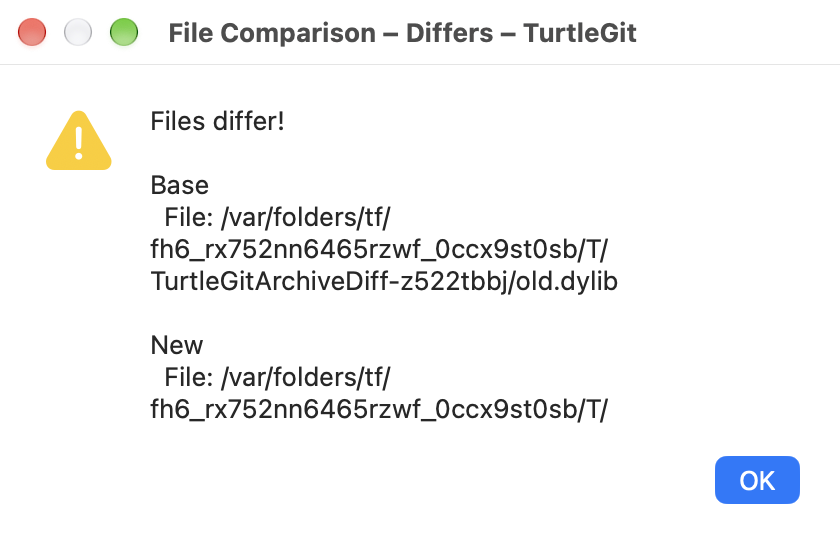
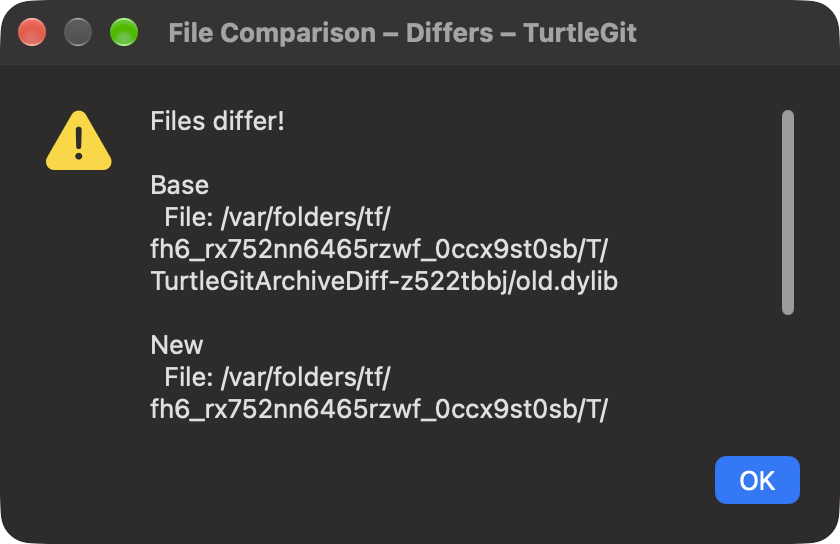

# Bundled binary and Mathematica comparisons

Settings → Diff Viewer → Advanced → Restore Defaults installs the bundled
`.zip`, `.dll`, `.exe`, `.dylib`, `.nb` and Word document comparisons. Accept Advanced and Apply
Settings to save the changes. Other associations are retained; existing rows keep
their identity. Existing saved configurations remain authoritative until changed.
Each association or the general Diff Viewer program can choose an internal,
external or bundled tool. Shift reverses its enabled state for that invocation.
These are diff adapters; Merge Tool rejects them.

## Binary files and native libraries

DLL/EXE comparisons adapt TortoiseGit's `diff-dll.js`. A read-only native result
reports **Files are identical** or **Files differ!**, byte sizes, content changes
and available versions. The native result uses an information or warning symbol,
selectable text, scrolling and OK/Escape. Its light/dark appearance follows the
initiating comparison. Files with the same size are compared byte-for-byte in
cancellable chunks. Unknown/malformed version metadata does not prevent the byte
comparison; the report states that no version information is available.

Portable executable version information comes from the PE32/PE32+ RT_VERSION
resource and fixed file-version fields. The native `.dylib` extension adapts that
idea to Mach-O LC_ID_DYLIB current versions, including endian/32/64-bit variants
and universal slices. CPU labels identify versions in universal libraries.
Library versions and Windows file versions have different meanings; these are
reported metadata, not signing, integrity or compatibility judgments. Executable
code is never loaded or run to inspect it. The report is independent once opened;
closing the original comparison does not invalidate it. Original bytes are not
rewritten and there is no automatic staging or resolution.

## Mathematica notebooks

The `.nb` adaptation follows `diff-nb.js`: open a generated notebook containing
**Compare Notebooks**. The button invokes AuthorTools' NotebookDiff for the two
captured inputs. It requires an installed Mathematica environment with that
functionality and a suitable `.nb` file association. TurtleGit opens the generated
notebook through the macOS association; it does not press the comparison button
or evaluate notebook contents itself. A missing/refused receiver reports an error
in the initiating comparison and leaves the originals intact.

Private read-only copies preserve the exact selected historical or working bytes
and each input's filename. The generated driver is noneditable/nonsaveable and
uses quoted literal paths, including escaped quotes, backslashes, control characters
and Unicode. Character-code escaping follows Wolfram's documented
[input syntax](https://reference.wolfram.com/language/tutorial/InputSyntax.html).
No shell interprets filenames. Failed preparation/launch removes its private
files. Successful driver/inputs remain available after TurtleGit exits because the
button may be pressed later; Settings → Saved Data → Temp files or system temporary
cleanup can remove them. Reopen the original comparison to capture newer bytes.

Preparation and an outstanding macOS launch callback retain their own Quit guard.
Closing/cancelling before dispatch rejects a late handoff. If the SDK reports an
already accepted launch after the owner closes, the successful private inputs are
retained for the receiver; no obsolete error or replacement native window opens.

## Acceptance still open

Core and native checks distinguish local binary parsing and generated notebook
handoff from actually executing Mathematica. The latter, physical popup/keyboard/
VoiceOver, all PE resource languages, exotic Mach-O slices, real receiver grants,
signed Finder/App Store access and full source dialog parity remain open. Word comparison is documented in [its native adapter guide](WORD-COMPARISON.md).
Word merge, Excel, PowerPoint and LibreOffice/OpenDocument automation remain open.

## Native captures

The actual owned binary result window, captured by the macOS compositor in Aqua
and Dark Aqua. Long result text scrolls. These captures cover the native binary
report only; they do not show Mathematica execution or establish every dialog's
visual parity.

