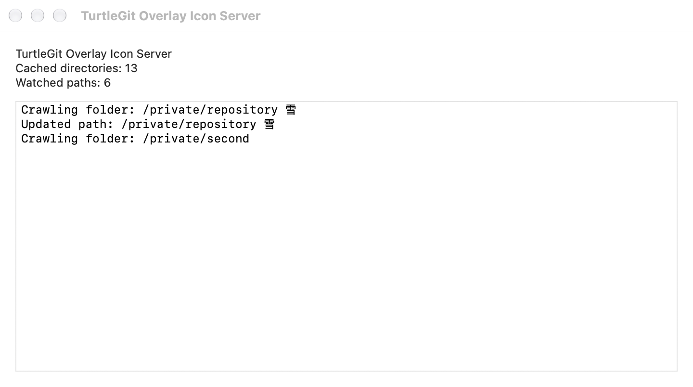
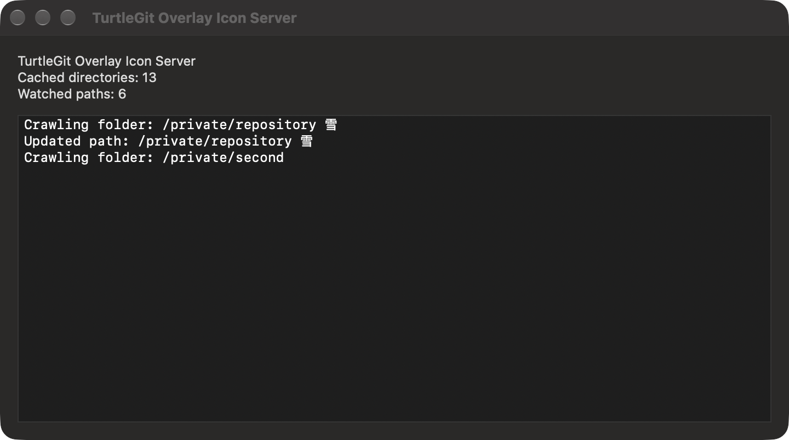

# Status-cache menu bar interface

The independent Finder cache helper can show a menu-bar icon, following
TortoiseGit's optional `CacheTrayIcon` interface. Enable the background service in
Finder Integration, then set **Advanced → CacheTrayIcon** to **true** and Apply.
Setting it to false hides the icon and activity window. This preference does not
register a service or grant repository access by itself.

Open the icon's menu for **Show Cache Activity**, **Enable/Disable Status Cache**
and **Exit**. Show/Hide Cache Activity replaces the Windows tray double-click
with a discoverable native menu command. The icon reuses upstream turtle artwork;
menu icons follow ShowAppContextMenuIcons. The tooltip shows cached directories
and watched paths. Counts reflect this helper's published folder paths and actual
FSEvents registrations, rather than the number of files in the repository.

The native activity window displays the latest fifteen crawl/update/error lines
in chronological order. Text is selectable and scrollable, with native light/dark
appearance. Closing this window leaves the service running; it can be reopened
from the menu. The helper remains independent of the main app's windows.

Enable/Disable Status Cache shares the existing Finder overlay cache-mode
preference. None uses normal folder badges; Enable restores the default status
projection. Other icon, volume and include/exclude choices remain unchanged. This
changes the accepted collection policy and fences pending readers; the helper
can continue publishing repository metadata for Finder context menus. Shell and
Shell Extended are additional choices in Icon Overlays; their lighter status
classification and folder rules are explained in [Finder status behavior](FINDER-STATUS-POLICY.md). The app
honors the accepted shared setting when it next opens instead of overwriting it
with older local defaults. A later explicit Settings Apply can replace that
snapshot. A damaged settings record is reported and retained, allowing retry.

Exit stops this helper instance after its readers and watchers settle. The icon
shows stopping state and refuses repeated commands during cleanup. It does not
quit the main app, revoke saved grants or unregister the login service. A later
app/launchd request can start the registered helper again. Normal system Quit and
termination signals use the same awaited shutdown path.

This ports TGITCache.cpp's tray tooltip/menu/window and FolderCrawler.cpp's
15-line activity ring at pinned commit
`7338078f8ddd924b8cddee35f512f2286072136d`. Local activity paths remain in the
helper's memory and window, not in its authenticated status reply or the shared
Finder snapshot. Counts and messages describe the native collector's work rather
than claiming a Windows directory-cache implementation.

Signed login-item registration, App Group transfer, physical menu-bar interaction,
accessibility clients and Finder rendering remain separate acceptance work. Local
checks use private settings and a native activity window without installing a real
menu-bar item or registering a user's launch job. See
[background service](FINDER-SERVICE-DEPLOYMENT.md) for deployment prerequisites.

## Native activity appearance

These unaltered compositor captures show the shipping activity window with private
fixture counts and paths. They verify window presentation, not a signed installed
service or a real menu-bar item.

