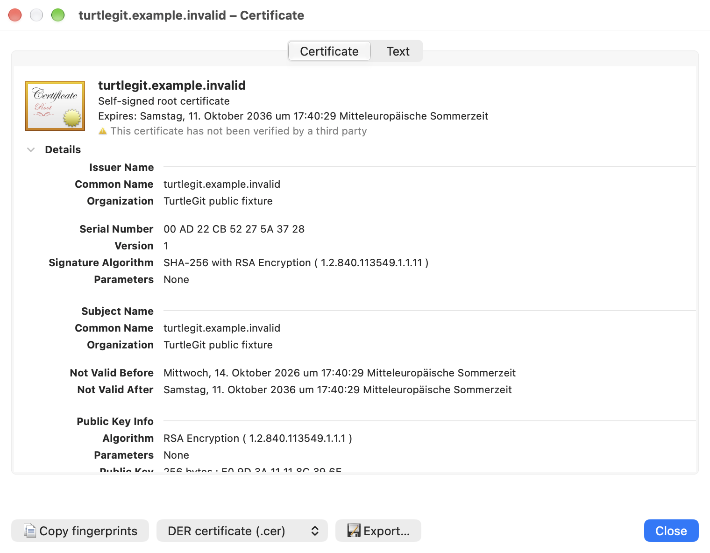
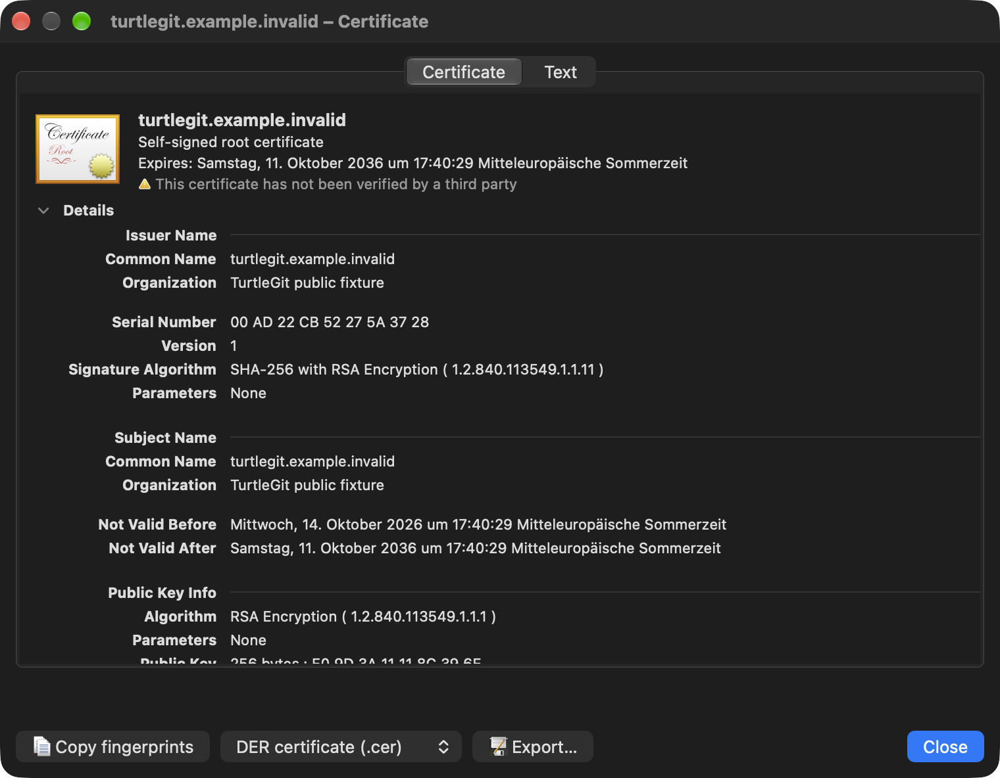

# Inspecting and exporting an SVN server certificate

In **SVN Certificate Check**, choose **Open certificate**. The **Certificate**
page uses macOS's expandable native certificate view for the subject, issuer,
validity, public key, signature and extensions. The **Text** page retains the
selectable Security.framework property report and both fingerprints. Certificate
trust editing is disabled. Inspecting a certificate does not import it, change
Keychain trust, or accept the SVN connection; return to Certificate Check to
make that decision. The native display's certificate status is distinct from
SVN's reported authentication failures.

**Copy fingerprints** copies the named SHA-1 and SHA-256 values. To save the
public certificate, choose **DER certificate (.cer)** or **PEM certificate (.pem)**,
then **Export…**. A native Save panel selects the destination. DER preserves the
exact certificate bytes; PEM contains the same bytes as 64-character Base64 rows
inside the standard certificate delimiters. Neither format contains a private
key. Cancelling the picker leaves files unchanged. Export errors remain in the
inspector and can be retried. The chosen format is captured before the picker.

Closing the inspector or its authentication parent dismisses owned pickers and
refuses their late callbacks. An export already accepted keeps its destination
permission and finishes before the helper returns the authentication response.
This avoids process exit abandoning an accepted save. Closing/rejecting the
parent still returns only one rejection. No external certificate application is
launched, and no Keychain import or trust-save action is offered.

## Source relationship and acceptance

Pinned `CheckCertificateDlg.cpp` at
`7338078f8ddd924b8cddee35f512f2286072136d` writes the DER certificate and Shell
Opens the Windows certificate viewer. This workflow supplies native macOS
inspection and public-certificate export within the owned authentication window.
The existing source certificate icon and parent rejection/temporary/permanent
choices remain separate. Requests without DER retain their reported fingerprint
and cannot open the inspector.

The [grouped checkpoint](qa/certificate-inspector-family-2026-10-17.json) passed
seven focused Core cases and one combined native authentication/inspector receiver.
The initial build exposed an accidental Core framework dependency in the standalone
helper; source-level model/artwork/scope wiring was corrected and the Debug repair
passed with the existing runtime audit intact. The passed Core cases were not
repeated. The receiver was reaped and independently absent. Both raw native
captures below were individually reviewed.

Live SVN/TLS, complete certificate
chains, signed helper/save grants, physical keyboard/VoiceOver and every native
certificate extension/disclosure layout remain separate acceptance work. The
single DER leaf supplied by the SVN callback does not supply a complete chain.

