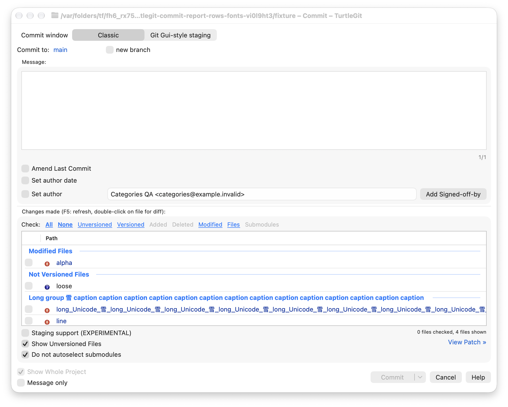
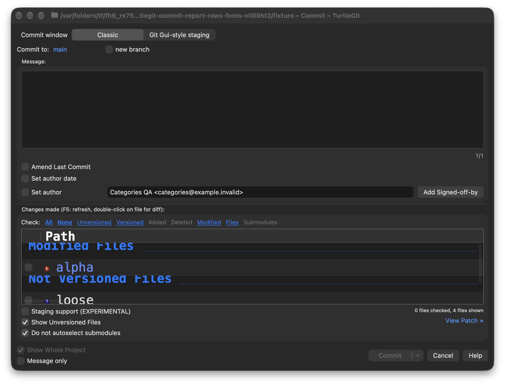

# Commit report-row geometry

The pinned TortoiseGit Commit dialog uses a single-line `SysListView32`
`LVS_REPORT` file list (`src/Resources/TortoiseProcENG.rc`, `IDC_FILELIST`).
`src/Git/GitStatusListCtrl.cpp` installs its optional configured file-list font
and small image list. The pinned `doc/images/en/Commit.png` shows compact rows,
category headings, checkboxes and colored status text beneath the message pane.
This comparison concerns file-list geometry, not certification of the whole dialog.
The native integration also uses Apple’s public
[`defaultMinListRowHeight`](https://developer.apple.com/documentation/swiftui/environmentvalues/defaultminlistrowheight)
environment value; actual Table layout is verified by the native checkpoint
rather than inferred from that API description alone.

## Native implementation

Commit now keeps Path, Filename, Extension, Status, counts, date, size and LFS
owner captions on one line. Paths truncate in the middle; other captions truncate
at the end. Full path help, accessibility identity and copy data retain the
original text, including embedded newlines and Unicode. Group captions use the
configured file-list font with a bold trait rather than an unrelated headline
size. Metadata cells expose their complete value through help. The spanning native
group-heading layer also uses a single-line text cell and clips drawing to its
row. Merely constraining the underlying SwiftUI caption did not prevent that
separate layer from wrapping multiline group names into adjacent rows.

The opt-in `NativeReportRowGeometry` derives one row height from the regular and
bold font line metrics, the native checkbox minimum and vertical padding. It
uses AppKit’s custom row-size style and disables automatic row fitting for this
Commit list without consulting cells inside height callbacks. Public sizing
property observations queue a coalesced update if SwiftUI later resets its
estimated height. SwiftUI receives the same font-derived row minimum through its environment, so
its embedded cell layout agrees with the native row. Font preference changes
update both values. Existing inclusion checkboxes, colors, columns and intercell spacing retain
their owners. AppKit sizing-mode changes can clear native selection. The helper
therefore preserves a selection only with a caller-supplied byte-exact row
identity receipt and unchanged owner, table, delegate and data source. A changed
model or a successor invalidates that receipt; there is no count-only fallback. Other tables do not opt in.

The adapter installs geometry during its deferred native configuration and
restores the previous row-size style, automatic-height and row-height settings
on detach or window close. Observations and queued updates retire before
restoration. Successor adapters inherit the original baseline; a predecessor's
late teardown cannot restore over its successor. Closed-window callbacks cannot
revive their retired owner.

## Diagnostic boundary

The preceding category workload passed its behavior assertions while emitting
AppKit's table-delegate reentrancy warning. A bounded interposer captured an
AppKit row-span cache recursion under SwiftUI's outline coordinator update.
The table used automatic row heights; the trace did not establish that varying
row heights caused the recursion. The single-line layout is an independently
confirmed source-parity correction. The retained eight category/submodule/staging/ownership case/engine pairs now
pass without that warning. This establishes the observed affected-workload
outcome, rather than a general proof about every AppKit table or macOS version.

An initial diagnostic interposer recursively intercepted its own forwarding and
was terminated and reaped. A corrected interposer and subsequent public setter
instrumentation completed the category assertions. These diagnostic attempts
are separate from production acceptance; no production logging hook is shipped.

## Acceptance scope

The [dated checkpoint](qa/commit-report-rows-2026-10-25.json) records the Debug
builds, six distinct geometry/font/ownership case/engine pairs cumulatively
passing after the documented repairs, and the retained eight category cases.
The final geometry workload repeats the original category assertions with both
Git engines without the reentrancy warning. Actual default-light and large-font
dark native captures were inspected; all owned receivers were reaped. No Core
implementation changed. A later terminal hosted run exposed two stale
Inaccessible inventory/icon assumptions; only those two Core methods were
selected for the local fixture-repair checkpoint. No full local Core suite was
rerun.

The record retains the failed interposer, bridge trap, sizing reset, inner
SwiftUI layout mismatch, selection-mode loss and fixture ownership-boundary
correction separately. The source fixes cover both SwiftUI/native sizing and
the spanning native group drawing. The bridge trap was not reproduced through
actual Commit editor lookup; its broader cause remains unresolved.

Full-dialog visual/physical and VoiceOver acceptance, signed installed behavior,
complete hosted CI and full upstream parity remain separate requirements.
