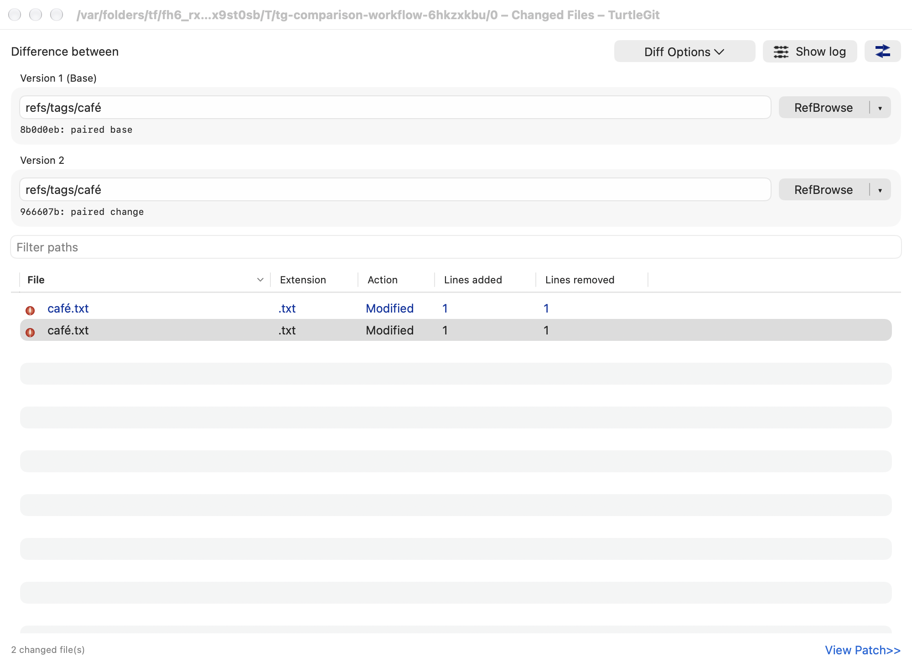
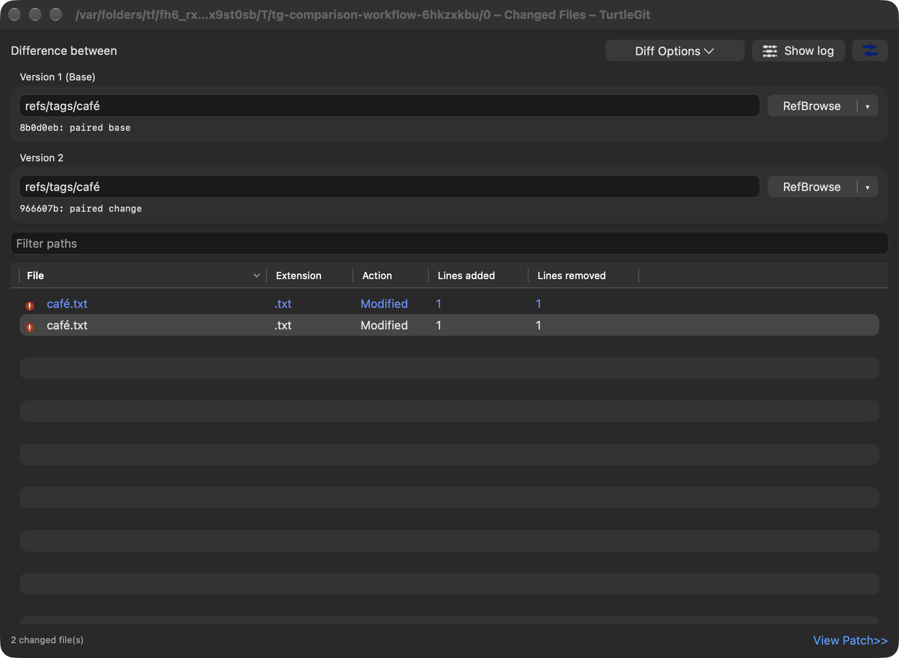

# Changed Files comparison workflow

This continuation compares the pinned TortoiseGit
`7338078f8ddd924b8cddee35f512f2286072136d` `FileDiffDlg.cpp`, `IDD_DIFFFILES`
and `doc/images/en/CompareRevisions.png`. The native window retains Difference
between, Diff Options, Show log, Swap, the two revision groups, filter, five-column
changed-file list and View Patch link.

## Compared history and native options

Toolbar Show log now routes the compared **base..destination** range, using the
pinned snapshot endpoints, rather than opening all destination history. A working
tree endpoint maps to HEAD for history; an empty base opens destination history.
Tree-only objects have no commit history and retain the explicit refusal. The app
routes this through its normal Log manager. A standalone comparison controller
also has a default owned Log route; its child windows are closed with the owner.
File-list Show log remains path-scoped destination history, as in the source.

Diff Options is a native popup with the four whitespace choices, separator and
Common ancestor in source order. Native checkmarks, original command artwork,
the context-icon preference and an active button caption reflect the actual
options. An accepted item reloads once. Captured option items refuse reuse or
execution after another comparison/input/selection/busy/modal state or retirement.

The two revision buttons now follow the source CMenuButton behavior: RefBrowse,
Log and RefLog are the only choices. Each button remembers its last choice for
that window; the main segment repeats it and the arrow opens the choice menu.
Picker ownership and delayed validation remain on the existing native browser/
Log/RefLog paths.

## File identity, sorting, colors and commands

The SwiftUI table encodes only its native row identities; model selections,
shared keyboard/copy adapters and Git commands retain exact path bytes. Canonical
Unicode peers remain independently selectable. The existing source literal UTF-16
path/status/number comparators remain available to embedded lists and table
headers. Original status icons and the owning preference store's status colors
apply to all displayed cells; selected rows retain native contrast.

Reference completions deduplicate exact names, retaining canonical peers. Revision
resolution disables macOS Git argument precomposition. Viewer and unified-patch
caches use exact path-keyed maps, so one spelling cannot reuse another's viewer.
Saved lists, clipboard output, comparisons and patch selections use displayed row
order and exact selected paths.

File context receipts are tied to their model, pinned comparison and current
selection/focus/filter/sort/column state. They cannot be claimed twice or in a
different model. Changes away and back do not revive a receipt. A selection or
revision/option change cancels outstanding preparation cooperatively and dismisses
its owned chooser, retaining the existing operation/grant lifetime until drain.

## Owned panels and Git effects

Export, historical Save, Open With and Save selected list share
OwnedFilePanelSession. Operations stay busy through native sheet release. Duplicate
responses, cancellation and retirement cannot start a later write or external
launch. Save selected list now uses the same counted/cancellable operation owner,
pinned endpoints and destination security-scope lifetime as the blob save path.

Core comparison selection and Revert preflight match exact paths/old paths and
reject unselected canonical peers. Selected tree reads, checkout and cached
removal disable Git argument precomposition. Revert plans with ambiguous writes to the same local destination are refused
before mutation; exact index-only removals remain available for all selected
Git names. Export similarly
refuses canonical destination collisions before writing, and checks execution
paths by exact membership. Physical filesystem aliases and case folding beyond
these checks remain a separate acceptance concern.

## Evidence and limits

The grouped record is [comparison workflow QA](qa/comparison-workflow-2026-10-17.json).
It records 48 distinct focused Core cases across the initial/affected checkpoints
and eight native workflow/engine combinations: the new comparison workflow,
per-file recovery, Rebase embedded lists and the retained launch workflow, each
with system and bundled Git. All passed within the recorded scope; failed
attempts and focused fixture corrections are retained. All 15 owned receiver
PIDs from those attempts were independently absent after cleanup.
Native table/menu dispatch, real history routing and native chooser cancellation
are exercised in private repositories/preferences/pasteboards. This does not
establish physical popup/mouse/keyboard behavior, VoiceOver, signed panel grants,
actual external application handoff or all source comparison variants. Existing
per-file recovery, Rebase embedded lists and other limits in
[comparison launch parity](COMPARISON-LAUNCH-PARITY.md) remain applicable.

## Native reference comparison

The actual light/dark captures retain the source toolbar, two revision groups,
RefBrowse split selectors, filter and five-column list. Status colors apply across
the row; selection uses the native appearance. macOS group spacing, window chrome
and the existing count/View Patch footer differ from the Windows reference.
The fixture deliberately contains two visually identical filenames with distinct
UTF-8 spellings; each remains a separate Git selection and viewer.

The [pinned Compare Revisions screenshot](https://github.com/TortoiseGit/TortoiseGit/blob/7338078f8ddd924b8cddee35f512f2286072136d/doc/images/en/CompareRevisions.png)
was inspected directly (image blob `d0c367dfd37d9261ccbd0bb1f6e98e4753cad941`).
This is a controlled comparison-window capture, not a complete popup, resize or
accessibility audit.

## Fixture and CI corrections

The native receiver sends the selected segment through the same dispatcher used
by the momentary control's target action. AppKit documents that programmatic
[setSelected(_:forSegment:)](https://developer.apple.com/documentation/appkit/nssegmentedcontrol/setselected%28_%3Aforsegment%3A%29)
has no effect for a momentary control. That injected dispatch does not prove a
physical mouse gesture. Picker cancellation follows the Log model's normal Cancel
action; directly closing its sheet in the earlier fixture left subsequent Save
presentation unattached. The final native receiver requires real Save/Export/
Open With sheet attachment, cancellation and operation drain.

Hosted run `39026026679` failed one of 1,739 Core cases (two skipped): the detail
cancellation fixture observed an empty helper PID marker. Seven related helpers
now write a temporary marker and atomically rename it into place, so marker
existence means both owned PIDs have been published. Their cancellation and
process-reaping assertions are retained. All seven focused cases passed locally;
that is not a successful full hosted run. The subsequent `d265e016` macOS run was
still in progress when inspected; its Pages run had succeeded.

The retained launch fixture's delayed tree read and protected checkout wrappers
now match the `-c core.precomposeunicode=false` prefix before `ls-tree`/`checkout`.
The waits still require the actual helper to start, and the read cancellation and
protected-write close/drain assertions are retained.

## Captured file drag delivery — October 21, 2026

The [revision-list drag family](FILE-LIST-DRAG-PARITY.md) adds target-revision delivery through native row item providers while retaining the existing columns, selection and menus. Captured paths, backend preferences and access leases survive source-window replacement or closure. The family records actual grouped validation and remaining physical/signed acceptance.
