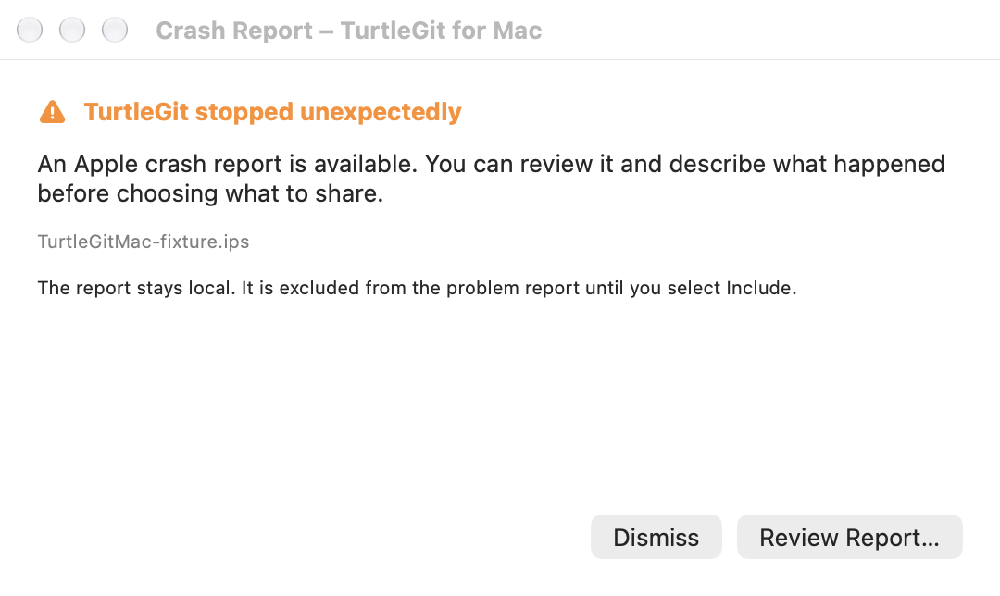
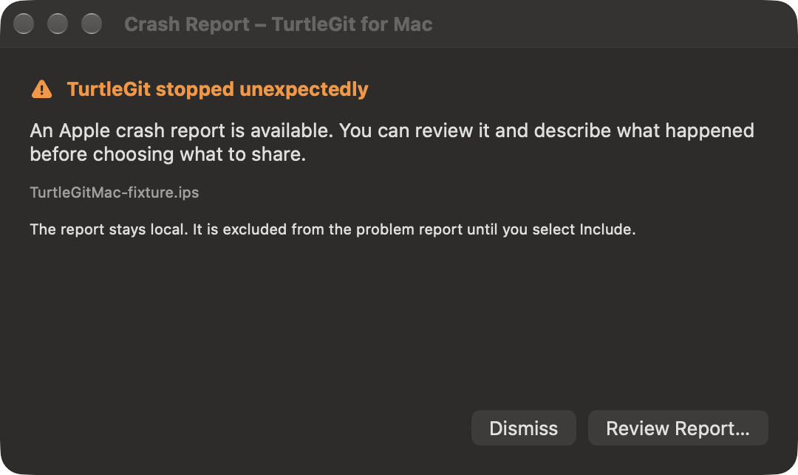

# Native problem reports and remaining crash-sender work

Pinned source: `7338078f8ddd924b8cddee35f512f2286072136d`,
`ext/CrashServer/CrashHandler/SendRpt/SendRpt.rc` and the SendRpt helpers.
The five Windows resources describe initial report/solution lookup, collecting
additional dump information, consent/details, displaying a solution and assertion
reporting. Their Windows dump collector and DrDump transport are not ported.
No automatic upload or solution result is claimed by the native support window.

## Native review and export — October 17, 2026

Help → Report a Problem opens a native, reusable window independent of an open
repository. It includes captured application/bundled-component versions and macOS
information, a problem/steps editor, an owned Apple crash-report chooser, inclusion
and home-path replacement choices, an exact selectable report preview, Copy,
Save and a separate issue-form button. Apple generates `.ips` and legacy `.crash`
reports; see [Apple's report acquisition guide](https://developer.apple.com/documentation/xcode/acquiring-crash-reports-and-diagnostic-logs)
and [the two-object IPS format](https://developer.apple.com/documentation/xcode/interpreting-the-json-format-of-a-crash-report).

Import reads one selected regular file with a 4 MiB cap, rejects symlinks/devices/
invalid text and parses process/exception metadata without changing the original
report text. The modern two-JSON-object format and a standalone exported crash-data
object are supported, alongside legacy Process/Exception or Termination fields.
The report is excluded by default, including after replacement. Home-path
replacement is a specific convenience, not a general secret scrubber. Users review
the exact payload; other private data can remain. Preview, Copy and Save use that
same payload. The selected report and description are held in memory, not saved
as preferences or put into a URL.

The issue-form action opens this fork's blank GitHub form, with no description,
crash body or device data in the URL. Posting/attaching is a separate action in the
browser. The native window does not send a message, upload a dump to DrDump or
claim a server-side solution. TestFlight/App Store crash collection is provided by
Apple when configured for distribution; see [Apple's collection service](https://help.apple.com/xcode/mac/current/en.lproj/dev675635e70.html).
This window supplements that workflow.

Read tasks retain their selected-file scope and Quit count through cancellation;
closure rejects late data/errors. Native picker replies retire once. Export
captures the reviewed bytes before its Save sheet, writes atomically and retains
its selected-file scope/operation count until completion, even after forced owner
closure. Ordinary Close is blocked during a write. Retained fields and Copy/
Save/issue actions cannot operate after picker/read/write transitions or closure.

The grouped checkpoint passed: six Core tests, Debug app build and one native
workflow receiver. Code review before native testing found the SwiftUI root's
strong controller cycle; a weak owner removed it, and native release-after-close
is now asserted. Core was not repeated for that UI-only repair. Both raw light/
dark captures were reviewed; receiver 65217 and its private paths were independently
absent. Help was regenerated and its freshness check passed. Exact evidence is in
[the checkpoint](qa/support-report-family-2026-10-17.json).
Actual user picker gestures,
signed file grants, every supported Apple report variant and complete physical
keyboard/VoiceOver/layout acceptance remain open. The launch-discovery continuation
below adds local post-crash report review. Windows minidump/assert collection, direct DrDump submission and solution lookup
remain unported. The original crash-resource controls remain unmapped; no dialog
is certified complete by this native adaptation.

## Local launch discovery and recovery — October 17, 2026

The native app now checks for a recent Apple report on launch and offers a
modeless Review Report / Dismiss window. This adapts the pinned SendRpt initial
report and consent/details sequence to Apple's OS-generated reports; it does
not implement DrDump collection, automatic submission or solution lookup.
The original Windows resources remain pending rather than being declared fully
ported by this adaptation.

Discovery is a cancellable background operation with a 32-candidate read bound,
4 MiB per-file cap and 30-day age window. Filename boundaries, exact process and
bundle identity, regular-file checks and no-follow reads exclude other apps,
symlinks, malformed and oversized reports. Metadata-header bundleID, crash-body
bundleInfo and legacy Identifier fields are supported. No recursive traversal
or new sandbox entitlement is added. Unavailable/denied folders retain the manual
chooser. Actual signed App Store access requires installed-app acceptance.

Review reuses the existing support window and installs the immutable report with
inclusion off. A busy picker/read/write keeps the notice open for retry without
acknowledging or replacing data. Dismiss and the close button retain the report
on disk. Accepted Review/Dismiss persist only a SHA-256 content identity in the
64-entry handled list. The same content under another filename is suppressed.
The report window's Check for crash reports at launch preference allows disabling
and re-enabling discovery. Closing during a scan cancels it and retains the Quit
count until the worker drains; late results cannot show UI or acknowledge data.

See [batch evidence](qa/crash-recovery-family-2026-10-17.json). These are local
report-recovery controls; restoration of unsaved editor/repository state,
Windows assertions/minidumps, all report variants, physical accessibility and
signed distribution remain outside this checkpoint.

The refreshed [light report editor](site/assets/support-report-light.png) and
[dark report editor](site/assets/support-report-dark.png) include the launch-check
preference and explicit report-inclusion checkbox.
