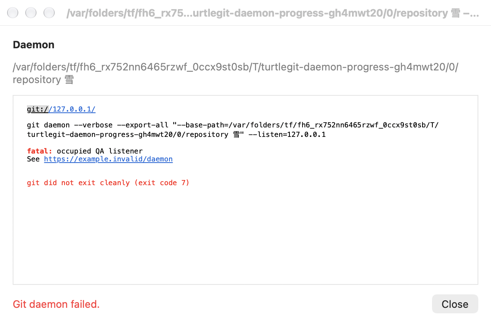
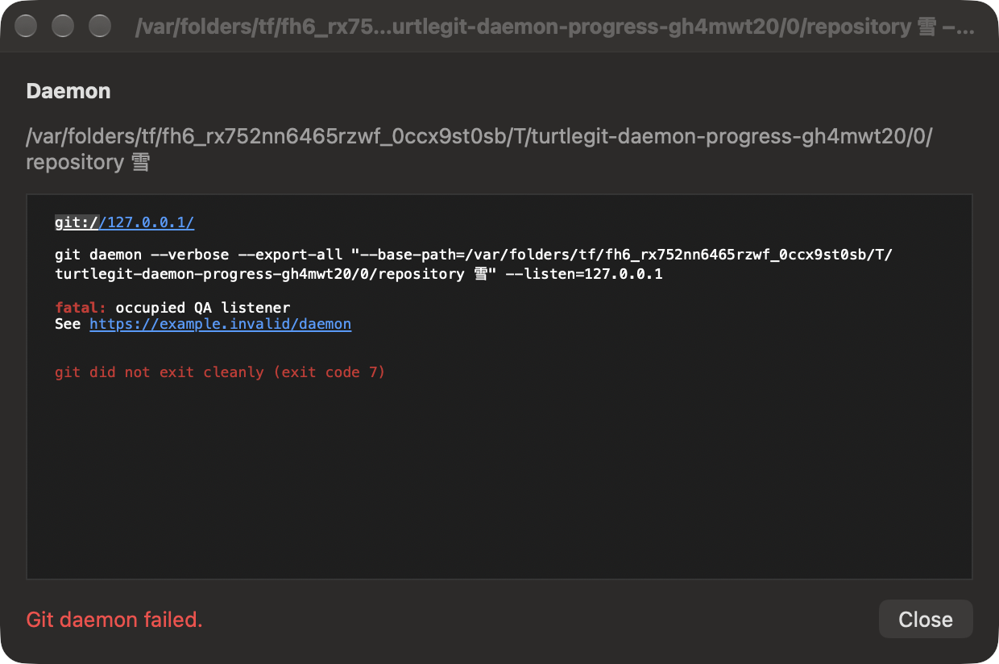

# Git daemon — native implementation and remaining acceptance

Pinned source: `Commands/DaemonCommand.cpp`, `MenuInfo.cpp`,
`IDS_DAEMON_SECURITY_WARN` and the generic `ProgressDlg` at
`7338078f8ddd924b8cddee35f512f2286072136d`.

The app and Finder route Daemon to one native window per repository root,
including bare repositories. Finder retains the source icon, selection clauses,
placement between Browse References and Revision Graph, and shared menu
preferences for visibility, first-level placement and icons. No Git command is
run inside the Finder extension to construct this menu.

The initial native warning retains the source text, Proceed/Abort and the
remembered-warning choice. Only Proceed saves that choice; Abort clears it.
After Proceed, the window displays repository URLs, the command, bounded Git
output, lifecycle status and Cancel, changing to Close after exit. Native system
colors support light and dark appearances. This adapts the source's warning plus
generic progress window rather than inventing a dedicated upstream dialog.

Serving defaults retain `git daemon --verbose --export-all --base-path=<root>`:
port 9418 and Git's default listen interfaces. The source exposes repository
data without authentication or encryption. The port does not enable
`receive-pack`. IPv4 and bracketed IPv6 URLs come from local interface addresses;
zone IDs are omitted, with localhost as fallback. Numeric custom listen addresses
and ports are supported by the Core runner for private validation, without
changing the normal user-facing defaults.

The server runs outside the repository actor so a long-running listener does not
block other dialogs. Its real repository security scope remains retained through
exit. An owned process group handles cancellation, including workers; natural
leader exit also kills remaining workers before reaping the leader and releasing
its reserved process-group ID. Output is drained continuously, with a bounded
diagnostic tail and bounded producer mailbox instead of an unlimited spool or
one UI task per chunk. Readiness is detected across chunk boundaries even when
the visible-output queue fills.

Cancel stops the server and leaves the final output visible. Closing during a
run requests cancellation and closes only after the owned process exits. Forced
owner closure also cancels it, and a process-count guard prevents Quit while
cleanup is pending. The App Store configuration adds the incoming-network
entitlement; an unsigned build is not evidence of signed sandbox acceptance.

Remaining acceptance: physical source comparison in both appearances, signed
Finder handoff and bookmark access, firewall prompts, actual LAN/IPv6 serving,
bundled-helper sandbox inheritance and App Store review. Private tests bind only
loopback and do not establish those gates. The complete app remains an unfinished
port; adding this command does not certify the full dialog inventory.

Grouped validation on 2026-10-12: Debug arm64 build exited 0 (with existing
compiler warnings and exit-zero diagnostic noise). Forty focused Core tests
passed, zero failures, in 4.901 seconds. Real loopback Git clone, immediate port
reuse, occupied-port errors, pre-cancellation, unchanged HEAD/index, and worker
cleanup on natural exit and cancellation passed. The actual Finder menu builder
verified all 56 implemented root entries against the pinned order fixture; the
Core condition oracle now covers 59 commands including the three LFS children.
One combined native receiver compilation/process verified warning, remembered
Proceed, Abort, split readiness, output flooding, Cancel/close, forced closure
and Quit ownership alongside the existing LFS/mail fixtures. Daemon native
process responses were injected; real mail used only the owned loopback SMTP
fixture. No installed app or Finder extension was activated. See
[the dated record](qa/daemon-batch-2026-10-12.json).

## Connected native progress family — October 17, 2026

Daemon now uses the shared native progress output control rather than a plain
SwiftUI text block. It provides icon-bearing Copy/Copy All menus, selection
preservation, completed fatal/error/warning styling, clickable URLs and the
source completion footer with exit code, optional elapsed time and finish date.
The display keeps its captured output limit; raw daemon failures remain available
for diagnostics. The command fallback no longer repeats the `git` prefix. Source `m_PreText`
addresses and the command now belong to the scrollable/copyable log, so hosts
with many interfaces do not squeeze the output region. A fully delivered raw
failure tail is not appended again.

Cancel, Escape and titlebar close now honor ConfirmKillProcess through a single
owned Yes/No question. Repeated requests and old/duplicate answers cannot stop a
new question. Natural completion during the question preserves its result and
defers automatic close until the answer; late Yes cannot turn success into
cancellation. The captured generic progress auto-close policy applies only to
successful natural exit. Cancellation/failure remain reviewable unless an
accepted titlebar close requested closure after drain.

Running/confirmation/result states contribute to the native Dock progress owner.
A separate worker contribution and the repository access lease survive forced
window closure until the actual process drains. Quit is also blocked by pending
Daemon questions after natural process exit. Forced retirement dismisses its
owned sheet, refuses late UI publication and still records its final Action log.
Warning-only dismissal writes no progress record. These use native macOS
lifetimes in place of the source Windows process/taskbar handles.

The source references remain DaemonCommand.cpp plus ProgressDlg.cpp::OnCancel,
WriteLog and completion/auto-close behavior at the pinned upstream revision.
The Debug build and the grouped native family passed with system and bundled
Git. The first passing checkpoint needed the address-region/duplicate-detail
layout correction found in raw captures; only this family was rebuilt/rechecked.
All four receivers were reaped and independently absent. Final raw light/dark
captures were individually reviewed. Core was unchanged and not repeated.
[The progress QA](qa/daemon-progress-family-2026-10-17.json) retains actual scope,
repairs, real loopback execution and cleanup. Physical default-button/
keyboard/VoiceOver, actual Dock display, public LAN/firewall behavior and signed
Finder/App Store acceptance remain open.

