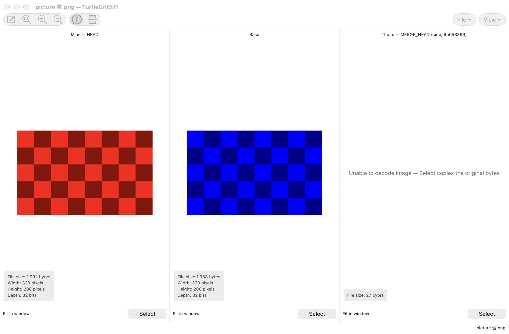
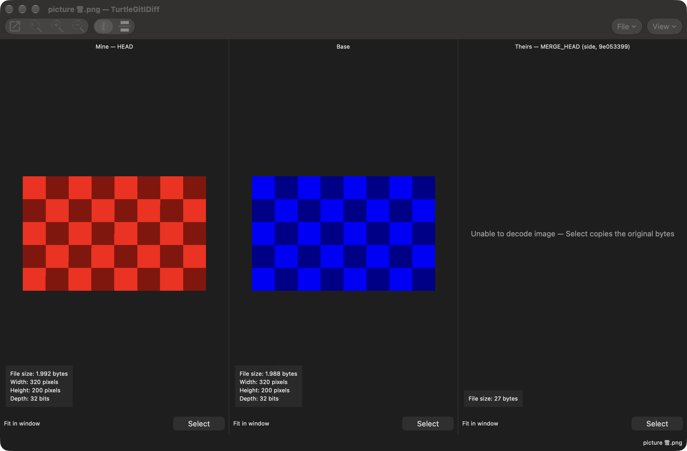

# TurtleGit dialog guide

These instructions describe the implemented macOS workflows. The complete
TortoiseGit port and signed Finder/App Store acceptance remain in progress.
Start with [Getting started](GETTING-STARTED.md) and
[repository folder access](REPOSITORY-FOLDER-ACCESS.md) when opening a repository.

## Edit Notes

Log, RefLog, Rebase and Synchronization share the source-shaped multiline Notes
editor, original edit command artwork, project minimum length and message styling.
Missing author/committer details offer repository Git Settings and are checked
again after it closes. Saving retains the captured commit and notes ref; Cancel
requests cancellation while the editor waits for its Git child. Ordinary errors
retain the draft; confirmed saves with failed refresh and uncertain mutation
outcomes have separate recovery messages. See [Editing Git notes](GIT-NOTES.md)
and the [source comparison](EDIT-NOTES-PARITY.md).
The editor chooses `core.notesRef` or `refs/notes/commits`, independently of
`GIT_NOTES_REF`. The stored note commit uses configured `user.name` and
`user.email` for both identities; environment identity overrides do not replace
those values. See [Notes storage](NOTES-BACKEND-PARITY.md) for source behavior and
recovery limits.

## Clone and create

Use Clone to choose a repository URL and a destination folder. Choose an empty
or new destination, review the branch and clone options, then start the operation.
The progress window reports Git's output and offers cancellation. A cancelled or
failed clone can leave files in its destination; inspect them before retrying.

Clone output includes the actual quoted command and colored completion status,
with optional timing/date and a retained 100 percent bar. SSH-setting warnings
and opening the repository are separate phases; a successful Git clone can still
need **Retry opening repository**, which does not clone again. Review a warning
before using Show Log or Show in Finder. Those actions release the Clone result
and options first, then open the captured destination with the original settings.

Create Repository initializes Git in the selected folder. Choose a bare repository
only when you want repository storage without a working tree. Authorize the
folder when macOS requests access. For a new repository folder, authorize an
existing parent that contains the destination. Cancelling authorization stops the
Init request. After Clone or Create Repository succeeds,
TurtleGit opens the result when the workspace finishes its current operation.
If several creations finish while it is busy, the latest result opens. Choosing
Open Repository or Close Repository before that handoff takes priority. Closing
the workspace cancels its automatic handoff; the new repository remains on disk
and can be opened later.

Init checks special-folder and nonempty-bare warnings before writing. Abort leaves
the destination unchanged. A successful operation shows an owned confirmation;
an error stays with the options so it can be acknowledged and retried. Pending
questions and Git/metadata work keep the creation workflow owned until they
settle. Closing a window forcibly cancels its remaining work and rejects late
answers; completed repository contents remain on disk.

## Working Tree and Add

Working Tree lists changes and offers the same kinds of status filters as
TortoiseGit. Show Whole Project expands a file/folder invocation to the repository.
Show unversioned, ignored, unmodified and staged files as needed. F5 refreshes;
double-click a file to compare it. Select rows for context-menu actions. Checking
files and selecting rows are separate operations.

Context **Commit…** passes the selected rows; the footer Commit follows the
invoked scope and Whole Project. For an unversioned or ignored focused row,
choose **Add**, or hold Shift for **Add as Executable (+x)** / **Add as Symlink**
on a file. These open Add progress; mode choices change the index mode, leaving
the working file intact. Mixed-selection commands follow the focused row and
act on the captured selected paths.

Add lists files eligible for the chosen Add operation. Check the paths to add,
then choose OK. Header menus control optional columns. Adding records content in
Git's index; it does not create a commit. Add progress shows Action and Path
notifications, followed by a colored Finished result with elapsed time. Its running
bar disappears when finished. Use a file row's menu for Log, Open, Open With or
Explore to. Keyboard Copy includes Action and Path; the menu copies Path only.
Commit closes the result and its owned activity before opening the captured
repository's Commit window. Commit's own explicit Add menu opens this shared
progress sheet and returns to the same Commit window. Add's engine choice is
captured before validation; subsequent Settings changes do not change that work.
The source default uses libgit2 and configured one-shot clean filters. Disabling
that Add bit or the master switch uses Git commands. A failure or cancellation
preserves the previous index; inspect the result before retrying. See
[the engine guide](LIBGIT2-TRANSPORT.md).

Ignore offers repository ignore-file or local exclusion choices for the selected
patterns. Review the path and pattern before saving. Ignoring a tracked file does
not remove it from Git; use the applicable remove/keep-local workflow separately.

## Commit

Commit first checks the configured author and committer identity. If a name or
email is missing, choose **Yes** to open Git Settings, set the values and accept
with **OK**. TurtleGit checks again after Settings closes; **No** abandons this
Commit request. The Start Commit hook and file/template preparation wait for a
complete identity. Your captured paths and message presets stay with the request.

Write the commit message above the changed-file list. In ordinary mode, check the
files to include. Use the Check links to select categories. Show Unversioned Files
includes new files in the list; review what is checked before committing.

The changed-file list keeps each file and group caption on one line when you
resize columns. Row height follows the configured file-list font and leaves room
for checkboxes and status icons. Hover for full values; copying retains the
original filenames, including Unicode and embedded line breaks.

The Check links follow the source action categories: **Added** includes copies,
while **Modified** selects modification/type-change actions rather than every row
whose display status falls back to Modified. Hold Shift to uncheck a category;
Shift reverses **All** and **None** too. With **Do not autoselect submodules** on,
ordinary category checking leaves submodules alone. Explicit **Submodules** and
**All** still select them, as in TortoiseGit. Unchecking is always allowed.
With staging support enabled these same links stage or unstage the matching
paths, so review their result before committing.

**Show Whole Project** remembers its choice for this repository. Changing it
reloads status for the whole repository or the original file/folder scope, so
newly changed files appear without reopening Commit. Review the checked rows
after changing scope.

The message editor’s **Paste file list** command inserts checked files in their
displayed order, including the displayed rename/copy paths and action labels.
Unversioned files use the Added label. The project property
`tsvn.logfilelistenglish` controls whether these labels use English (the default)
or the current interface language.

When the project configures a message width (`tgit.logwidthmarker`), the editor
shows a column border and permits horizontal scrolling. Editing splits long lines
at that width. Select text and choose **Split lines** from its context menu to
join and reflow the selected lines. Opening an existing message preserves its
text. Without a configured width, text wraps visually to the editor window.
The shared Rebase message editor uses the same project policy.

Amend Last Commit changes the latest commit. Set author date and Set author
allow explicit attribution. These options rewrite commit metadata; verify them
before accepting. Message only is available for the corresponding commit flow.

Staging support (EXPERIMENTAL) enables the index-based workflow. The file list
retains its place; partial staging opens in a separate window to the right.
Checkboxes update immediately after a whole-file or partial staging action. Status
labels, colors, groups and line counts retain their loaded values, as in TortoiseGit;
press **F5** to rebuild them. This keeps the row in place while staging. If a staging
refresh fails or is cancelled, refresh with F5 before committing.
Review staged content as well as working-tree content before committing.

Enabling staging closes the current patch companion and refreshes the file list.
An explanation describes checked, unchecked and mixed states; choose **Do not show
this message again** to remember that choice. Changing modes keeps the message,
checked paths and Git index. In staging mode, Commit includes the whole index,
including staged files outside the displayed scope.

Mode and patch visibility are saved per repository. If saving fails, the error is
shown and the current view stays usable; the next window uses the last saved
settings. Cancel waits for an active preference write to stop before continuing.

When HEAD is detached, Commit asks whether to create a branch. Choose **Yes** to
open Create Branch with switching enabled, **No** to commit while detached, or
**Cancel** to return to your draft. If you create a branch without switching,
Commit asks again. Cancelling Create Branch abandons that commit attempt. A branch
already created remains available if the later commit fails.

A malformed configured issue expression does not itself block Commit. The
project's missing-issue question still applies when its check expression finds
no match; numeric issue-field validation remains active. If only extraction is
invalid, a successful check can still suppress that question, as in TortoiseGit.
Message History still inserts the selected message when no IDs can be extracted,
and keeps the separate issue field unchanged. The Regex Tester continues to
report invalid expressions.

When cancelling a draft, the saved message history includes the separate issue
field using the project's issue-line template. Declining cancellation keeps the
editor and issue field unchanged. An invalid issue ID can still be recovered from
history even though it cannot be committed with numeric issue validation enabled.

The Commit split button offers Commit, ReCommit, and Commit & Push. ReCommit
continues the commit workflow. After an ordinary Commit & Push, a configured
branch push destination opens Push progress directly. An amended commit or a
missing destination opens the Push dialog for review. The Push action offered in
commit results also opens that dialog. A commit or push failure is reported in
its owning workflow. Read the output before retrying.
A successful commit restores files marked for restoration before the client
post-commit hook runs. HEAD keeps the committed contents; the working file gets
the saved full contents. If completion reports a restoration or post-hook error,
Git may already have committed: inspect the result and remaining saved copies
before retrying. Git can also create a commit and then return an error. If the
result warns that HEAD changed during the attempt, inspect Log before retrying;
the warning does not assume that a concurrent HEAD change belongs to this commit.

The editor keeps your draft while issue lines, hook output and formatting are
prepared separately for Git. Failed attempted messages are retained in Recent
messages after acknowledging the
failed result. ReCommit reads the next template, runs the Start Commit hook and clears the
previous draft's Undo history once the new draft is ready. It retains the separate
issue field. New edits can be undone normally; a failed commit
keeps the current draft's Undo history.

See [Getting started](GETTING-STARTED.md#use-the-staging-area).

## Log and RefLog

Log shows the revision graph before the revision list, followed by the selected
message and changed files. Use filters to narrow the displayed history. Select a
revision to inspect it; file and revision menus offer the relevant comparisons
and history operations. [Finding revisions](LOG-FIND.md) explains Log's Find flow.

Drag a file from the changed-file list to another application to copy the
selected revision's contents. Working-tree rows offer the actual working file.
Deleted/missing files, submodules and group headings cannot deliver file
contents. Historical files use their leaf filenames; the receiving application
chooses destination names when several files have the same name. Delivery keeps
the revision captured at drag start even if you change selection or close Log.

RefLog shows recorded movements of a reference. Choose the reference, refresh,
and select an entry for its context actions. Reflog entries are local recovery
information. A selected commit can still require a separate confirmation before
a history-changing operation runs.

Refresh (F5) reloads references and their entries. If the selected reference was
deleted, the view returns to HEAD. Clearing or deleting the last stash instead
leaves the empty stash view until a full Refresh. You can refresh again or close
the window while history or diff data is loading. An active deletion must finish
before normal closure; **Abort** in its confirmation leaves the entries unchanged.

When a Log display filter or graph rollup hides commits, adjacent visible rows
may not form a continuous range. Compare and Format Patch still support two
selected revisions; ranges of three or more require no hidden display rows.
Combine requires a continuous selection and its checked-out-branch validation.
An all-matching filter and a complete file-scoped Follow walk keep their normal
range commands.

## Repository Browser and references

Repository Browser reads the tree at a pinned revision. Navigate folders, inspect
files, and use Open or Save to work with a historical copy. A historical file is
not the current working file. Review a Revert action carefully before accepting it.

Drag selected files or folders to export their historical contents. Folder drags
also offer the recursive repository-relative paths as text; submodules contribute
their names without inventing file contents. Dragging the root in the folder tree
exports its top-level items directly. Accepted transfers keep the displayed
revision even if you refresh or close the Browser before the receiver reads them.

The **Revision** button opens a single-selection Log for the displayed snapshot.
Choose a commit and press **OK** to browse it; **Cancel** keeps the current revision.
The picker hides the working-tree row and offers the configured Log actions.
When an exact object ID has a matching reference, the button can show that
reference name; its tooltip also shows the pinned object ID. Folder navigation
and file actions continue to use that snapshot until you choose a revision or
refresh. Selecting another revision retains the folder when it still exists.

A tag can lead to a commit or a standalone tree. A tree can supply historical
files, but has no commit history for Log or Blame. Mark for comparison keeps the
displayed object even if its branch moves later. Submodule history uses the
selected historical gitlink when pinning is enabled; an unavailable child commit
is reported rather than replaced by the child's current checkout.

Browse References lists branches, tags and remote-tracking references. Use the
filter and selected reference for the offered actions. Picking a reference in a
child dialog returns it to the caller; it does not itself check out that reference.

The browser keeps distinct Unicode spellings from Git as separate entries, even
when they look alike. Export refuses names that collide on the destination volume.
Historical windows also keep distinct file scopes and named references separate,
so opening a similar-looking name does not reuse another request's contents.
Working-tree actions report a conflict if another tracked path has the same
Unicode spelling and resolves to the same filesystem item. Checks also inspect
each parent folder and untracked or ignored names, including case aliases, using
the actual volume's lookup identity. Distinct names on a sensitive volume can
remain distinct. A tracked name may use the filesystem's equivalent Unicode
spelling, but an untracked alias cannot silently substitute for it. These checks
run before working comparison, submodule access and Revert; another process can
still change a file between validation and use. Raw filenames containing invalid
UTF-8 bytes remain unsupported.

Use **Mark for comparison** to retain a historical file and its pinned revision,
then **Compare with…** on another file. The contents menu also refreshes a working
file marked elsewhere in the app or Finder. A new working mark replaces the
previous choice; reopening the menu with the same working mark preserves a newer
historical choice made in this browser. Clearing the working mark removes its
imported choice without clearing a historical mark. A menu opened before its
comparison mark changes cannot dispatch that old comparison.

Submodule Open browses the recorded child revision when available; **Show
submodule log** opens that revision's history. An unavailable child revision can
offer **Update**. Its question closes before opening Update. Child Log, Browser,
Update and comparisons keep the originating browser's preferences, appearance
and repository access.

## Branch, tag and checkout

Create Branch or Tag asks for a name and a base revision: HEAD, a branch, a tag,
or an explicit object. A new branch requires a commit. A tag can also name an
existing tree or blob, and retains an annotated tag object chosen as its target.
Choose the base before accepting. Branch tracking, force,
switch, signing and push options depend on the operation and reference type.
Cancel stops active creation or loading and waits for its processes to finish;
when configured, confirm the running-process question first. A branch or tag
already created is retained. If only its description failed, **Retry description**
saves that description without recreating the branch or switching again.

If a branch and tag would share the same name, review Continue/Abort; Abort is
the default. Cancelling that warning or entering an invalid name leaves the saved
Switch/Push choice unchanged. Once the form is accepted, that choice is remembered
even if resolving the base or creating the reference fails. A creation error stays
with this window for acknowledgment and correction. Tag Push releases the creation
window first and opens Push for the captured full tag name with the same settings.

Switch/Checkout chooses the target branch, tag or commit. Review Create New
Branch, force/overwrite, merge and tracking options when available. Force can
discard working changes. A checkout failure leaves its Git output available for
inspection; resolve the reported condition before retrying. The completed result
offers the applicable next actions, including Submodule Update, Pull, Commit or
Stash. A selected action closes the owned result before opening the next dialog.
Pending tag-name and cancellation questions keep their accepted target and options.

Branch/tag collision checks retain the exact entered name in each namespace.
The accepted operation also retains its backend choice while validation,
warnings, progress and retries are pending. Changing Advanced settings affects
the next accepted operation. A selected helper failure stays with the owned
workflow for review rather than silently switching engines.

Switch progress shows the actual quoted checkout command before its output,
followed by a result status and optional elapsed time/date. The completed bar
remains at 100 percent. Copy or Copy all information retains the displayed text.
Retry and Switch with merge retain the reviewed options. A chosen child waits for
the result window, cancellation question and actual work to finish, then inherits
the repository access, preferences and appearance. As in the pinned source,
the **Resolve…** action after a failed Switch with merge opens Commit to review
the conflicts. A forced close cancels owned work and cannot launch a queued child.

## Fetch and Pull

Clone and Fetch keep the upstream command-line defaults. An explicitly selected
optional libgit2 backend uses the same forms and owned progress, with native
credentials and certificate review. Its result list keeps reference updates and
Clone checkout files, with captured-range Log actions and completed-file commands.
See [optional libgit2 transport](LIBGIT2-TRANSPORT.md).

Choose a configured Remote or an Arbitrary URL. Remote Branch narrows the request;
the browse button selects a remote branch. Manage Remotes opens the repository's
remote settings. Returning reloads remote names, the current tracked/submodule
branch defaults and tag/prune hints. Unrelated operation options and explicit
tag/prune overrides remain. Authentication uses the configured SSH/credential
workflow.

Select Remote Ref keeps the captured Remote in a selectable read-only field.
Choose a listed branch or type its exact name. F5 without modifiers reloads the
list and selects its first entry; an empty list disables OK. Loading and error
sheets keep the parent Fetch/Pull draft blocked. Acknowledge a listing error
before retrying. Cancel leaves the parent branch unchanged.

In Browse References, the remotes folder offers Add Remote. Enter Name and URL
and choose OK to save the local configuration without fetching. A failed save
keeps the draft and opens an owned error sheet; acknowledge it to retry.

Fetch obtains remote objects and references. Pull also integrates them into the
current branch. Pull offers Squash, No Commit, No Fast Forward and Fast Forward
Only where applicable. Incompatible choices disable one another. Depth is shown
for a shallow repository and is used only when its checkbox is enabled.

Tags and Prune have three states: mixed uses configuration, checked enables the
option, and unchecked disables it. The adjacent text describes the configured
default. With multiple destinations, each destination's default is used.

Launch Rebase After Fetch opens the native Rebase flow after the fetch. A branch
configured to require rebase can select that behavior automatically. Read the
progress and conflict result before starting another integration operation.

## Synchronization progress

For an explicitly enabled libgit2 Fetch, the Log tab uses source Action/Path reference-result rows with captured-hash Show Log and Copy actions. Diagnostics and completion stay alongside the result table; CLI operations retain the text output. See [Synchronization Fetch results](SYNC-TRANSFER-NOTIFICATIONS-PARITY.md).

Selected libgit2 Fetch also follows the source configuration lifecycle: append the selected spec after loading the remote, use the loaded specs for this fetch, and retain the addition for later fetches. Repeated requests preserve duplicate entries; this behavior applies to the optional backend. See [lifecycle scope and limitations](SYNC-TRANSFER-NOTIFICATIONS-PARITY.md#source-fetch-configuration-lifecycle--october-23-2026).

Synchronization replaces its branch/remote inputs with phase and progress while
an inline command runs. The output retains 100 percent and a colored completion
footer with the actual Git command's elapsed time and finish date. A later
reference or conflict lookup can report its own error without changing the
completed command's result. Cancellation waits for owned Git activity and its
confirmation sheet to settle before releasing the workflow.

Files dragged from the incoming or outgoing change list use the comparison's
base revision, matching TortoiseGit. A new or renamed path absent at that base
cannot be delivered; dragging does not substitute another revision. Changed
Files provides an explicit Export action for the comparison target instead.

## Push

In Ref, choose the local source and remote destination, or Push all branches.
The local browse menu offers references, Log and RefLog. A source choice does not
change the checked-out branch. In Destination, choose a configured remote or an
arbitrary URL. The all-remotes choice is available when multiple remotes exist.

Force with lease and Force are distinct, mutually constrained options. Include
Tags and lease mode also constrain one another. Review the selected references
and output when replacing remote history. Set upstream records tracking;
the two Always push options save the selected remote or destination branch for
the local branch. They are enabled only for applicable source/destination choices.

Recurse submodule offers None, Check and On-demand. Push option forwards the
entered option through Git. Autoload SSH key uses the selected remote's saved
SSH configuration. Manage opens remote settings. Choose OK to start Push, then
review the progress result. Cancelling cannot undo changes already accepted by
the remote.

## Merge and conflicts

Merge first checks the Git identity and whether a TurtleGit replay is active.
If identity needs repair, complete the owned Git Settings sheet before continuing.
An active TurtleGit replay must be finished or aborted before starting Merge.

Choose the revision to merge and review the merge options/message. Commit options
control whether Git creates a merge commit automatically. A custom message uses
the repository's commit encoding and the configured comment-stripping and message
sanitizing preferences. The automatic message and Squash retain Git's own message
behavior. An unavailable commit encoding reports an error before Merge changes
the repository. As in the source, characters unavailable in the selected encoding
can be replaced with question marks. Message History opens a separate owned sheet; closing it preserves
the current draft unless you accept an entry.

After a successful committed merge, a Git-SVN repository also offers SVN DCommit,
including merges selected by a tag or commit. This opens the existing SVN workflow
with its own options and confirmation. A conflict leaves an unfinished merge in
the repository; it is not resolved by dismissing progress.

Merge progress retains selectable native output with **Copy** and **Copy all
information to clipboard**. Completed output styles diagnostic prefixes and
links; the final status, elapsed time and finish date follow the captured progress
preferences. Turning off **Show Git execution timings and timestamp** keeps the status
line. The completed bar reaches 100 percent, and the current-work label reports
the result instead of retaining an old transfer phase.
Cancellation shows Git's returned exit status when available. Cancellation before
a process result uses **User cancelled**; a failure without a process exit code
uses **Operation failed**.

Post-actions depend on the result: conflicts offer Resolve and Commit; an
unrelated-history failure can offer a new Merge attempt; a successful No Commit
or Squash merge offers Commit. A normal committed branch merge can offer Remove
branch and Push. Review branch deletion separately before accepting it. The
conflict reminder, running-process cancellation and deletion questions finish
closing before work continues. Child actions retain this merge's repository,
preferences and appearance and wait for the result window and owned work to drain.
Forcibly closing a window cancels its owned work and cannot launch a queued child.
Closing a completed conflict result leaves it in place; Cancel/title-bar dismissal
checks for remaining conflicts and can open Abort Merge.

Use Resolve or the conflict-file context menu to open the appropriate text,
image, delete/modify or submodule workflow. Compare the named sides, save the
intended result and mark it resolved. Continue the parent operation only after
reviewing the remaining conflicts. [Conflict identities](CONFLICT-IDENTITIES.md)
explains the side captions, and [Save As targets](SAVE-AS-TARGETS.md) explains
how an exported copy differs from the actual merge result.

Resolve's operation progress uses a separate Action/Path notification list with
a timed Finished row. Its file rows offer Log, Open, Open With and Explore to.
Commit waits until the result window and its activity close, then opens Commit
for that repository with the same presentation preferences.

In Resolve, drop files or folders from the same repository to extend the displayed
conflicts. Dropping a folder includes its conflicted descendants; dropping the
repository root shows all conflicts. Dropped conflicts become checked again,
while unrelated manual unchecks remain. Drops do not stage or resolve anything.
Other repositories and Git administrative files are ignored. Cancel stops pending
drop reads. Use **F5** to refresh, or **Control-Return / Command-Return** to resolve
only the checked files through the normal progress flow.

Resolve's file menu also provides path Log, Blame, Open/Open With, the alternative
editor, Reveal in Finder, two-file comparison and unified changes where the
selected conflict types permit them. Submodules have separate containing-file and
child-repository Logs. Clipboard choices preserve the displayed row order and
literal paths. Menu commands retain their original selection; a refreshed list or
changed conflict stages require a new menu before a file action can proceed.
Open With can be cancelled without opening the file. Revert uses its own progress
sheet to restore selected conflicts from HEAD, with recoverable working files in
Trash. A cancelled/failed attempt can be retried after reviewing its result.
Submodule results offer a separate comparison/update handoff. Delete appears for
a missing selected mark; it removes all selected index entries and moves existing
selected working files to Trash. Holding Shift when preparing that menu requests
permanent deletion, which the confirmation identifies. No leaves files untouched.

Advanced **RefreshFileListAfterResolvingConflict** controls explicit parent file-
list refresh callbacks after resolution. Its default is true. It does not suppress
explicit F5, replay state or independent repository/filesystem observations.

Comparison options can make different source lines compare equal. When Base,
Mine and Theirs still differ in their original text or endings, the merge editor
flags an **Ignored conflict**, retaining Mine text without inventing marker lines.
Use the normal conflict navigation and Mine/Theirs choices to resolve it. Undo
restores its unresolved state even when choosing Mine did not change any bytes.
Choosing a side counts as a modified result until saved, including that same-byte
Mine choice, so Close and Quit still offer to save it. Save warns while such conflicts remain; Mark as resolved stays unavailable.

Common rows in a three-way merge keep their normal colors even when whitespace,
case, comment or regex options make their original text compare equal. Collapse
uses separate visibility metadata shared by all three panes. It can hide a common
ignored conflict; **Continue resolving conflicts** reveals it for an explicit
choice. Collapsing or expanding a row does not resolve or save it. Source block
choices retain the copied visibility, while newly typed result rows remain shown.

When first-difference navigation is enabled, Compare opens with the first state
block selected, including neutral rows in combined view. Block transfer commands
require a selected block or text range. Later keyboard, mouse or Find navigation
supersedes a pending caret restoration.

In two-pane and one-pane comparison, Previous/Next difference searches from the
active pane's caret and selects the whole source-state block. Control-Up/Down, Option-Up/Down and F7/Shift-F7 use the same navigation.

In a three-pane conflict editor, **View → Line diff bar** shows the aligned
Theirs line above the Mine line. Move the caret or pointer over a source line to
inspect it. The bar displays whitespace and inline differences independently of
the main panes' visibility choices, and follows each source's horizontal offset.
It is read-only and does not change the result, selection or resolved state.
Three-pane loads initially hide the bar while retaining its saved View choice;
an explicit View command reveals it. Changing Locator visibility restores that
saved choice.
The View menu also toggles source/result line numbers. As in TortoiseGitMerge,
inline-difference traversal is available in two-pane comparison; three-pane
conflict inspection uses the line-diff bar.

In two-pane Compare, the caret also advances to the first inline difference when
inline display is enabled.
Neutral Base and Mine rows are separate stops; filtered common rows are skipped.
Collapsed sections remain collapsed, and navigation stops at the first/last block. The highlighted block has top/bottom boundary lines;
the insertion caret stays separate. Right-click selects the clicked state block,
including unchanged lines. Copy copies an existing block or text selection. Cut copies it without
deleting when no text is selected, and Paste inserts at the caret. Drag or use
Shift with navigation keys to select text for normal Cut/replace behavior.

Typing and ordinary Cut/Paste retain the current comparison rows. Edited rows
stay where you edited them, including a removed row in combined view; untouched
removal rows keep their original appearance. Inserted lines add gaps in the
opposite pane. Undo/Redo restores the row layout, and Save retains it. Reload or
changing the view/options rebuilds the comparison. Three-pane source views stay
read-only; edit the merged result or use the source block choices.

Undo follows the most recent edit across both comparison panes. An edit that
leaves the same text still marks that pane modified after Save. Undo/Redo can
return to the saved state. When both sides of an alignment gap become empty,
the redundant row disappears; ordinary blank lines remain.

The [Merge comparison filters guide](MERGE-FILTERS.md) explains the shipped GUID
preset and importing/exporting `regexfilters.ini` libraries.

Changing comparison options or the active regex filter asks about unsaved work.
With two modified panes, choose Save left, Save right or Save both; any pane you
do not save reloads from disk. Don't Save reloads both, and Cancel keeps the
current draft and options. Accepted changes clear Undo/Redo history. Failed Save
leaves the current options and draft available for recovery.

In three-pane Merge, navigation follows the focused source or result pane.
Control-Up/Down or F7/Shift-F7 moves between differences; F8/Shift-F8 moves between
conflicts. Source and result context menus offer Mine, Theirs and both ordering
choices for selected ordinary or changed source blocks, as well as unresolved
conflicts. A choice affects the captured block even if you later move the
selection. Removed source rows and empty alignment gaps do not become saved
content; choosing the unchanged opposite side can restore text at that position.
After choosing Mine or Theirs for a conflict, select an individual line to take
the other source for that line while retaining its neighbors. Undo/Redo restores
the earlier choices. The result overview uses logical row counts rather than
counting each conflict marker as another conflicted row.
Choices retain source colors and count as modifications even when the selected
text is unchanged. Missing mappings after manual edits disable the affected
choices; Reload regenerates mappings and replaces the current draft after its
save/discard question. Undo/Redo restores edited text and the target caret, and clears selections in all
panes. Sections omitted
from a pane can cause its highlighted block to span a different number of lines.

In one-pane comparison, a filtered common line can appear as a neutral pair.
Ignore whitespace changes can fold that pair, while Modified-only Find still
includes it. Ignore all whitespace changes collapses common pairs to Mine.
Save As retains both neutral rows; ordinary removed rows are omitted. Editing
uses the same retained payloads, with normal Undo/Redo and encoding controls.

## Rebase and Cherry Pick

Rebase prepares commits relative to the selected branch/upstream and optional
onto target. Review the plan and each row action before starting. Edit, squash,
skip and conflict handling can change the resulting history. Cherry Pick uses a
related replay plan over the selected commits.

Before replay, **Refresh** or unmodified **F5** reloads the current HEAD branch,
reference choices and a fresh plan. Successful refresh resets added commits,
manual order and row actions to source defaults; cancellation or failure keeps
the accepted draft. During conflict recovery it refreshes recovery state. See
[reference refresh](REFERENCE-REFRESH-PARITY.md) for phase rules.

**Add** opens a multiple-selection Log. Accepted commits appear above the current
list and can repeat earlier commits. You can build an editable draft before branch
and upstream are valid. Cancel during Add keeps the previous complete plan or
draft. Cherry Pick asks which parent to use for a merge commit; cancelling the
question keeps the plan available without starting replay.

A Pick failure without conflicts offers **Skip**, **Retry**, **Cancel**, and
**Do the same for the rest**. The remembered Skip choice belongs to this replay;
Retry clears it. A failed cleanup has its own Retry/Abort decision. See
[execution recovery](REBASE-EXECUTION-RECOVERY-PARITY.md). Empty commits, conflicts
and Edit/Squash pauses retain their separate paths.

When replay stops, inspect its message and Conflict Files, resolve and save the
required files, then continue through the owning replay window. Use Abort when
you intend to abandon the unfinished replay. Closing a window is not a substitute
for completing or aborting the repository operation. See
[Cherry Pick](CHERRY-PICK.md), [Conflict Files](REBASE-CONFLICT-FILES.md),
[Edit and Split Commit](REBASE-SPLIT.md) and [recovery](REBASE-REFERENCE-RECOVERY.md).

Changed Files and Rebase's Revision Files can revert selected files to either
eligible revision. If one file fails, **Ignore** continues with the next selected
file; **Abort** stops and retains earlier completed changes. The result reports
how many files were reverted. Root comparisons offer **Revert to empty tree**,
which removes selected entries from the index without moving HEAD. Export saves
the destination revision; it does not need the Base file's contents.

Dragging from Changed Files or Rebase's Revision Files also copies the target
revision's contents. Historical executable files retain their executable mode;
historical symbolic links are regular files containing the link target text.
Working-tree drags offer the actual file URL. These operations leave the
repository and index unchanged. See the [file-list drag comparison](FILE-LIST-DRAG-PARITY.md)
for the source rules and remaining physical and signed acceptance.

If a staged file disappears from the working tree, Commit and Working Tree offer
**Restore from index**, **Remove from index** and **Ignore**, with
**Do the same for the rest** for this read. A completed recovery asks for an
explicit refresh with F5. See [missing staged files](MISSING-STAGED-FILES.md).

Commit, Working Tree and Revert keep the file-list reading position through
refresh. **RememberFileListPosition** in Advanced Settings controls restoring
scroll position, highlighted files and focus; turning it off returns to the top.
File checkboxes and staging contents remain independent. Ctrl-A or Command-A
selects file rows without checking them. A newer file-list gesture takes priority
over an older pending position restore.

## Stash, revert, reset and clean

Stash Save records the selected working state using its offered options. Stash
Apply restores a stash without dropping it; Pop also requests removal after
application. Conflicts still require resolution. Inspect the result before
assuming that a stash has been removed. Save checks your Git name and email and
opens Git Settings when they need to be completed. The accepted settings are read
again before saving. Pull, Merge, Pop and Apply follow-up actions close the Save
result before opening the next operation; View Changes does the same after a
restore. A pending warning or cancellation question keeps that operation owned
until you answer it.

Save progress shows the actual quoted command, colored completion status and
optional execution timing/date. The bar stays at 100 percent while the final stash
reference is read. Follow-up actions become available only after that read settles;
a later read error does not rewrite the completed Git command's status. Cancelling
or forcibly closing the result waits for owned work and sheets to finish. It
cannot start a queued follow-up. Apply/Pop keep their separate result questions.

Revert working files restores their selected state; see
[Reverting working files](REVERTING-FILES.md). The file-selection window supports sortable saved columns, file history/Blame, Open With/export, and same-repository file drops. Context Revert opens its recovery/progress window and refreshes the list when closed. Completed results offer per-file history, Open/Open With and Finder reveal, sortable Action/Path columns and selected-row copying. Revert a commit from Log creates
an inverse change; see [Reverting a commit](REVERT-COMMIT.md).

Reset selects a revision and reset mode. Review the mode before accepting: changes
to the index and working tree depend on it. Hard Reset asks for confirmation
before discarding local changes. Result actions keep the chosen repository and
close the result before opening Submodule Update, Cleanup or Bisect. Clean removes selected untracked or
ignored content according to its options. Review its candidates; these operations
are not ordinary editor Undo actions.

Reset progress shows its actual quoted command, output and final status, with
optional execution timing/date and a completed 100 percent bar. A later bisect
metadata error remains a diagnostic; it does not turn a successful Reset into a
failed Git command. Retry retains the original plan and checks that HEAD has not
changed. Cancellation and result closure wait for actual owned work and sheets;
Submodule Update, Clean and Bisect children inherit the same preferences,
appearance and repository access. Forcibly closing progress cannot start a queued
post-action.

When Reset is configured to use libgit2, its progress window also shows sortable
Action/Path rows with the source Checkout icon. You can copy selected rows or
paths and open their file history, Open/Open With, or reveal them in Finder.
These notifications describe files selected for checkout; a later error can leave
a partial result. With recycling enabled, Hard Reset moves an existing notified
item to Trash before allowing its overwrite. A recycling failure stops the
operation; files already moved remain recoverable. Files removed without a
checkout notification follow the selected engine's reset behavior. Retry keeps
the accepted engine and recycling choice. The ordinary command-line backend
retains its existing output presentation.

Log's commit-revert workflow likewise retains the backend selected when you
accept the operation, including across its Skip/Abort decisions. The selected
libgit2 engine retains its native conflict index and message state. Review any
conflicts in the working tree and Commit window before creating a commit.

## Submodules and worktrees

Submodule Add asks for the repository, destination path and optional branch.
Update works on the selected submodules and offered init/recursive/update choices.
Large explicit selections run in ordered command batches. Progress retains earlier
results if a later batch fails or is cancelled, and repository views refresh after
attempted changes. Only a successful Update enables its completion actions.

When Add succeeds but configuring its SSH key fails, the result distinguishes
those phases. **Retry key configuration** retries the captured key setup for the
added submodule without repeating Add. Sync retains results for earlier directories
when a later command fails or is cancelled.
Revert can mark a submodule for comparison. With working-copy marks, Submodule Diff compares its indexed commit with the checkout and labels the From group **Index**. Historical renamed gitlinks retain both paths. A submodule is a separate repository. Inspect its own status and commit pointer
when the superproject reports a change.

New Worktree creates another checkout attached to the same repository storage.
In Finder, select the watched repository's root folder (or a bare repository)
and choose **TurtleGit → New Worktree…**. Choose a destination parent outside a
working tree; the creation dialog appends the repository name and removes a
trailing `.git`. Review the path and options before OK creates anything.
Completed progress keeps its status and elapsed time visible. If the checkout
has submodules, **Submodule Update…** closes that progress window before opening
the update dialog for the new checkout.
Choose its path, target revision and branch options. Worktree List offers the
applicable management actions. macOS may require additional parent-folder access
for creation, movement or removal. See [repository folder access](REPOSITORY-FOLDER-ACCESS.md).

## Patches and export

Format Patch prepares selected commits as patch files. Send Patch prepares the
mail delivery workflow; review recipients, message and attachments. Request Pull
prepares a request describing the selected range and repository URL. A separate
waiting window offers Cancel during generation. The result opens in the
Alternative Editor chosen in Settings, or in Send Mail for recipient/message
review. If opening fails, **Open request** retries the generated document.
Authenticated repository checks use the normal Git/SSH prompts; credentials
and mail-client permissions depend on the selected transport/delivery method.

If the SMTP server certificate cannot be validated, review its hostname, issuer
and fingerprints before choosing **Accept certificate**. **Cancel** is the default.
**Open certificate** offers a read-only inspector and certificate export. See
[SMTP certificate review](SMTP-CERTIFICATE-REVIEW.md) for temporary acceptance and
cancellation behavior.

Apply Patch Serial imports mail patches as commits through `git am`. Apply and
the completed OK action check the effective author and committer identity. If a
field is missing, Yes opens Settings on the Git page; closing Settings rechecks
all four fields and repeats the question if needed. No returns without starting
another import or accepting completed OK.

An active import offers Abort, Skip, Resolved and Cancel. Resolve conflicts and
stage the result before choosing Resolved. Failed recovery retains the session
and diagnostic and asks again; later patches wait. Cancel preserves remaining
Git state. Running Abort stops the batch after the current command; it is not a
promise to undo completed commits. Idle close offers Abort, Keep session or Cancel;
a failed abort keeps the native window open for retry. See
[Apply Patch Serial identity and recovery](IMPORT-PATCH-PARITY.md).

Review/apply single patch uses the comparison/review workflow. Its source-file chooser offers Use Clipboard Patch, capturing the copied diff before target selection. Finder’s existing eligible Review action also uses registered patch clipboard data when the selected file is not a patch. Opening a review does not apply it. Resolve a failed
or conflicted application in its owning dialog before continuing. A Unified Diff
document can be edited and saved without staging those edits automatically.

In a Unified Diff window or attached partial-patch view, Command-F opens the
bottom Find bar and seeds it from selected text. Typing searches from the top;
Previous/Next, Command-G/Shift-Command-G and F3/Shift-F3 continue from the current
selection. Search stops at the document boundary. Escape hides Find first.
Search is literal. Enable Match case for exact letter case; with it disabled,
Straße also matches STRASSE. Search does not merge different Unicode spellings.

Revision Export saves the selected revision/subtree. It does not switch the
working tree. See [Revision Export](REVISION-EXPORT.md).

Export progress shows the actual archive invocation and its completion footer.
The archive is prepared in a temporary sibling file before replacing the chosen
ZIP. A completed Git command can show 100 percent while that replacement is still
pending; Show in Finder is available only after the whole export succeeds. If
replacement fails, its diagnostic remains visible and the previous destination
is retained. Show in Finder closes the owned result and options before revealing
the captured ZIP. Cancellation waits for command and temporary-file cleanup.

## Bisect

Start Bisect with a known good and known bad revision. Git chooses a revision to
test. Mark the tested revision Good, Bad or Skip as appropriate. Continue until
the result is found, then use Reset to leave the bisect operation. These actions
can change the checked-out revision; preserve working changes beforehand.
Completed progress shows its status and optional elapsed time. Its split action
button keeps the applicable Submodule Update and Good/Bad/Skip/Reset choices
in one menu. Submodule Update opens after the Bisect window closes. A failed or
cancelled command can retain changes already made; inspect the refreshed repository
state before deciding how to continue.
If you accept Stash, that stash remains available after Bisect. A cancelled
revision-list read starts no session; an interrupted operation may still require
Reset. Returning to the form or starting a later action uses the current settings.

## Settings

Finish unsaved Settings changes before opening a different repository or closing
the current repository. Those actions retain the current repository and drafts
until Settings can close; refreshing the same repository remains available.
Settings opened from Blame selects its Blame page.

Settings uses a navigation tree. **Apply** saves changed pages and keeps Settings
open. **OK** saves before closing; **Cancel**, Escape and the window close button
discard unapplied drafts. Changes already saved through Apply remain saved.
When an operation or child dialog temporarily prevents completion, the footer
buttons are disabled. An accepted close waits for page cleanup and then finishes
automatically. A validation or save failure leaves Settings open for correction.

Switching between Global and repository Settings waits for the accepted old
window close to finish, then opens the requested context and page. A newer
request during that close replaces the pending destination. Unsaved drafts or
active work can refuse a context switch; finish or cancel that Settings visit
before retrying. A pending request cannot reopen Settings after its workspace
retires or silently follow a different repository.

Git, Dialogs 3 and Issue Tracker pages distinguish a read-only
Effective view from stored Local, Project, Global and System values where offered.
Select a stored source, edit the relevant values/inherit choices, then select the
Save to destination. Copying to a different destination asks for confirmation.

Git configuration writes occur field by field. A later failure can leave earlier
fields saved; inspect the error before retrying. Folder authorization may be
required for configuration files outside the repository. Changing the displayed
source reloads that page's values.

General configures the Git engine and initial setup. Appearance and Colors control
the native light/dark presentation and status/graph colors. Finder settings control
menus and overlays within macOS's extension behavior. Diff/Merge tools and Unified
Diff Viewer select built-in or external tools. Saved Data clears only the chosen
category. See [Saved Data](SAVED-DATA.md), [SSH authentication](SSH-AUTHENTICATION.md),
[Git authentication](GIT-AUTHENTICATION.md) and [Privacy](PRIVACY.md).

### External tool configuration

Diff Viewer, Merge Tool and Unified Diff Viewer let you choose a built-in viewer
or an external application. Browse changes the current draft; Apply saves it and
Cancel keeps the previously saved choice. Alternative Editor retains its custom
application when you temporarily choose TextEdit.

Advanced Diff/Merge rules match filenames and extensions case-insensitively while
preserving their Unicode spelling. Names that look alike can therefore have
separate rules. Editing or removing one rule keeps the other rules intact.
Executable paths and argument templates are saved as entered. Restore Defaults
replaces shipped adapter rules while retaining your other associations. See the
[tool configuration comparison](LITERAL-TOOL-CONFIGURATION-PARITY.md) for matching
precedence and current acceptance limits.

### Hook Scripts

Settings → Hook Scripts lists hook type, path, command, Wait and Show. Check a
row to enable it; double-click any row cell to edit. Add begins disabled with no
type or path selected. Choose a type and an existing absolute working-tree folder,
or `*` for all repositories, then enter a macOS command. Run for this repository
stores the shared command in `.tgitconfig`; switching it off restores the typed
global path. Copy keeps the selected command/options and clears its destination
path so you can choose another scope.

OK in the editor updates the Settings draft. Apply saves it; Cancel restores the
saved list. Browse chooses a folder or script and waits for the chooser to close
before changing the draft. Repository scripts require a per-user decision before
their first execution. No is the safe default; Cancel stops the pending operation.
Remembered decisions apply only to that exact repository, type and command.
Approval/failure sheets close before execution or Continue proceeds. Cancellation
also dismisses an owned pending question and waits for script work to end.

App Store script grants remain attached to their selected files through execution.
A stale grant can be renewed only when it resolves to the same selected path;
a missing or mismatched grant requires selecting the script again.

## Finder and permissions

Open **Settings → Icon Overlays → Manage Finder Extension…** to enable the
installed extension in macOS. The page shows its activation status when you return.
**Apply** saves badge preferences; it does not activate a disabled extension.
Open a repository in TurtleGit and authorize its folder to publish initial status.
From a previously unknown folder, the Finder submenu offers **Clone…**, **Create
repository…** and **Add to TurtleGit…**. Add saves an authorized existing repository
in Recents and Watched Repositories without replacing the open workspace. A
successful Clone registers its resulting repository automatically. These actions
retain the existing opt-in for background refresh after Quit; see
[first-use registration](FINDER-REGISTRATION-PARITY.md).

Under **Icon Overlays → Watched Repositories**, add folders whose status should
stay refreshed. **Refresh after TurtleGit quits** enables the independent signed
cache service. Check Status reports its actual publication or access failures;
Synchronize transfers updated folder grants. Disabling the service stops its
background job. The app and helper retain their own private folder permissions.

Advanced **CacheSave** controls the separate warm cache used across restarts;
its default is true. Disabling it keeps live badges and refreshes running. Failed
Apply retains the saved choice and can be retried after reopening Settings.
See [cache persistence and recovery](FINDER-CACHE-PERSISTENCE.md).

Finder actions keep the selected paths. A Finder command does not grant file
access; TurtleGit asks you to authorize a repository if no saved grant covers it.
The signed development checkpoint verifies activation, live badges and independent
background refresh for a disposable repository. Full command, distribution and
minimum-macOS acceptance remain in progress. See
[repository folder access](REPOSITORY-FOLDER-ACCESS.md) and
[signed Finder development](SIGNED-FINDER-DEVELOPMENT.md).

The three-pane merge result displays removed Base records and blank conflict slots
in alignment with Mine and Theirs. Typing in a blank conflict slot resolves that
line while leaving neighboring conflict lines unresolved. Multiline paste inserts
matching source gaps, and Undo/Redo restores all three layouts. Saving writes file
content and remaining conflict markers; it omits untouched removed rows and gaps.

“Mine then Theirs” and “Theirs then Mine” keep the result aligned and show matching
gaps in both source panes. You can continue choosing or editing individual rows
afterward. Selecting a single unresolved source row resolves only that row.
Resolved conflict gaps stay visible in the resolved color without becoming saved
blank lines. Rows disappear only when all three panes contain ordinary gaps;
Undo/Redo restores the entire layout.

Result whitespace commands and Encoding/EOL choices preserve aligned rows and
conflict/resolution colors. The format ribbon reports real row endings. The
selected output ending also applies to subsequent typing and source choices.
Encoding/EOL changes can be undone together; Save keeps the chosen format.
While the Encoding dialog or Save is active, edits and Undo wait for it to finish.

**Reload with encoding** reinterprets an individual input's saved bytes, including
read-only Base/Mine/Theirs and historical panes. Control-selection in the encoding
menu provides the same action. The comparison or merged result is regenerated;
unsaved edits require the existing Save/Discard/Cancel decision. Output conversion
and read-only EOL restrictions remain separate. See
[input encoding](MERGE-INPUT-ENCODING-PARITY.md) for source mappings and limits.

## Dock progress

Git command windows show progress in the application Dock. Green indicates running
work, yellow indicates a waiting replay/question and red indicates an open failed
result. Successful completion clears its indicator; close an inspected failed
result to clear it. Other running windows keep their progress. Unknown work uses
an animated segment, which stays still with macOS Reduce Motion enabled. See
[Dock progress](DOCK-PROGRESS.md) for simultaneous-operation behavior.

## Open patch documents from Finder

Choose TurtleGit in **Open With** for a `.patch` or `.diff` file. It opens an
independent Unified Diff window, preserving the active repository. You can edit,
Undo and Save the document. Reopening the same file focuses its existing window
and keeps unsaved edits. Applying it to a repository remains a separate command.
See [application and document identity](APPLICATION-IDENTITY.md).

## Complete a destination path

Clone, New Worktree, Rename and Export offer filesystem matches while you type a
path. Right-click the field and choose **Complete Path** to request matches
explicitly. Choose a match with the native completion list; directory matches end with
`/`. Relative paths stay relative, and selecting a `~/` match fills its absolute
path. Use Browse when a destination needs a macOS access grant. Completion does
not create, move, clone or export anything until you confirm the dialog.

ZIP archive comparisons can use the bundled read-only names/date/size inventory.
See [ZIP comparison](ZIP-COMPARISON.md) for Settings → Diff Viewer → Advanced →
Restore Defaults, raw Shift comparison, and the metadata-only scope.

Bundled [binary and Mathematica comparisons](BUNDLED-COMPARISONS.md) also use the
Diff Viewer associations. Binary results are read-only; notebook comparison opens
a generated Compare Notebooks button in the associated notebook application.

[Microsoft Word comparison](WORD-COMPARISON.md) creates a new result with tracked
formatting changes. With Word installed it needs your macOS Automation
permission; when Word is unavailable it tries the separate LibreOffice adapter. Shift
keeps the ordinary internal comparison; the originals remain unchanged.

[Word merge](WORD-MERGE.md) prepares a private three-way document. Review it in
Word and Save As the original conflicting path. Blocking mode offers an explicit
Mark Resolved/No question; Word has no trusted exit status.

[Excel comparison](EXCEL-COMPARISON.md) uses full or fast workbook modes with red
changed-value highlighting, reference/hidden-sheet colors and protection warnings.
It requires Excel; original workbook bytes remain unchanged.

[PowerPoint presentation comparison](POWERPOINT-COMPARISON.md) opens a native
slide list and paired/overlay/difference review after PowerPoint exports captured
inputs. It includes slide text and notes, change navigation and review export.
Original presentations remain unchanged. Native slide review has separate limits
from the Windows PowerPoint revision/accept-reject interface.

### Image versus text comparison

Normal two-file comparisons choose IDiff for the source image extensions unless
an explicit filename/extension association overrides them. Hold Shift when
starting the comparison to use Merge instead. Disabled image associations also
use Merge; Shift activates their saved tool. A selected viewer stays selected on
Reload even if Settings changes. Invalid image data shows its decode message in
IDiff. Use **Load Images** to view image content with arbitrary filenames; this
explicit command does not invoke configured external diff programs. Explicit
Merge Open/source comparisons stay in the Merge editor.

In image comparison, Ctrl-wheel zooms around the pointer. Drag pans the image;
Shift-drag leaves a linked peer in place. In overlay mode, Shift-drag moves only
the first image and Ctrl-drag only the second. Ctrl-Shift-wheel adjusts blend
alpha. Ordinary trackpad scrolling and Shift-wheel use native scrolling.

Drop a local file onto an image pane to preview it there. If several files are
dropped, only the first is used. Reload restores the original comparison inputs.
Image Info and the pane-title tooltip show the current preview’s metadata.
WMF, EMF and EMF+ use the bundled renderer in the same image panes. EMF+ regions,
hatch fills, bitmap texture brushes and [custom pen caps](METAFILE-CUSTOM-CAP-PARITY.md)
(default fill/stroke paths and adjustable arrows) use those panes too; unsupported drawing
variants report a conversion error. Decoding runs
in the background and cancels when its owning input is replaced or closed.
Unsupported drawing records retain an undecodable side; original captured bytes
remain available. See [Windows metafile rendering](IMAGE-METAFILE-PARITY.md).

### Image conflict selection

A file dropped onto a conflict pane changes its preview. **Select still uses the
original conflict revision**, as the pane’s preview notice explains.

Image conflicts use the filename extension and your Merge Tool association.
Each Mine/Base/Theirs pane has Select, even if that side cannot be decoded as an
image. Select copies its captured original bytes; the diagnostic distinguishes
an undecodable image from an absent Base. For an add/add conflict, selecting the
absent Base writes an empty file. The resolution question follows the copy:
**No** keeps the selected working file and unmerged index; **Yes** stages the
selected result without committing. Reload after an external edit or a changed
merge/rebase context. Closing a question normally is blocked; forced retirement
cancels its answer and prevents late staging.

The following native captures use a private Git conflict with a damaged incoming
image. The source bytes remain selectable in the third pane.

### Checkbox Commit index behavior

Checkbox mode commits checked whole files. Unchecked modifications become
unstaged. By default, unchecked additions, renames and staged deletions are
restored in the index after the attempt; their working files remain unchanged.
Advanced → ReaddUnselectedAddedFilesAfterCommit controls this restoration.
Use Staging support to preserve and commit exact staged contents instead.
See [checkbox index behavior](COMMIT-CHECKBOX-INDEX.md), including failure and
cancellation effects.

[LibreOffice comparison and merge](LIBREOFFICE-COMPARISON.md) use tracked changes
for ODT/ODS/SXW documents. Merges retain Save As and explicit Mark Resolved/No.
An installed LibreOffice Python runtime is required; live/signed acceptance remains open.

In Compare and Merge, Wrap long lines keeps each input's logical text unchanged.
Previous difference/conflict enters the last wrapped screen row; Next enters the
first. A context block retains the clicked wrapped subline. Resizing, font changes
and wrapping retain the visible source row and reading position, while linked
panes keep their common row heights.

Text comparison and merge margins use the original colored line-change icons.
Hover an icon for its meaning: added, removed, conflicted, ignored conflict,
edited, identical or whitespace-only changes. Hiding line numbers keeps the
icon margin visible. Marked blocks take precedence over moved/change symbols.
Click the margin to select a line, or Shift-click/drag to extend from the caret
origin. Matching row boundaries appear in the other panes. Double-click a folded
marker in the margin to expand it; moved icons retain their counterpart jump.

In two-file text comparison, **View → Moved blocks** marks relocated lines in
the margins. Hover a move icon for its destination/source line; double-click
the margin or use **Go to moved block** in the text context menu to select the
counterpart. It also works in combined view. Two-pane comparisons retain the
final empty line after a trailing ending; Go to Line and gutter input can select
it, and typing there appends text without changing the previous ending. Combined
view follows TortoiseMerge’s separate layout and omits that empty EOF record.
Changing this comparison option
asks about unsaved edits before reloading the files.

Use **View → Switch left and right view** to reverse a two-file comparison.
Unsaved edits get Save/Don't Save/Cancel before reloading. Each file keeps its
own Save target. **Toolbar** and **Status Bar** in View control the window chrome;
the two-pane divider position is restored after using combined view.

When a Compare or Merge window is active, its commands also appear in the native
**File**, **Edit**, **Navigate**, **View** and **Help** menus, with icons and checked
view choices. **F6** and **Shift-F6** cycle its visible panes. **Save As…** uses the
active pane; commands remain available from the menu when the toolbar is hidden.

Editor menus return when macOS rebuilds the menu bar. Additional source shortcuts
include **F11** for the next difference, **Shift-F11/Ctrl-F11** for the previous,
**F12/Alt-Right** to use the left block in comparison, and **Ctrl-F9/Ctrl-F10** to
choose Theirs/Mine in a merge. Add **Shift** to those merge keys to keep both
blocks in the corresponding order. **Ctrl-F3** searches the selected text;
**Edit → Clear Search Highlights** clears that pane's search paint.

Compare and Merge support **Insert/Overwrite** through Edit → Overwrite mode or
the **INS/OVR** footer control (Insert key). Overwrite replaces one complete Unicode
character; paste, Tab and Return keep inserting. **Ctrl-Enter** cycles only the
current line ending through CRLF, CR and LF, with Undo; an unended final line is
unchanged. **Ctrl-M** toggles a selected comparison block’s mark. See
[typing and line endings](MERGE-TYPING-PARITY.md) for behavior and limitations.

Compare and Merge keyboard movement skips collapsed unchanged sections without
opening them. Shift extends from the original selection anchor, including when
you reverse direction. Home (Fn-Left), Command-Left and Control-A toggle between
the first non-space/tab character and the beginning of the logical line; add
Shift to extend the selection. Command-Home still moves to the document start.
Find, Go To Line and explicit section expansion continue to reveal their targets.

Option-arrow word movement and Shift selection use the configured Merge word
separators, including punctuation runs. Option-Delete and Option-forward-Delete
remove to the same boundary; delivered Control-Backspace/Delete events use those
commands too. Existing selections are deleted as selected. Word movement crosses
empty lines and alignment gaps until the next word boundary. Native composed
characters stay intact. See [word input behavior](MERGE-WORD-INPUT-PARITY.md).

Backspace and forward Delete join real lines across alignment gaps; an actual
blank line remains file content. A selection across a collapsed section includes
its underlying text, so deleting across that section removes that text too.
Undo restores the edit and its aligned pane state. Read-only source panes allow
navigation and selection while keeping their text protected. See
[pane input behavior](MERGE-PANE-INPUT-PARITY.md) for the source scope and remaining
physical keyboard and accessibility acceptance.

In patch review, highlighting files changes the selection only. Double-click or
press Return to preview one file. Right-click offers **Preview patched file**,
**Patch all files** and **Patch selected files**; Shift-F10 opens that menu from
the keyboard. **View → Patch file list** and the Hide/Show file list button restore
or hide the panel without losing the selection. See
[the native patch panel](PATCH-FILE-PANEL-PARITY.md) for behavior and current limits.

Patch review now checks initial file states. A **conflict** row can be previewed
in the three-pane editor using the recorded patch base, current working file and
patched base. Resolve its blocks and Save; Mark as resolved is disabled here.
**Patch all/selected** can save a clean recorded-base merge, while conflicts stay
unwritten for review. Missing base versions remain errors. See
[patch recovery](PATCH-RECOVERY-PARITY.md) for supported paths and limitations.

### Patch conflicts involving binary files, links or deletions

Review Patch shows Current working file and Patched recorded base side by side.
Choose **Keep current file** (Control-F10) or **Use patched file** (Control-F9) to
select the complete file contents, type and paths. Link previews show their target
string without opening it. A deletion requires confirmation with Cancel as the
default. Empty regular files remain files. Patch all leaves these conflicts for
an explicit choice; refresh if a reviewed file has since changed.

### Saving a read-only comparison or merged result

Save opens Save As when the current output is read-only. Cancel keeps your draft;
a successful choice makes later saves use the selected file. A repository conflict
saved elsewhere leaves the original conflict unresolved. Backup original file
applies to later normal saves. Initial Save As keeps an empty file; normal Save
asks whether to delete or keep it. Closing an editor while a save choice is
pending does not apply a late answer.

### Allowing an editor to save in a folder

In the Store build, a save may ask you to choose the folder containing its output.
This allows replacement saves, backups and recreating a deleted file. Existing
folder access is reused. Choose the containing folder and Allow Save, or Cancel
to keep your draft and existing files. Source Save As and unified patch output
use the same rule.

### Commit keyboard and selection shortcuts

Control-Return or Command-Return runs the Commit button's current action.
Command-Option-Return runs ReCommit; Command-Shift-Return runs Commit & Push.
The native Commit menu follows the active Commit window and shows its current
options. Return in the issue field moves focus to the commit message.

Click a Check category to check its matching files; Shift-click unchecks them.
Shift-None checks all eligible files, and Shift-All unchecks all. In staging mode
these actions stage or unstage the corresponding files. Signed-off-by reads the
configured identity as an owned operation and keeps your draft on cancellation.

In **Browse References**, right-click the column header to show/hide metadata
columns or reset their order, widths and visibility. Resize/reorder columns and
the namespace divider to keep that layout for later browsers and pickers.
Double-click a column boundary to fit contents; hold Shift to include the title.
F5 refreshes, Ctrl-E/Cmd-E focuses Filter, and Escape clears its current text.
Ctrl-A/Cmd-A selects every row in a multi-select list. F2 renames the first
selected local branch; Return accepts and Escape cancels the inline edit.

### Log navigation history

Use Option-Left/Right or Cmd-[ / Cmd-] to go Back/Forward through selected
revisions. Add Shift to highlight and scroll to the revision while retaining the
current selection. Mouse side buttons use the same Back/Forward behavior. The
Jump chooser’s context menu exposes these actions and **Go to copied commit hash**.
Outside editable fields, Cmd-V or Ctrl-V jumps to a copied lowercase commit hash
or prefix; text fields retain normal paste. Option-Up/Down uses the selected
Jump category.

### Repository Browser layout

The Repository Browser remembers its folder/list divider with its column layout.
Right-click the contents header for Extension/Size visibility or **Reset column
order**; Name remains visible. Reset restores columns after Yes/No confirmation
and keeps the divider position. In the contents list, Ctrl-A or Cmd-A selects all
and Ctrl-C or Cmd-C copies the selected names. F5 refreshes the active browser.
The contents list receives initial focus once after loading. Refreshing or
returning from a child window does not repeatedly take focus from a folder or
field you selected.

## About and version information

Use the app menu’s About entry for TurtleGit for Mac, or About Tools for Merge,
Blame, Image Diff and Unified Diff. Each window shows the original project
attribution, local License/Notices and a selectable version report. The app’s
About window also offers the update action for its distribution.

The report distinguishes the Git engine selected in General from the bundled
component versions. It captures that engine when the window opens; close and
reopen About after changing it. Copy Version Information copies the displayed
report, including the engine path, app build, macOS and architecture. Selected
text retains ordinary Copy behavior. Closing cancels an unfinished version check.

The app and Merge banners respond to pointer movement and clicks. They respect
macOS Reduce Motion and pause when their window is hidden or minimized.

## Report a problem

Choose **Help → Report a Problem…** to prepare a support report without opening a
repository. Describe what happened and the steps needed to reproduce it. Choose
an Apple `.ips` or `.crash` file if you have one, then explicitly enable **Include
the selected crash report** to add it to the preview.

At launch, TurtleGit checks the current user's local DiagnosticReports folder for
recent reports matching this app's exact process and bundle identity. A notice
offers **Review Report…** or **Dismiss**. Review opens the same report editor;
crash text remains excluded until you enable Include. Dismiss leaves the Apple
report on disk. Both choices remember only a content hash so the same report
does not prompt again. Disable **Check for crash reports at launch** in the
report window to stop automatic checking; manual import remains available.

Discovery examines at most 32 recent matching candidates from the last 30 days.
If the folder is unavailable or sandbox access is denied, choose a report
manually. Signed App Store discovery still needs installed-app verification.
This workflow recovers a diagnostic report; it does not restore unsaved edits.

Review the complete preview. Home-folder replacement removes that path only;
other private details can remain. **Copy Report** copies exactly the preview;
**Save Report…** writes it to a chosen text file. **Open Issue Form** opens a blank
form for this fork; paste the reviewed report or attach the saved file yourself.
Selecting or previewing a report does not upload it. Direct Windows DrDump
submission and automatic solution lookup remain unported.
