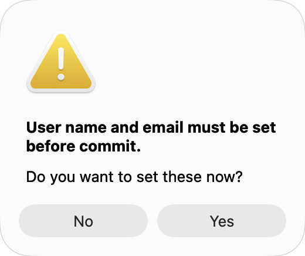
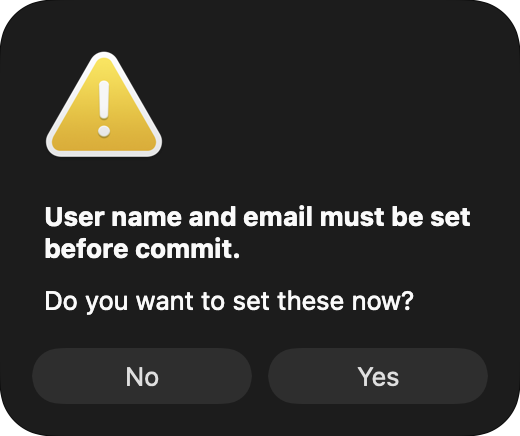

# Edit Notes parity

Pinned reference: `7338078f8ddd924b8cddee35f512f2286072136d`.

## Upstream comparison

`GitLogListBase.cpp` places Edit Notes after the revision mutation actions with
original `IDI_EDIT` artwork and excludes stash revisions and the adjacent stash
index parent. `GitLogListAction.cpp` invokes `CAppUtils::EditNote`, which checks
identity, reads the active default note and configures `IDD_INPUTDLG` with the Edit
Notes title/hint. Its optional checkbox is hidden. `InputDlg.cpp` supplies the
multiline editor, Undo, initial end caret, project minimum log length, resizable
layout, saved geometry and Control-Return acceptance. `Git.cpp` creates/replaces
the note using libgit2, including empty content.

## Native implementation

The revision menu now has Edit Notes with original `menuedit.ico`; selection,
busy/loading and stash/index-parent guards are mapped. Owned loading checks Git
identity and reads the exact note blob from the active notes ref, independently
of extra `notes.displayRef` output. Selection replacement, reload and close cancel
that read and reject stale responses. Read errors do not open a blank editor.

The native sheet maps the visible hint, plain multiline editor and OK/Cancel
controls. It seeds exact Unicode text, starts the caret at the end, enables Undo,
and disables quote/dash/text substitution. Command-Return and Control-Return
accept; Escape cancels. Project `tgit.logminsize` uses the shared existing scope
precedence and includes, also from HEAD in a bare repository. Minimum length is
measured in UTF-16 units, following the source editor. NUL/non-UTF-8 notes are
rejected rather than silently rewritten.

Saving writes exact UTF-8 bytes using `git hash-object -w` followed by
`git notes add --force --allow-empty --reuse-message`, retaining the notes ref
captured when the dialog opened.
Empty content creates an empty note rather than deleting its association. The
save owns its cancellation token through blob creation, mutation and readback.
Cancel requests cancellation and keeps the editor guarded while its child drains.
The displayed notes aggregate is reread into the existing entry and message pane.
The owning repository callback can also refresh its open history views. A failed write keeps the draft
for retry; a successful write followed by a failed display refresh closes the
editor and explicitly reports that notes were saved. This recovery presentation
is a native adaptation of upstream's separate save/read error paths.

The CLI flags and default/display ref distinction are documented in the
[official Git notes manual](https://git-scm.com/docs/git-notes).

## Evidence and remaining work

See [the verification record](qa/log-notes-edit-2026-10-06.json) for focused core
and headless native checks. A headless receiver is not displayed dialog acceptance.

Still pending: displayed menu/dialog/keyboard/focus/Undo/resize acceptance in
light/dark, saved geometry, log-font/width settings, project issue highlighting,
link and spelling behavior, broader multi-ref and malformed-note compatibility,
and signed sandbox/App Store checks. The October 20 continuation below addresses
the missing-identity Settings handoff and save cancellation. Updating a
note does not rerun an existing Notes search; refresh its search when needed.
Concurrent external note changes are force-overwritten on OK, as upstream does.
The full Log/application port remains incomplete.

## Identity and save lifecycle — October 20, 2026

The connected continuation covers Edit Notes from Log, RefLog, Rebase and
Synchronization. `AppUtils.cpp::CheckUserData` and `EditNote` are the pinned
behavior references: all four author/committer values are required before the
note is read, and Yes opens repository Git Settings before checking again.
Cancelling Settings does not itself certify or invalidate the effective identity.
The native implementation must reread it, including environment overrides.

The save owns its captured commit, active notes ref, repository access and child
processes. Cancellation must reach blob creation, note mutation and display
readback. A cancelled process can already have changed a ref, so recovery must
distinguish a confirmed saved note from an ordinary failure and an uncertain
outcome. The draft remains available after an ordinary failure or cancellation;
an uncertain outcome requires inspection before retrying. A confirmed save with
failed display readback closes the accepted editor and reports the refresh
failure separately. No automatic retry can safely resolve an uncertain outcome.

The native implementation uses an owned completion warning in the shared
Log/RefLog/Rebase presenter after the editor detaches. Synchronization retains
the confirmed-write warning through its refresh and includes a concurrent refresh
error when present. Forced owner closure cancels and drains the preparation,
Settings, save and warning children before its close callback releases the owner.
Generic Input dialogs retain their existing save behavior; cancellable saving is
opted into by Notes.

The Debug app build passed. Ten distinct focused Core methods passed: ten with
system Git and the six new methods again with bundled Git, for sixteen executions.
All five native cases passed with both engines, for ten case/engine passes.
Fixture-only failures and focused repairs are retained in the
[dated evidence](qa/commit-note-lifecycle-2026-10-20.json); application/Core checks
were not repeated. All fourteen launched receivers, including failed attempts,
were reaped and independently absent after the checkpoint.

The native checks cover actual Settings and warning buttons, native text Undo,
real note writes, captured targets and late owner closure. Held operation/error
boundaries exercise native receipt handling; Core tests separately cancel actual
Git children. The two-second recovery deadline requests cancellation and allows
additional time to drain its process. Recovery establishes the current target
content, not which concurrent writer produced it. Synchronization currently
retains its disabled loading form during preparation; exact upstream modal
ordering remains a native adaptation. Full physical, broader compatibility and
signed acceptance remain open.

The following are actual offscreen AppKit view bitmaps, not physical interaction
or compositor screenshots. Both appearances were inspected.

## Shared history save ownership (October 11, deferred validation)

The shared Sync Notes editor now tracks an atomic save independently of its
window. If its owner is forcibly closed, late UI publication remains fenced and
Quit remains blocked until the save task returns. This continues to retain the
repository access lease for the operation. That checkpoint was uncompiled
and untested; the later shared Input host consolidation and current message-style
records provide scoped build/native evidence. Full physical and signed acceptance
remain open.

## Shared source-style presentation — October 15, 2026

The [shared message styling family](SHARED-MESSAGE-STYLES.md) connects issue/URL
hotspots and source text formatting to the native Input, Notes, Merge and Rebase
editors, with owning font/style preferences, IME protection and owned cancellation.
Descriptions keep the source non-project route. Earlier missing issue-styling
statements above are superseded only for this implemented scope; full physical,
Scintilla and signed acceptance remain open. See its dated evidence.
