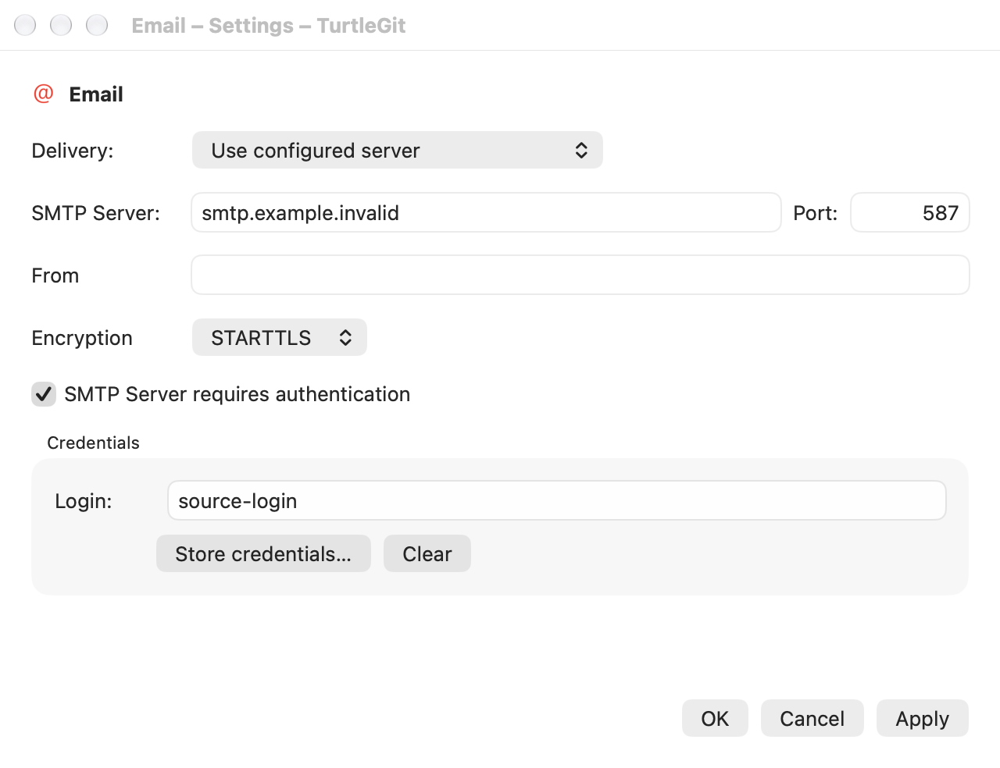
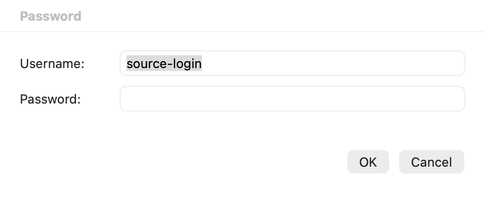

# Email settings and SMTP credentials

Source: pinned TortoiseGit `7338078f8ddd924b8cddee35f512f2286072136d`,
`Settings/SettingSMTP.cpp/.h`, `UserPassword.cpp/.h`, `IDD_SETTINGSMTP` and
`IDD_USER_PASSWD`. This is a partial native family audit, not certification.

## Source controls and behavior

The Email page retains Delivery, SMTP Server/Port, the disabled From placeholder,
Encryption, authentication and the Credentials group with read-only/selectable
Login, Store credentials and Clear. Direct SMTP is the source default; configured
server fields enable only for configured delivery, with Login/Store additionally
requiring authentication. Clear depends on an existing login independently of
delivery/authentication. Port preserves source UInt32 validation, including zero;
transport performs its separate usable-network-port validation.

The mail-client choice appears when Apple Mail is installed, adapting source
mail-client detection. An unavailable saved Mail choice displays Direct and can
be persisted with Apply; discovery alone never writes the saved setting. The
remaining enum identities stay stable when the middle choice is absent.

Apply saves delivery/server/port/encryption/authentication. Cancel discards those
unsaved options. Credential Store/Clear are immediate and independent of Apply,
matching the single source credential slot. Cancel does not undo accepted Store
or Clear. Native Keychain storage retains the existing app-private namespace;
passwords are excluded from UserDefaults and read-only Login metadata queries.

| Resource controls | Native mapping |
| --- | --- |
| Delivery label / `IDC_SMTPDELIVERYCOMBO` | `EmailDelivery`, installed-client choices and native Picker |
| Server/Port labels and `IDC_SMTP_SERVER` / `IDC_SMTP_PORT` | configured-only fields and UInt32 model validation |
| From label / `IDC_SEND_ADDRESS` | permanently disabled empty source placeholder |
| Encryption label / `IDC_SMTPENCRYPTIONCOMBO` | none / STARTTLS / SSL-TLS native Picker |
| `IDC_SMTP_AUTH` | configured-only authentication checkbox |
| Credentials group, Login label / `IDC_SMTP_USER` | native read-only/selectable Login metadata field |
| `IDC_STORECREDENTIALS` / `IDC_CLEARCREDENTIALS` | owned native editor / immediate credential deletion |
| Password dialog Username / Password / OK / Cancel | native text / secure text fields and default/cancel buttons |

## Owned credential editor

The native Password sheet uses the source field order, right-aligned OK/Cancel,
Return/Escape and Username→Password→OK→Cancel tab chain. Initial focus goes to
Username when empty, otherwise Password. Empty usernames retain the dialog with
an error and Username focus. Empty passwords remain valid. The secure control
limits passwords to 255 UTF-16 units, preserving an entire Unicode scalar at the
boundary rather than creating a split surrogate. Return from either field submits.

A captured editor request owns the Settings context. Duplicate invocation cannot
open a second editor. A replaced context, cancelled/detached host or retired model
rejects late replies. Completion consumes once, clears the secure field/editor,
and starts one immediate Store operation. Credentials are never part of the
observable Settings draft. Clearing a control releases its visible string; this
is not a claim that Swift/AppKit heap copies can be securely zeroed.

An idle editor owns application Quit and Settings close/navigation/Apply gates,
independently of an active Keychain operation. Forced host closure cancels the
owned sheet and clears the credential control. Already-started credential work
retains its existing independent drain accounting and cannot publish to a retired
Settings model. Standalone Email windows inherit their supplied preferences.

## Acceptance limits

Signed Keychain/TCC behavior, real Apple Mail execution, physical keyboard/IME/
VoiceOver, every source validation balloon and complete window/theme parity remain
open. No public email, user Keychain or global user preferences are needed for
private native verification. The existing SMTP and Send Mail transport contract
is unchanged by this editor family.

## Native checkpoint and captures

The Debug build and both grouped native families pass: the new editor and retained
Email options/Keychain-adapter fixture. Three owned receivers, including the first
fixture attempt, were reaped and independently absent. The fixture's SwiftUI
button-title readiness check was replaced with its actual native Login field; no
application repair or expanded test cycle followed that change. Core/SMTP
algorithms were unchanged and their suites were not repeated.

Four passive ScreenCaptureKit images were individually reviewed: source field
order, complete labels/values, credentials group and footer fit in both appearances,
with no clipped controls. Inactive window titles reflect preserved user focus.
No live Keychain/public mail was used. See
[batch evidence](qa/email-credential-editor-2026-10-17.json).

[Email Settings, dark](site/assets/email-settings-dark.png).

[Password editor, dark](site/assets/smtp-credentials-dark.png).
