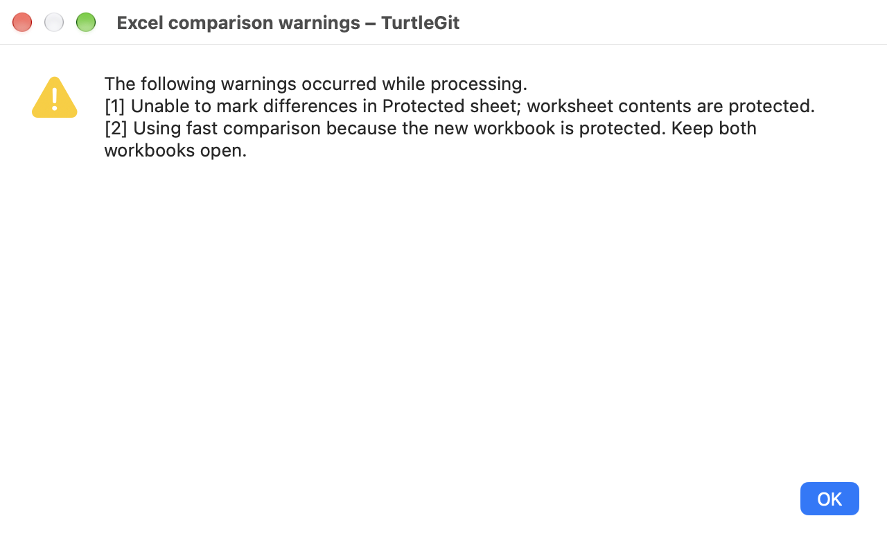
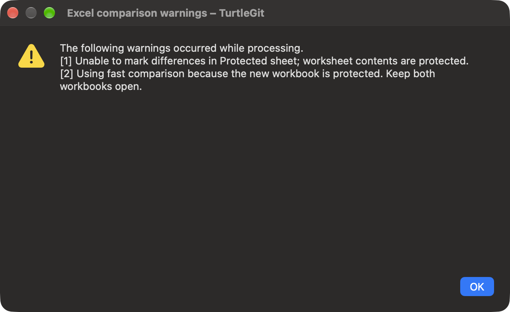

# Microsoft Excel workbook comparison

The bundled Excel adapter ports TortoiseGit's `diff-xls.js`. It opens captured
base/new workbooks in Excel and adds conditional formatting to the new copy so
changed cell values appear red. The view keeps Excel formulas, worksheets and
formatting; it is not a plain-text or metadata-only export. Microsoft Excel must
be installed separately.

New unsaved Diff Viewer defaults include `.xls`, `.xlsx`, `.xlsm`, `.xlsb` and
`.xlam`. Existing saved choices remain authoritative. Settings → Diff Viewer →
Advanced → Restore Defaults restores bundled associations while retaining other
records. Accept Advanced and Apply Settings. The program editor offers **Microsoft
Excel workbook comparison** and **Microsoft Excel workbook comparison (fast)**.
The full mode is the default. Shift bypasses an enabled association to retain the
ordinary internal byte/text view. Excel adapters are not merge tools.

## Full and fast modes

Worksheets pair by position, as upstream does. Full mode copies matching base
worksheets into the new workbook as uniquely named `Dummy_for_Comparison…`
reference sheets with gray tabs. Fast mode avoids those copies and uses references
to the open base workbook; keep both workbooks open. Workbook protection or an
uncopyable sheet can fall back to fast references with a warning.

Normally visible tabs lose their special color. Hidden worksheets are unhidden
and marked green where structure protection permits. Protected contents cannot
receive conditional formatting and are reported. Existing conditional formatting
in the private new copy is replaced with the red comparison rule. Native formula
conversion uses an owned scratch workbook, which is then closed. Sheet/workbook
names are quoted inside the reference formula; they never become script syntax.
The matching cells compare values, so distinct formulas with equal values are not
highlighted. Newly added sheets mark their used cells red; extra base sheets remain
visible in the base workbook. These edge policies need live Excel acceptance.

The adapter tries to stack only the two comparison windows horizontally. The
Windows-only synchronized-side-by-side API has no matching command in the inspected
Mac dictionary; synchronized scrolling remains open. Protection/layout failures
are reported rather than preventing all comparison. A native warning window shows
up to ten source-style numbered warnings plus a remaining count. Its text is
selectable and scrollable, with light/dark appearance and OK/Escape.

## Inputs, permission and lifetime

Input bytes are captured exactly in private read-only files with distinct role
prefixes. Source/original workbooks are never rewritten, staged or saved by the
adapter. Excel's automatic macros are disabled for opening and the prior security
value is restored on success/error where Excel responds. Existing external links
are not refreshed during opening. The source's saved-state behavior suppresses an
unwanted Save As prompt for these comparison copies. Other user workbooks are not
closed and Excel is never terminated on cancellation or failure.

Paths and the full/fast flag arrive as Apple-event descriptors to a fixed handler.
Preparation runs off the UI thread; the Excel worker is serialized. Cancellation
before dispatch suppresses it. An already dispatched operation cannot be rolled
back; actual worker/Quit ownership lasts until its callback settles. A retired
owner does not open a late warning or report an obsolete error. Success or a
possibly opened/uncertain failure retains copies through normal app cleanup;
confirmed denied/unopened failure removes them. Saved Data → Temp files or OS
cleanup can remove retained copies later.

macOS Automation permission is required. Denial provides the System Settings →
Privacy & Security → Automation recovery hint. The AppStore preparation profile
requests a target-specific Excel exception, alongside Word; the installed Office
dictionaries declare no scripting access groups. Mail retains its compose-only
target. This follows the mechanism documented by
[Apple](https://developer.apple.com/library/archive/documentation/Miscellaneous/Reference/EntitlementKeyReference/Chapters/AppSandboxTemporaryExceptionEntitlements.html),
with exception use cases still required for eventual review. Source declarations
and unsigned audits do not prove signed sandbox or App Store acceptance.

## Acceptance still open

Core/native checks distinguish exact snapshots, mode/descriptor dispatch, warning
presentation, permission failure and retired-worker lifetime from live Excel
behavior. The local optional terminology check compiles the fixed handler without
executing workbook operations. It does not prove conditional-format rendering,
locale/formula handling, protected workbooks, macro policy, every format or actual
TCC/file grants. Those checks, synchronized scrolling, physical UI/VoiceOver,
signed Finder/AppStore and full upstream parity remain open.

## Native warning appearance

These captures show the shipping TurtleGit warning window with injected protected-
sheet warnings. They verify readable native light/dark presentation, not live
Excel comparison output.

