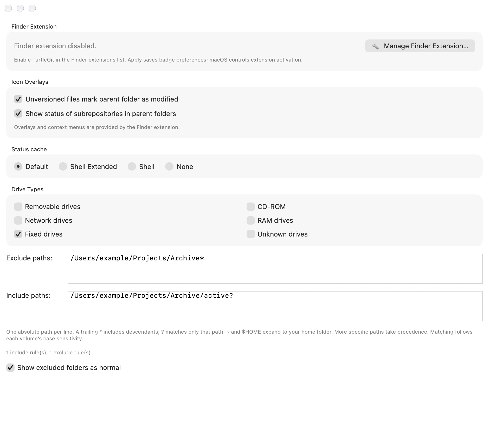
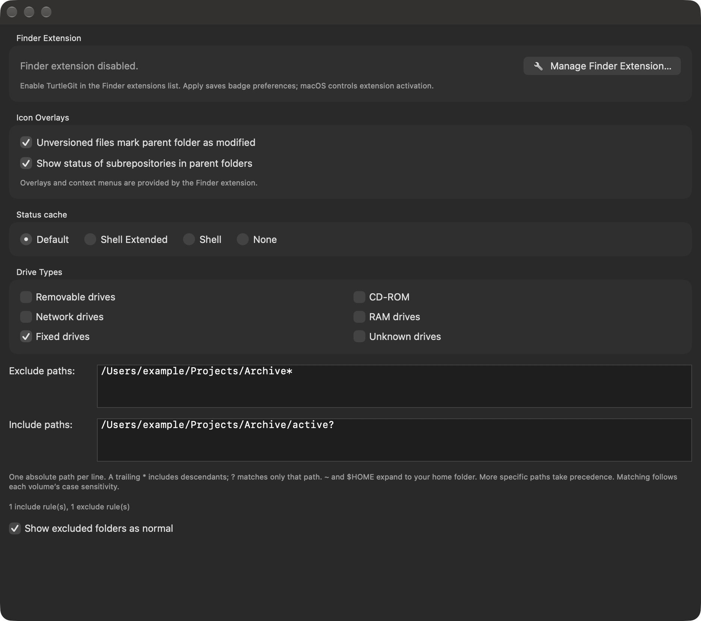

# Finder status collection and cache policy

Pinned TortoiseGit: `7338078f8ddd924b8cddee35f512f2286072136d`.
This family connects Icon Overlays, three Advanced settings, the foreground
publisher, watched repositories, the independent cache helper and Finder's cached
badge reader. It preserves the main application's full working-tree status.

## Source modes

The Icon Overlays page follows `IDD_SETTINGSOVERLAY` and `SetOverlayPage.cpp` order:

| Choice | Stored value | Status and folder behavior |
| --- | --- | --- |
| Default | 1 | Full index/HEAD/working-tree classification and ignored files; recursive folder rollup |
| Shell Extended | 3 | Lightweight index/working-tree classification; recursive folder rollup |
| Shell | 2 | Lightweight classification; modified direct children affect their folder, while ordinary modified grandchildren do not propagate further |
| None | 0 | Normal repository-folder badges, without file-state badges |

The four choices use standard AppKit radio buttons in source order, with native
keyboard grouping and localized captions. The two propagation controls use
standard checkboxes. Their callbacks retain the exact live Settings owner and
form context and refuse hidden, sheet-covered or retired owners.

Only Default enables the retained unversioned-parent and subrepository-parent
propagation options. Switching modes preserves their saved values. The menu-bar
Enable command restores Default; Disable selects None without replacing other
overlay preferences.

The distinction follows actual pinned source, including its quirks.
`GitFolderStatus::BuildCache` passes a different recursion argument for Shell and
Shell Extended. The `GitStatus.cpp` `isfull` expression casts the result of its
conditional, whose results are `dll` or `exe`, then compares it with `dllFull`.
Consequently this path does not turn Shell Extended into full staged/HEAD
classification. A staged-only change can remain Normal in either lightweight
mode, and ignore classification differs from Default. The native implementation
does not silently substitute a different interpretation of the enum comment.

## Index, path and content policy

`OverlaysCaseSensitive` defaults to true. As in `GitIndex.cpp`, true clears the
index's ignore-case capability; false retains that capability rather than
unconditionally folding every filename. Exact byte spellings win, and ambiguous
aliases cannot overwrite a different literal path. The helper's native index
lookup uses libgit2's ASCII case behavior; complete Windows Unicode casing
equivalence remains unverified. Overlay path-mask matching retains its separate
volume-based rules. Menu facts and original paths remain available separately.

`TGitCacheCheckContentMaxSize` defaults to 10,240 KiB. Its source ordering matters:
skip-worktree wins over assume-valid, then missing/type/size differences and the
recorded modification time are checked. Only an equal-sized file with different
stats and size strictly below the configured byte threshold is content-hashed.
A file at the threshold remains Modified after a stat mismatch, even if its
bytes happen to match. This setting is not a generic file-size exclusion.

The native helper reads the index without refreshing or rewriting it. Content
comparison uses repository clean filters; symlinks use their literal target
bytes. Generic full-status discovery would hash files before the cutoff check,
so the helper instead enumerates bounded worktree paths and inspects the index
and HEAD directly. Pre/post file, index and HEAD witnesses reject stale reads.
The existing parent-owned cancellation and filter-process drain remain in force.

Explicit bounds are 100,000 index entries, 100,000 visited worktree paths, depth
256, 1 MiB per path, 200,000 wire rows, 64 MiB wire output and 256 MiB of aggregate
content input actually selected for hashing. Exceeding a bound fails collection;
it does not classify an unread file as clean or truncate a successful snapshot.
These bounds can refuse otherwise valid large repositories.

## Native ownership and publication

Source `BlockStatus` checks the global `TortoiseGitProc.exe` mutex only in Shell
cache paths. A long-lived macOS app instead owns a global advisory lease during
active command work, including cancellation and process drain. Ordinary open
windows do not retain it. Multiple owners hold the same persistent lock inode;
the last owner releases it and process death clears kernel ownership. The helper
and Finder use a nonblocking probe. Default remains independent of this option.

The lease combines native command ownership and actual mutating Git process
lifetimes. Inspection and collector verbs do not block themselves. A retained
failure does not leave the cache blocked after work ends. Shell collectors retire
pending work while blocked and requeue when command ownership clears.

Each published root carries its accepted policy identity and effective index-case
mode. Publication tickets capture that identity. A mode/Advanced Apply fences
old tickets and suppresses old-policy overlays without deleting context-menu
facts, root grants or other live owners. Collectors cannot replace the accepted
policy with an older captured value. Warm restoration obeys the same identity.

Settings derive the merged policy and write only their own record under the
store's cross-process writer lock. Failed publication restores exact prior bytes
and the prior fence; another app cannot interleave a newer settings write with
that rollback. Apply/Cancel, edited rows, stale pages, modal ownership and retry
remain part of the same operation. App startup migrates older Advanced overrides
only when the independent shared policy record is absent.

## Finder and background adaptation

Finder never runs Git. Shell requests are asynchronous, bounded and coalesced
through a dedicated query-only service endpoint. That endpoint can refresh only
already authorized watched roots. The separate application endpoint retains
grant-replacement authority. Both use their own same-team, exact-identifier code
requirements. Queries do not register the service or grant repository access.

Default retains background watching. Shell and Shell Extended use the lightweight
collector in the helper and can answer observations while the main app is closed
when the authorized background service is enabled. Refreshes currently coalesce
at repository scope; they do not reproduce Windows' in-process directory-cache
storage or timing. Their distinct folder-rollup results remain observable. The
main app's status window continues to read full Git status in every badge mode.
The helper's lightweight context facts are conservative; accepted commands
revalidate their actual Git state in the app before changing the repository.

## Checkpoint and remaining acceptance

The universal helper executed the full/light protocol and retained runtime checks
on arm64 and x86_64. The relevant Core group now has 80 distinct passing methods
across the initial run and two focused fixture repairs. The Debug app build and
grouped native workflow passed with Apple Git and bundled Git, including real
radio/checkbox clicks, mode-specific collection, transactional Apply/Cancel,
failed publication/retry and owner retirement. [Batch evidence](qa/finder-status-policy-2026-10-20.json)
retains the initial failures and actual repair scope.

The images below show the actual hosted page in inactive windows, using private
example paths. A brief WindowServer capture replaced the invalid offscreen
bitmap attempt; the capture receiver and its windows were closed immediately.

Physical installed Finder queries, current distribution-signed IPC/App Group
operation, all filesystem/filter variants and App Store acceptance still require
separate evidence. The 256 MiB aggregate hash boundary was not exercised. This
family does not certify the whole Finder extension or complete TortoiseGit port.
