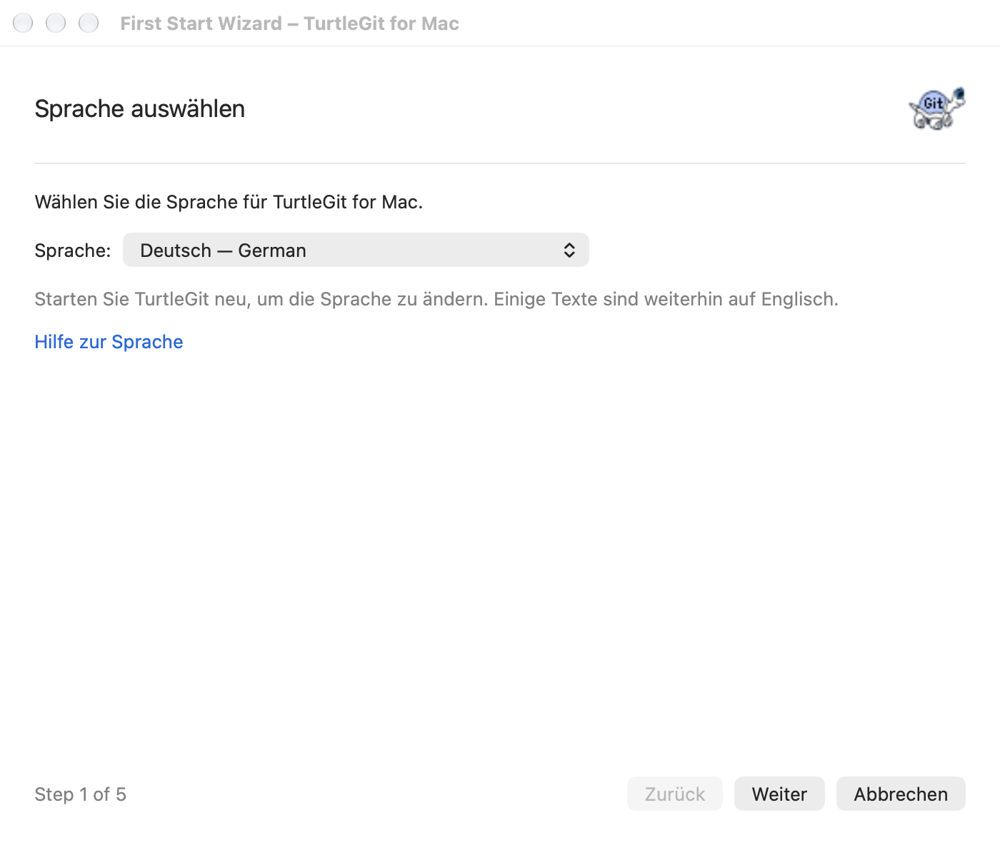
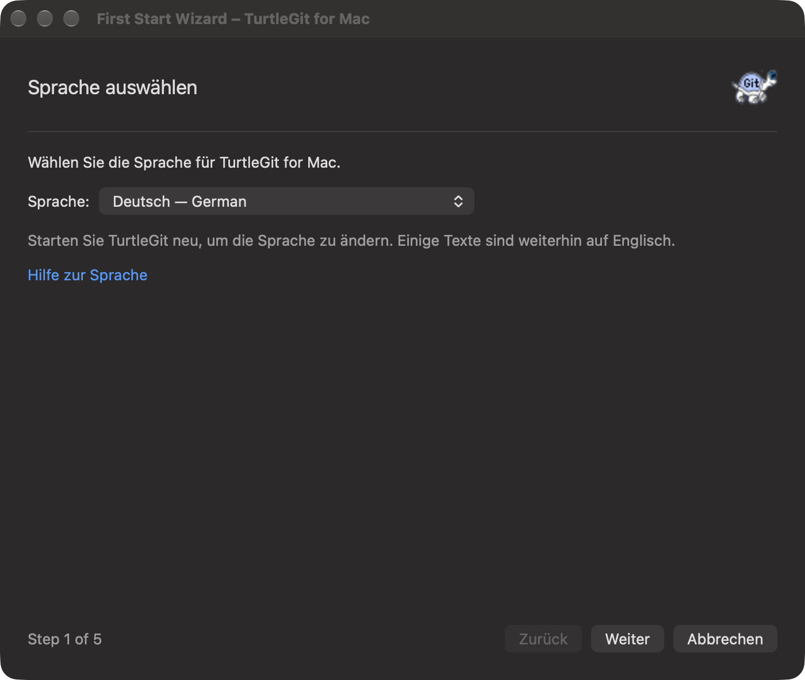

# First Start Wizard — implementation in progress

Reference: pinned FirstStartWizard and its Language/Start/Git/User/Authentication
pages at `7338078f8ddd924b8cddee35f512f2286072136d`.

The native wizard uses the source five-stage order, page titles, Back/Next/Finish
and Cancel. General's Re-run First Start Wizard and the application menu reuse
one wizard window. The header uses the original turtle artwork. Language offers
English and the bundled partial source label translations. Welcome explains the setup and links to
this fork's documentation. Git uses the shared native engine/path/Extra PATH
model, Browse and Check now. Next checks Git even if unchanged, saves the engine
and creates a configuration reader using that engine. AppStore Git stays bundled.
Windows Cygwin/MSYS compatibility hacks do not apply to the native Git runtime.

User information loads ordinary effective configuration, without replacing it
with process author-identity overrides. Its Don't store checkbox gates only
name/email writes. Next trims and validates both fields, then writes only these
two global keys. Other keys, includes, scoped credentials and repository-local
configuration remain untouched. Sequential failures report the key and possible
earlier writes. Saved earlier steps remain saved if Cancel ends a later step,
matching source wizard behavior. Back preserves current fields when the engine
is unchanged; changing engines refreshes the configuration reader.

Authentication uses OpenSSH, with existing SSH config/agent/remote key-file
behavior. HTTP helpers are discovered in Git's execution directory and PATH;
None plus installed osxkeychain/manager/manager-core/cache/store choices appear.
The existing effective helper is selected. Multiple, URL-specific or custom
helpers switch the page to a preserved advanced state, preventing simplification
from destroying existing configuration. Don't store skips the global helper
write. None removes only the unscoped global helper key (not URL-specific keys).
Finish saves the selected helper and records FirstStartComplete.

Global/XDG folders use the existing configuration permission store and owned
native authorization sheets. Closing fences pending chooser/read callbacks.
Next/Finish captures the submitted identity/helper, skip decisions and owning
preferences before starting work. Read-only Git checks and configuration reads
can be cancelled by closing the wizard; accepted identity/helper writes block
normal Close until settled. Forced closure lets accepted writes finish while
suppressing late navigation/finish. First Start, General engine checks and
credential reads retain application Quit accounting until backend work settles.

The wizard opens once per process on startup until Finish records completion.
Cancel leaves setup available next launch. Documentation preview bundles and
XCTest hosts skip automatic presentation. Manual re-run remains available. Source refresh/localization
installation and Create Library's macOS equivalent remain open. Native SSH
key generation and Advanced credentials are available as owned sheets; their
source adaptations and validation are recorded below. Full source page sizes/layout/focus and keyboard,
light/dark, helper discovery, global include/XDG precedence, Next/Back/Cancel,
partial failure, permission/read/close/quit ownership and signed sandbox checks
remain in the grouped General/Wizard validation. The earlier Settings/Tools
passing checkpoint does not cover this continuation. Inventory remains unchanged;
no dialog is newly certified.

## Grouped General/Updates/Wizard checkpoint — 2026-10-11

Debug Xcode build exited 0. The focused GeneralSetupBatchTests, GitRuntimeSSHTests
and GitConfigurationTests group passed: 13 tests, zero failures, 3.018 seconds.
Coverage includes selective identity saves, preservation of includes/scoped
credentials, validation before writes, idempotent helper clearing, engine
preference persistence, PATH validation/precedence and App Store isolation,
version/prerelease ordering, malformed tags, feed filtering and unexpected links.
No app was launched and no live release request was tested. Xcode emitted existing
warnings and six unusual SwiftCompile diagnostics reporting exit code 0 with no
output; this is not a clean diagnostics claim. Logs and remaining acceptance are
in `qa/general-setup-batch-2026-10-11.json`. Native visual/keyboard/ownership, live
network, bookmark renewal and signed sandbox acceptance remain open. This
checkpoint supersedes the uncompiled/untested statements above. Inventory is
unchanged; no dialog is newly certified.

## Advanced credential continuation

Advanced configuration now opens the native Credential page as an owned wizard
sheet, blocks navigation until closed, and reloads helper choices without
replacing identity fields. See CREDENTIAL-SETTINGS-PARITY.md. This continuation
is uncompiled and untested and is outside the preceding General/setup checkpoint.
Native SSH key generation and the rest of the authentication-section validation
remain pending.

## Grouped authentication checkpoint — 2026-10-11

Credential settings and native SSH key generation were validated together. Debug
Xcode build exited 0. AuthenticationSettingsBatchTests, SSHAskpassTests and
GeneralSetupBatchTests passed: 17 tests, zero failures, 20.638 seconds. Coverage
includes live Git scoped writes, preservation of other URLs/includes/unknown
keys, helper reset chains, implicit versus explicit-empty booleans, stale save/
remove rejection, simple helper/None replacement, invalid-write refusal, plain
and encrypted Ed25519 generation, exclusive publication, file permissions,
fingerprint, private staging cleanup and existing one-use agent-helper behavior.
Real encrypted output was loaded into an owned private agent with its phrase;
loading without a phrase failed. Pre-cancelled requests publish nothing. No app
was launched and no full suite was rerun.

Xcode emitted existing warnings and four unusual SwiftCompile diagnostics
reporting exit code 0 with no output; this is not a clean diagnostics claim.
Native layout/keyboard/theme/owned sheets, live generation cancellation,
publication races, all algorithm/bit choices, read-only simplification,
partial-write failures and signed sandbox acceptance remain open. Logs and
limitations are in `qa/authentication-settings-batch-2026-10-11.json`.
This supersedes the uncompiled/untested statements above. Full-port and inventory
certification remain unchanged.

## Source forms and owned setup operations — October 15, 2026

The User page now keeps explicit Name and Email labels visible beside native
fields, with the commit-identity hint above and global-defaults hint below,
matching the pinned resource's ordering. Authentication pairs SSH selection with
Generate and Don't store with Advanced. OpenSSH replaces Windows PuTTY selection.
Git keeps explicit executable/Extra PATH rows with Browse and version checking.
The source artwork remains in the wizard header; light/dark colors follow macOS.

Opening Advanced selects Don't store immediately, as
`FirstStartWizardAuthentication::OnBnClickedAdvancedconfiguration` does. Closing
the owned credentials sheet reloads helpers without clearing that choice or
replacing unsaved identity fields. Navigation and parent Close remain blocked
while either authentication child sheet is open.

The configuration reader and completion flag use the wizard's own preference
store and captured engine. Back preserves fields for the same engine; a changed
engine reloads them. General Apply continues to work for a cached page that has
disappeared from Settings, while cancellation invalidates pending version results
and prevents a cancelled check from saving engine preferences.

Source translation installation, arbitrary SSH client selection,
all physical keyboard/focus gestures, every helper and include/XDG configuration,
permission renewal and signed App Store sandbox acceptance remain open. No dialog
is certified complete.

Debug builds exited 0. The grouped native receiver passed with system and bundled
Git, using private configuration and preferences, actual child sheets and held
script/sleep descendants. Four raw User/Authentication light/dark captures were
visually inspected. The first fixture incorrectly looked for a SwiftUI static
label as an NSTextField; capture then exposed a real zero-width hosting window,
fixed by setting content size after host attachment. The final group passed and
all owned receivers/helpers were reaped. Core operations were unchanged and their
suites were not repeated. See [exact evidence](qa/first-start-family-2026-10-15.json).

## Captured five-page forms and Git checks — October 17, 2026

The complete five-page body now scrolls independently of the persistent source
Back/Next/Finish/Cancel footer. Git retains introduction, executable and Extra
PATH rows, Browse, version/Check now and recommendation/help in source order.
The recommendation points to the bundled macOS runtime, and Authentication adds
OpenSSH setup/FAQ help. These links open the native Help topics, with the existing
online fallback when bundled Help is unavailable. The original turtle remains
in the header; both appearances follow the owning native window.

Fields and page actions capture their owning page and form generation. Leaving
and revisiting a page, opening/closing a child picker, starting/settling a Git
check and changing a Don't store dependency invalidate retained callbacks.
Git's native executable picker blocks page navigation and ordinary Close until
answered; forced owner closure retires it and rejects late responses. Check now
retains cancellation/Quit ownership and offers Cancel check outside the disabled
page body. Read-only checks may still be cancelled by closing the wizard.
Accepted configuration writes retain the previous noncancellable save behavior.
Finish records completion once even if the close callback leaves the window open.
Queued focus requests capture the page visit and wait for navigation to become
available after configuration reads; old requests cannot focus a revisited page.

Fourteen previously unreviewed source controls receive partial native mappings:
ten Git controls, three installed-language controls and the Welcome text/link.
The three language download/Refresh controls remain pending: translations are bundled with the native app, which cannot install Windows DLL
language packs. The three source
Cygwin/MSYS workaround controls remain pending adaptations and have no native
checkboxes: their Windows runtime compatibility behavior does not apply to the
native Git process. Arbitrary SSH client selection, native localization,
physical keyboard/VoiceOver acceptance, all helper/include/XDG variants,
permission renewal and signed App Store sandbox acceptance remain open.

The Debug build exited 0. The expanded grouped native flow passed with system
and bundled Git, including retained form dependencies, picker/check/Close gates,
cancelled results, once-only Finish with a deliberately open completion callback,
private identity/helper saves, actual child sheets, read cancellation and accepted
writes after forced closure. Both receivers were reaped and independently absent.
All ten raw five-page light/dark captures were individually reviewed: controls,
source order and footer fit without clipping. Receivers use prohibited activation
and never make a window key. Core was unchanged and was not repeated. The build
retains existing isolation warnings and one exit-zero/no-output diagnostic;
this is not a clean diagnostics claim. See [batch evidence](qa/first-start-source-family-2026-10-17.json).

## Native bundled language page — October 17, 2026

The Language page uses the shared native locale choices and captured page/revision
binding. Next saves the app-specific language override before moving to Welcome;
later Cancel retains that saved page. Old/retired/page-mismatched bindings cannot
change its replacement. This operation does not inspect Git or touch global Git
identity/credential files. The app asks for a restart to apply the language rather
than copying Windows' forced process relaunch. See [Languages](LANGUAGES.md) for
partial coverage and English fallback; full translated/RTL/physical/signed
acceptance remains open. Grouped German/French/English native checks and the
48-topic Help receiver passed. Four owned light/dark captures were reviewed and
all receiver PIDs were independently absent. See
[language batch evidence](qa/language-family-2026-10-17.json).

## Explicit page startup and bootstrap ownership — October 18, 2026

The source `firststartwizard /page:<number>` entry now reaches the native five-page
wizard. A fresh window selects 0–4, with Language fallback for unavailable values.
A repeated command focuses the current wizard and preserves its draft, page and
pending work. An explicit wizard command suppresses automatic first-run page
creation, so it does not race the requested initial page.

Initial User/Authentication pages read global configuration through the selected
engine and existing scoped configuration authorization. They do not apply an
engine preference or write identity/helper settings on opening. Next/Finish retain
the existing captured write paths. Bootstrap holds its operation counter until
actual return, cancels on forced close and rejects late configuration. Owning
preferences persist the completion flag. [Batch evidence](qa/utility-commands-2026-10-18.json)
records actual checks; physical input/rendered fidelity, real scope/credential
interaction and signed Store acceptance remain open.
