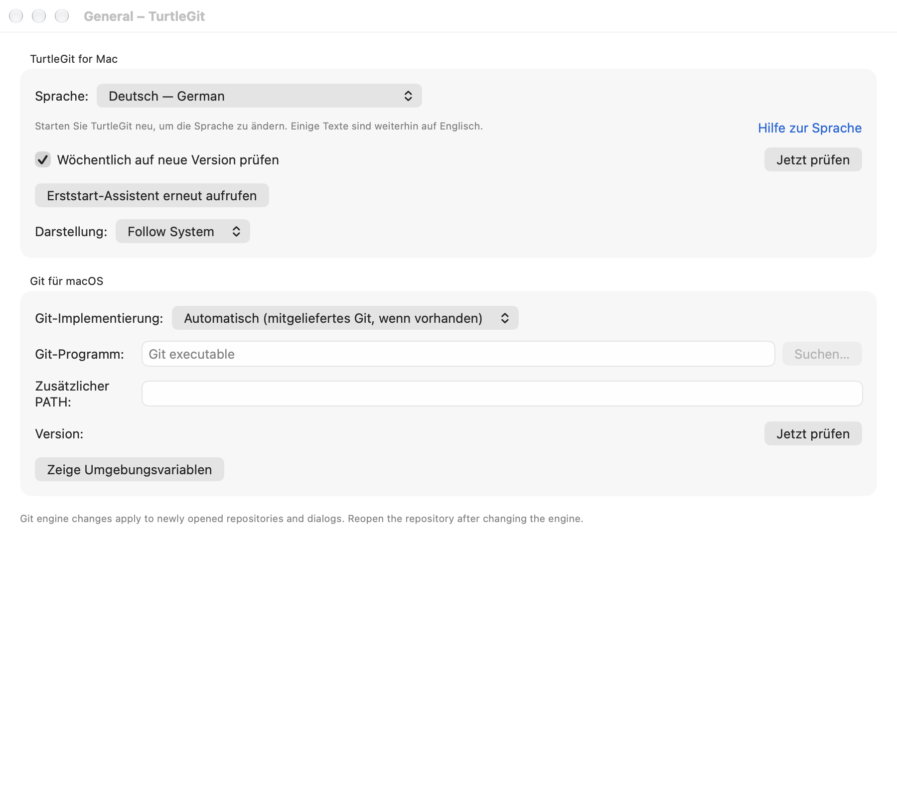
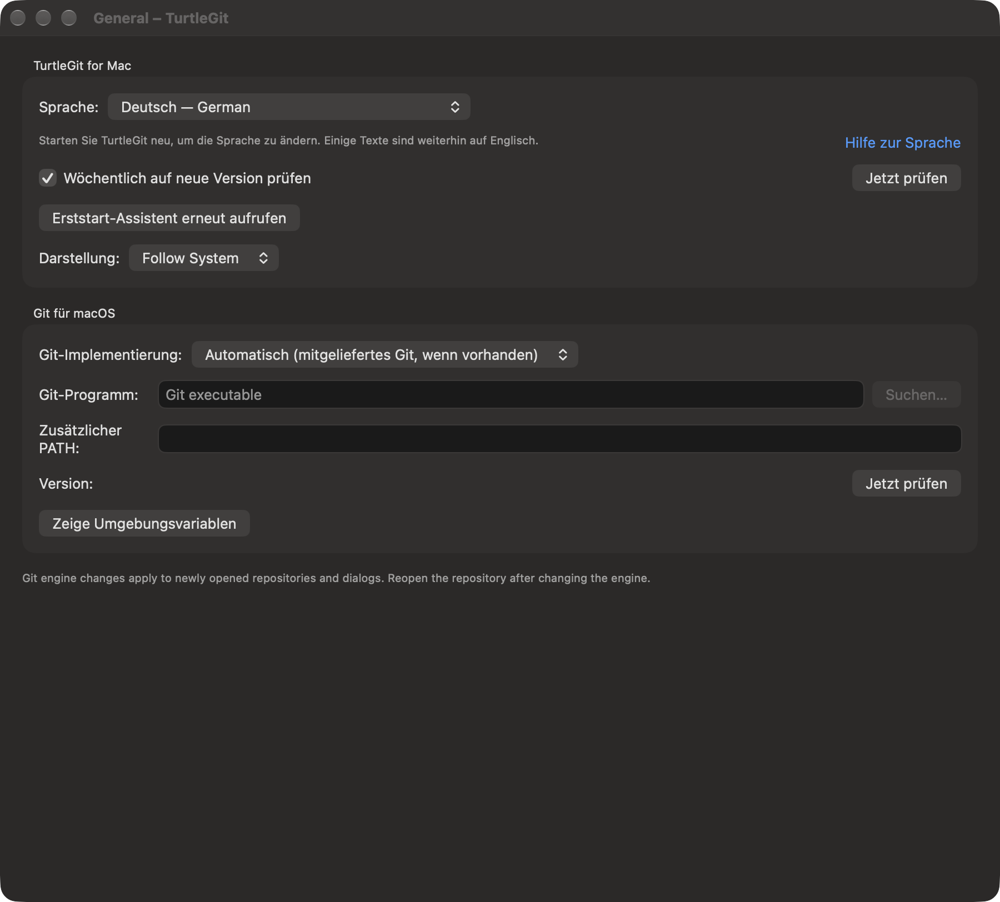

# General settings — implementation in progress

Reference: pinned SetMainPage.cpp and IDD_SETTINGSMAIN at
`7338078f8ddd924b8cddee35f512f2286072136d`.

General now uses an application group and Git for macOS group instead of only
appearance controls. The application group exposes bundled language selection and the shared
System/Light/Dark draft. Matching native labels now use English and 37 source
translation catalogs; complete localization remains open. See [Languages](LANGUAGES.md).

The Git group provides automatic/bundled, system and custom engine selection,
Git executable path, owned native Browse, Extra PATH, version Check now and Show
Environment Variables. Custom selection replaces the Windows Git.exe folder
setting with a macOS executable file. Selected file bookmarks resolve without UI;
access leases remain alive for engines captured by repositories and open dialogs.
Custom engine selection is validated by running `git --version` in private app
temporary storage, with draft runtime environment, before Apply saves it.
Version checks are cancelable and fence callbacks when the page disappears.
The environment viewer is an owned read-only native sheet, supports selection,
and shows the effective draft process variables without writing them to logs or
files. Shared property-sheet Apply/Cancel owns the preference draft.

Runtime selection is consumed by GitRuntime.executable for newly created
repositories. Existing repository objects retain their captured engine, matching
the source restart requirement; the UI asks the user to reopen after changes.
Extra PATH augments the runtime PATH, preserving bundled Git/SSH precedence.
Its entries must be absolute directories and cannot introduce empty/current-
directory components. With no extra directories, existing external-engine
behavior remains unchanged. No shell evaluates the configured path.

The AppStore build ignores custom/system engines and Extra PATH. It retains the
existing requirement for bundled Git and SSH; these controls are disabled and
show the automatic selection. This implementation does not turn folder access
into permission to execute an unbundled engine in the AppStore sandbox.

This continuation is **uncompiled and untested**. The previous grouped build and
four tool tests do not cover it. Runtime-selection, bookmark moves/renewal,
PATH precedence, validation failures, native Check/Browse/environment ownership,
Apply/Cancel, reopened repositories, Finder/background engine boundaries and
signed sandbox checks remain in the next combined General-section validation.
Language assets/localization, weekly release checking/Check now, full First Start
Wizard and Windows Create Library's macOS adaptation remain pending. No inactive
controls are presented as those implemented features. General is not certified
and inventory counts remain unchanged.

## Weekly update check continuation (uncompiled and untested)

The weekly preference and Check now are now connected to a native release-check
window and GitHub release metadata for this fork. AppStore builds open their
managed-update result instead. See [Release updates](RELEASE-UPDATES-PARITY.md)
for request/version rules, owned windows/confirmation, remaining source installer
scope and grouped acceptance. The pending weekly-check statement above describes
the previous checkpoint; both General continuations remain unverified.

## First Start Wizard continuation (uncompiled and untested)

General's Re-run First Start Wizard and the application menu now open the native
five-stage manual setup flow. See [First Start Wizard](FIRST-START-WIZARD-PARITY.md)
for source-ordered saves, credential preservation, permission ownership and the
remaining automatic-first-run/key-generation/Advanced/native acceptance scope.
This and the preceding General/update work await grouped validation.

## Grouped General/Updates/Wizard checkpoint — 2026-10-11

Debug Xcode build exited 0. The focused GeneralSetupBatchTests, GitRuntimeSSHTests
and GitConfigurationTests group passed: 13 tests, zero failures, 3.018 seconds.
Coverage includes selective identity saves, preservation of includes/scoped
credentials, validation before writes, idempotent helper clearing, engine
preference persistence, PATH validation/precedence and App Store isolation,
version/prerelease ordering, malformed tags, feed filtering and unexpected links.
No app was launched and no live release request was tested. Xcode emitted existing
warnings and six unusual SwiftCompile diagnostics reporting exit code 0 with no
output; this is not a clean diagnostics claim. Logs and remaining acceptance are
in `qa/general-setup-batch-2026-10-11.json`. Native visual/keyboard/ownership, live
network, bookmark renewal and signed sandbox acceptance remain open. This
checkpoint supersedes the uncompiled/untested statements above. Inventory is
unchanged; no dialog is newly certified.

## Source inputs and owned engine validation — October 17, 2026

The Git executable now uses native literal filesystem completion, retaining the
source's path-entry behavior with macOS security-scope boundaries. A visible Extra
PATH label remains beside populated values. Cached-page activation is observable,
so inactive controls re-enable when their page returns. Windows Git folders stay
adapted to macOS executable selection; no shell interprets either field.

Check now has Cancel check and a cancelling state. Cancellation retains busy/Quit
ownership until the real worker drains, including workers that ignore their token.
Page retirement fences late results while preserving independent operation counts.
A version or error is accepted only for the unchanged captured draft. Apply checks
the same identity after asynchronous validation and refuses to save an older draft
over a newer one; hidden cached pages can still participate in property-sheet Apply.

Browse captures the full engine draft, page lifecycle and owner. Duplicate Browse
and update-disable questions share a single owned dialog. Browse validates a
regular executable before creating its bookmark, preserves the captured Extra
PATH, and rejects changed/retired/duplicate replies. The update question retains
Abort as its default and accepts Disable only once for its captured live page.
Suspension, view dismantling and actual owner closure cancel both native dialogs;
Settings close/navigation and application Quit account for their ownership.

Fifteen of sixteen static source controls now have partial mappings. Language now offers the bundled partial label translations; its mapping does not
claim complete source localization support. The
Windows Create Library control remains pending: no Finder Library equivalent has
been implemented. The environment viewer is a native read-only sheet rather than
a temporary file opened in a Windows editor. Physical keyboard/sheets, translation
assets, signed grants and complete source/App Store acceptance remain open.
Four distinct native case/engine combinations pass with system and bundled Git, with two affected source rechecks after the checkbox layout repair. Both raw light/dark captures were individually reviewed: compact groups, persistent labels and footers fit without clipping. All seven owned receivers were reaped and independently absent; source receivers also assert real child-process cleanup. Core was unchanged and not repeated. See [batch evidence](qa/general-source-family-2026-10-17.json) for the build/capture failures, repairs and remaining acceptance.

## Bundled language choices — October 17, 2026

General Language is now a real draft participating in property-sheet Apply/Cancel.
The app owns its language override independently of system/global settings and
retains the original macOS language order when the page is merely read. Old field
callbacks and inactive owners cannot change a new draft; cached hidden pages may
participate in Apply. Re-activation reloads a wizard-saved choice when there is no
unapplied draft. System removes the app override. All languages use the same
native selector in AppStore builds; no external language package is executed.
Restart is explicit, preserving other open windows rather than forcing a relaunch.
The grouped native language workflow passed, including Apply/Cancel, stale callbacks,
wizard persistence and System reset. German light/dark captures were reviewed;
remaining English fallback is visible. All owned receivers were reaped. See
[language batch evidence](qa/language-family-2026-10-17.json). Complete localization,
physical language/RTL layouts and signed acceptance remain open.

