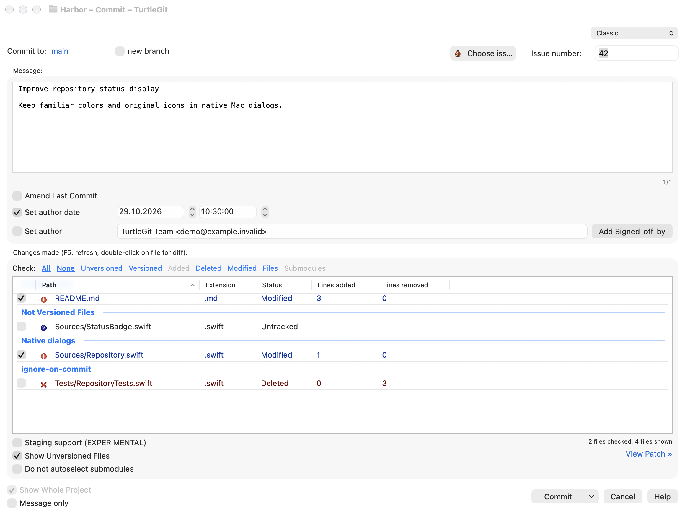
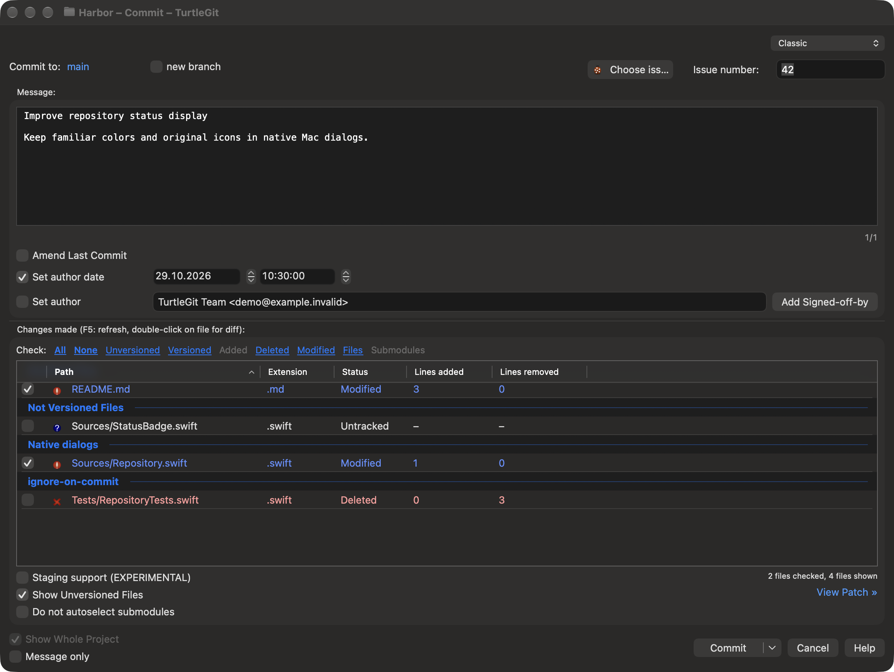
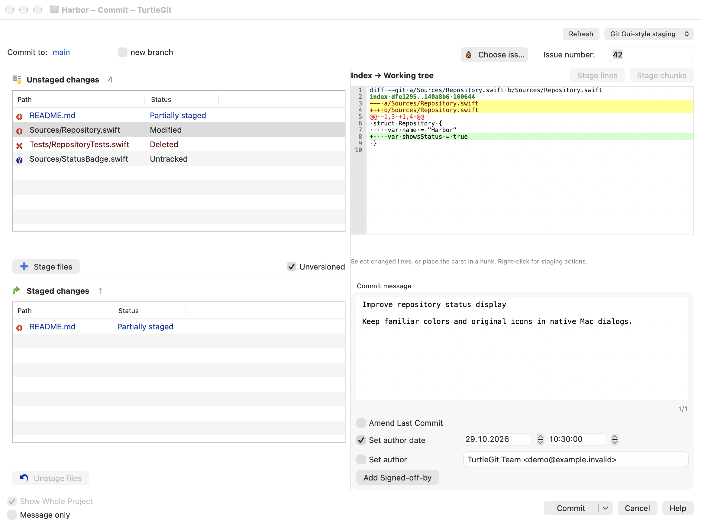
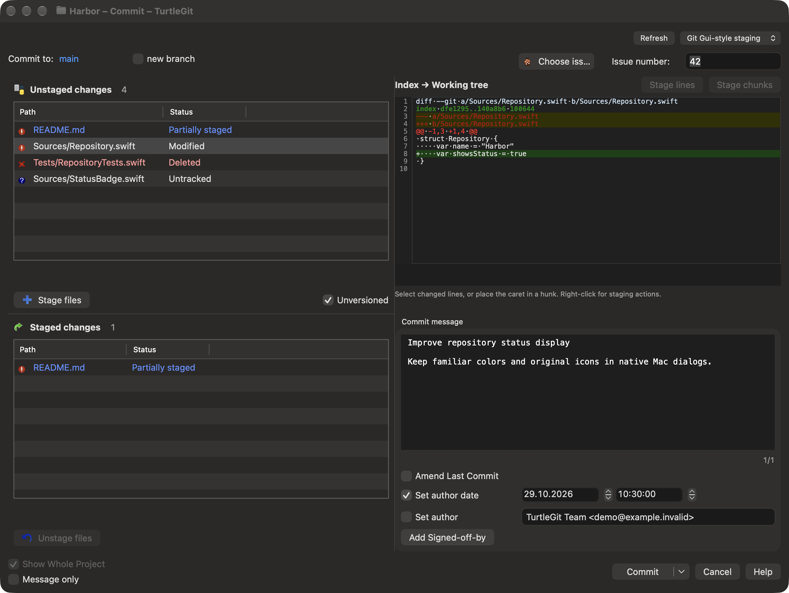
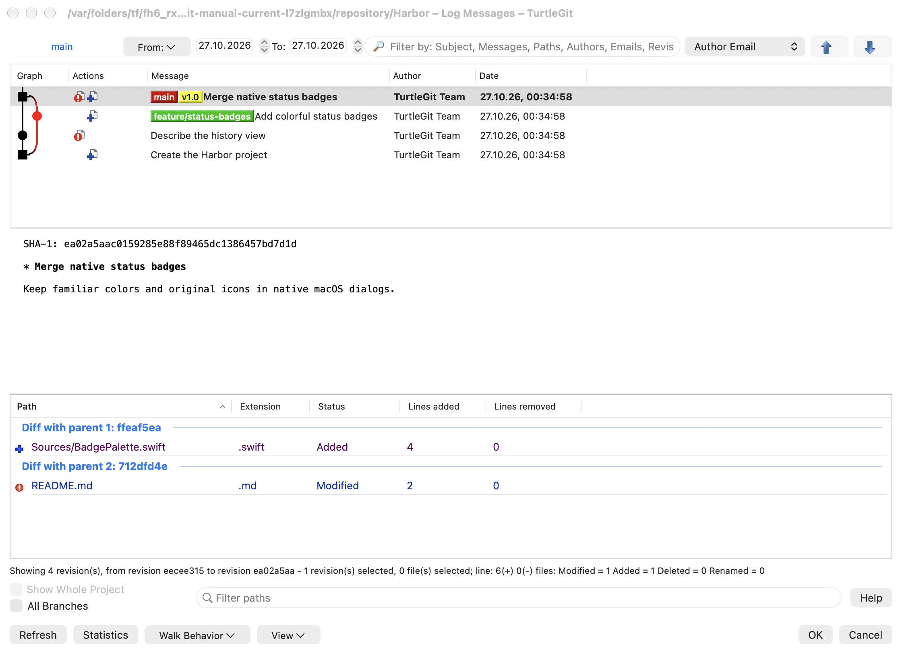
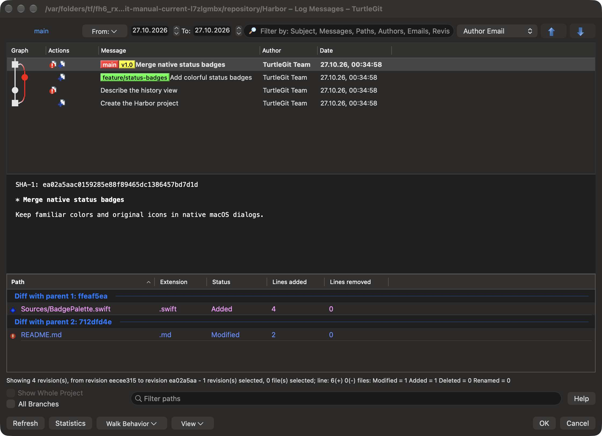
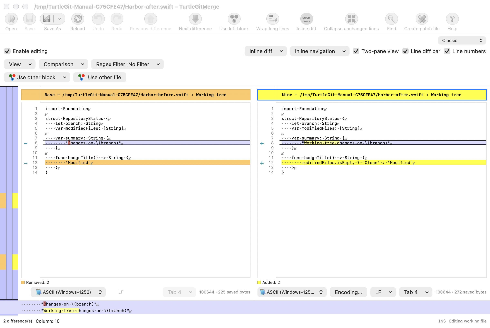
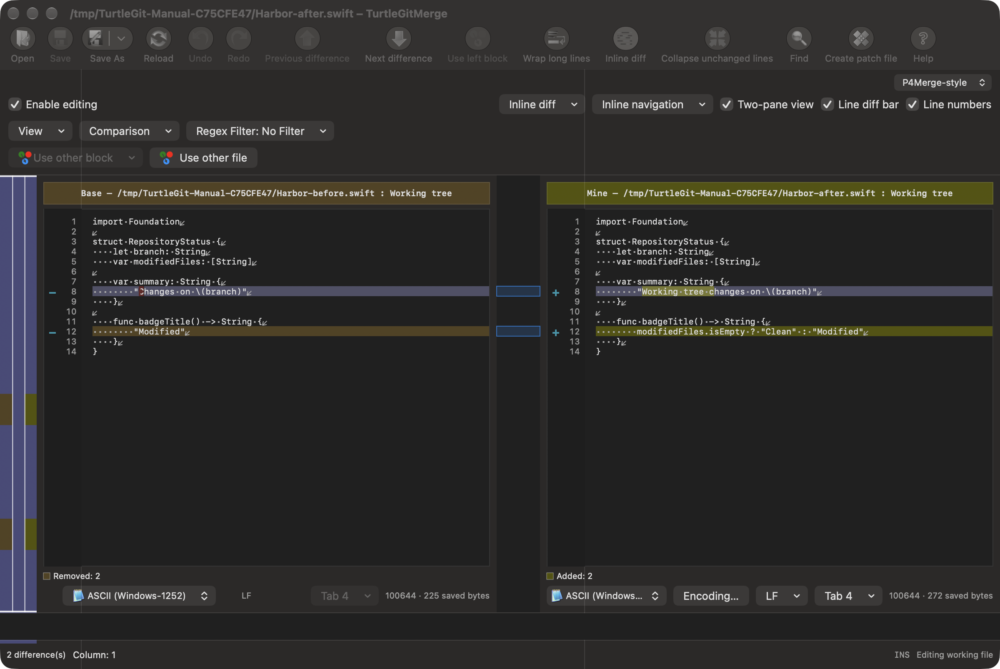
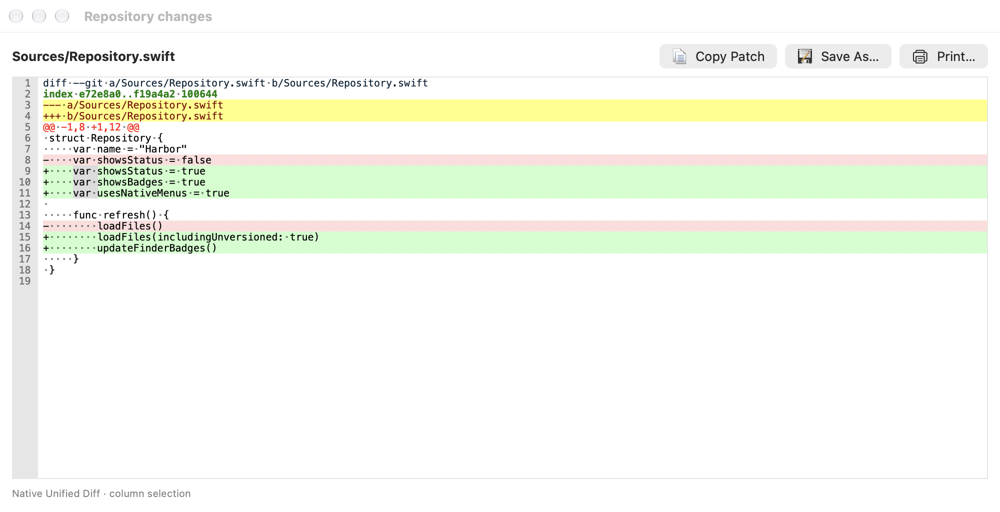
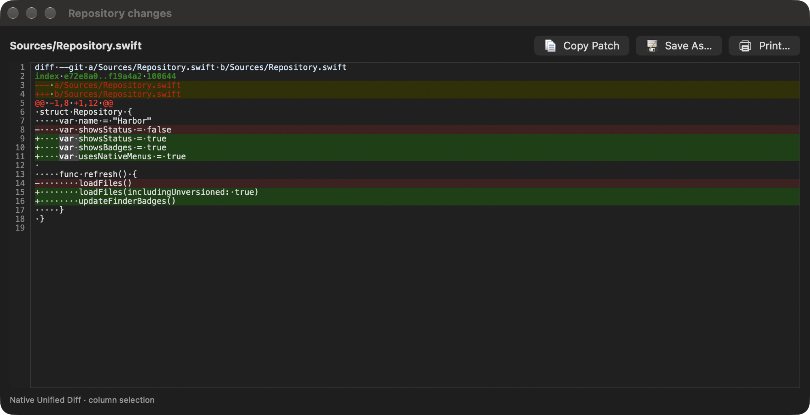

# Getting started with TurtleGit for Mac

TurtleGit brings Git commands, file status badges, history and comparison tools
to macOS. This chapter covers opening a repository, working from Finder,
committing changes and reviewing history in native Mac windows.

Requires macOS 13 or later. Mac App Store distribution is planned; no store
purchase is available yet. Build and signing
instructions are in the [project README](../README.md) and
[distribution guide](DISTRIBUTION.md).

## Set up Git and authentication

Open **First Start Wizard…** from the application menu, or re-run it from
General settings. Choose the interface language, Git engine, identity and
authentication settings in order. Git and identity choices save when their
steps succeed; cancelling a later step keeps those earlier choices.

On Authentication, **Automatic OpenSSH** uses the normal SSH configuration.
Choose **Custom OpenSSH** to enter or browse for another OpenSSH executable.
**Check now** reads its version without saving the choice; **Cancel check**
stops a pending check. Finish saves a changed SSH choice before applying the
HTTP credential-helper choice. If that later step fails, the accepted SSH
choice remains saved so you can correct the helper and retry. **Don't store**
for HTTP credentials does not discard the SSH choice.

The sandboxed distribution build includes Git and OpenSSH, so a separate Git
installation is not required. Custom executable selection is disabled in that
build. Builds made for development can use a separately configured Git or SSH
client. See [SSH setup](FIRST-START-SSH-PARITY.md) for authentication details and
platform limitations.

## Open, clone or create

Use **Open Repository…** (Command-O) to select an existing repository folder
and open the main workspace.
Use **Clone…** (Command-Shift-C) for a remote or local source, or **Create
Repository…** (Command-Shift-R) for a new repository. Clone has its own options
and progress windows; inspect the result before continuing. A failed Clone can
leave partial files: retry does not delete them for you. See [Clone parity](CLONE-PARITY.md)
for supported options, cancellation and remaining authentication work.

Finder commands, Settings, About and standalone comparison or patch documents
open their own windows. They do not need to open a repository workspace first.
Closing a dialog leaves any existing workspace available.

The source button remembers **Browse…** or **Open**. Use its arrow to change the
action. Open reveals a local source in Finder (or its closest existing parent)
or opens a remote URL using its registered application. It does not start a clone.
Local sources may require folder permission. Cancel stops a pending source request.

After successful bare creation or cloning, TurtleGit sets its branded folder icon
when no existing custom icon is present. An icon failure is reported separately:
the Git repository remains created and you do not need to repeat Init or Clone.

Opening a working repository enables the status, commit and history workflows.
Bare repositories support history and remote operations but do not have a
working tree to edit or commit. If saved folder access cannot be renewed, select
the folder again through Open Repository.

## Start from Finder

Finder commands start TurtleGit when needed. You do not need to open the app or
its workspace first. If the selected repository has no saved folder permission,
choose its folder when macOS asks; receiving a Finder command does not itself
grant access to your files.

First open **Settings → Icon Overlays → Manage Finder Extension…** and enable
TurtleGit in the macOS Finder extensions list. Return to Settings to see the
activation status. **Apply** saves badge preferences; macOS controls extension
activation. Enabling the extension does not grant folder access or register a
repository.

With the signed Finder extension enabled, select a folder and open **TurtleGit**
in its context menu. **Clone…** opens the clone form with that destination;
**Create repository…** opens the creation form. For a repository already on disk,
choose **Add to TurtleGit…**. The app requests folder access when needed, validates
the repository and saves it in Open Recent and Watched Repositories. Registration
runs without opening a workspace and does not replace a repository already open there.
When access is needed, the picker opens inside the selected folder; click
**Allow Access** to approve it. Valid saved access avoids another picker.

Registered repository folders retain their general Git commands when TurtleGit
is closed. The app restores folder permission and validates the repository when
you invoke a command. File-state commands require a current status publication;
registered-folder hints alone do not supply badges or tracked-file status.

A successful Clone also registers its resulting repository using the destination
permission you already granted. A registration failure is reported separately from
the successful Git clone, so you can retry registration without cloning again.
To continue badge updates after quitting, enable **Settings → Icon Overlays →
Watched Repositories → Refresh after TurtleGit quits**. Registering or cloning a
repository does not change that background preference.

If Finder Sync is disabled or macOS does not show its submenu, select the folder
and use **Services → Open in TurtleGit** to open the repository or its folder chooser.
Finder controls extension/menu placement. These commands do not grant access to
other repositories or cause a scan of your Mac. See the
[registration workflow](FINDER-REGISTRATION-PARITY.md) for scope and current
verification limits.

## Commit with checked files

Open **Commit** for the current repository. In **Classic**, the message sits
above the changed-file list. With **Staging support (EXPERIMENTAL)** off, check the files whose
current whole-file contents you want to commit. Highlighting a row is separate
from checking it. Category links such as All and None change the checked set.
Unrelated staged changes are preserved outside the checked-file commit.

**Show Unversioned Files** includes files that Git does not yet track. **Show
Whole Project** expands a scoped selection to the repository. In Classic,
double-click a file to inspect its diff or edit its conflict. **Do not autoselect submodules**
controls automatic submodule selection in checked-file mode; it is disabled in
staging mode.

The dialog includes **Amend Last Commit**, **Set author date**, **Set author**
and **Message only**. The commit choice offers **Commit**, **ReCommit** and
**Commit & Push**. Options have eligibility rules; inspect the enabled controls
and result before continuing. [Commit parity](COMMIT-PARITY.md) records their
source comparisons, verification and remaining work.

The Classic Commit window in light appearance:

The same window in dark appearance:

## Edit commit and other messages

Commit, Merge, Rebase, Notes and branch-description editors offer **Message
Lines** in the Edit menu and matching commands in the text context menu. Use
**Copy Lines**, **Cut Lines**, **Delete Line**, **Duplicate Selection or Line**
and **Transpose Lines** to edit complete lines; Duplicate repeats selected text
when a selection is present. The shortcuts are ⌘⌥C, ⌘⌥X, ⌘⌥K, ⌘⌥D and ⌘⌥T.
Changes, including configured automatic line wrapping, can be undone together.
Tab continues to move between dialog controls.

**Message Text Size** offers **Zoom In**, **Zoom Out** and **Actual Size**
(⌘+, ⌘− and ⌘0). Zoom affects the current message editor only; it does not
change the saved font setting or the message. A new message session starts at
the configured size. See [message-editor behavior](MESSAGE-EDITOR-COMMANDS-PARITY.md)
for the source comparison and remaining acceptance work.

## Choose a commit window

The **Commit window** selector offers **Classic** and **Git Gui-style staging**.
Classic remains the default. The choice is saved for subsequent Commit windows.
The staging workspace shows unstaged files above staged files on the left, with
an embedded patch and commit message on the right. Select a file in either list
to review that side of the index. A partially staged file appears in both lists.
Use **Stage files** or **Unstage files** for whole-file changes. Double-click a
row in the upper **Unstaged changes** list to stage it, or in the lower **Staged
changes** list to unstage it. Double-clicking a selected row transfers the
selected group. Classic keeps its double-click Diff action.

Select changed lines in the patch, then use **Stage lines** or **Stage chunks**;
the staged view offers the corresponding Unstage actions. The working file is
preserved.

The alternative workspace commits the Git index, including staged changes outside
the displayed scope. It shares the classic commit checks and progress workflow.
Both layouts show **Commit to:** and offer **new branch**. Project-configured
issue fields and issue-provider actions appear in the destination band. The message
area includes **Amend Last Commit**, **Set author**, **Set author date** with
separate date/time controls, and **Add Signed-off-by**. Switching layouts retains
the message, branch name, issue value and author/date choices.

The **Commit** menu works in either layout. Use ⌘⌥M to focus the message and
⌘⌥F to focus the active file list. File context menus retain Compare, Open, Resolve,
Revert, ignore, changelist and other commands when the selected files allow them.
Space stages or unstages the selection in the focused staging list. Changing the
interface preserves the draft, options and index; switching back restores the
repository's classic staging preference.

**Compare with base** opens the explicitly selected files even when their
working contents equal the base. Normally that base is HEAD. While amending,
**Show diff to last commit** chooses HEAD; turning it off compares against HEAD's
first parent, or an empty base for a root commit. This changes what you review;
it does not stage files or create a commit.

## Use the staging area

In Classic, enable **Staging support (EXPERIMENTAL)** to use the Git index. The same file list
shows unstaged, staged and mixed checkbox states. Mixed means that a file has
both staged contents and later working-tree changes. Stage/Unstage commands act
on selected rows; enabling the mode alone does not change the index.

Staging mode commits **all staged changes**, including changes outside the
currently displayed scope. Later unstaged edits remain in the working tree.
Inspect the staged diff rather than relying on highlighted rows.

Partial staging opens an attached patch window to the right of Commit. Select
lines or hunks to stage or unstage. It changes the index while preserving
working-tree contents; a stale patch is rejected. Partial operations support modified, added and deleted regular UTF-8 text files.
Selected untracked files can be previewed without first adding them to the index.
Renames and executable-bit changes that include text hunks are applied together
with the selected text, as shown by the patch header. Unstaging a rename hunk
can move the index entry back to its original path while leaving working files
unchanged. Pure metadata changes, copies, binary files and symlinks require
whole-file staging; see the [Commit audit](COMMIT-PARITY.md) for exact limits.

## Inspect history and differences

Open **Log** to inspect the revision list with its graph before the list columns.
Revision and file context menus provide history and comparison commands, with
original upstream artwork. Colored unified patches and native file comparison
windows are available through supported routes. See [Log parity](LOG-PARITY.md),
[Log graph](LOG-GRAPH.md) and [comparison parity](SUBMODULE-DIFF-PARITY.md) for
implemented commands and remaining differences.

The Log window shows the revision graph before the commit list, with the selected
commit's message and changed paths below. This example selects a merge so you can
inspect its differences against each parent.

These examples show the native controls using the offline Harbor sample
repository. Available actions depend on the repository and selection. The
[partial-staging example](site/assets/partial-staging.png) shows the patch controls.

Return to the [documentation index](README.md) for other workflows.

## Browse references

Choose **Browse References** in the TurtleGit menu or sidebar to inspect branches,
tags and other reference namespaces. The standalone window supports multiple
selection. Select two references and use their context menu to open a Log range;
the last selected reference is the right endpoint. Double-click opens Log, or
Repo-browser for a tree object. Copy ref names copies selected shortened
names in displayed order (branch names, or tags/remotes with their namespace). Revision pickers in other dialogs remain single-selection.

Single-reference menus include Fetch, Merge, Switch, creation, rename, tracking and
deletion where applicable. See [reference browsing](REFERENCE-BROWSER-PARITY.md)
for command eligibility and platform differences.

To delete several references, select branches, tags or remote branches from one
namespace and choose **Delete N…** in the context menu. Review the confirmation:
remote branches are removed on the remote, and branch batches do not check whether
every branch is merged. A failed batch can leave earlier deletions completed.

Select two references to use **Compare selected refs** for their changed-file list
or **Show changes as unified diff** for a patch. Comparisons follow the displayed
list order; Log ranges put the last-selected reference on the right. Unified Diff
uses the displayed object IDs even if a branch moves afterward. Hold Shift to
reverse the configured built-in/external unified viewer choice.

Right-click a branch or tag folder in Browse References to create a branch or tag
from HEAD. **Delete all tags** applies to the tag rows currently displayed in that
folder and filter. Tags outside the displayed list remain intact.

Use **Delete remote tags on "remote"…** in a tag folder to open the remote tag list.
Select tags, click Delete and confirm; Abort is the default. The dialog refreshes
and stays open after deletion. Local tags remain intact. Remote folders also offer
Fetch and Delete remote tags for their configured remote.

In **Git Synchronization**, click **Manage** beside Remote URL to edit remotes.
Use **Add New/Save** to add a name and URL, or select an existing remote and
apply its URL, Push URL, tag, prune or Push Default changes. Closing Remote
settings refreshes Synchronization's remote list and outgoing results.
Unapplied edits are discarded when you cancel.

In Synchronization, use **…** beside Local Branch to choose a local branch and
load its tracking destination. Use **…** beside Remote Branch to choose a stored
remote-tracking reference; its remote and branch populate both fields. These
choices prepare Sync without checking out a branch or changing Git configuration.
Cancel leaves your current fields unchanged.

## Inspect commits in Synchronization

In **Git Synchronization**, **Log** shows Action/Path reference results for an explicitly enabled libgit2 Fetch. Select a completed Update ref row and choose **Show Log** to inspect its captured old/new revisions. Partial results remain available after failure or cancellation. The default CLI Fetch keeps its text log. See [Fetch result details](SYNC-TRANSFER-NOTIFICATIONS-PARITY.md).

With optional libgit2 Fetch, a selected branch spec is appended to the named remote’s fetch configuration. The current fetch uses the configuration loaded before that addition; later fetches see it. Repeated selected requests append duplicate entries. CLI Fetch retains its existing behavior. See [configuration lifecycle details](SYNC-TRANSFER-NOTIFICATIONS-PARITY.md#source-fetch-configuration-lifecycle--october-23-2026).

In **Git Synchronization**, open **Out Commits** to inspect the outgoing history.
**In Commits** appears when incoming history is available. Each list has a compact
revision graph and a context menu for the selected commits.

For one commit, **Compare with working tree** opens its changed-file comparison.
**Compare with previous revision** compares it with its parent; merge commits
offer a parent submenu. Root commits have no previous revision. **Show changes as
unified diff** opens the patch, and merges provide additional modes under
**Unified diff with**. **Browse repository** opens the files at that revision.

In **Browse repository**, right-click a file or folder for **Show log**, or a
file for **Blame**. These views keep the Browser's selected revision. Git names
that cannot be displayed as UTF-8 have an escaped byte label; history and Blame
still read the original Git path. You can compare historical versions and use
**Open** or **Save revision to…** under a safe suggested filename. These outputs
follow the selected backend's checkout-filter policy; the explicit stored-blob
commands always deliver unfiltered contents. You can also drag individual
historical files into a receiving app. Undecodable names receive a usable Mac
filename with their original extension where possible; ordinary filenames stay
unchanged. A drag carries descriptive text alongside the promised file copies.
**Copy to clipboard** and Copy Names continue to copy text. See
[historical file transfer](RAW-HISTORICAL-FILE-TRANSFER-PARITY.md).
For a historical folder, **Save as
archive…** preserves original member names inside a chosen ZIP or TAR, including
folders absent from the current working tree. See [folder archives](REVISION-EXPORT.md#save-a-historical-browser-folder-as-an-archive).
Working-tree comparison, original-name checkout and ordinary folder export remain
unavailable for these names. See
[historical filename handling](RAW-HISTORY-PARITY.md).

Select two commit rows to open **Compare revisions**, a unified diff, or one of
three **Show log of** ranges. The menu labels identify the endpoints:

| Range | Commits shown |
| --- | --- |
| `A..B` | Commits reachable from B that are not reachable from A |
| `B..A` | Commits reachable from A that are not reachable from B |
| `A...B` | Commits reachable from either endpoint, excluding their shared history |

A range can be empty. Menu captions abbreviate the hashes; the opened Log uses the
full commit IDs. **Compare change sets** opens a read-only comparison of the two
commit patches in displayed row order. This currently cannot compare a root
commit; merge patches follow the first-parent range behavior of TortoiseGit.

For a single commit, choose **Show branches this commit is on** to list references
whose history contains it. These can include descendant branches and tags, not
just references pointing directly at the commit. The dialog's **Show log** button
opens Log at that commit. Its reference rows provide Log, repository browsing and
comparison commands. Navigation back to a commit targets the list that opened
the dialog. If you have changed tabs, return to that commit tab to see the requested
row; reopening the tab later does not repeat an already-handled navigation.
Normal reference navigation selects the commit. Hold Shift while double-clicking
a reference to highlight the commit in italics while keeping the selection.
If its commit is outside that list, the reference dialog explains that it is not
visible; your selection remains unchanged.

Choose **Find** from a commit list's context menu, or press **Cmd+F** with that
list focused. Incoming and outgoing lists keep separate Find windows and search
positions. Search includes commit text, metadata and changed paths; Match case
and Regular Expression refine it. Click a reference to navigate to its commit.
**Shift+Return** highlights a text match without changing the selected rows.
If you switch tabs while a Find window is open, its results still belong to its
original list. See the [light Find capture](site/assets/sync-find-light.png) and
[dark Find capture](site/assets/sync-find-dark.png).

For a single commit, **Export this version…** opens Export options attached to
Sync. Choose the destination ZIP and export the whole project or a directory.
When that commit has a tag, the dialog initially selects the first tag. Use
the Branch **…** button to browse references; selecting a tag there switches to
Tag. The Commit **…** button opens Log at the typed revision so you can choose
one commit. Cancel keeps the current choice. Close the
completed progress result to return to Sync; Cancel dismisses the options. See
the [light Export sheet](site/assets/sync-export-light.png) and
[dark Export sheet](site/assets/sync-export-dark.png).

The existing [light Sync screenshot](site/assets/git-synchronization-light.png)
and [dark Sync screenshot](site/assets/git-synchronization-dark.png) show native
windows with incoming and outgoing history. See [Synchronization](SYNCHRONIZATION-PARITY.md)
for command details and platform limitations.

## Standalone comparison and merging

Choose **Tools → Open in TurtleGitMerge…** without needing a repository.
Use **Merging** and select Base, Their and My files. Two selected files open a
comparison; three open a three-pane merge. You can drop a file onto a path field
or use **Browse…**. Path suggestions follow accessible folders; App Store builds
require file/folder authorization for paths outside the app container.

For two-file comparisons, choose **Classic** or **P4Merge-style** from the compact
dropdown at the upper right. The selected layout is remembered; changing it does
not save either file.

Repository file comparisons use the selected file's actual base and working
contents. Added files have an empty base; deleted files have an empty destination.
A file removed only from the index still shows its working contents when it
remains on disk. Explicitly selected unchanged files remain visible in mixed
selections.

Submodule comparisons show gitlink revisions: an Added submodule uses the parent
index's revision, even when its child checkout has advanced. See
[Submodules and worktrees](DIALOG-GUIDE.md#submodules-and-worktrees).

Three-file results start unnamed. **Save** asks for a destination; later Save
uses that file. **Save As…** chooses another destination, and Cancel keeps the
current one. Inputs stay unchanged unless you explicitly select an input file
as the output. Shared input paths are supported. If another program changes an
input or an already-saved output, reload/review the changes before saving again.

When you return to a text comparison or merge window, TurtleGit checks its local
source files. **Load changes** replaces the current views and discards unsaved
edits. **Ignore changes** and **Cancel** keep the displayed versions and acknowledge
that disk change; another later change can prompt again. Retained source panes
are marked separately from the merged result. Saving a retained version does not
automatically authorize overwriting newer disk contents: use an independent
**Save As…** copy when the original Save is refused. The separate result/output
file is protected by Save checks and is not another activation-watched input.

Choose **Apply unified diff** for a patch file and target directory, or select
**Use Unified Diff from clipboard**. The checkbox follows clipboard format
availability without reading clipboard text until OK. If clipboard contents
are cleared while selected, you can uncheck it and choose a patch file. See
[Merge Open parity](MERGE-OPEN-PARITY.md) for current validation and limitations.

In a text comparison or merge, **View → Scroll → Line Up / Line Down** moves all displayed panes by one visible line. **Line Left / Line Right** moves them by one font character cell where horizontal scrolling is available. These commands leave text, caret selections and Undo history unchanged; ordinary caret arrow keys keep their usual behavior. See the [viewport navigation record](VIEWPORT-NAVIGATION-PARITY.md) for source mapping and platform differences.

## Open a standalone unified diff

Open a patch document in the Unified Diff viewer to read, edit and save its text
without opening a repository. The command-line entry also accepts piped diff
bytes and an optional window title; see [standalone Unified Diff](COMMAND-LINE.md#standalone-unified-diff).
The viewer has Find and a window-local Light/Dark choice. Saving writes the patch
document; applying it to a working tree is a separate action that requires a
repository and folder access.

For command-line use, install the [Unified Diff launcher](../scripts/turtlegit-udiff)
in your `PATH`. Run `turtlegit-udiff changes.patch` for a file, or pipe
`git diff | turtlegit-udiff` to open the captured diff. The command waits until
its viewer closes and reports whether the initial input loaded successfully.
File arguments may require an owned macOS permission picker.

The numbered gutter selects whole lines. Use **Option-drag** to select a column,
or **Command-Option-Shift-Arrows** to extend it from the keyboard. **Edit → Lines**
offers copying, cutting, duplication, transposition and indentation. Undo restores
the document and selection. Column copying carries its shape to another TurtleGit
patch view; ordinary typing affects the active row.

## Appearance and folder access

Windows follow the application or system Light/Dark appearance, with separate
color palettes for comparison, patch and Blame views. Standalone Unified Diff can
use its own appearance choice. Use Settings to customize fonts and colors.

macOS can ask you to select a repository, its external Git metadata, a destination
or an input file before allowing access. These permissions are separate from Git's
safe-directory trust checks. Review any trust question and its exact repository
and configuration path before accepting it. Cancelling a permission or trust
request does not grant access. Registration alone does not enable background
refresh or scan other folders.

## Text encoding and line endings

In an editable comparison or merged-result pane, choose **Encoding…** beside
its format indicators. Choose the output encoding and EOL, then OK. **Auto**
preserves mixed endings and unended final lines. Cancel changes nothing. The
chooser edits the draft; use Save or Save As to write it. A format that cannot
represent the text without loss is rejected. Go To Line uses the source file's
numbered lines, excludes alignment gaps and is unavailable for one-line panes.

If a file's text is displayed with the wrong characters, use that pane's
**Reload with encoding** menu to read its original bytes with another decoder.
You can also hold Control while selecting an encoding. This works for read-only
historical and merge inputs. It rebuilds the comparison or merge; unsaved edits
use the usual Save/Discard/Cancel decision. Cancel retains your draft. Accepted
choices stay in effect for subsequent reloads of that document. Reinterpreting
an input does not convert the file on disk. If you save before reloading, that
save remains written even if the new decoder fails. See
[input encoding parity](MERGE-INPUT-ENCODING-PARITY.md).

In a two-file text comparison, enable **Line diff bar** to see Base above Mine
beneath the panes. Move the pointer over a line to inspect its inline changes,
spaces, tabs and original ending, even with the pane display options hidden.
The bar follows the source font, colors, word mode and horizontal scroll positions.
Its visibility is saved; one-file and ordinary three-pane views hide it. See
[Line Diff Bar parity](MERGE-LINE-DIFF-PARITY.md) for remaining acceptance.

Choose **Create patch file** in a two-file comparison's toolbar or File menu to
export a unified diff of the saved inputs. Unsaved pane edits are excluded, as
in TortoiseMerge. In **Settings → Diff Viewer → Merge Editor → Diffing**, set
**Context lines for patches** (-1 for Git's default, 0 for no context, up to 1000).
Apply saves the setting; Cancel discards changes. See
[Create patch parity](MERGE-PATCH-PARITY.md) for scope and remaining acceptance.

In **Settings → Diff Viewer → Merge Editor → Colors**, choose Light or Dark
and use a swatch's dropdown for **Automatic** or **More colors…**. Automatic
restores that foreground/background channel; Restore Default restores the
selected palette. Both palettes remain drafts until Apply. Cancel discards
both. The custom picker accepts RGB colors, with opacity excluded. See
[Merge Colors parity](MERGE-COLORS-PARITY.md) for remaining acceptance.

In a two-file comparison, uncheck **Two-pane view** for a combined Base–Mine list.
Removed lines precede added lines. The combined editor saves Mine and leaves
untouched removed lines out of the result. Switching with unsaved edits offers
Save/Don’t Save/Cancel. Set the default in **Merge Editor → Misc → Use one-pane
view as default for 2-file diff**. See [one-pane parity](MERGE-ONE-PANE-PARITY.md).

In a combined comparison, Copy includes removed text; Cut/Paste edit Mine.
Two-view transfer commands are disabled because the opposite pane is hidden.
Mark/Unmark actions belong to the two-pane right view. The combined popup orders
clipboard commands before format choices. See
[one-pane context parity](MERGE-ONE-PANE-CONTEXT-PARITY.md).

**Merge Editor → Misc → Default to UTF-8 encoding** controls detection for
ASCII files when opening or reloading. It defaults off, matching upstream.
BOMs and valid non-ASCII UTF-8 retain their formats. Applying it does not recode
an open draft. The initial legacy adapter is Windows-1252; see
[default encoding parity](MERGE-DEFAULT-ENCODING-PARITY.md).

Choose **View → Wrap long lines** in a comparison or merge viewer to wrap text
to the pane width. The choice is saved and horizontal scrolling is disabled
while wrapped. Corresponding source rows remain vertically aligned; resizing
reflows them. File bytes and logical edit/Find/Undo offsets stay unchanged. See
[wrapping parity](MERGE-WRAPPING-PARITY.md) for remaining acceptance.

## Refreshing the Working Tree

Use **Refresh**, Command-R or F5 in the Working Tree window. The progress label
shows the current operation; **Cancel** stops its owned work. A failed or
cancelled refresh retains the last complete table. Closing while work is running
requests cancellation and keeps the window until it settles. Completed staging
or index changes are retained; refresh to inspect them after cancellation.

Show unversioned files and Show all staged files are remembered. Show Whole
Project is remembered per repository for file/folder-scoped windows. Ignored
and locally ignored flags remain choices for the current window. Successful
refresh preserves selected paths that are still visible.

Working Tree’s file menu offers history, old-name history for renames, and Blame
for existing tracked files, including a missing file’s committed history. Select
two files for **Compare two files**. **Open**, **Open With…** and the configured
alternative editor use working contents. **Export…** preserves the relative
paths and current working contents in the chosen folder.

Context **Commit…** opens Commit for the selected files. With an unversioned or
ignored focused row, **Add** opens native progress; hold Shift on a file for
**Add as Executable (+x)** or **Add as Symlink**. Those choices change the staged
Git mode, leaving the disk file intact. In a mixed selection, the focused row
controls which source commands appear; actions retain the selected targets.

Context **Delete** asks before moving paths to Trash and removes any corresponding
index entries. Hold Shift for permanent deletion. The Delete key applies when
the focus mark has an unversioned or ignored working copy; context Delete also applies to missing
tracked rows. Confirming a mixed selection acts on the entire selected set.

Working Tree displays status categories and saved changelists as group headings.
Use **Move to changelist** to name or reorganize selected files, or **Remove from
changelist** to return them to their status category. **ignore-on-commit** keeps
files out of automatic checked-file selection in Commit; assigning it in Working
Tree does not change staging. **Keep changelists** shares Commit’s preference for
retaining membership after a successful commit. Clipboard copies follow the
visible group order and omit headings.

For a submodule row, **Show log** shows changes to its gitlink in the parent
repository; **Show submodule log** opens the child checkout’s current history.
The latter is available in Commit and Working Tree and requires an initialized
child checkout. Submodule Diff’s From/To Log buttons instead open history at the
respective displayed child revision. Its Cancel button stops an active refresh
while retaining the prior From/To information.

Log shows a read count while Git loads revisions, then displays complete row
batches while later notes and metadata are still being read. History actions
remain gated until the load finishes. Cancelling a replacement read restores
the previous stable list and graph; an interrupted prefix is not treated as a
completed history.

Advanced’s **NoSortLocalBranchesFirst** changes branch ordering on the next
reference load. **LogTooManyItemsThreshold** controls when Log suppresses an
oversized changed-file list. **NumDiffWarning** controls the warning before opening multiple file viewers
from Log, Commit, Working Tree, Add and Changed Files. Log’s parent groups count
as one selected-file action. The minimum threshold is three, matching TortoiseGit.
Closing the initiating window cancels pending confirmation and Git preparation.
Aggregated unified patches remain a single viewer; Changed Files’ per-file
unified command uses the many-viewer warning.

The comparison and conflict editors offer **Inline diff** and **Inline diff
word-wise**. Inline visibility is remembered; word mode applies to the current
window. In two-pane view, **Next/Previous inline difference** move between change
boundaries on the current line with Control-Option-Right/Left. They do not wrap.
Three-pane merge sources show inline colors while their result pane remains
editable; inline navigation is disabled in that layout, matching TortoiseGit.

## Choosing colors

In Settings, Colors 1 controls file status colors, Colors 2 reference labels and
filter matches, and Colors 3 the graph lanes. Each color swatch has an
**Automatic** choice for its default and **More colors…** for the native picker.
Blame, Unified Diff and Merge Colors also offer separate Light/Dark palettes.
The palette being edited is independent of the window appearance. Changes stay
in the Settings draft until **Apply**; **Cancel** restores saved choices.

Settings keeps its page heading and **OK / Cancel / Apply / Help** visible when
you resize the window. Scroll the page to reach lower controls; narrower pages
can also scroll horizontally. Returning to a visited page restores its scroll
position. Hover a shortened sidebar caption for its complete name. A validation
error selects its page and expands the required sidebar parents.

From Log, Merge uses the reference label you clicked, otherwise the selected
commit’s first reference. Rebase prefers a local branch on that commit. If the
chosen reference has moved, refresh the Log before trying again. Preparation can
be cancelled by closing Log; a cancelled or retired window does not open late
Merge/Rebase options.
