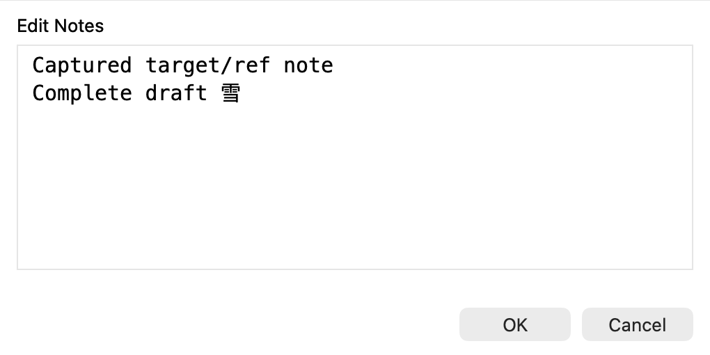
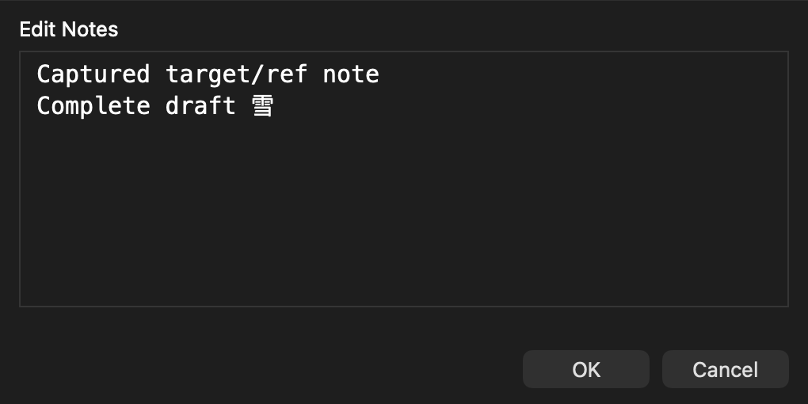

# Editing Git notes

Git notes add information to an existing commit without changing that commit.
TurtleGit displays them below the commit message in Log Messages.

1. Open Log Messages and select one commit.
2. Open its context menu and choose **Edit Notes**.
3. Edit the note. **OK** saves it; **Cancel** keeps the existing note.

Command-Return and Control-Return also save. Escape cancels. If your project
requires a minimum message length, OK is disabled until the note meets it.
Editing is unavailable for stash rows. The same editor is available from the
revision menus in RefLog, Rebase and Synchronization.

If Git's author or committer name or email is missing, choose **Yes** to open
Git Settings for this repository, or **No** to stop opening the editor. TurtleGit
checks the effective identity again after Settings closes. Environment overrides can satisfy this opening check. The actual note commit
uses configured **user.name** and **user.email** for both author and committer,
with the current time. If those configured values are missing, saving reports an
error and retains the draft.

The editor loads **core.notesRef**, or **refs/notes/commits** when no default is
configured. **GIT_NOTES_REF** does not replace this editor default. Additional
notes refs configured for Log display are not combined into the editable text.
It saves back to the exact ref captured when you opened the editor. Clearing the text saves an empty note;
it does not delete the note association. Notes are separate from the commit and
need their own fetch/push configuration; see the [Git notes manual](https://git-scm.com/docs/git-notes).

During saving, **Cancel** requests cancellation and waits for the owned Git
process to stop. The editor retains your draft after cancellation or an ordinary
write failure. A process can change the notes ref before reporting interruption:
if TurtleGit cannot establish the outcome, inspect the existing note before
retrying. If the app confirms that notes were saved but could not be refreshed,
the editor closes and reports that refresh failure separately. Refresh Log to
read them again. Refresh an existing Notes search after editing so its matches
are recalculated.

The native editor is shown below in light and dark appearance. These retained
layout captures do not certify every keyboard or signed deployment workflow.

The source comparison and remaining acceptance work are recorded in
[Edit Notes parity](EDIT-NOTES-PARITY.md) and
[Notes storage and owned editing](NOTES-BACKEND-PARITY.md).
