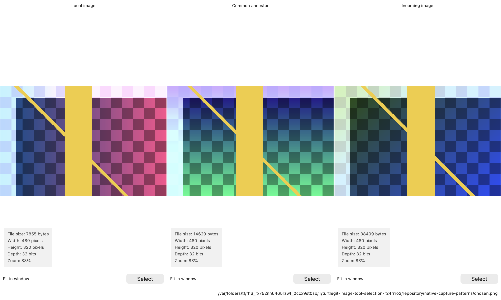
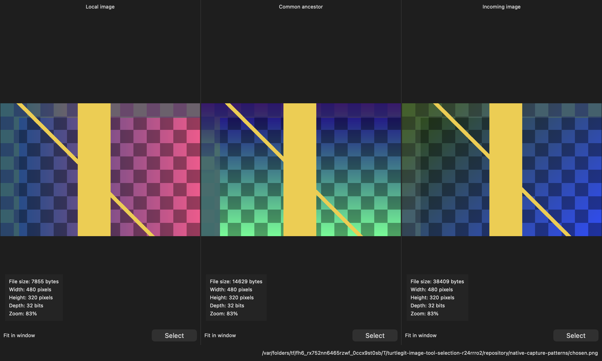

# Use TurtleGitIDiff with local images

TurtleGitIDiff compares local images and lets you select one of three inputs.
A Git repository is optional. Run the installed application through the waiting
[`scripts/turtlegit-idiff`](../scripts/turtlegit-idiff) wrapper, or invoke
`TurtleGitMac --image-tool` directly. The wrapper uses
`/Applications/TurtleGit for Mac.app/Contents/MacOS/TurtleGitMac`; set
`TURTLEGIT_APP` or `TURTLEGIT_IDIFF_EXECUTABLE` for a different local installation.
It forwards literal arguments and waits for the window and its owned work.

## Compare two images

```sh
scripts/turtlegit-idiff --left '/path/original.png' --right '/path/changed.png'
```

Two positional paths also work. Without files, the native **Load Images** dialog
lets you choose them. A Base-only request opens that chooser with the file seeded
as the left input, following the source entry route. Open replaces the current
comparison in its existing frame. **Left title** and **Right title** arguments
change captions while the real paths remain in the tooltips and permissions.
Use `--left-title`, `--right-title`, `--overlay`, `--fit`, `--fit-widths`,
`--fit-heights` or `--show-info` for the corresponding comparison presentation.
The [image controls guide](IMAGE-COMPARISON.md) explains zoom, blending, frames,
position linking and display colors.

## Choose one of three images

```sh
scripts/turtlegit-idiff \
  --base '/path/base.png' --mine '/path/mine.png' --theirs '/path/theirs.png' \
  --result '/path/result.png' \
  --base-title 'Common version' --mine-title 'My version' --theirs-title 'Incoming version'
```

The panes appear **Mine / Base / Theirs**. Each has its own **Select** button,
frame controls, zoom and information. Arrange vertical stacks those panes. The
source three-pane mode has no cross-pane position/dimension link, even though
its general command handler accepts those comparison flags. Overlay remains a
two-image comparison control.





These native content captures show the panes and output path; the window frame
and toolbar are outside the captures.

Select copies the complete captured input container to the result. Selecting a
frame of a GIF or TIFF does not export only that frame; WMF/EMF are copied as
original records, not as preview rasters. An existing empty or undecodable file
can still be selected as original bytes. A missing or unreadable side cannot.
Dropped images are previews; they do not retarget the source Select buttons.

Without `--result`, Select returns the chosen side without creating a file.
With a result, an accepted copy outside Git completes immediately. If an already
authorized repository contains unmerged stages for that result, TurtleGit asks
whether to mark it resolved. **No** keeps the copied file and the window open,
as upstream does. **Yes** stages that exact saved image without committing or
continuing a merge/rebase. A staging failure leaves the copied image available
with **Retry Mark as resolved**; retry validates the output and original
conflict stages without rewriting the image.

| Process result | Meaning |
| --- | --- |
| `0` | Comparison closed, chooser cancelled, or selection window closed without an accepted choice |
| `1` | Mine selected |
| `2` | Theirs selected |
| `3` | Base selected |
| `64` | Invalid request or startup/authorization failure; no accepted choice |
| `127` | Wrapper could not find the application executable |

These are selection-protocol values. Git mergetool's ordinary zero/nonzero exit
convention needs an adapter if you use this selection protocol directly.

## File access and replacement

The sandboxed app asks for the actual inputs and the folder needed for an
atomic result write. A file path or descriptive title grants no access. Closing
or cancelling a pending chooser/decoder keeps its authority owned until the real
work drains. A narrow output grant does not permit an upward Git search; if a
repository cannot be discovered within current grants, the image choice can
still complete without optional Git resolution.

Inputs and result snapshots are revalidated before publication. Outside changes,
replaced files and changed conflict stages require review rather than silent
overwrite. An explicit result matching an input path is supported: owned writes
advance that path's validation snapshot while each pane retains its originally
displayed bytes. Reload adopts current disk inputs. A distinct hard-linked result
is replaced atomically, preserving the other source names.

`--delete-inputs-on-close` implements the source temporary-input cleanup flag.
It removes only the originally captured, unchanged inputs after accepted work
has drained. Replaced or edited inputs remain. Cleanup cannot target an explicit
same-path result; choose a separate output for that combination. Regular-file
receipts currently refuse symbolic-link inputs/results. Partial two-role selection
requests and Windows HWND notification flags remain explicit unsupported cases;
use all three named inputs or the two-file comparison entry.
