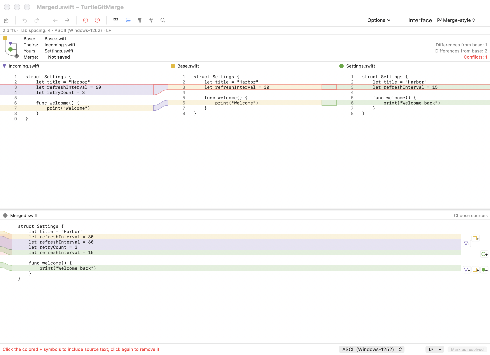

# Optional comparison and commit interfaces

Classic remains the default for both workflows. The saved application preferences
are `TurtleGit.Comparison.CurvedInterface` and `TurtleGit.Commit.GitGuiInterface`.
The comparison preference is shared by two-file and three-way text windows;
changing it does not replace the document or save a file. Commit's alternative
workspace uses the existing Git index and partial-patch backend, with an owned
embedded patch model retired when its window closes or interface changes.

## Source comparison

Pinned TortoiseGit baseline: `7338078f8ddd924b8cddee35f512f2286072136d`.
`src/TortoiseMerge/MainFrm.cpp::OnCreateClient` constructs the classic upper
source panes and lower result pane. That layout remains available.
`src/Resources/TortoiseProcENG.rc::IDD_COMMITDLG` and
`src/TortoiseProc/CommitDlg.cpp` retain the source's single-list staging toggle
and checked-file commit behavior in Classic. The new interfaces are intentional
Mac alternatives, not claims of additional upstream dialog parity.

The alternative Commit workspace reuses source status artwork, separate index
and working-tree snapshots, stale-patch checks, serial repository operations,
identity/hooks/preflight and owned progress. It shows staged and unstaged lists,
whole-file Stage/Unstage, line/chunk actions, message and Amend. It does not copy
Git Gui's menu system. Classic-only options remain accessible by switching back.

## Four-pane merge presentation

The comparison option now uses Theirs, Base and Yours in the upper band and an
editable result below. This corrects the initial side-by-side-result layout.
The native toolbar is replaced locally with a compact command row, source diagram,
file/merge status, whole-source choices, and a saved source/result divider.
Purple/yellow/green source shapes and pale bands follow Perforce's documented
scheme. Each source displays original lines; connectors use diff3's original
UTF-16 source ranges and TextKit glyph rectangles, including unequal blocks,
empty insertions and independent scrolling. Classic retains its original colors.

The pinned Subversion diff3 plan now retains each original change region and its
Base/Theirs/Mine coordinates. Result-region mappings carry ordered source choices
inside the existing undoable presentation. Inline buttons include/remove each
source independently, combine in click order, and avoid duplicating identical
payloads. Whole-file choices include Base. All choices, manual typing, Undo/Redo,
Save, read-only and operation ownership use the existing result editor workflow.
The compact toolbar, relative file labels, flat headers, compact filled/outlined +/−
source selectors and colored result flow gutter follow the reference screenshots.
An explicit display/serialized projection shows unresolved source alternatives
without Git marker lines. Save still reads the serialized conflict state. Editing
a candidate resolves only that engine region to its visible contents plus the
edit; Undo restores both the markers and candidate presentation.

Buttons capture the expected presentation so stale actions cannot replace newer
edits. Choices crossing an invalidated mapping are disabled instead of guessing.

References reviewed: [Perforce merge guide](https://www.perforce.com/manuals/v23.1/p4merge/Content/P4Merge/diff-merge.p4merge.html)
and its [four-pane screenshot](https://help.perforce.com/helix-core/server-apps/p4merge/current/Content/Resources/Images/p4v-merge-highlight.png).

## Native captures

Actual inactive native windows using disposable Swift input files:

[After including Theirs and Yours](site/assets/p4merge-style-light.png) ·
[Unresolved dark appearance](site/assets/p4merge-style-unresolved-dark.png)

## Remaining behavior and acceptance

- The layout, source colors and chunk-selection workflow follow the reference;
  not every P4Merge menu, syntax language, gesture or theme is reproduced.
- Unresolved result blocks use a lossless candidate projection and the existing
  save checks. Perforce's proprietary rendering and internal format are not used.
- Edits crossing engine-region boundaries can invalidate exact selection maps.
  Those source choices are disabled until Undo/reload restores the map.
- The source panes scroll independently, with actual connectors and shared
  previous/next-region navigation. Very dense overlapping chunk controls do not
  yet provide Perforce's expandable compact selector.
- Full physical keyboard, VoiceOver, multi-display resizing and signed App Store
  acceptance remain open. Focused local checks do not prove full hosted CI.
- Commit issue-provider, author/date and branch options use Classic; the alternative
  intentionally presents a smaller set of commit controls.

See [getting started](GETTING-STARTED.md) and [merge tool](MERGE-TOOL.md) for use.
