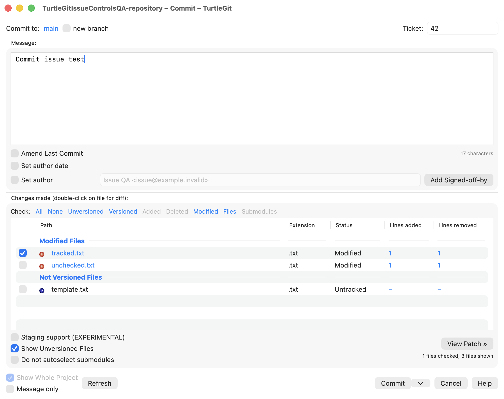
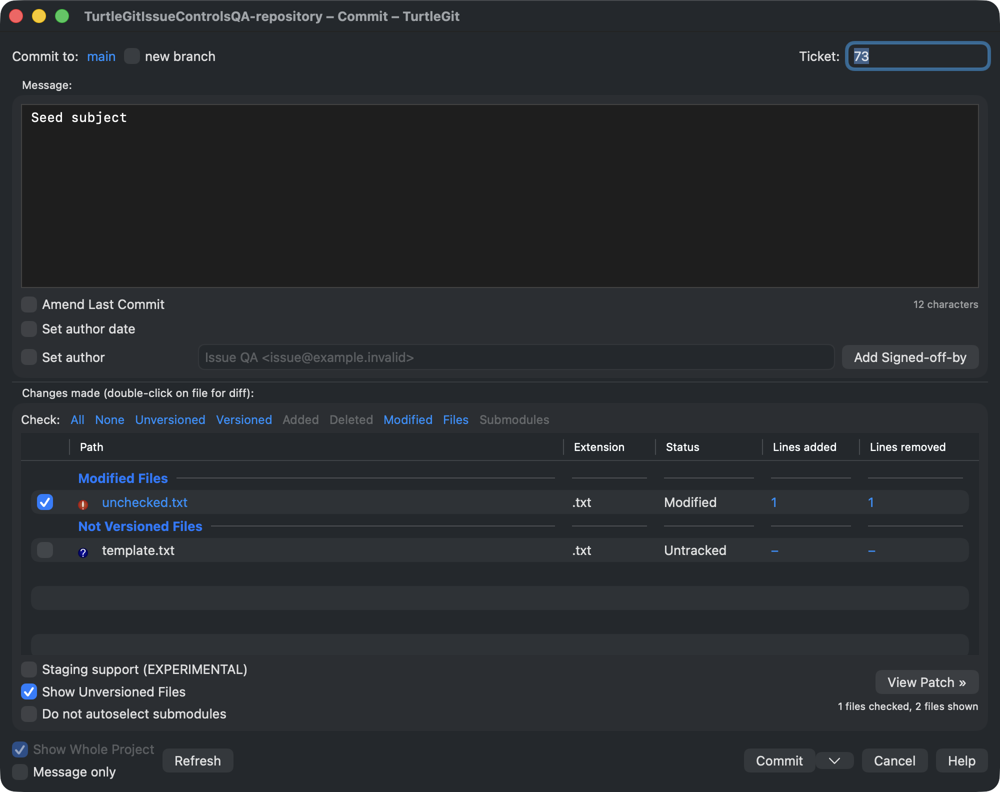
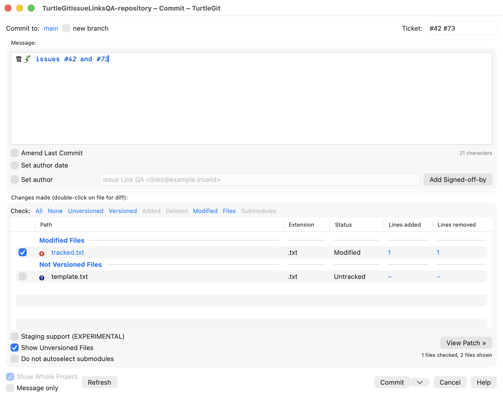
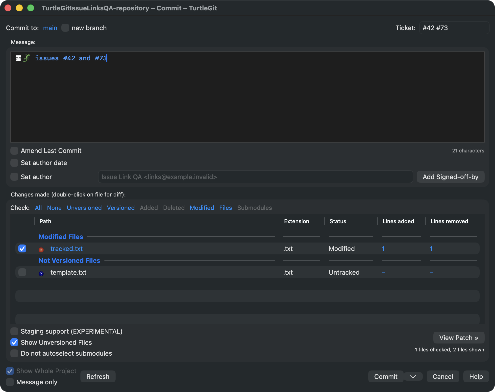
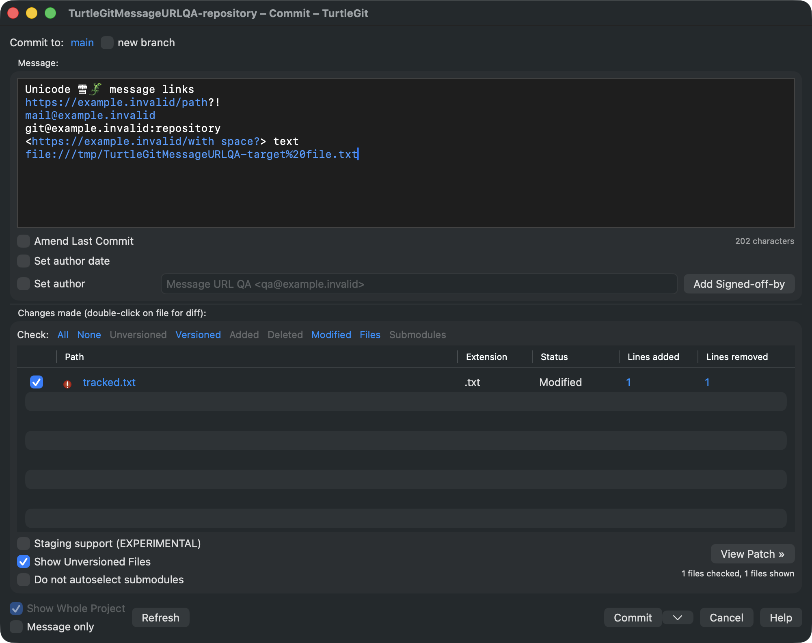
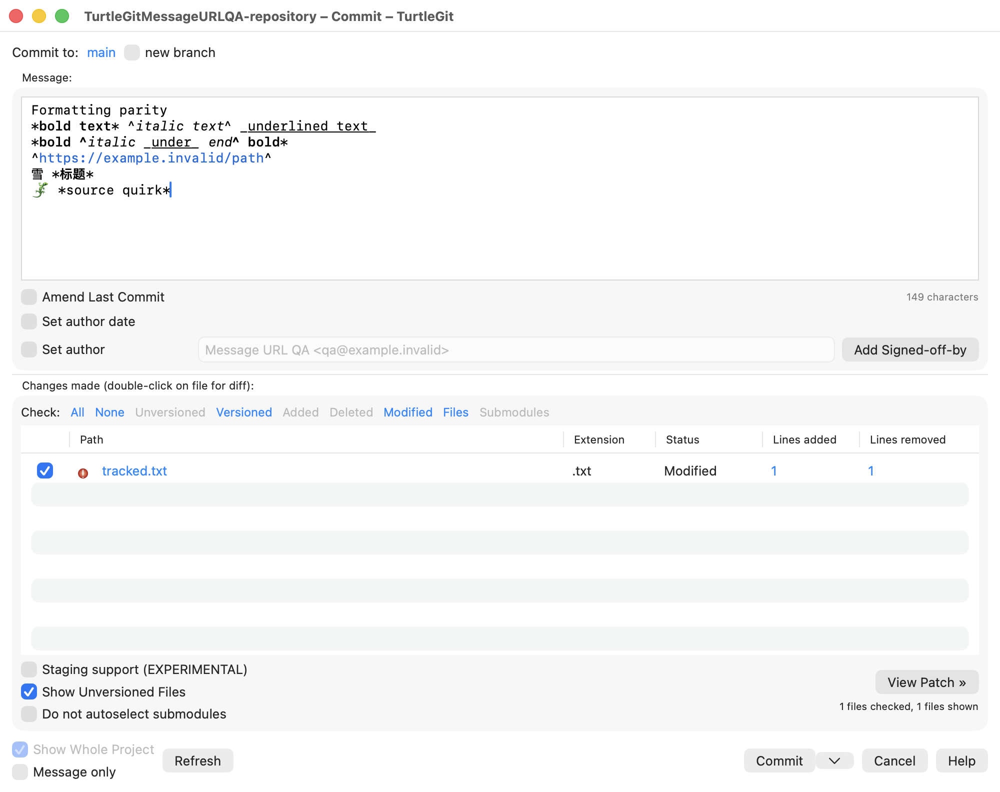
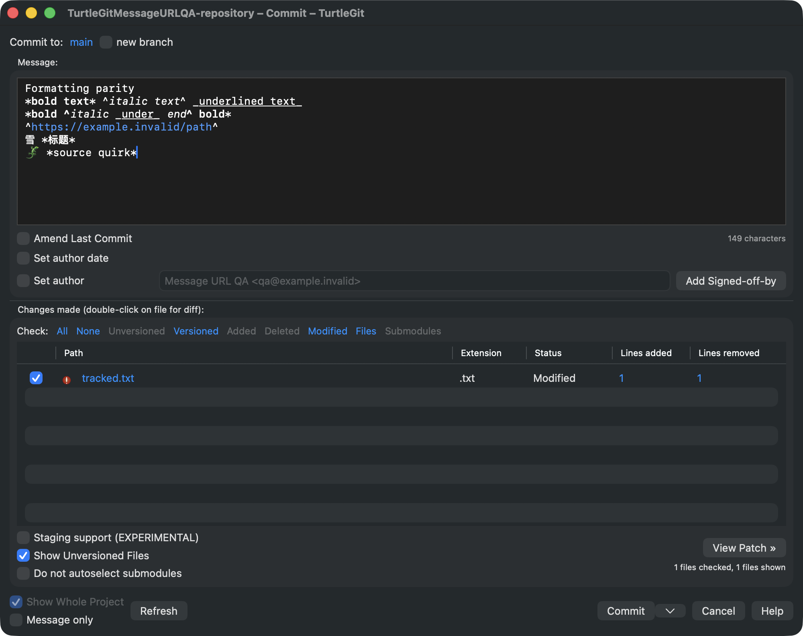

# Issue tracker integration audit

The pinned TortoiseGit baseline is
`7338078f8ddd924b8cddee35f512f2286072136d`. The audited files are
`src/TortoiseProc/ProjectProperties.cpp`, its header, and
`test/UnitTests/ProjectPropertiesTest.cpp`. Their Git blob hashes match the
repository inventory. The native Commit field, configuration loader, template
line handling and warning sequence are implemented, with broader integration
and signed sandbox acceptance still pending.
Build, process, source reconstruction and signing evidence is recorded in
[runtime acceptance](qa/issue-regex-runtime-2026-10-05.json).

## Matching engine

Upstream `FindBugIDPositions` uses C++ `std::wregex` with its default ECMAScript
grammar. One expression extracts capture group 1. Two expressions use the
complete second-expression matches inside each complete first-expression match.
A captureless first expression can satisfy `HasBugID` while extracting no IDs.
`HasBugID` searches only the first expression. UTF-16 character positions are
required by the Windows source and by native `NSString` ranges.

TurtleGit retains this C++ algorithm in `Sources/TurtleGitIssueRegex/main.cpp`.
macOS has 32-bit `wchar_t`, so the transport stores one UTF-16 code unit per
wide character. A private helper process receives three UTF-16LE files and
returns match presence and UTF-16 ranges. The Swift reader validates those
ranges. Inputs are argument arrays without a shell; diagnostic text is limited
to 1024 bytes. A shared runner bounds execution to five seconds plus a
one-second termination grace and forcibly reaps its own unresponsive process.
EditorConfig now uses the same runner. Excessive helper output is rejected.

The helper reports malformed expressions as an explicit failure. Upstream
silently catches compilation failures and may retain previously compiled
expressions. This error-state behavior is not yet mapped in the native property
loader. Matching grammar and UTF-16 positions are retained; libc++ versus MSVC
locale, character-class, pathological-expression and exception differences
still need cross-platform acceptance. No Foundation/ICU regex substitution is
used.

## Build and distribution

Run `python3 scripts/build-issue-regex-runtime.py` before Swift tests or a direct
Xcode build. CI and `scripts/build.sh` prepare it automatically. All Xcode
configurations embed `build/issue-regex-runtime/IssueRegex` at
`Contents/Helpers/IssueRegex`. The generated project includes the new Swift
reader and shared runner. The package contains the complete helper source,
GPL license, reconstruction and validation scripts, and source/binary hashes.
Only system dynamic libraries are linked; no Homebrew C++ runtime is required.

The validator checks both architecture slices and their macOS 13 load commands,
source correspondence, licenses and functional protocol examples. Add
`--all-architectures` to execute arm64 and x86_64 explicitly; Apple Silicon
requires Rosetta for the latter. This does not prove execution on an actual
Intel Mac or macOS 13 host.

AppStore signing applies only App Sandbox and sandbox inheritance to this
helper. Debug/Release use ordinary hardened-runtime signing. The unsigned
package is executed before signing; inherited sandbox signatures and
entitlements are inspected afterwards. Running an inherited helper directly
from unsandboxed Python does not prove signed app invocation and is skipped.
Debug preview signing updates both text-helper hashes and reseals the app.
Signed native App Store execution and scoped configuration access remain
unverified.

## Native Commit controls

`IssueTrackerProperties` reads Git's system/global/XDG values, overlays the
working tree's `.tgitconfig`, then overlays repository configuration. Native
Git worktree and command scopes remain higher priority on macOS. Includes use
Git's parser and relative file paths. A bare repository reads `HEAD:.tgitconfig`.
The configured label and issue field appear in the upper-right branch row, as
in the upstream resource at x=177/249, y=6/3; absent `bugtraq.message` hides them.
Initial issue focus and template-line extraction were verified in dark mode.

Numeric IDs accept only ASCII digits, commas and spaces. Template extraction
uses UTF-16 positions and trims only LF, including leaving CR from CRLF intact.
Message insertion trims the field, performs the upstream comma-space
replacement, avoids duplicate IDs and honors append/prepend. URL component
escaping is implemented and tested; native tracker links are described below.
Foundation supplies numeric comparison for natural ID ordering; full
`StrCmpLogicalW` locale/punctuation/equivalent-ID behavior is not proven.

Commit checks missing issue ID, exact unedited template, and missing identity
sign-off in that order. Each warning completes before committing or modifying
the index. Add Signed-off-by and the warning use the same identity and trailer
placement. Template comparison retains the upstream exact-text behavior:
extracting a template line trims trailing LF, which can change equality with
the original template. This source quirk is not normalized away.

Native No/Abort and numeric rejection retained HEAD and raw index bytes. A
real checked-file commit added the exact configured sign-off and `Refs: 42`
line, committed the latest selected contents, and preserved unchecked staged
and working versions. The field seeded `73` from a template and received
initial focus in dark mode. All QA apps were closed. Twenty-eight focused
Commit/issue/message tests and both unsigned app builds/resource audits passed.
See [control acceptance](qa/commit-issue-controls-2026-10-05.json).

## Message highlighting, links and history

`SciEdit.cpp` and its header were verified against inventory blobs
`5d221b688a02e72bf8b5ef0a9e260f9aa2a3fc7e` and
`0c26375d84d7d27b111a5759af820d9058da9b6e`. `MarkEnteredBugID` uses
narrow C++ ECMAScript regexes over UTF-8 bytes, unlike the UTF-16 validation
matcher. The bundled helper now retains that separate styling algorithm.
Single-expression capture 1 becomes the identifier; its preceding matched
context is bold. Two-expression matching styles complete inner matches and
surrounding context. Identifiers are bold italic hotspots. Adjacent equal
styles merge before resolving the link, matching Scintilla's contiguous style
scan. No simple-template styling fallback is invented.

AppKit maps complete UTF-8 scalar boundaries to UTF-16 attributed ranges,
using dynamic link colors and plain base typing attributes. Partial UTF-8
scalar ranges cannot be represented by AppKit and are omitted. Styling is
serialized off the main thread, debounced and canceled when superseded; stale
results do not replace newer text. Attribute updates preserve selection and
Undo registration. Native link activation follows the configured URL with
UTF-8 component escaping, and tooltips contain the resolved URL.

Recent messages matches `CommitDlg.cpp`'s prefix gate and updates a visible
issue field only when the chosen message yields nonempty IDs. A message with
no IDs retains the prior field. Pick commit message and ordinary typing only
insert text; they do not update the issue field. History matching uses the
wide validation algorithm, not the editor's byte matcher.

Native acceptance verified bold/italic ranges after Unicode prefixes, ordinary
link clicks opening the exact percent-escaped local QA target, retained Undo,
Recent-message field updates, no-ID retention, revision-picker retention and
removal of stale link attributes. Actual light and dark captures are below.
HEAD, raw index and working contents were unchanged. One QA app ran at a time;
all were closed after testing. See [recorded evidence](qa/commit-issue-links-2026-10-05.json).

Full-message native restyling does not yet reproduce every incremental
Scintilla anchor/styling state. Tracker providers, spell checking, snippets
and the remaining SciEdit functionality are pending. URL/email matching
is described below.
Signed inherited-helper invocation remains unverified. Native link dispatch
uses Apple's [NSTextView delegate](https://developer.apple.com/documentation/appkit/nstextviewdelegate/textview(_:clickedonlink:at:)).

## Ordinary URL and email links

The verified `src/Utils/URLFinder.h` blob is
`069cadee1eacb70a6d46ebeaf0933e76c8a3430d`. Its `FindURLMatches` scanner is
ported in `MessageURLFinder.swift`, using the same ASCII delimiter set,
trailing punctuation removal, angle-bracket mode and supported case-sensitive
prefixes: HTTP, HTTPS, Git, FTP, file and mailto (their lowercase spellings).
Email targets receive `mailto:`. Git SSH addresses containing a colon after
`@` are not email links. Bracketed URLs retain spaces and Unicode, with native
UTF-16 ranges advanced by complete scalars, matching SciEdit's byte traversal.
The scanner retains the upstream bracket-at-end-of-text quirk.

The Windows `PathIsURL` gate is adapted using scheme syntax before the original
prefix whitelist. Microsoft's [API documentation](https://learn.microsoft.com/en-us/windows/win32/api/shlwapi/nf-shlwapi-pathisurla)
describes URL-format testing but does not define every unusual scheme case.
Those cross-platform classification edge cases and non-ASCII CRT character
classification remain unverified; Foundation link guessing is disabled.

`SciEdit::StyleURLs` follows issue styling. Native composition therefore
splits issue runs at ordinary URL boundaries and resolves any remaining ID
hotspot from its actual visible substring. Ordinary links use the regular
font and dynamic link color; issue context and IDs keep bold/italic styles.
When issue matching fails during typing, ordinary links can still appear,
while Commit validation continues reporting configuration failures.

The upstream `AppUtilsTest.cpp` fixtures were verified at blob
`c2db167dc2893395ba497ba030d1a0e78b22bf6c`. Their complete URL range examples,
plus Unicode, punctuation, email/SSH gates and issue-style overlap tests pass.
Native acceptance without any tracker configuration verifies plain-font links,
Undo, removal of stale links, and a normal click opening the exact local file
with a percent-escaped space. HEAD, raw index and working contents remained
unchanged. The sole QA app quit normally; only its TextEdit QA document was
closed. See [URL acceptance](qa/commit-message-urls-2026-10-05.json).

## Marker formatting and preference

`SciEdit::StyleEnteredText` and `FindStyleChars` now map to
`MessageFormatting.swift`. Only the contents of valid `*bold*`, `^italic^`
and `_underlined_` spans receive formatting; marker characters remain literal.
Matching is per line, requires alphanumeric text beside the marker, and rejects
markers inside ordinary words. Bold, italic and underline passes overwrite
rather than combine traits, following the source order. Issue styles precede
these passes; ordinary URL styles follow them. Overwritten issue hotspots are
split before resolving their visible identifier text.

`StyleCommitMessages` is enabled by default, as in the pinned
`SettingsAdvanced.cpp` blob `1b222ebf9053e0e902f79413899dc92d35071464`.
The macOS Commit settings tab exposes it and restyles open drafts when changed.
Disabling it leaves issue/URL links active and does not change the draft or its
Undo history. The native setting is saved in the app's defaults; the remaining
upstream Advanced settings are not implied complete by this one mapping.

The source increments a scalar counter while indexing a UTF-16 CString for
word classification. That supplementary-character boundary quirk is retained:
`雪 *标题*` styles its BMP text, while `🦎 *bold*` can remain plain. Native ranges
still use actual UTF-16 offsets. Null terminators and line boundaries stop a
match. Windows [IsCharAlphaNumericW](https://learn.microsoft.com/en-us/windows/win32/api/winuser/nf-winuser-ischaralphanumericw)
uses the user's language semantics. Native letters/decimal-digit character
sets are an adaptation; exact locale-dependent Windows classification needs
cross-platform acceptance. Incremental Scintilla state is still pending.

Fifteen focused formatting/URL/issue tests pass, including nested precedence,
word boundaries, CR/LF, BMP/supplementary text, null termination, disabled
formatting and URL overrides. Native preference toggling, retained Undo and
both appearances passed. Editor/preference changes preserved HEAD/index/working
contents, and a subsequent real disposable commit retained the entire literal
message and selected working contents. The QA app quit normally. See
[formatting acceptance](qa/commit-message-format-2026-10-05.json).

## Remaining Commit behavior

- Validate XDG/system includes, conditional includes and scoped ancestor access
  in a signed app, and review CLI versus libgit2 precedence differences.
- Verify exact Windows natural ID ordering, incremental styling anchors, unusual
  Windows scheme classification, spell checking and other SciEdit editor behavior.
- Audit Windows tracker-provider plugins and define the macOS equivalent.
- Compare native light/dark Commit layouts and all controls with upstream;
  exercise scoped/signed builds, hooks, message-only and ReCommit/Push combinations.

See [Commit parity](COMMIT-PARITY.md) for the broader dialog audit. Original
source references are [ProjectProperties.cpp](https://github.com/TortoiseGit/TortoiseGit/blob/7338078f8ddd924b8cddee35f512f2286072136d/src/TortoiseProc/ProjectProperties.cpp)
and the [official integration manual](https://tortoisegit.org/docs/tortoisegit/tgit-dug-bugtracker.html).

## Native Bugtraq Regex Tester — 2026-10-12

Ported BugtraqRegexTestDlg.cpp/.h and IDD_BUGTRAQREGEXTESTER's control order:
editable source sample above Message part expression and Bug-ID expression,
then OK/Cancel. The sample is the pinned source resource. The native text view
uses the shared log font, UTF-16 issue runs, system light/dark issue colors and
underlining. Its plain-text Cut/Copy/Paste/Select All context menu honors app icon
preferences, using the original Copy icon and macOS symbols for the other editing
actions. Native clipboard injection keeps QA separate from the general clipboard.

The existing C++ ECMAScript helper validates and extracts matches off the main
thread; no ICU/Foundation grammar replaces it. An empty first field still
validates the second field while producing no issue runs. Invalid edits report
the helper error and restyle current sample text with the last valid expression
pair, retaining source behavior rather than publishing old offsets for new text.
A debounce, captured generation and cancellation token reject superseded or
retired results even when an injected provider ignores cancellation. Active
matcher requests fence app Quit until they finish; closing cancels owned work.
OK returns trimmed expressions once, including source-style acceptance of an
invalid draft, and Cancel/closure return no draft once.

The File-menu utility seeds from the current repository's existing issue
properties, or starts empty without a repository. It explicitly does not persist
configuration. The reusable controller's result callback is ready for the missing
Issue Tracker Settings page; that page and parent Apply integration are still
open. File-menu configuration seeding and signed grants are compiled/wired but
not native-dispatch acceptance. The tester is partial-native-replacement, not
certified complete. Field-specific invalid-regex adornment, complete SciEdit
commands/spelling, physical focus/keyboard/layout and signed invocation remain
open. The original C++ engine's libc++/MSVC edge differences also remain open.

The first Debug build failed on a main-actor model used as a default argument.
Construction now occurs inside the controller initializer; the corrected build
exited 0. XcodeGen initially regenerated unrelated manual references and omitted
the app's existing exported diff type; those changes were restored, and the
checked project adds only four new source references. The generator spec now
also retains the existing diff type, verified with resolved JSON versus the
Info.plist. No new type or document behavior was introduced.

The object-linked native receiver passed, then an expanded native Cut/Paste check
also passed. Total: two receiver compilations/processes, both reaped. Checks cover
the real sample control/highlight/private clipboard/menu icons/light-dark hosts,
single/two-expression real-helper matching, Unicode/UTF-16 positions, invalid
recovery/current-text fallback styling, empty-first-field validation, trimmed
OK/Cancel, ignored-cancellation late-result/newer-preview/retirement fences and
Quit accounting. Core was unchanged and was not rerun; neither the complete
eighteen-family group nor physical/signed UI was exercised. No screenshot is
claimed. See `qa/issue-regex-tester-native-2026-10-12.json`.

## Scoped Issue Tracker Config and tester Apply — 2026-10-12

Ported SettingsBugtraqConfig.cpp/.h and IDD_SETTINGSBUGTRAQ_CONFIG's source group/
field order: Effective/Local/Project/Global/System, BugTraq URL/warning/message/
append/label/number/logregex, inheritance controls, IBugTraqProvider win32/x64
UUIDs/parameters, and Save to. The Settings tree now has Issue Tracker Config
with the original bugtraq.ico, copied byte-for-byte with SHA-256/Git blob metadata.
The source UI label `bugtraq.warningifnoissue` writes its actual source key
`bugtraq.warnifnoissue`. Effective is read-only; stored scopes retain missing
versus explicit-empty values and inherited booleans. Windows provider data is
preserved but does not execute COM providers on macOS. The associations/provider
integration dialogs remain unported. System is readable/copyable here; privileged
system-file saving remains unsupported, like the existing native project pages.

Core shares scoped project read/write primitives with Dialogs 3, preserving
.tgitconfig, includes, bare HEAD reads and source-ordered per-key writes. Saves
affect only known BugTraq keys, retaining other Git settings and include files.
Regex CRLF converts to LF when stored. Writes preflight destination/NUL values,
use Git locks and report the failed key; multi-key writes are not atomic and do
not promise stale-snapshot protection. Commit's existing property reader consumes
the stored values without a second configuration representation.

The page owns its Regex Tester and captures the source generation. Duplicate
opens, source changes and Apply are blocked while the child is active. Tester
OK returns trimmed expressions into the page draft without saving; tester Cancel
leaves the draft unchanged; shared Cancel restores the prior saved fields and
destination. Parent retirement closes its child and owned permission/confirmation
sheets, cancels reads and fences late replies. Hidden-page Apply captures the
destination/draft and does not restore active state after retirement. Authorized
source-ordered writes may finish after forced closure; presentation is fenced.
Global file access and destination-change confirmation use the existing native
permission workflow. Saves are counted for page-switch/close/Quit guards.

Validation: three focused Core tests passed, zero failures, 2.157 seconds. They
cover scoped round trips/consumer settings, include/unrelated-key preservation,
explicit-empty strings/implicit and empty booleans, regex newline normalization,
Project/bare reads, invalid destinations/NUL/cancellation and a shared Dialogs
reader/writer regression. Debug builds exited 0 before and after the source icon
addition; the first emitted an existing exit-zero/no-output SwiftCompile
diagnostic, so this is not a clean diagnostics claim.

Native page checks passed with system and bundled Git, then passed again with the
added icon decode check: two cached receiver compilations, four owned processes,
all reaped. Actual private Git/shared Settings Apply and Commit reading, Effective/
stored inheritance, destination-only Cancel/copy, owned tester OK/Cancel/draft-only/
duplicate/source gates, light/dark hosts, validation and held-save retirement/
Quit fencing passed. No plugin, general clipboard or user config was touched.
No full Core/nineteen-family group, physical UI or signed grants were exercised.
The resource is partial-native-replacement, not certified complete. See
`qa/issue-tracker-settings-native-2026-10-12.json`. Physical focus/layout/help,
no-repository/signed permissions, source plugin association/effective registry
fallback, system saving and complete tracker integration remain open.

## Displayed light/dark capture review — 2026-10-12

Four compositor captures now show the actual Issue Tracker Config page and Regex
Tester in Aqua/Dark Aqua. The Settings page uses a dedicated native host and shared
transaction footer; the full Settings navigation tree is absent. Private draft
values and the original source sample were used; the matcher is the actual C++
helper. No screenshot pixels were generated, edited or reconstructed.

Reviewed the final captures against the pinned Windows
`doc/images/en/SettingsIssueTrackerConfig.png` and both resource layouts. The
source scope order, BugTraq field order, inheritance/boolean controls, regex/Test,
provider group, Save-to and tester sample/expression/button order are present.
Native rounded controls, system sizing/spacing and the provider-availability
caption differ intentionally for macOS. The native page is scrollable and its
standalone capture is wider than the source page. These images do not establish
full navigation, minimum-size/focus/keyboard, field-specific invalid adornment,
help, plugin or signed behavior.

AppKit cacheDisplay first produced incomplete SwiftUI/black captures; those were
rejected and are not published. A compositor pass was readable but inactive, so
the final pass explicitly activated only the owned windows and cleared field
focus. All four final images were viewed and inspected before copying unchanged
to the site. Four capture-only receiver compilations/processes ran during this
render/visual repair, all exited 0 and were reaped; all owned windows/helper work retired.
Visual review also removed repeated placeholders from empty fields, retaining
accessibility labels and matching the source blank boxes. Its Debug build exited
0 and the displayed captures were refreshed and reviewed. No Core or behavioral
suite was rerun for this presentation-only change. The optional capture case is
excluded from the default CI group and requires local window-capture permission.
See `qa/issue-tracker-captures-2026-10-12.json` for final dimensions and hashes.

The [shared hotspot interaction family](MESSAGE-LINK-INTERACTION-PARITY.md) now
owns editable link activation and captured icon menus across Commit, Merge,
Rebase and Input/Notes/Description. It records the source's dormant relative-root
helper instead of inventing a remote mapping. Existing byte styling/escaping is
unchanged; physical/signed acceptance remains partial.

The [hierarchical settings lifecycle batch](CONFIGURATION-LIFECYCLE-PARITY.md)
adds shared read/Quit ownership, Dialogs 3 save ownership, captured confirmation
context and owning hierarchy-hint preferences. Its
[grouped checkpoint](qa/configuration-lifecycle-2026-10-15.json) records native
checks and the remaining physical/signed scope.
