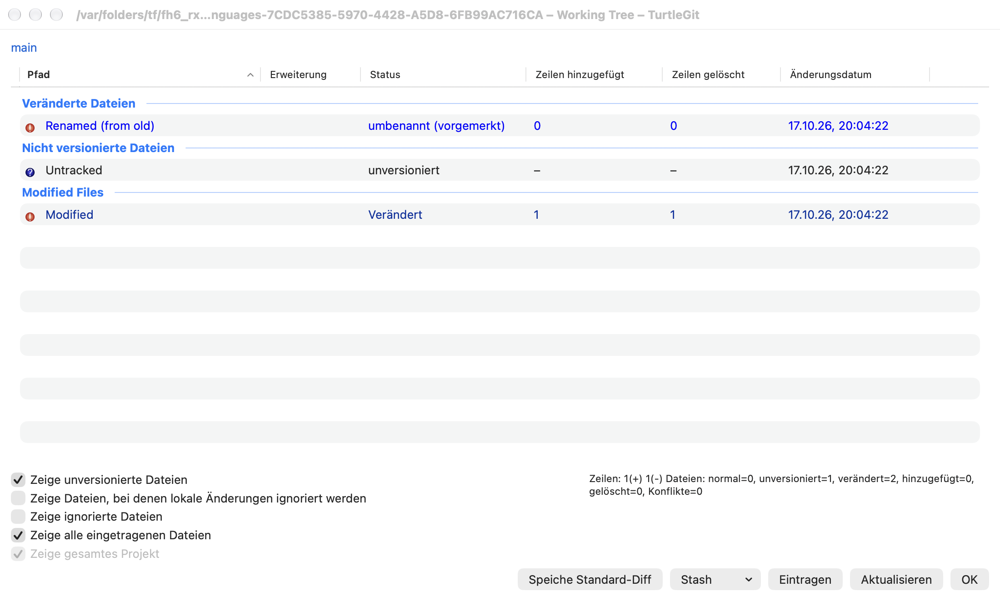
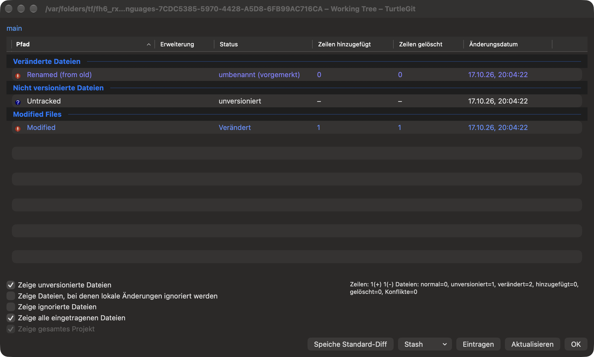
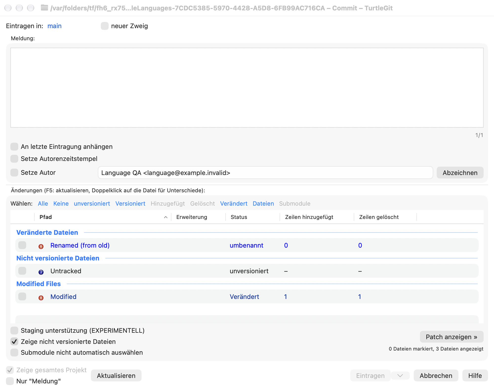
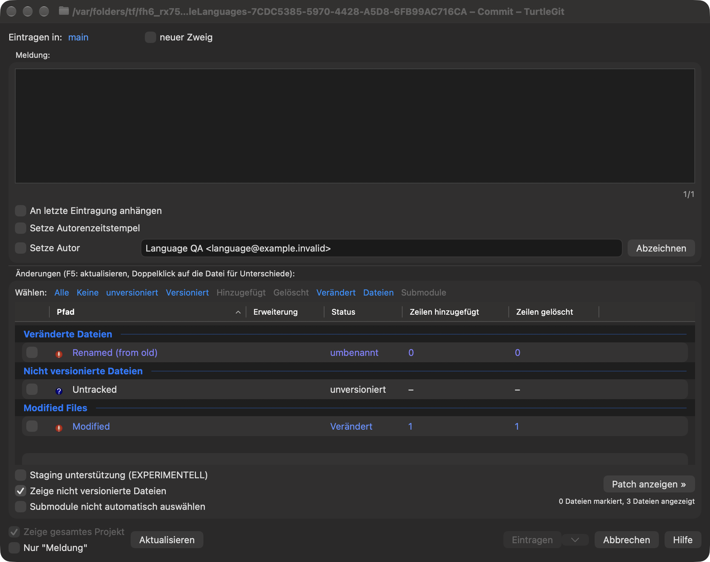

# Languages

Choose **Settings → General → Language**, then **Apply**. Restart TurtleGit to
apply the language throughout the app. **Cancel** discards an unapplied choice.
**System Language** follows macOS; choosing it removes TurtleGit's own language
override. These preferences belong to TurtleGit and do not change your system or
Git configuration.

The First Start Wizard offers the same bundled languages. **Next** saves its
language page. As with other wizard pages, cancelling a later page keeps that
saved choice. Unlike Windows' separate TortoiseGit processes, this native app does
not relaunch itself and discard other open windows after a language change.

English and 37 source translation catalogs are bundled. Language names appear in
their own language with an English description. They cover matching TortoiseGit
labels, including common buttons, checkboxes and command captions. Coverage varies:
Mac-specific wording, dynamic messages and remaining native AppKit captions can
still appear in English. This is partial localization, not a claim that every
window is fully translated. Git commands, repository/reference names, filenames,
user text and server diagnostics are not translated as labels.

Missing, fuzzy, ambiguous, plural and formatted source entries use English until
they have a reviewed native adapter. German includes a small set of Mac-specific
setup/navigation translations. No Windows language DLL is loaded or installed;
additional translations arrive with app updates. Bundled Help remains English.

For contributors, `python3 scripts/build-localizations.py --write` generates the
String Catalog, locale identifiers, manifest and retained translator notices from
the pinned upstream PO blobs. `--check` verifies the same artifacts without
changing them. `Configuration/NativeTranslations.json` contains reviewed native
wording adaptations. The app bundle audit checks all compiled locale tables and
English fallback. The SwiftPM executable is an unbundled development entry point;
localized distribution uses the Xcode app.

## File-list captions and columns — October 17, 2026

Dynamic status cells now use the compiled catalog in Commit, Working Tree,
workspace overview, Log changed files, revision comparisons, Rebase conflict
lists and Synchronization file lists. The shared status/Resolve and comparison
clipboard formatters receive the same bounded caption adapter. Column headings
in copied tables are translated; path-only copies retain literal paths. LFS
clipboard headings use the same column captions. Source/status model values,
Git action letters, row IDs, sort keys and saved column identifiers remain stable.
Repository paths, references, lock owners, user text and server diagnostics are
never submitted as file-list labels, even when a path is named `Modified`.

Fixed AppKit headers in Add, Add/Revert/LFS progress, Log/Sync history tables and
the patch file panel now request their existing translations. Native header
menus display translated column names. Column discovery resolves unambiguous
localized captions and retains the existing declared-order fallback; native
column objects retain their semantic identity across layout restoration. A
translated Copy to Clipboard parent still receives its current-column command.
Its column caption uses the same catalog. This does not certify every AppKit menu
or alert caption in the app.

The pinned `CTGitPath::GetActionName` and GitStatusListCtrl use resource-backed
status/action labels. The native catalog uses explicit spelling aliases:
`Renamed` from `renamed`, `Untracked` from `Unversioned`, and `Skip-worktree` from
`skip-worktree`. Metadata headers also use `Last modified` from `Modification date`
and `File size` from `Size`. They retain native English keys and source translations, without
general case folding. Ambiguous/fuzzy/missing translations still fall back to
English. Reviewed German/French native wording covers type changes, the
assume-unchanged flag, staged qualifiers and the column prefix. Other languages
can retain English for these Mac-specific phrases.

[Batch evidence](qa/file-list-languages-2026-10-17.json) records the affected
Core serialization contracts, actual native controls, compiled language processes,
source provenance and owned process cleanup. Physical clipboard/menu tracking,
all locales, RTL, full status sorting/source variants, VoiceOver and signed
sandbox/installed Finder acceptance remain open. No hidden Windows
KeepFileListsEnglish control is activated: the pinned resource hides it and the
source has no consumer.

The earlier [status-caption evidence](qa/file-list-languages-2026-10-17.json)
retains that checkpoint's captures. The current group/count captures below
supersede its English group, metadata and count limitations within this scope.

## Group, selection and count continuation — October 17, 2026

Commit and Working Tree now translate built-in group headings through their
semantic group role. User changelist names, including `Modified Files`, remain
literal. Both the drawn native heading and its underlying SwiftUI/accessibility
caption follow that rule. Group IDs, selection and Git path membership are
unchanged. Quick-check buttons and the Commit menu now request their label
translations; All/None, Shift inversion, icons and command ownership are retained.
The native Commit menu is placed before macOS's semantic Window/Help menus even
when their captions are translated.

Commit's checked/shown and staged/unstaged summaries, plus Working Tree's source
line/action totals and visible-file tooltip, use named integer templates.
`Configuration/NativeTranslations.json` supplies reviewed German/French forms.
Translation fields can be reordered, but omission, duplication, invented fields,
malformed braces and printf-style substitutions are refused by generation. The
runtime independently falls back to the English template for invalid fields.
Only integer values are substituted in one pass. Checked/shown text selects
English singular/other forms for each count; staged text distinguishes a single
unstaged file. This is not a complete CLDR/plural port across all languages.

The original totals, including the pinned normal-count behavior, are preserved.
Type-specific metadata headings reuse their reviewed source labels. The patch
and partial-staging controls now localize their dynamic captions; their actions
and right-hand staging window behavior stay the same. Other untranslated native
messages and full physical/RTL/VoiceOver/signed acceptance remain open.

[Continuation evidence](qa/file-list-groups-languages-2026-10-17.json) records the
Core format contracts, converter validation, native command and counter checks,
source provenance, actual captures and receiver cleanup.

These unaltered German light/dark captures show translated built-in groups,
selection links, counters and metadata headings. The English group `Modified Files`
is a deliberately named user changelist; filenames also deliberately retain English.
Other untranslated messages and full application parity remain separate work.

## Finder command-language handoff

The Finder extension now bundles the same compiled source catalogs as the app.
General Apply and First Start language acceptance publish the selected language
with the existing Finder menu preferences. Returning to System Language removes
only the app override and makes Finder resolve its system language order. Each
new menu resolves the selected `lproj` explicitly, so an already running extension
can adopt an accepted choice without relying on its cached `Bundle.main` language.
A shared-write failure leaves the General choice unapplied for Retry; unsigned
builds without App Group access still save the local app choice. App startup
publishes the accepted choice again. Older shared settings without a language
field retain System Language; unknown identifiers use that same fallback.

Ordinary, creation, LFS, ignore and clipboard commands use semantic caption keys.
The marked-comparison prefix and validated ignore-count templates are translated
without interpreting the path or filename as a format string. Actual filenames,
extension masks, repository paths, URL payloads, menu order and source icons stay
literal or retain their existing command identity. Context Menu Apply/Cancel uses
the latest General language rather than restoring an older page draft. Badge
accessibility captions are registered again after a language change.

Missing source labels still fall back to English. These are native menu-builder
and resource checks; activation, distributed notification delivery and badge
announcements in a signed installed Finder extension remain release gates.
