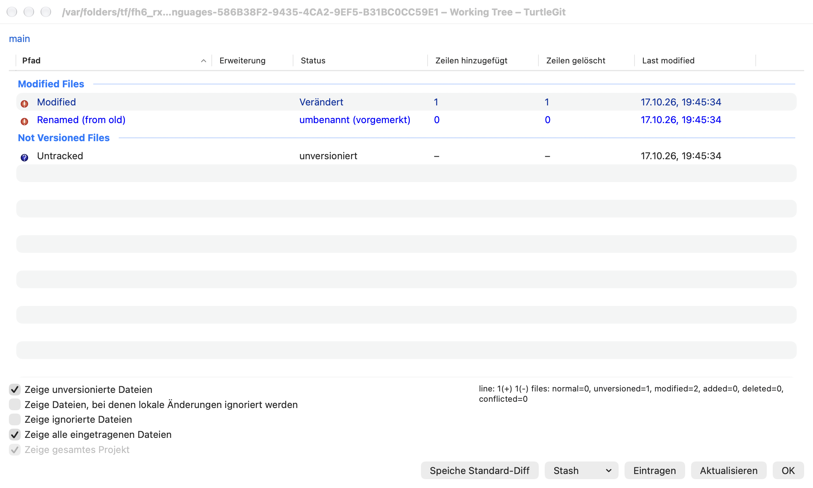
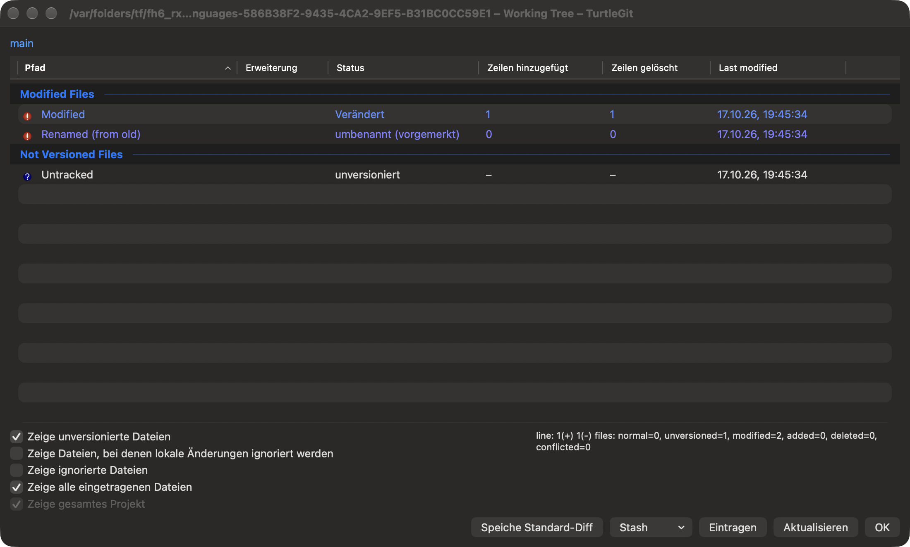
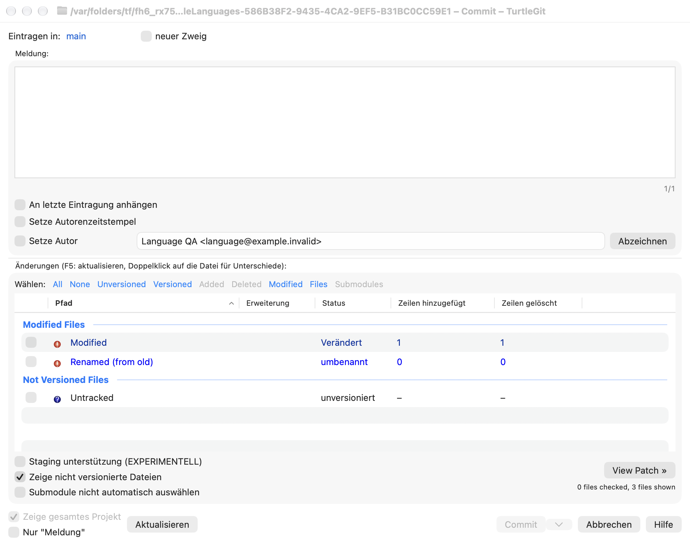
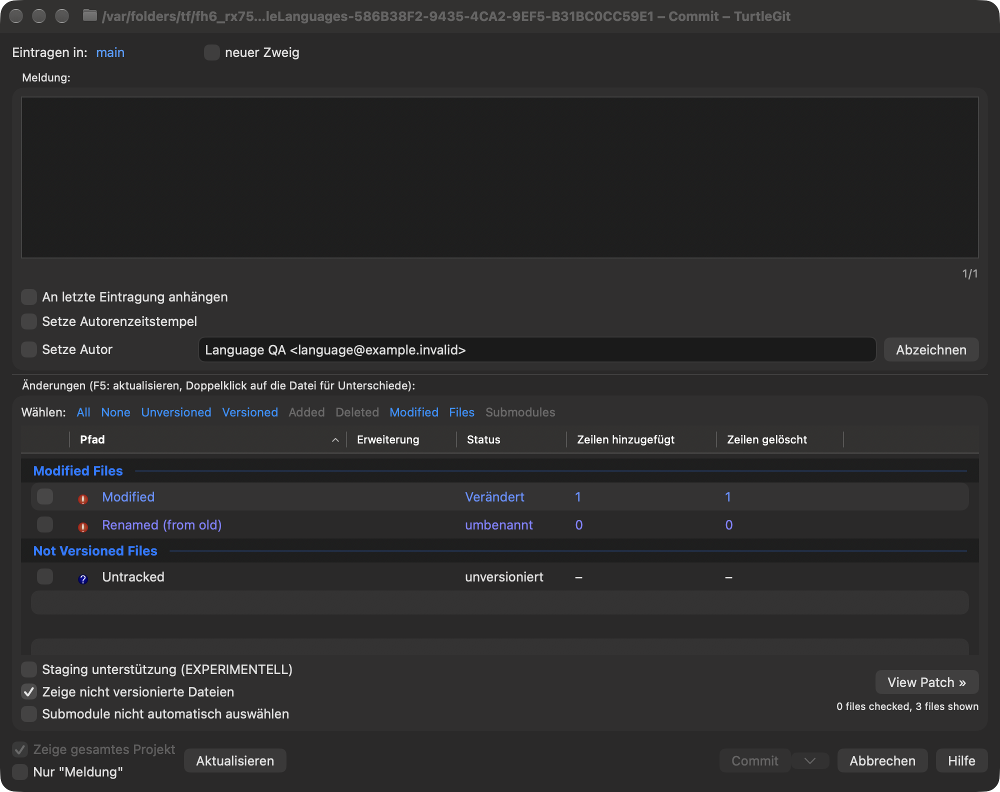

# Languages

Choose **Settings → General → Language**, then **Apply**. Restart TurtleGit to
apply the language throughout the app. **Cancel** discards an unapplied choice.
**System Language** follows macOS; choosing it removes TurtleGit's own language
override. These preferences belong to TurtleGit and do not change your system or
Git configuration.

The First Start Wizard offers the same bundled languages. **Next** saves its
language page. As with other wizard pages, cancelling a later page keeps that
saved choice. Unlike Windows' separate TortoiseGit processes, this native app does
not relaunch itself and discard other open windows after a language change.

English and 37 source translation catalogs are bundled. Language names appear in
their own language with an English description. They cover matching TortoiseGit
labels, including common buttons, checkboxes and command captions. Coverage varies:
Mac-specific wording, dynamic messages and remaining native AppKit captions can
still appear in English. This is partial localization, not a claim that every
window is fully translated. Git commands, repository/reference names, filenames,
user text and server diagnostics are not translated as labels.

Missing, fuzzy, ambiguous, plural and formatted source entries use English until
they have a reviewed native adapter. German includes a small set of Mac-specific
setup/navigation translations. No Windows language DLL is loaded or installed;
additional translations arrive with app updates. Bundled Help remains English.

For contributors, `python3 scripts/build-localizations.py --write` generates the
String Catalog, locale identifiers, manifest and retained translator notices from
the pinned upstream PO blobs. `--check` verifies the same artifacts without
changing them. `Configuration/NativeTranslations.json` contains reviewed native
wording adaptations. The app bundle audit checks all compiled locale tables and
English fallback. The SwiftPM executable is an unbundled development entry point;
localized distribution uses the Xcode app.

## File-list captions and columns — October 17, 2026

Dynamic status cells now use the compiled catalog in Commit, Working Tree,
workspace overview, Log changed files, revision comparisons, Rebase conflict
lists and Synchronization file lists. The shared status/Resolve and comparison
clipboard formatters receive the same bounded caption adapter. Column headings
in copied tables are translated; path-only copies retain literal paths. LFS
clipboard headings use the same column captions. Source/status model values,
Git action letters, row IDs, sort keys and saved column identifiers remain stable.
Repository paths, references, lock owners, user text and server diagnostics are
never submitted as file-list labels, even when a path is named `Modified`.

Fixed AppKit headers in Add, Add/Revert/LFS progress, Log/Sync history tables and
the patch file panel now request their existing translations. Native header
menus display translated column names. Column discovery resolves unambiguous
localized captions and retains the existing declared-order fallback; native
column objects retain their semantic identity across layout restoration. A
translated Copy to Clipboard parent still receives its current-column command.
Its column caption uses the same catalog. This does not certify every AppKit menu
or alert caption in the app.

The pinned `CTGitPath::GetActionName` and GitStatusListCtrl use resource-backed
status/action labels. The native catalog adds three explicit spelling aliases:
`Renamed` from `renamed`, `Untracked` from `Unversioned`, and `Skip-worktree` from
`skip-worktree`. They retain native English keys and source translations, without
general case folding. Ambiguous/fuzzy/missing translations still fall back to
English. Reviewed German/French native wording covers type changes, the
assume-unchanged flag, staged qualifiers and the column prefix. Other languages
can retain English for these Mac-specific phrases.

[Batch evidence](qa/file-list-languages-2026-10-17.json) records the affected
Core serialization contracts, actual native controls, compiled language processes,
source provenance and owned process cleanup. Physical clipboard/menu tracking,
all locales, RTL, full status sorting/source variants, VoiceOver and signed
sandbox/installed Finder acceptance remain open. No hidden Windows
KeepFileListsEnglish control is activated: the pinned resource hides it and the
source has no consumer.

These unaltered native captures show German status captions and deliberately
English filenames. Standard group labels, quick-check links, some metadata
headings and dynamic counters still use English; their translation is separate
remaining work. These images do not claim a fully localized dialog.

