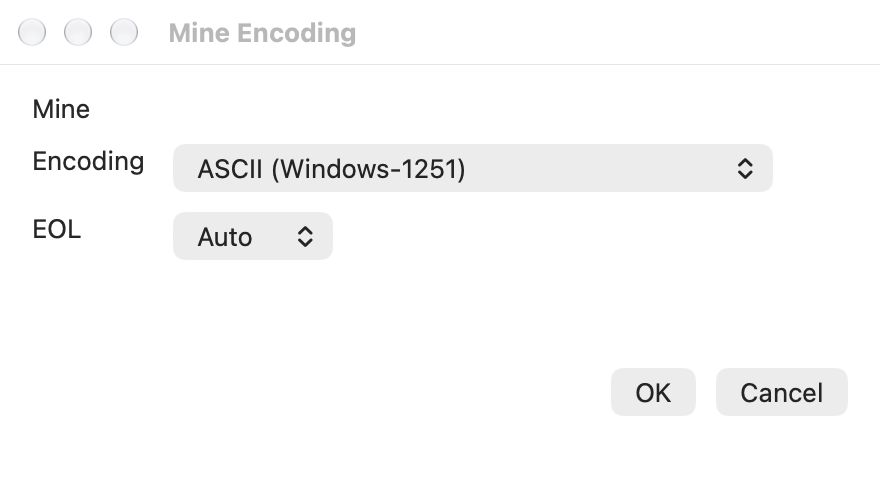
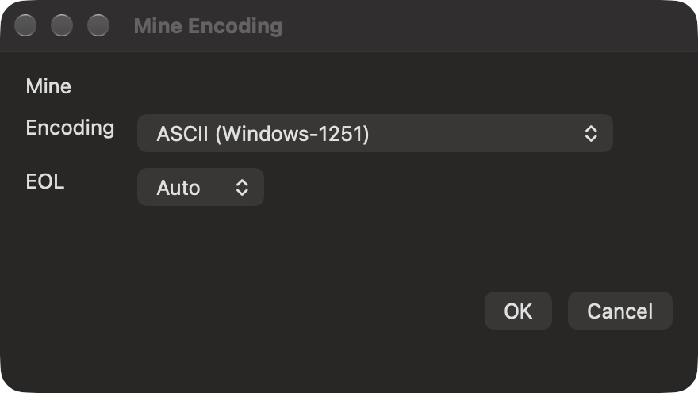

# Legacy text formats in Compare and Merge

TortoiseMerge's `FileTextLines.cpp` uses the Windows system ANSI code page for
its source **ASCII** format. macOS has no equivalent Windows ACP setting.
**Settings → Merge Editor → Legacy text encoding** supplies that choice explicitly.
The default remains Windows-1252 for compatibility with earlier TurtleGit builds.

Supported choices are Windows-1250, 1251, 1252, 1253, 1254, 1255, 1256, 1257 and
1258; Windows-874; Shift-JIS (932), GBK (936), Korean (949) and Big5 (950).
The codecs use Foundation's Windows-code-page bridge with strict round-trip
validation. A conversion that loses or normalizes characters is rejected before
changing the draft or file. This is not a promise that every Windows legacy
mapping, malformed sequence or OEM code page has been reproduced.

The legacy preference is a native platform adaptation, not an additional pinned
TortoiseMerge checkbox. The source's nine-item Encoding hierarchy remains:
one configured ASCII/legacy choice and eight Unicode choices. Current legacy
panes retain their actual codec in that first slot even after the default changes.
Native context commands carry the chosen codec rather than reinterpreting a menu
index under a newer preference.

## Loading and saving

The existing source `CheckUnicodeType` classifier still decides Unicode versus
ASCII/legacy. UTF BOMs and valid non-ASCII UTF-8 take precedence; the saved
Use UTF-8 default continues to govern ordinary ASCII input. The legacy preference
does not force UTF-8 files through a regional codec. Strict decoding failure
remains unsupported text, without a second automatic reinterpretation.

Two-pane comparison, repository conflict loading, standalone three-way Merge and
the patch comparison/merge adapters carry the selected policy into their reads.
Changing the default affects subsequent loading; it does not reinterpret open
panes, rewrite their text or change their saved encoding. Format changes and
Save continue using the pane's retained codec. Existing EOL, missing-final-newline,
mode, stale-file, backup and index guards remain in use.

Saved native pane targets retain their explicitly selected legacy codec while
their bytes remain unchanged. When an external tool rewrites the bytes, reads
run source detection again, so newly written UTF-8 and Unicode BOMs can take
precedence. Byte/mode validation remains separate from text interpretation.

## Evidence and limits

[The checkpoint](qa/legacy-format-family-2026-10-17.json) records 49 distinct
focused Core cases across retained and affected runs. New cases cover all 14
regional codecs, exact working-file saves/reloads and modes, source choice order,
preference fallback, external Unicode rewrites and a real Windows-1251 Git
conflict whose Save preserves HEAD and raw index bytes.

Four final native workflows cover Settings Apply/Cancel, Windows-1251 Compare,
Shift-JIS standalone Merge, retained pane codec after changing defaults,
conversion refusal, exact saves and the retained Encoding/format/Undo families.
The legacy receiver supplies its private standalone Save As destination through
the existing chooser hook. It does not prove a physical Save As interaction.
The captures show the unchanged nine-choice dialog with a retained Windows-1251
selection, presented in an owned standalone QA window.

Remaining work includes exhaustive Windows mapping/codepage compatibility,
legacy patch preparation/recovery and external-tool combinations, physical
Settings/popup/keyboard/VoiceOver acceptance, full translated labels and signed
sandbox/App Store acceptance. These results do not certify complete format or
whole-app parity.

The later [patch-codec workflow continuation](PATCH-CODEC-WORKFLOWS.md) connects
legacy file preview/classification, captured recorded-base recovery and automatic
application, including a manual UTF-8 continuation for unrepresentable output.
Original-patch/serial-import text presentation remains a separate open family.
