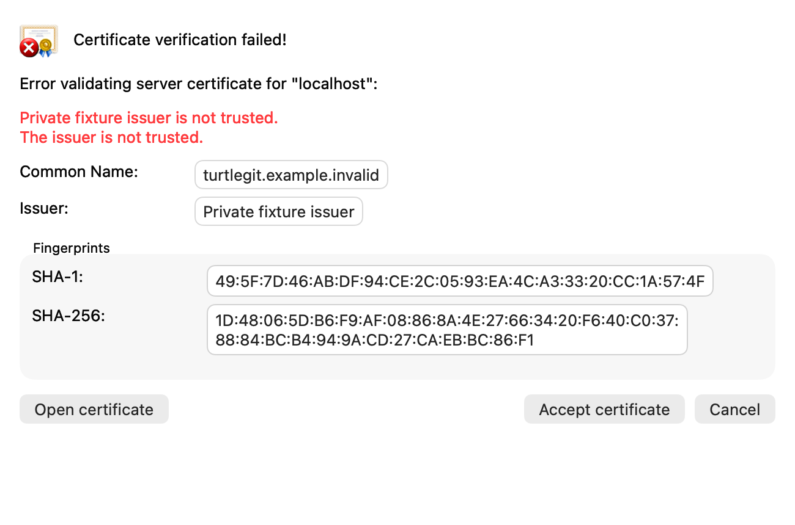
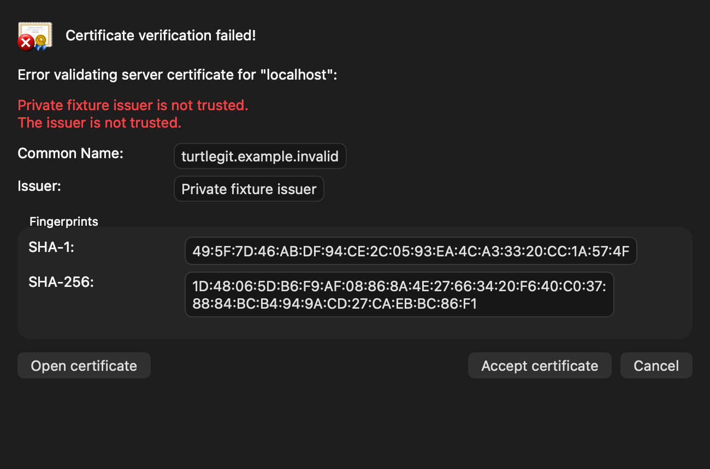
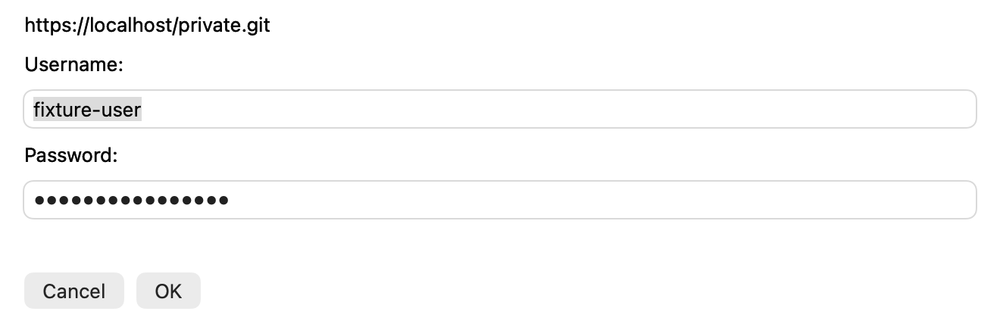
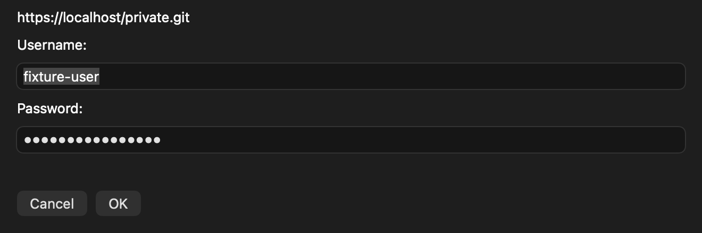

# Optional libgit2 Clone, Fetch and Sync parity

Baseline: TortoiseGit `7338078f8ddd924b8cddee35f512f2286072136d`.
The libgit2 pin is its `ext/libgit2` gitlink
`f7164261c9bc0a7e0ebf767c584e5192810a8b24` (1.9.4).
This family is a partial native replacement, not certification of the whole port.

## Source gates and connected callers

`src/Git/Git.h` assigns Clone command index 1 and Fetch index 2;
`Git.cpp::UsingLibGit2` tests `(1 << cmd) & mask` with the global switch.
The source default mask `0x66780` excludes both. `CloneCommand.cpp` selects
`ProgressCommands/CloneProgressCommand.cpp`; `AppUtils.cpp::DoFetch` and
`SyncDlg.cpp` select `FetchProgressCommand.cpp`. The selected callbacks report
transfer/checkout progress and call `CAppUtils::Git2GetUserPassword` and
`Git2CertificateCheck` on the actual operation. The latter maps `IDD_CERTCHECK`.

Native `GitLibGit2Configuration` captures the switch, mask and requested runtime.
`Clone.swift`, `Fetch.swift` and `Synchronization.swift` select a literal packaged
helper while retaining the captured original Git for validation, references,
configuration and follow-up commands. The native Clone/Fetch/Sync models capture
private or production preferences before asynchronous choices. Missing requested
runtimes fail explicitly. The source Advanced catalog is retained; the mask remains
an expert stored preference. The default CLI workflows and SVN are unchanged.

The selected helper maps the same operation arguments onto libgit2: Clone
branch/origin, bare/no-checkout, shallow depth and recursive submodules; Fetch
named/arbitrary/all remotes, explicit refspecs, tags, prune, force and depth.
FETCH_HEAD, tracking references and tag destinations are actual repository results.
Sync Fetch/Rebase preparation and tag fetch use this route; ordinary Pull, Push,
Prune and Remote Update use their existing commands. The user guide is
[Optional libgit2 transport](LIBGIT2-TRANSPORT.md).

## Actual connection and native decisions

The private static libgit2 engine uses SecureTransport and OpenSSH exec support.
`certificate_check` receives the actual connection's certificate. Valid system
trust proceeds without a prompt. An invalid X.509 peer reaches the separately
gated `TurtleGit Git transport prompt v1:` protocol, with bounded DER and the
source-shaped native certificate form. The private authority patch adds the actual
HTTP endpoint's port to that callback without changing built-in TLS hostname
validation; it prevents a redirected port from inheriting another connection's
exception. Temporary exceptions are exact to host, port and DER and remain in one
operation. No probe/reconnect or global verification-off setting is used.

The native helper offers combined credentials and certificate review with Common
Name, Issuer, SHA-1/SHA-256, Open certificate, Accept certificate and default Cancel.
Its read-only inspector retains Copy and DER/PEM export. Permanent trust, credential
saving and SVN client-certificate modes are refused by this Git-specific protocol.
The existing SVN protocol retains its behavior.

A private 0600 lock connects actual prompt/export retirement to parent cancellation.
The parent writes a cancel marker first, waits for the native prompt's real release,
then interrupts/reaps its process group. A newly starting prompt refuses the marker.
The ordinary Git cancellation policy is unchanged. Native pending acceptance is
converted to rejection when cancelled, including while an accepted export drains.

## Runtime, evidence and remaining scope

`Configuration/LibGit2Runtime.json` pins source/checksum/patch and macOS 13 universal
architectures. The runtime carries its reconstruction sources, licenses and
provenance; the helper is relocated to standard app code placement and receives
inherited sandbox signing with the existing runtime pipeline. Debug reuse and CI
keys include the helper, bridge, patch, compiler/SDK and build/validation recipes.
The optional backend does not depend on a user-installed Python or Homebrew library.

[Batch QA](qa/libgit2-transport-2026-10-19.json) records actual attempts and outcomes.
The Core group uses the real helper and private repositories plus a loopback smart
HTTPS Git server and mock credentials. Native checks exercise actual local
Clone/Fetch model routing and the real prompt/inspector implementation offscreen.
These scopes must not be represented as a physical public HTTPS or SSH session.

Other source libgit2 command-mask consumers for local operations,
all HTTP authentication providers/server configurations, physical keyboard and
VoiceOver behavior, complete inspector/compositor parity, installed signed grants,
signed SSH/HTTPS and App Store distribution remain separate acceptance or porting
work. Current-source full hosted CI remains unproven until its complete run passes.

The Clone/Fetch optional engine does not execute external Git filter/LFS process drivers or
ordinary Git hooks. `git_repository_init_ext` copies repository templates; this
does not prove hook execution. Conventional custom `GIT_ASKPASS` and Git credential
helpers remain unsupported by this engine. The CLI engine retains these workflows.
Custom CA anchors augment system roots; built-in valid peers proceed directly.
An invalid peer is evaluated against custom anchors on its actual leaf and hostname,
without a second network probe. A missing intermediate may require explicit native
review. Redirect handling clears cross-authority cached credentials and sensitive
headers, and proxy changes clear cached proxy credentials.

## Native content captures

The grouped offscreen receiver captures the production prompt controller with
private sample credentials and a fixture certificate. These are native content
captures, not physical window/compositor or public-server acceptance.

## Connected remote-reference continuation

[Remote-reference engine parity](REMOTE-REFERENCE-ENGINE-PARITY.md) connects
GetRemoteRefs and DeleteRemoteRefs consumers to source Fetch/Push mask bits.
This adds remote picker/tag catalogs, Browser remote branch deletion and Sync
tag compare/delete/refill. General Push remains the source CLI path; it is not
a missing general Push implementation implied by the DeleteRemoteRefs mask name.
The continuation has its own batch evidence and remaining acceptance limits.

The [historical materialization continuation](HISTORICAL-MATERIALIZATION-PARITY.md)
adds the source default GetOneFile bit and a separate custom smudge adapter for
historical file output. This does not change the recorded Clone/Fetch filter,
LFS process-driver or hook limitations.
