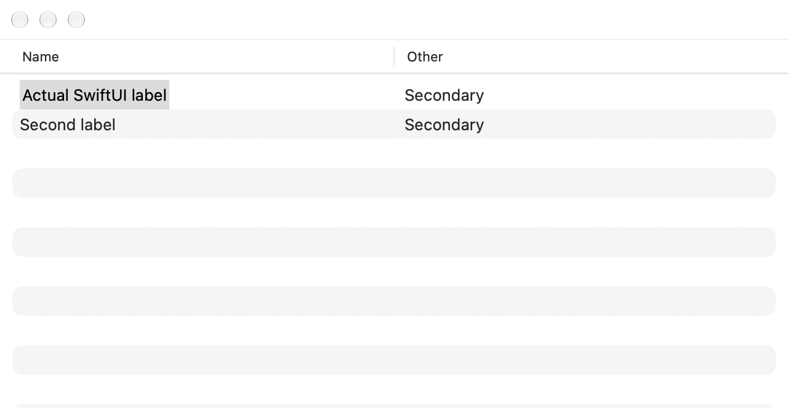
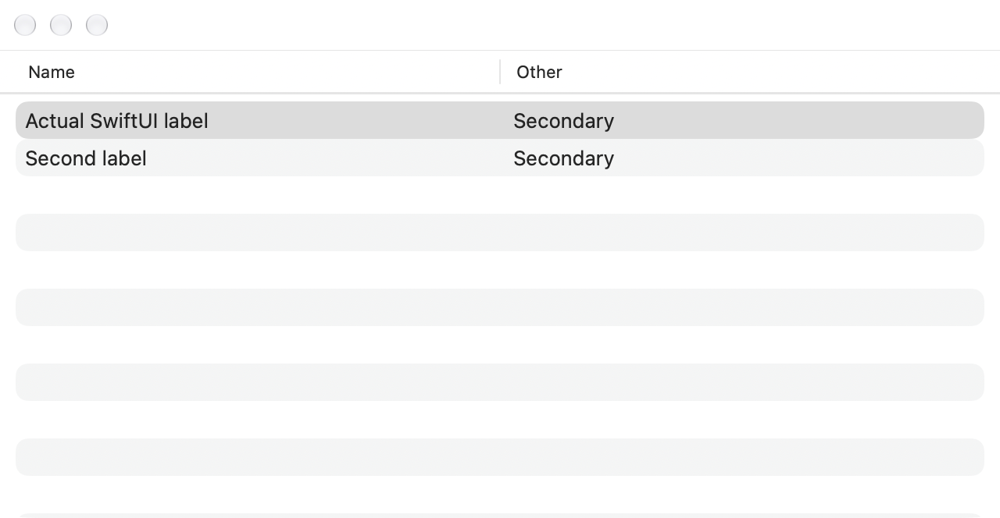
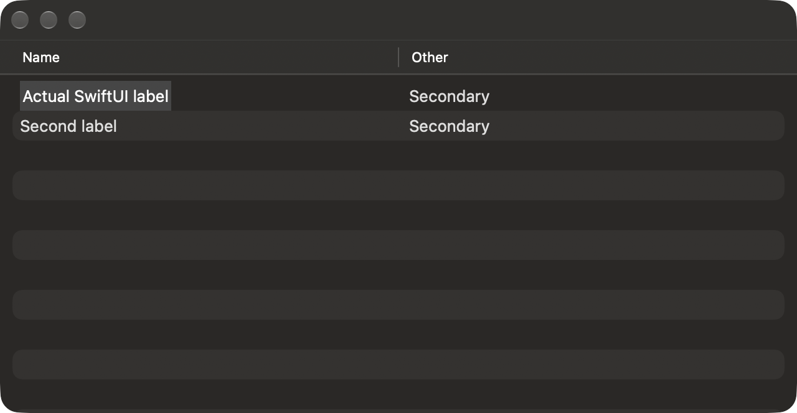
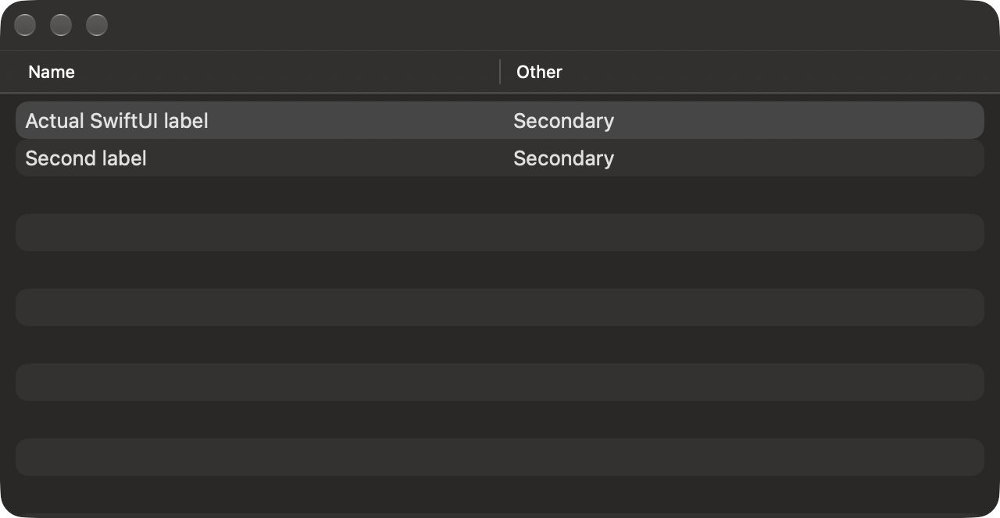

# Source list-selection presentation

Pinned TortoiseGit: `7338078f8ddd924b8cddee35f512f2286072136d`.
This batch ports the connected configurable file/reference/progress list
presentation family. It does not certify every dialog or the complete app.

## Source contract

`SettingsAdvanced.cpp` registers `FullRowSelect` as a default-true boolean.
`CResizableColumnsListCtrl::Init` reads its DWORD and enables the native extended
style for a nonzero value. [Microsoft's style reference](https://learn.microsoft.com/en-us/windows/win32/controls/extended-list-view-styles)
describes the selected item and its subitems being highlighted. This setting
does not justify introducing a new marquee-selection system or changing Git
commands.

| Source consumer | Native surface |
| --- | --- |
| `GitStatusListCtrl.cpp` → `ResizableColumnsListCtrl.h` | Commit, Working Tree, Add, Resolve and changed-file/comparison tables |
| `RepositoryBrowser.cpp:214` | Repository contents; directory tree excluded |
| `WorktreeListDlg.cpp:88` | Worktree List paths |
| `LFSLocksDlg.cpp:61` → `GitStatusListCtrl` | LFS lock files |
| `BrowseRefsDlg.cpp:312` | Reference leaves; namespace tree excluded |
| `FileDiffDlg.cpp:148` | Revision comparison files |
| `CommitIsOnRefsDlg.cpp:126` | Containing references |
| `SyncDlg.cpp:1121–1132` | File, remote-reference and tag-comparison lists |
| `GitProgressList.cpp:978` | File-operation and shared LFS result rows |
| `ImportPatchDlg.cpp:175` | Checked patch list with retained result backgrounds |
| `FindDlg.cpp:142` | Reference Find results |
| `SetHooks.cpp:58`, `SetBugTraq.cpp:57` | Hook and issue-provider lists |
| `SetProgsAdvDlg.cpp:133` | Diff/merge tool associations |
| `SetLookAndFeelPage.cpp:194,329,445` | Context-menu Settings lists |

`GitLogListBase::SetStyle` unconditionally includes `LVS_EX_FULLROWSELECT`.
Main Log, Reflog, Rebase and embedded history therefore retain whole-row
selection. Blame's source grid, trees and ordinary editors are not consumers of
this setting. The existing Hooks list already clipped selection to its first
column; the shared implementation refines that to the actual primary label.

## Native implementation scope

The Core presentation policy reads the source default and DWORD truth value.
The existing Advanced store retains strict boolean editing, validation before
mutation, changed-row Apply, blank deletion and Cancel. Its tooltip identifies
the effective list consumer.

The shared native adapter binds to the exact table and its owning preference
domain. It tracks the logical primary column independently of display order,
uses actual text-field geometry or the file-list's measured visible caption,
and clips selection to the available label area. Fallback captions use a
vertically centered native text-cell frame; actual native text fields retain
their measured baseline. Existing checkbox and icon
columns are distinct from the primary label. Custom patch-row backgrounds and
status colors remain part of the row's presentation.

AppKit source-list selection can paint without calling `drawSelection`.
Label-only mode therefore suppresses the exact table and row selection styles
and uses a layer-backed foreground overlay. Full-row mode and retirement
restore the original styles, delegate and row class.

Native row identities, multiple selection, keyboard navigation, checkbox actions,
context targeting, inline editors and accessibility selection remain owned by
their existing controls. Detachment retires the adapter and restores the original
delegate; queued preference callbacks cannot attach to another window's table.

## Checkpoint and remaining acceptance

The focused Core policy/store group passed five tests. The Debug app build
passed after repairing the Merge Tool preference plumbing. Grouped native
checks passed the adapter and actual reference, containing-reference, Add,
operation-result, Sync and Repository Browser consumers with Apple/bundled Git.
They retain native actions, preference isolation, permitted column reordering,
hidden-column behavior and owner retirement.

WindowServer captures exposed the SwiftUI source-list paint path and a fallback
caption offset that property/geometry checks alone had not proved. The final
repair explicitly suppresses/restores native styles, composites the selected
label above the cells and centers its native text frame. The affected adapter
was checked again with all eight AppKit/SwiftUI, whole-row/label-only and
light/dark captures. A secondary-column pixel oracle rejects a retained
whole-row highlight in label-only mode. The final captures were inspected;
owned windows and receivers were closed. [Batch evidence](qa/list-selection-2026-10-20.json)
records the initial failures and focused repair scope.

These are diagnostic SwiftUI tables demonstrating the rendering difference,
not screenshots certifying another dialog's complete layout:

Windows pixel/font metrics, every list/input/accessibility variant and physical
signed distribution remain separate acceptance work. Raw Resolve/Sync file
lists share the tested bridge; they were not independently populated in this
checkpoint. Source row/pointer timing is adapted to AppKit. A scoped pass does
not certify all source dialogs, current full hosted integration or the whole app.
