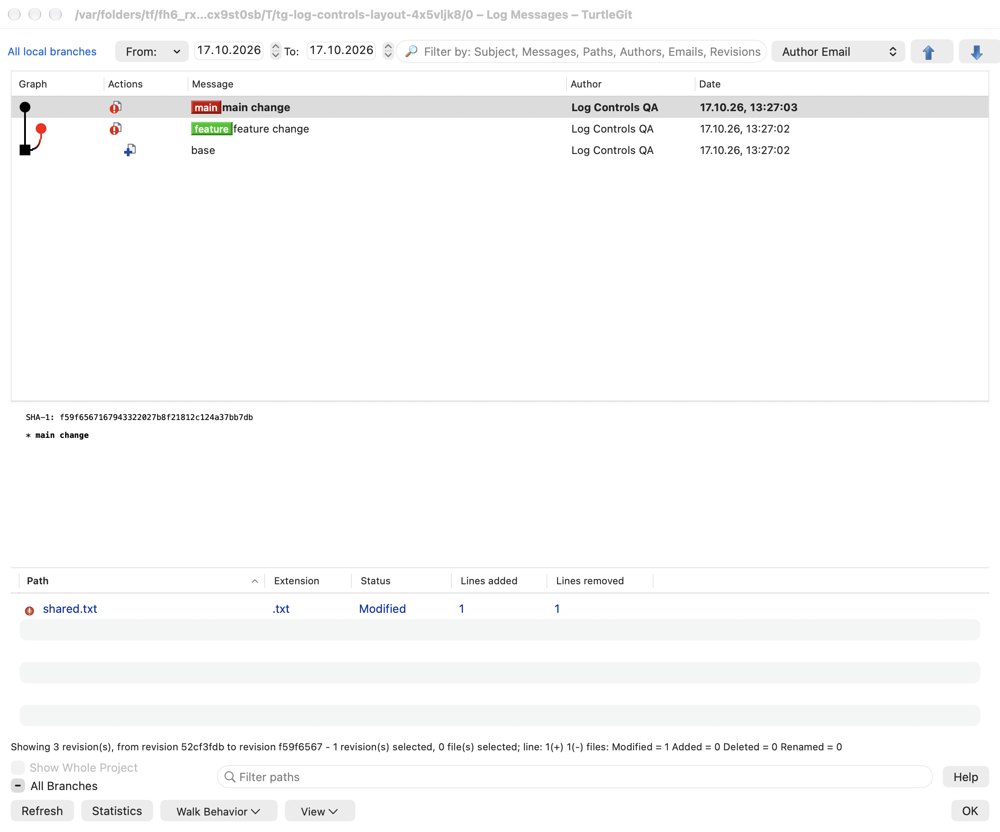
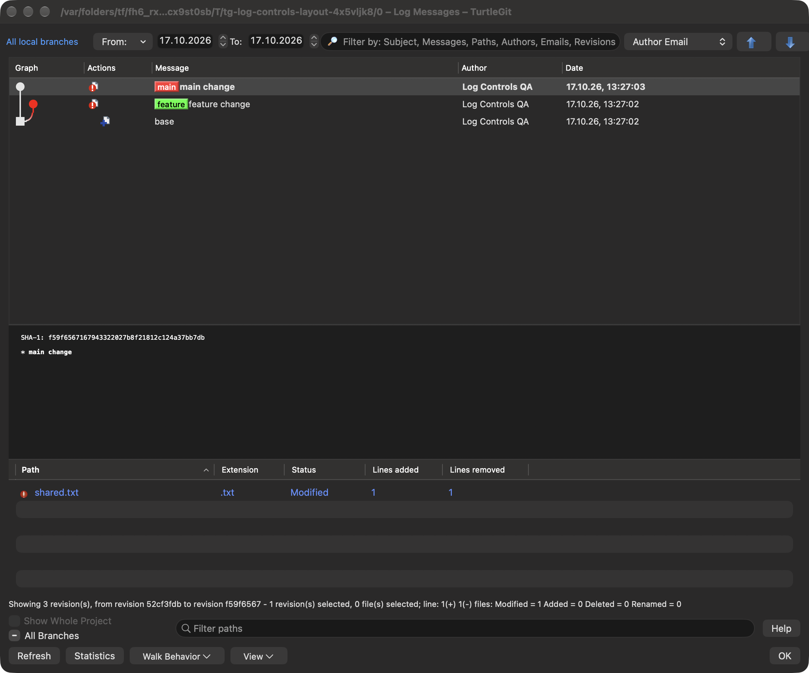

# Log reference/view controls and pane layout

This batch compares `LogDlg.cpp`/`LogDlg.h` at pinned upstream commit
`7338078f8ddd924b8cddee35f512f2286072136d`: constructor/destructor AllBranch
preferences, `SetParams`, `OnContextMenu`, `OnBnClickedAllBranch`,
`OnBnClickedWalkBehaviour`, `OnBnClickedView` and `SaveSplitterPos`.
The reference screenshot is `doc/images/en/LogMessages.png` at that pin.

## Reference range and scope

The reference label remains a native link-style button. Left click opens the
shared native reference browser, including multiple references and range choices.
Right click opens the source-order Browse references, HEAD/current branch,
FETCH_HEAD, All, All basic refs, All local branches and recent-expression
menu. The All Branches checkbox exposes the same right-click menu and retains the
source off/on/mixed representation. A mixed-state click returns to the current
range; it does not cycle through a third user-toggle state.

Reference-set masks retain the underlying range/tips. All branches can temporarily
show every reference, then switch off to the branch, multiple tips or range that
was displayed before it was enabled. The actual Git query omits the retained
explicit range while a broader mask is active, so the explicit range cannot
accidentally override All/basic/local. Choosing a new reference/range clears the
mask as in the source. An explicitly supplied initial revision also clears a
remembered mask for that window.

The repository/store-scoped AllBranch preference retains the source numeric
values: current 0, all 1, local 2, basic 3. The checkbox saves immediately so another
Log window can see its change; other mask changes save when the owner closes.
Invalid saved values fall back to current. Label visibility and reference-set
scope remain separate preferences.

## Native menus and ownership

Walk Behavior and View now use native popup buttons/NSMenus. Walk keeps the source
First Parent, No merges, Follow renames, Full history, separator, Compressed Graph,
Show labeled commits only order and checked states. Follow is unavailable without
a single-file scope. View keeps Hide/Gray paths, Show Unversioned Files, nested
Labels, Gravatar and View Patch in source order. The existing Mac working-tree
visibility choice remains an additional final group. Original command artwork
uses the shared context-icon preference, with native menu checkmarks and theme
colors. Reference/user-derived menu titles never pass through localization.

Each popup and its nested leaves share one receipt. Busy, child-modal, revision
projection/selection changes, another accepted control command and retirement
refuse old callbacks; a popup can accept only one command. Native button
representables clear their target/callbacks when dismantled. Reference left click
continues through the existing owned picker and its cancellation/close handling.

## Three-pane layout

The three existing panes remain revision list, message and changed files. A
noninteractive bridge binds to their actual native horizontal NSSplitView without
replacing its delegate, keyboard behavior or drag handling. Closing the owner
records the pane proportions in its supplied preferences. A later Log restores
those proportions at its actual available height, clamping revision/message/file
panes to 200/110/130 points. Smaller hypothetical bounds scale those minima to fit;
the normal window retains its existing minimum size. The source stores unscaled
splitter coordinates; proportional restoration is the native resize adaptation.

Minimized windows do not replace the saved layout. Corrupt/nonfinite/zero/negative
or wrong-version layouts are ignored. The bridge is retired with its hosting view;
late notifications or saved callbacks cannot write preferences after close.

## Evidence and limits

Nine relevant Core cases and six distinct native case/engine combinations passed
across the grouped checkpoint and affected native recheck. All nine recorded
receiver/helper PIDs were reaped and independently absent. Both final native
captures were inspected. Grouped evidence and actual repairs are recorded in
[Log controls/layout QA](qa/log-controls-layout-2026-10-17.json). This is partial
Log acceptance. Native menu item dispatch, picker choices, saved state and
native divider positions are checked in private repositories/preferences; those
checks do not establish physical popup tracking, divider dragging, VoiceOver or
signed App Store/Finder access. New owned-window light/dark captures document the
visible main-window result, not every menu state or every upstream Log variant.

## Current native captures

The owned-window captures below retain the three source panes, compact colored
graph before the revision list, colored branch labels and file status artwork.
The standard reference-scope caption has dedicated width; footer menu captions
include room for the native arrow. These controlled fixtures contain three
commits and do not represent a large-history or every-menu visual audit.

The [pinned source screenshot](https://github.com/TortoiseGit/TortoiseGit/blob/7338078f8ddd924b8cddee35f512f2286072136d/doc/images/en/LogMessages.png)
was compared directly; its image blob matches the pinned resource. The retained
zero-size, two-pane NSSplitView warning during shared child handling also occurs
in earlier reference-navigation records. This batch does not claim that warning
is resolved, nor identify a unique production root cause from the message alone.

## Primary conditional control follow-up

[The shared conditional UI audit](PRIMARY-CONDITIONAL-UI-PARITY.md) records the
Commit split control, Log control states and Working Tree refresh/cancellation
follow-up, with focused validation and remaining acceptance kept explicit.
