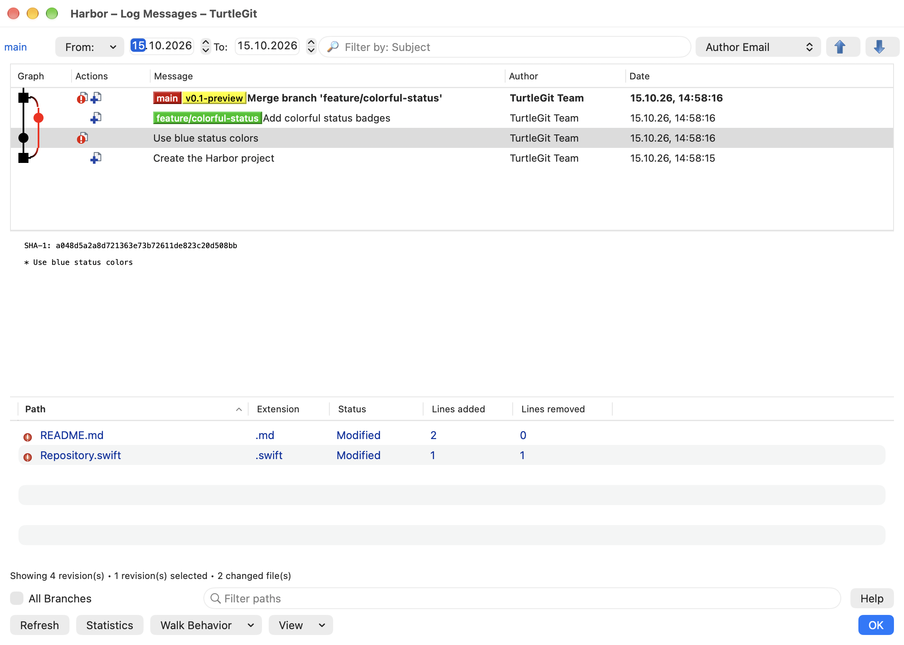
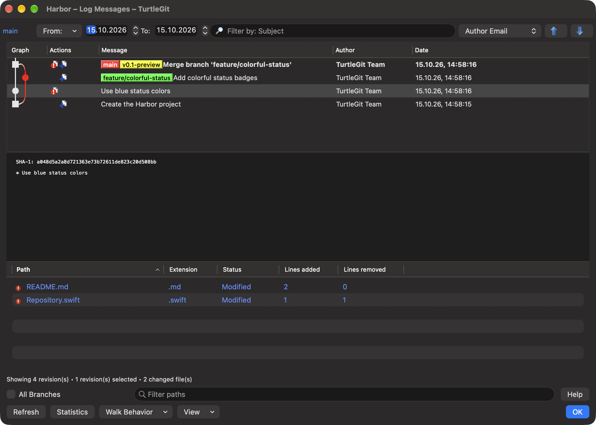

# Log filter controls and layout

Baseline: TortoiseGit `7338078f8ddd924b8cddee35f512f2286072136d`,
`LogDlg.cpp` filter handlers and `IDD_LOGMESSAGE` in `TortoiseProcENG.rc`.

The native header retains branch/reference selection, the From limitation menu
and date, To date, a combined filter field/menu and the ten Jump choices with
original up/down icons. Separate Search in and Search controls are replaced by
the source's integrated filter. Whole Project/All Branches, path filter and Help
occupy the lower filter row; Refresh/Statistics/Walk Behavior/View and OK/Cancel
occupy the final row. Ordinary Logs retain only OK; revision selectors also
show Cancel, following the source initialization. Working Tree visibility is in View. The revision graph,
message and changed-file panes keep their existing behavior and resize handles.

The native revision field menu follows Subject, Messages, Paths, Authors, Emails,
Revisions, Refname, Tag Info, Notes, configured Bug IDs, Toggle filters, All,
regular expression and case-sensitive order. Original filter artwork respects
the app menu-icon preference. The placeholder identifies selected fields; the
menu uses native checkmarks. Filter choices load and save through the owning
Log's preferences, including private picker/verification stores.

Typing coalesces for one second, following `LOGFILTER_TIMER`/`FILEFILTER_TIMER`.
Return and clearing submit immediately. Escape clears a nonempty native field;
this uses the native search-field convention for history and the explicit source
path-filter shortcut. IME marked text is not submitted until committed. Path
filtering retains the existing local path-match semantics without reading Git.

ECMAScript validation uses the same owned UTF-16 helper as actual Log matching,
including case mode and leading inversion. Invalid patterns retain the existing
history; the field displays red text with error tooltip/accessibility help.
As upstream, explicit Return directly refreshes and can reach the existing
inactive-filter fallback for invalid syntax; validation protects timed typing.

Explicit Refresh cancels a pending typing timer. Replaced queries and closing
cancel the validation token; late replies cannot reload history or show errors.
Started helper work retains its Quit counter until settlement even after forced
closure. Timers wait through another Git operation or owned sheet rather than
replace it. Menu commands consume their captured popup generation once and reject
a retired or blocked owner.

## Verification and remaining work

The focused Core regex group and native filter receiver cover helper syntax,
private settings, actual field/menu dispatch, typing coalescing, clear/Return/
Escape, invalid expressions, replacement and forced-close validation, Quit,
minimum-size geometry and unchanged repository data. Native cancellation replies
use controlled gates; Core's existing stalled-helper case verifies real owned
process cleanup. The Debug build, eight Core tests and both final native engine cases passed.
See [the batch record](qa/log-filters-2026-10-15.json) for visual repairs, the
rejected overlapping build and exact scope.

Physical typing/IME/menu/focus and VoiceOver, every locale/long branch name,
signed/minimum-OS execution and all upstream Log options remain open. Native
search fields and macOS fonts are explicit platform adaptations. Complete Log
and application parity remain unproven.

The final unaltered captures were reviewed against the pinned Log screenshot
and resource layout. From is readable at the minimum size; the graph, colorful
reference badges, three panes and source command rows are present. These do not
certify physical input, all source states or selected-row contrast in every theme.
The info line still lacks upstream range/line totals, and Whole Project remains
contextual rather than always present; those existing differences remain open.

