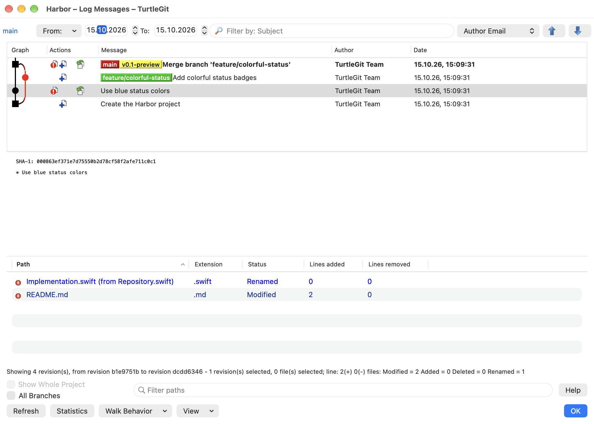
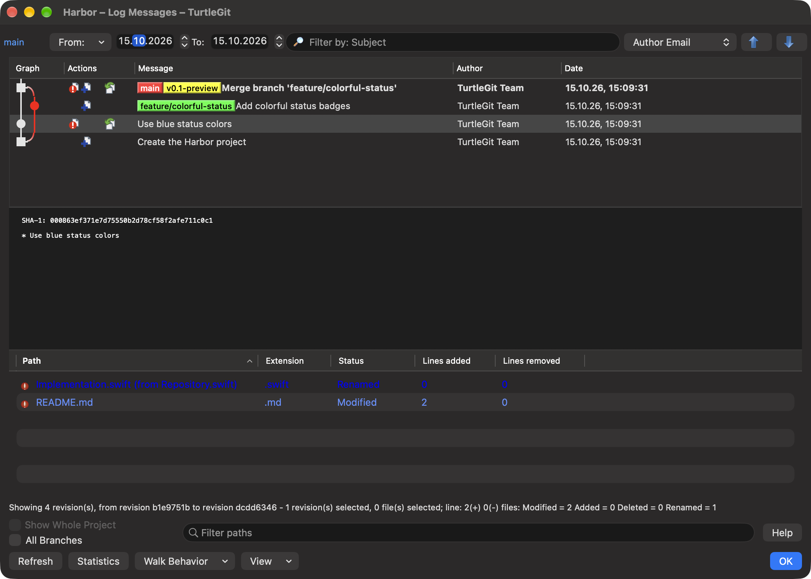

# Log scope, changed-path filters and information line

Baseline: TortoiseGit `7338078f8ddd924b8cddee35f512f2286072136d`,
`LogDlg.cpp::UpdateLogInfoLabel/OnBnClickShowWholeProject/FillLogMessageCtrl`,
`LogDlgFileFilter.cpp`, `FilterHelper.cpp` and
`GitStatusListCtrl.cpp::BuildStatistics/GetStatisticsString`, and the
`IDD_LOGMESSAGE` resource.

The information line now reports displayed revision count, oldest/newest source
hashes (eight characters), selected revisions and selected files. A leading
working-tree row is excluded from the revision count when real rows follow it,
while its selection still counts. As upstream, a lone working-tree pseudo row
counts as one displayed entry with empty hash endpoints. Exactly one selected
revision appends line additions/deletions and Modified/Added/Deleted/Renamed
counts. The native line can wrap to two lines and exposes its complete text in
a tooltip and as selectable text.

Statistics cover the complete current changed-file array, including hidden files
and separate merge-parent occurrences. Selected file count covers actual visible
selected occurrences. Rename also increments Modified; copy increments Added;
type changes increment Modified. Binary/unavailable line counts contribute zero.
Multiple/no revision selection omits the line/status suffix. These preserve the
source simple-statistics rules; they do not invent numeric counts for binary data.

The changed-path field now uses the shared source plain-query parser over current
and old names joined by a newline: words, quoted phrases, minus exclusions, plus
alternatives and leading inversion. It remains case-insensitive and uses no
regular-expression mode. Applying a path filter prunes hidden selected IDs,
selection marks and focused paths before patch refresh. Clearing does not restore
a previously hidden selection. This extends the earlier one-second native field
workflow; it no longer treats the whole query as a single substring.

Show Whole Project remains visible for an unscoped root Log, but is disabled.
For a path Log, its choice defaults to false and persists per repository through
the owning preference store, following the source repository key's purpose.
Checking reads the complete repository history; unchecking restores invocation
paths. Reopening a path Log restores the choice, and the title follows the active
scope while retaining revision/range labels. Follow renames forces scoped history
and disables the choice without overwriting a saved preference. Busy, blocked,
sheet and retired owners reject the toggle. Scope replacement rejects retired
callbacks and uses the existing cancellable history/detail pipeline.

## Verification and limits

The focused Core group covers source parser rules, old names, counts/ranges,
working rows, selection, parent occurrences, binary data and repository/store
preferences. The connected native filter receiver additionally exercises real
renames and history scopes, hidden selection cleanup, saved scope reopening,
Follow renames and busy/retired refusal, alongside its existing timing/menu/
validation and unchanged-repository assertions. The Debug build, five affected Core cases and both native Git-engine cases
passed on the first attempt. See [batch evidence](qa/log-footer-2026-10-15.json).

Physical selection/filter/checkbox gestures, all localization/large-list/resize
conditions, signed sandbox and minimum-OS acceptance remain open. Existing
multiple-revision changed-file aggregation is not expanded: the active pinned
source has no implementation in its multiple-selection branch either. This
batch does not certify full Log, Finder or application parity.

The current minimum-width compositor captures show the source information line
and permanent Whole Project control in both appearances. Dark rename text still
needs contrast review; these are current behavior evidence, not theme certification.

