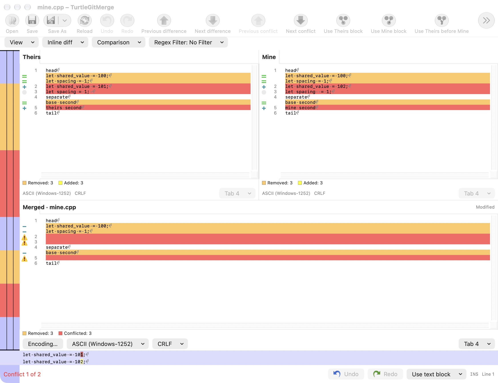
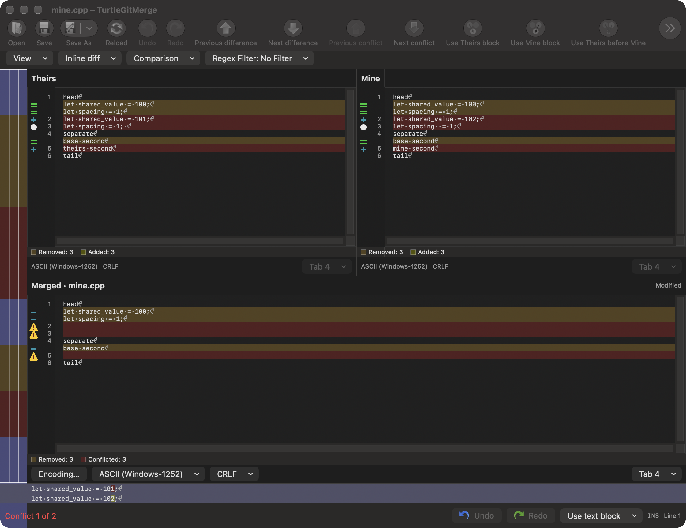

# Three-way Merge line inspection

Pinned source: `7338078f8ddd924b8cddee35f512f2286072136d`,
`src/TortoiseMerge/MainFrm.cpp` lines 1031–1033, 2977–3009,
`LineDiffBar.cpp::OnPaint`, and `BaseView.cpp::ShowDiffLines/GetLineColors`.
This family adds the source's explicitly available inspection pane to the native
three-way editor. It does not certify complete Merge parity.

The source hides the line diff pane on each ordinary three-way load without
clearing its saved View checkmark. Its View command remains enabled and toggles
the saved preference and actual pane. Changing Locator visibility restores the
saved line-diff visibility. Native Merge now keeps these two states separate:
load/reload hides the pane, explicit View or context-menu commands can reveal it,
and Locator visibility changes restore the saved choice. Two-file comparisons
retain their existing initial visibility policy.

The strip shows captured **Theirs above Mine**, rather than Base or the editable
merged result. Pointer and caret inspection resolve a logical aligned row;
result inspection uses its source navigation map when manual edits have removed
the aligned projection. Unsupported mappings clear the current preview instead
of inventing a source row. Folding and wrapping retain storage coordinates.
Neither strip becomes an editor or takes first responder.

Two-file and three-way strips now share the same TextKit renderer, configured
with their own labels, fonts, tab widths, ending icons and per-side horizontal
scroll positions. The strip forces whitespace and inline coloring locally,
including comparison-filtered rows. Main-pane whitespace/inline choices remain
unchanged. The general maximum inline length and word-mode rules still apply.
Missing-character indicators are drawing overlays, never inserted source text.

Main View, in-window View and per-pane context View menus share guarded model
actions. Context commands use the existing application icon preference. The
native line-number visibility adaptation is now available in all three panes;
it follows the existing saved setting initially and can be changed per window.
It does not rewrite the saved settings-page default. Busy operations, child
sheets, stale source layouts, replaced/closed owners and retirement cannot revive
an old inspection action. Replacing the source layout retires its preview.

Some tempting apparent gaps are intentional source behavior: three-way source
panes are read-only, only the merged target is writable, and
`BaseView::GetInlineDiffPositions` refuses inline navigation when the bottom
pane is visible. This batch preserves those gates rather than enabling an
unrelated two-file command in three-way mode.

The native fixture is
[`merge-conflict-inspection-native-2026-10-20.swift`](qa/merge-conflict-inspection-native-2026-10-20.swift).
It is intended for the grouped history/editor checkpoint with private inputs,
preferences and pasteboard. It exercises the real three-way and two-file hosts,
menu/visibility transitions, source/result pairing, local forced rendering,
fold/wrap behavior, busy/retired guards and unchanged input bytes. Validation
results and deliberate light/dark WindowServer captures are recorded by that
checkpoint after the connected implementation batch finishes.

Remaining acceptance includes physical pointer tracking, VoiceOver interaction,
all line-ending/long-line/encoding combinations, Windows docking and font metrics,
minimum-window layouts, signed Finder/App Store execution and full Merge parity.

These actual WindowServer captures show the private fixture's Theirs/Mine
inspection bar. The test application is inactive, so macOS dims its toolbar.
They establish the strip's layout and light/dark colors, not physical input or
complete editor parity.

## Native checkpoint

The Debug app and scoped native family checks passed with Apple and bundled Git
across the grouped checkpoint and focused repairs. The
[batch evidence](qa/history-editor-presentation-2026-10-20.json) records exact
checks, initial failures, repairs, captures and process cleanup. Core code was
unchanged and its suites were not repeated. This local result does not prove a
complete hosted CI pass, full source-window parity or signed distribution.
