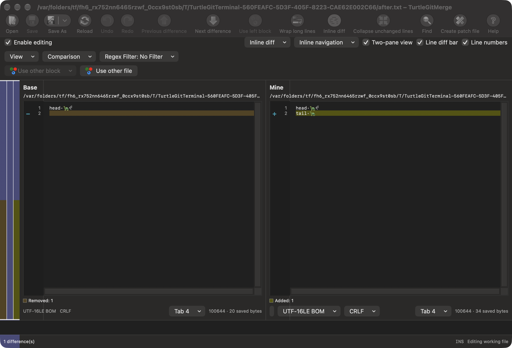
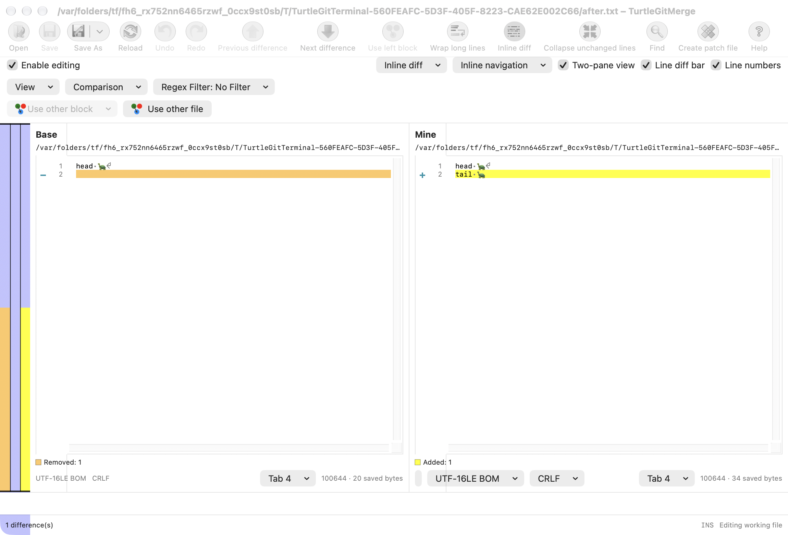

# Two-pane final NoEnding records

Baseline: TortoiseGit `7338078f8ddd924b8cddee35f512f2286072136d`,
FileTextLines::Load's final Add(line, NoEnding), DiffData::DoTwoWayDiff's
last-line repair, and BaseView::UseViewBlock's ending repair.

The engine plan retains physical original records and excludes a trailing empty
NoEnding token, as the source's svn_diff input does. Two-pane presentation now
restores that final record when a file is empty or ends in any supported ending.
It carries the next real source line number, an empty payload and no ending;
it is distinct from an Empty alignment gap. When both files have it, both records
are Normal and explicitly shown. If only one file has it, it is Added/Removed.
The repair fills the first trailing Empty slot on its side before adding another
row, preserving the existing peer pairing and source line coordinates.

The extra record participates in line numbers, Go to Line, selection, gutter
input, difference navigation, folding and locator states. Its payload adds no
bytes to source reconstruction, export or Save. Typing in it appends actual text
after the preceding original ending. The existing in-place editor keeps that
record's Edited state, source coordinates and exact encoding/ending provenance
through history. A new empty document therefore has a genuine line 1 rather than
being represented only by an alignment gap.

The source builds its combined view before the final-record post-pass. Combined
projection therefore excludes original empty NoEnding records, including when
one side fills a trailing changed block. It does not invent an empty difference
range. An Edited empty record remains user content. Original removed records,
neutral whitespace rows and explicit saved endings retain their existing rules.

Use other block normalizes incoming ended records to the target's ending style,
and repairs non-final occupied records that lack an ending. A real terminal empty
record counts as occupied, while alignment gaps do not. This supplies an ending
when accepting an added EOF record after an unterminated target line. Whole-file
serialization remains independent of display-only LFs. Existing both-order
commands retain their separate source ordering/endings behavior.

This is the two-file DoTwoWayDiff post-pass; three-way presentation has its own
source rules and receives no invented EOF row from this change. Exact native
last-line/fold/wrapped geometry, every block/marked-save variation, minimum-OS,
physical input and signed Finder/App Store acceptance remain open.

## Validation and captures

[Grouped evidence](qa/merge-terminal-records-2026-10-16.json) records 80 passing
focused Core checks, the Debug build, six distinct native cases and the capture
follow-up. A retained fixture crashed at objc_release; its manually created sheet
now disables release-on-close. Only affected/unrun cases continued. All eight
receivers, including that failure, were reaped and independently absent.

Actual inactive native captures show the final empty Base line opposite the
new unterminated tail after a real UTF-16LE BOM/CRLF Save and reload. Original
inputs/exported output and native history were checked separately from images.

