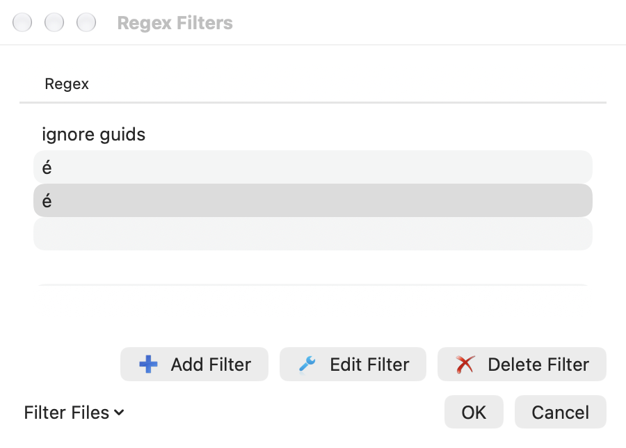
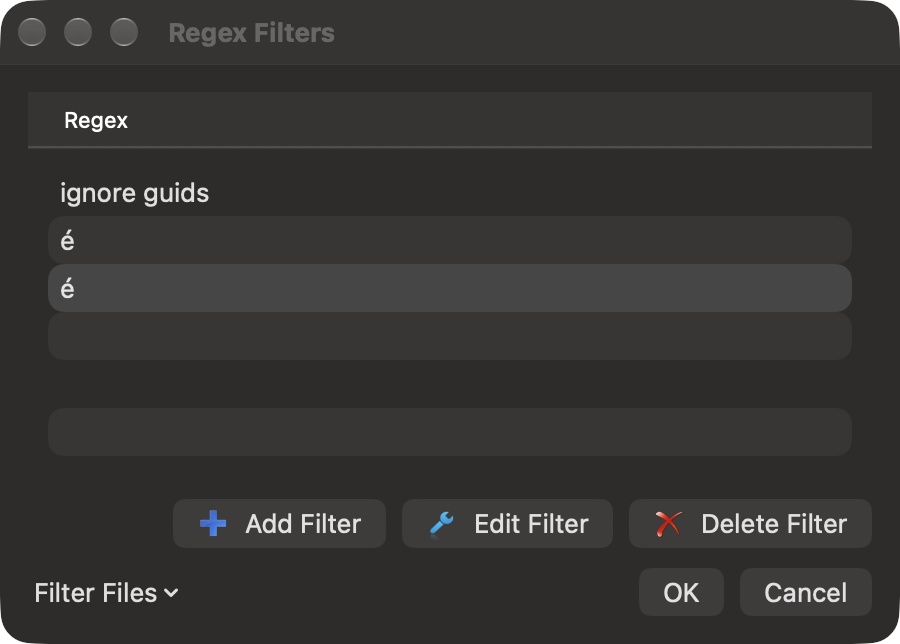

# Merge comparison filters

Regex filters ignore matching text when comparing lines. They do not rewrite the
source panes or the saved file. For example, ignore generated identifiers or
build numbers while reviewing other changes. Choose **Regex Filter** in Compare
or Merge, then choose a named filter. **No Filter** restores ordinary comparison.
Changing filters can ask you to save or discard unsaved work.

A fresh filter library includes TortoiseGit's **ignore guids** preset. It replaces
GUIDs with a common comparison key. The name is a literal source preset name,
independent of the application language. Existing saved libraries are retained;
deleting every filter and saving an empty library keeps it empty.

Open the filter list from the comparison's Regex Filter menu. Add, edit or delete
filters there. Each definition has a name, a regular expression and replacement.
Expressions use the existing ECMAScript engine; replacements can use capture
references such as `$1`. The filter runs separately on each line. The original
text remains available for viewing, copying and merge choices.

## Move filters between installations

In the filter list, choose **Filter Files → Import Filters…**, then select a
`regexfilters.ini` file. All expressions are checked before the draft changes.
Imported names replace matching existing names; other filters remain. Names match
without ASCII letter case. Unicode spellings retain their distinct identity.
Choose **OK** to save the completed draft, or **Cancel** to discard it.

**Filter Files → Export Filters…** saves the complete current draft to an INI file,
including edits you have not yet saved with OK. Export does not apply those edits
to the application's saved library. Cancelling a file chooser writes nothing.
The import source is never modified.

For example:

```ini
[ignore build numbers]
regex=build [0-9]+
replace=build
```

Imports support UTF-8 and Unicode files with a byte-order mark, up to 1 MiB and
256 filters per file. Export writes UTF-8 with a BOM and Windows-compatible line
endings. Backslashes and replacement characters remain literal INI values.
Only the filter names, expressions and replacements are exported, rather than
preserving the input file's comments or unrelated keys.

Convert a legacy Windows ANSI file to UTF-8 before importing it. The supported
INI format stores each value on one line. Export reports values with line breaks
or surrounding whitespace instead of silently changing them. Those definitions
remain available in the native saved library.

While a read or export is running, the list blocks edits and ordinary Close.
**Cancel operation** cancels a read or pending write; an atomic export already
being published may finish. Errors leave the draft available for correction.





The two visually identical accented names in these captures deliberately use
different Unicode spellings. They remain separate sections and menu choices.
Complete physical picker/keyboard/accessibility and signed sandbox acceptance
remain open. See the [source parity notes](MERGE-REGEX-FILTERS-PARITY.md).
