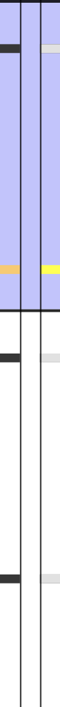
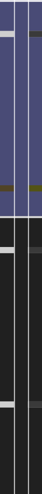

# Merge locator bar

Baseline: `7338078f8ddd924b8cddee35f512f2286072136d`,
`src/TortoiseMerge/LocatorBar.cpp` and MainFrm.cpp's LocatorBar/UseFishEye settings.

Both native comparison windows now have the source's left-side locator bar.
Its three stripes retain Left / Bottom / Right order: Before, empty, After in
two-pane mode; Theirs, Merged, Mine in three-pane mode. Consecutive state runs
are compressed and scaled against the longest actual pane, with a minimum pixel
for a changed run. Orange removals, yellow additions, red conflicts, gray gaps
and green filtered rows reuse the source light/dark palette. Normal rows leave
the blue viewport visible. Two boundary lines show the primary left source
pane's visible region. The extra optional Base pane is not a fourth stripe.

Core records initial merged-result colors while constructing the real
Subversion result. The locator keeps unchanged prefix/suffix colors after edits,
marks the edited middle yellow and overlays remaining conflict ranges red.
Original text, line endings, numbered source rows and saved bytes are unchanged.
Multiple disjoint manual edits can mark the unchanged middle between them yellow;
this is edit tracking, not a replacement merge algorithm.

Click/drag scrolls each actual pane to the selected row without selecting text,
changing Undo history or writing files. Individual panes clamp against their own
line counts. Keyboard arrows, Page Up/Down, Home/End and native accessibility
increment/decrement use the same navigation. Busy, pending two-pane preparation,
Quit confirmation and retired models refuse navigation, including stale dispatch.
Viewport tracking observes the existing native scroll views; the merged result
has a weak locator reference without joining the source-pane scroll group.

View → Locator bar and Use fish-eye in locator bar save the source defaults
(both enabled). Merge Editor Settings exposes the same options through its
existing Apply/Cancel transaction. The hover lens magnifies a tenth-height strip
fourfold, adapting the source StretchBlt lens to native clipped drawing. Appearance
changes invalidate the native view. Closing the editor removes its scroll observers
with the existing coordinators; the locator creates no child process or window.

## Grouped evidence

Forty Core tests passed with zero failures. They cover actual Subversion result
colors and conflict spans, Unicode/CRLF editing, source-state runs, unequal/empty
panes, bounded coordinates and isolated preference defaults/persistence, as well
as the existing source/comment/options/engine/presentation cases.

The unsigned arm64 Debug app build exited zero with existing diagnostic noise.
One frontend compilation and one receiver process exercised both production
viewers plus the locator: real engine stripes, native scroll/viewport changes,
unchanged selections/history/files, busy/stale and accessibility dispatch,
visibility persistence and native view recreation. Existing three-pane dirty
Cancel, regex reload, explicit resolution, two-pane Unicode selection, Undo/Redo,
encoding-preserving save and helper cleanup checks also passed. All owned windows
closed; no installed app was launched. See
[the batch record](qa/merge-locator-2026-10-12.json).

Actual native locator NSView light/dark captures were inspected and published as
small component captures on the website. They show two-pane stripes and the
viewport, not full-window layout or mouse/keyboard acceptance.

## Remaining acceptance

Physical mouse tracking and drag, fish-eye hover rendering, keyboard/VoiceOver,
three-pane scroll/layout/captures, resize/high-contrast/large-document behavior,
Settings transaction interaction and signed sandbox acceptance remain open.
Full folded-line integration, three-pane result/source alignment and complete
source-state equivalence remain pending. Find/marked-word overlays are implemented
in the continuation below.
This batch does not certify the full merge editor or application port.

## Find bands and shared marked words — October 15, 2026

The native locator now paints per-pane marked-word rows, then Find rows, over
its state stripes using the pinned normal-color intensity scales 200 and 30.
Find bands honor modified-only, case and whole-word navigation/count options;
marked rows use the source case-sensitive character-group boundaries. Multiple
occurrences on one row produce one band. Each band is at least two native points
high. Both band families participate in the existing fish-eye rendering and
normal theme changes. Accessibility reports marked/search row totals.

Double-click selects a source character group and marks it across the owning
document's panes. Repeating the same word toggles it off. Option-double-click
marks only that pane, adapting the source Control modifier to macOS context-menu
conventions. Triple-click restores the earlier marked word before AppKit's line
selection. Native menus expose Mark Word at Caret and Clear Marked Word with the
existing icon policy, so marking is also available without a pointer gesture.
Optional Base participates in shared marking but does not add a locator stripe.

Marked words have their own temporary paint and do not replace Find's query.
Source per-run coloring applies intensity 200 before Find intensity 30 where they
overlap. Edits, Undo/Redo, folding and presentation updates recompute ranges.
Locator publication coalesces on the main actor after view updates, reads the
current registered panes and refuses retired owners; it retains no pane/window.
Marked words remain session-local and never change saved text or Undo history.
The grouped checkpoint passed 14 Core cases, Debug compilation and both native
engine groups. See [word/locator evidence](qa/merge-marked-word-2026-10-15.json).
Physical
multi-click/modifier/VoiceOver acceptance, full folded coordinate equivalence,
full-window visual parity and signed sandbox acceptance remain open.

Reviewed actual locator component captures show marked-word bands on the left
and independent Find bands on the right over the existing source colors and
viewport. These are component captures, not full-window visual certification.

