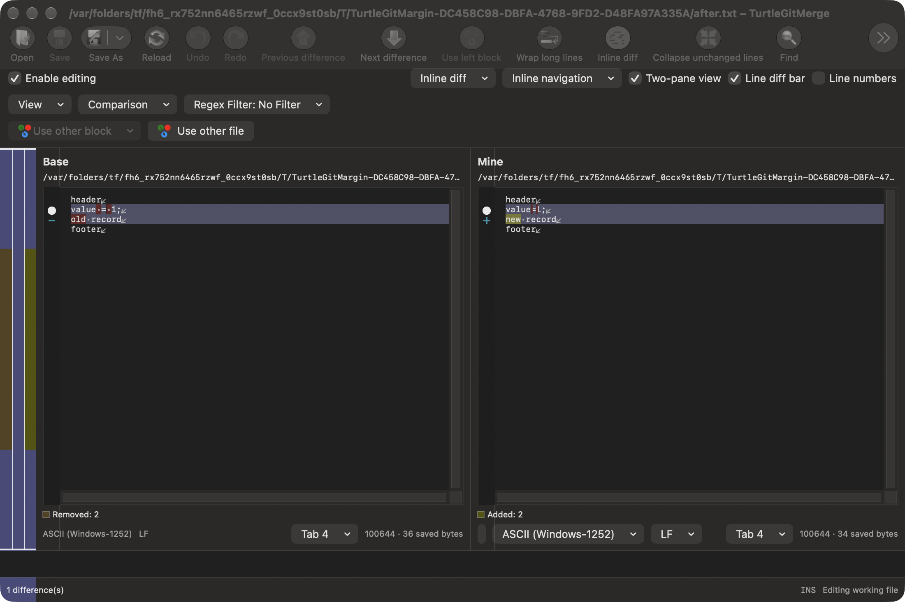
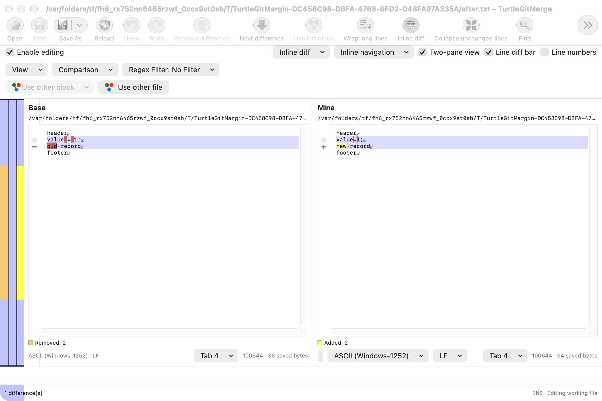
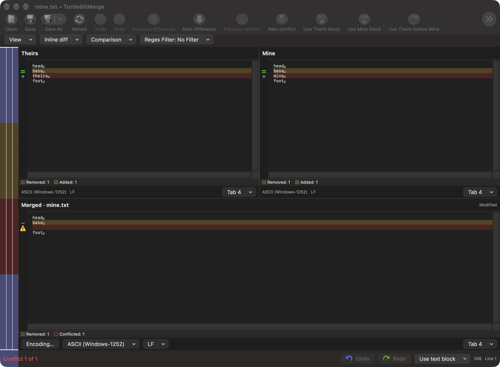
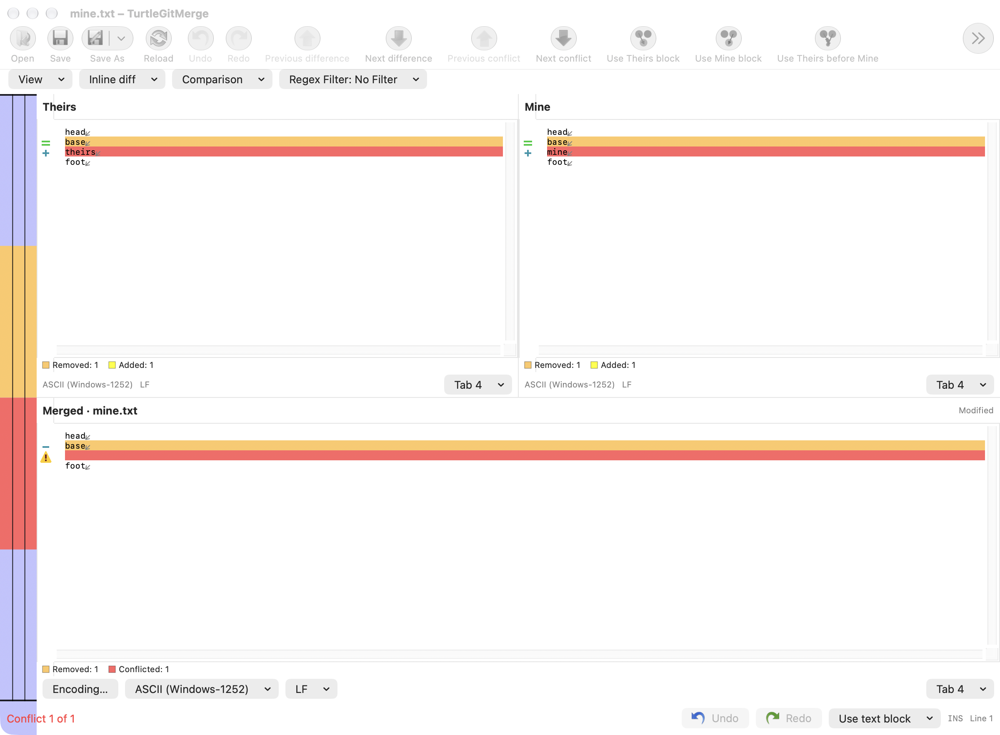

# Merge line-change margins

Baseline: TortoiseGit `7338078f8ddd924b8cddee35f512f2286072136d`,
`BaseView::DrawMargin`, `GetMarginWidth`, `GetWhitespaceBlock`,
`GetWhitespaceString`, `IsBlockWhitespaceOnly` and `FilterWhitespaces`.

The two-pane and three-pane editors now draw the original lineadded,
lineremoved, lineconflicted, lineconflictedignored, lineedited, lineequal and
linewhitespace artwork, alongside the retained moved/marked icons. Each asset
is copied unchanged from the pinned resources with its SHA-256 and source path
in Icons/provenance.json. Colored artwork is retained in both appearances.

Addition/removal aliases share their source icons; unresolved result slots and
ignored conflicts have separate icons. Edited rows retain their edit symbol.
Resolved, resolved-empty and ordinary gaps have no invented status icon.
The two source panes can replace their normal state symbol with Identical block
or Whitespace-only changes. The combined view and result have no peer and retain
their state symbols. Explicit marked blocks take priority over moved blocks;
moved blocks take priority over the whitespace/state symbol. Marked words and
search matches are separate text highlights, not marked blocks.

Whitespace classification uses original record payloads and endings. Normal rows
with equal payloads and pairs of empty payloads have no override, even when their
endings differ. Equal non-normal payloads get Identical block. Removing only
space, tab, CR and LF detects single-line whitespace changes. Otherwise the
source's same-state/Empty block search extends at most eight records each way;
block concatenation is refused above 2048 UTF-16 units including the source's
two-unit-per-row allocation allowance. Empty can inherit an adjacent non-Normal
state. Identical/reflowed blocks update the bounded block's icons together.
Nonbreaking space and canonically equivalent but byte-distinct Unicode are not
silently normalized. This decoration does not change comparison keys, folding,
Find categories, difference counts or saved bytes.

Classification is cached in the native ruler when original records/states or
peers change; drawing uses cached symbols and artwork. Native hover labels describe
the visible symbol; moved tooltips and double-click navigation retain their
captured peer route. Hidden/fold-marker rows do not draw icons or tooltips.
Hiding line numbers retains the source's 20-point icon margin in every pane;
showing them restores its measured number width. Initial indentation/number
defaults and later preference notifications now read the owning window’s supplied
preference store in both editors; they previously mixed it with global defaults.
Existing per-pane EditorConfig toggles remain independent on later Apply.
Existing wrapping and linked
scrolling use the resulting document width.

The source caches icons as screen rows are drawn; the native projection classifies
view records in a deterministic forward pass before drawing. Exact virtual wrapped
padding/icon repetition, margin selection/drag gestures, physical hover and
VoiceOver traversal, large-file performance, minimum-OS and signed installed
acceptance remain open. This does not certify complete Merge or app parity.

## Native captures and validation

Unedited, inactive native compositor captures in both appearances. The comparison
shows the icon-only margin and whitespace/added/removed symbols; the conflict
window shows equal source Base records, source additions and unresolved result
slots. Inactive toolbar controls use normal macOS dimming. These captures do not
certify every margin gesture or whole-window upstream geometry.

[Grouped evidence](qa/merge-margin-2026-10-16.json) records the 11 passing
Core checks, four native family cases, the capture follow-up, the initial
preference failure and two fixture corrections. All test-owned receivers and
capture helpers were reaped. Complete physical, signed and hosted acceptance
remain open.
