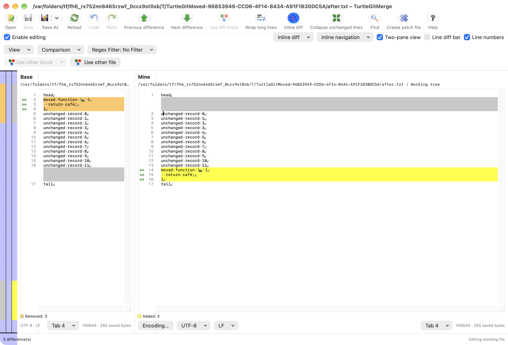
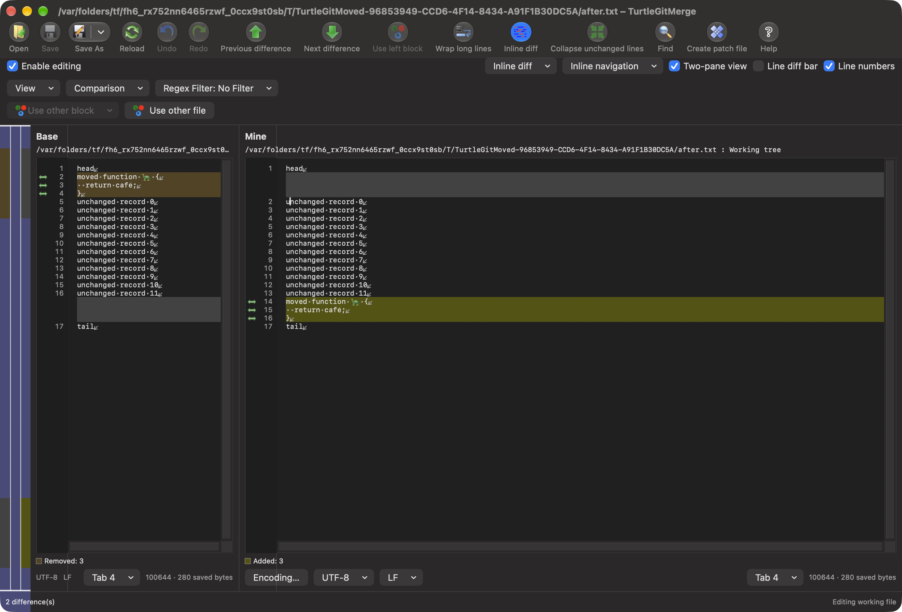

# Moved blocks

Source pin: `7338078f8ddd924b8cddee35f512f2286072136d`,
`MovedBlocks.cpp`, `DiffData::TieMovedBlocks`, `MainFrm::OnViewMovedBlocks`,
`BaseView::OnLButtonDblClk` and `OnToolTipNotify`.

Two-file comparison now offers **View → Moved blocks**, enabled by default and
saved as `TurtleGitMerge.ViewMovedBlocks`. The detector runs off the UI thread
against the authoritative Subversion modified intervals. It ports the source's
unique-line equivalence groups, repeated-line extension, left/right passes and
interval splitting. The source detector's special whitespace normalization and
final NoEnding-record refusal are retained. It compares original payloads after
removing EOL, separately from engine regex/case/comment keys.

Both panes show the original colored `moved.ico` in their native margins, with
Moved to/from line tooltips. Double-clicking a moved margin selects its whole
counterpart block, focuses that pane and centers linked scrolling. Combined view
maps removed and added occurrences independently and follows the move within the
same pane. **Go to moved block** in the native text context menu provides a
keyboard-accessible alternative. Line-number hiding retains a needed move margin.
Three-way views show the source-disabled toggle; they do not run this detector.

The saved toggle uses the existing owned comparison Save/Don't Save/Cancel and
reload workflow. Cancel preserves drafts/preferences; accepted reload clears old
Undo and rebuilds the links. Edits, projection changes, filtering and owner closure
invalidate old action targets. In-place editing retains move markers on surviving
view records, shifts peers with inserted rows and drops deleted records; new
records start unmarked. Destination selection stops at a newly inserted unmarked
row. Undo/Redo restores the captured move metadata with its matching presentation.
Navigation uses original line coordinates on load and retained view records after
an in-place edit. Following a move never changes source text, saved files, encoding, annotations or Git state.

The detector annotates the current authoritative alignment. Existing native row
pairing is retained; the full upstream DiffData line-pairing/sticking algorithm
has its own remaining parity work. Source tooltip display-row versus original
line numbering can differ when earlier changes insert padding. Physical margin,
trackpad/keyboard/VoiceOver, complete source layout, large-file/minimum-OS and
signed/App Store acceptance remain open. Retained edit tooltips keep the captured
source labels; full edit/tooltip numbering parity remains open.

The [batch record](qa/merge-moved-blocks-2026-10-16.json) records the initial
source-bookkeeping failure and repair, 1,265 matched source cases, the 45 focused
Core cases (41 initially passed; four repaired cases passed), three successful
Debug builds with their diagnostic noise, and eight distinct successful native
editor cases. The new move workflow and its captures passed after a fixture
aligned-row correction. Optional capture of the retained wrapped window failed;
its affected case and the six remaining cases then passed without captures.
All owned receivers were reaped and independently absent. This does not certify
complete editor, physical or signed behavior.

The [comparison EOF continuation](MERGE-EOF-PARITY.md) now restores the source
DoTwoWayDiff final-record/trailing-gap repair. Move detection still uses original
physical engine intervals, and source-to-view links retain original line numbers.
