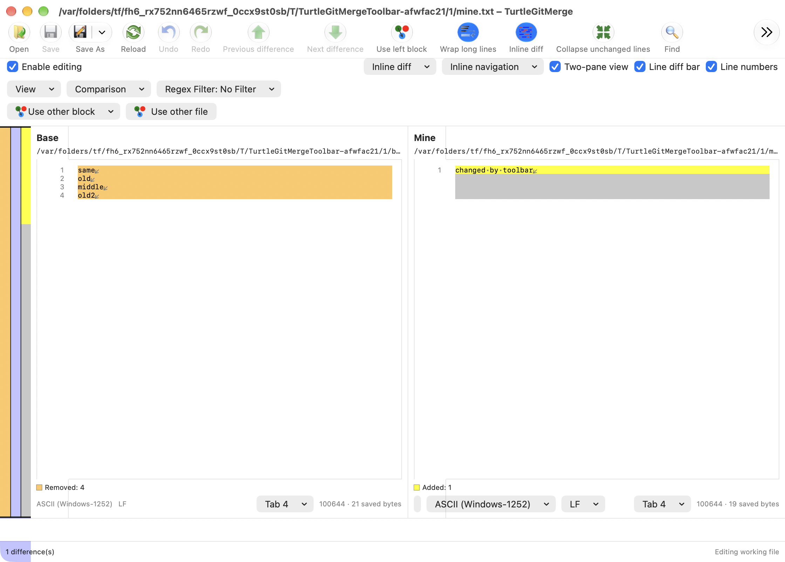
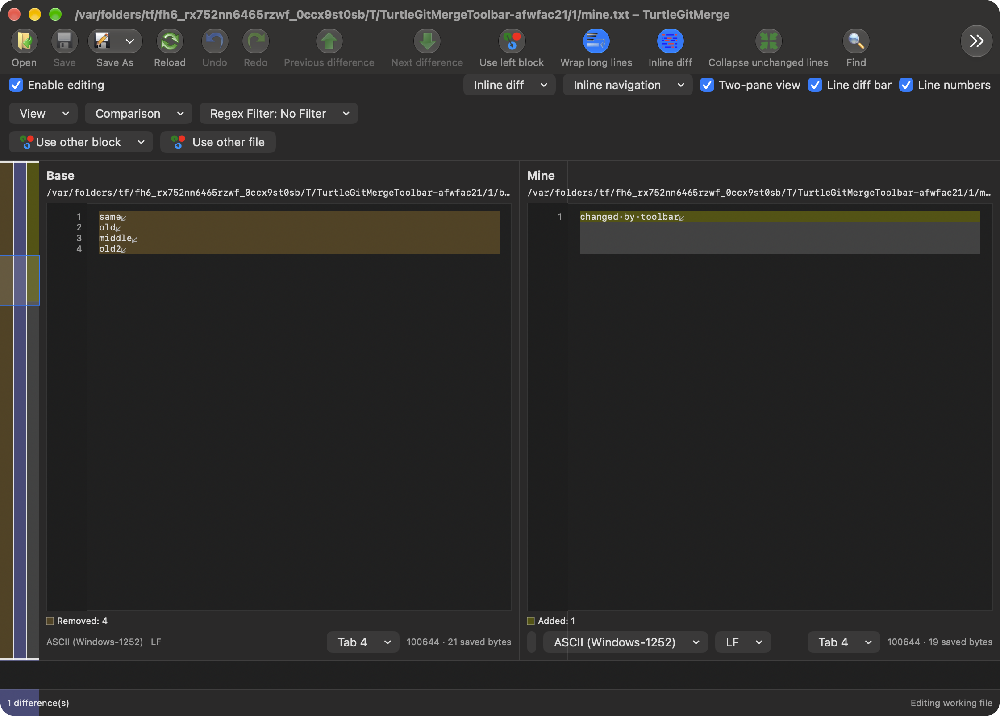
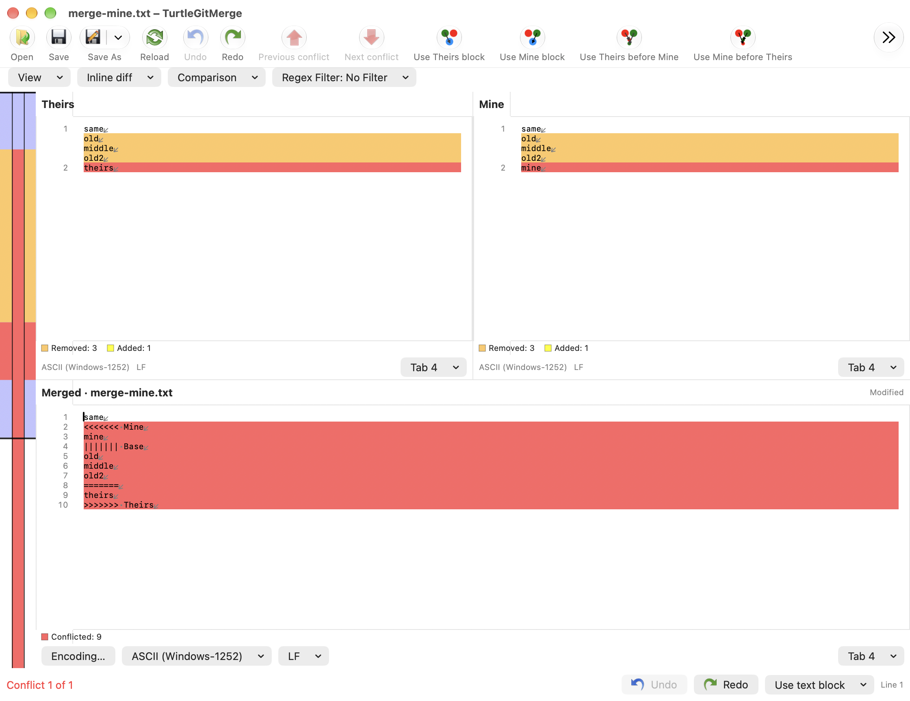
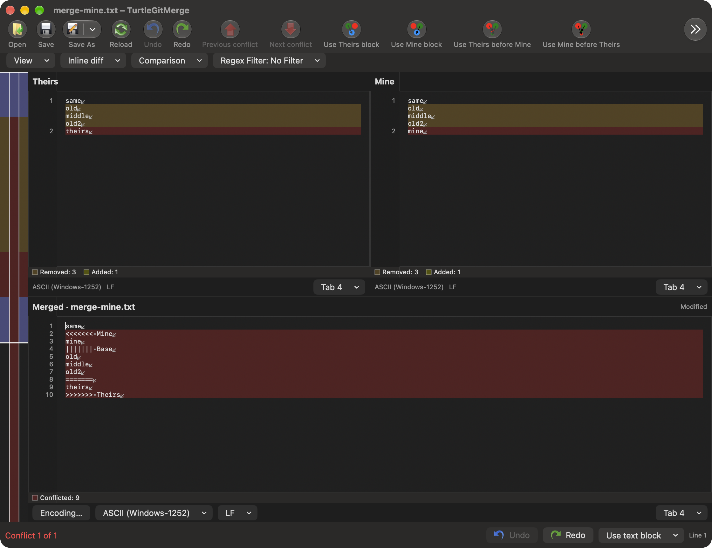

# Native Compare and Merge command toolbar

Baseline: TortoiseGit `7338078f8ddd924b8cddee35f512f2286072136d`,
`IDR_MAINFRAME` toolbar in `src/Resources/TortoiseMergeENG.rc`, its ribbon artwork
and the existing MainFrm command handlers.

Both text editor owners now install an AppKit toolbar. The top content row is
replaced when that toolbar is installed; detailed View/comparison/filter/format
controls remain in the content. AppKit supplies labels, overflow, customization,
Icon and Text/Icon Only modes and saved layouts. This is the macOS adaptation of
the Windows toolbar/ribbon, not an MFC ribbon implementation or a new inactive
Use Ribbons checkbox.

Open, Save, Reload, Undo and revision navigation keep the source relative groups.
Two-pane difference arrows use the original green artwork; conflict arrows retain
red. Existing source Save/Undo/Find/block-choice images are reused. Seven additional
Open/navigation/wrap/whitespace/collapse/one-pane BMPs are copied unchanged with
SHA-256 provenance; the shared decoder retains their original straight alpha.
Native Save As, Redo, Find, patch creation and Base/source comparison additions
retain existing workflows. Source-only/unsupported command variants are not
silently mapped to a different Git operation.

Save As retains separate left/right targets in two-pane views. Conflict editors
keep left/right/merged output and Continue resolving, plus a separate Compare
sources dropdown. Defaults include the actions formerly present in the top row;
items that do not fit remain in the native overflow menu. Palette commands add
whitespace, inline-word, one-pane and folding controls. Toggle states follow the
live model. Each window has a unique native toolbar identity. Only item order and display
mode are saved by editor family in the owning preference store; private hosts
write only their supplied store. Existing windows retain their own layouts.
Native automatic global toolbar saving is disabled.

Every item, dropdown and overflow dispatch rechecks its owning model's busy,
preparation, pending-choice, sheet and retirement gates. Automatic AppKit enabling
is disabled to avoid reviving unavailable operations. Queued state refreshes read
the current model and coalesce. Save, conflict choices and Undo use the existing
owned workflows, without a parallel Git implementation.

Image comparison removes the text toolbar. Open replacement retires the old items
and creates a toolbar bound to the surviving native window and new model. Closing
an owner cancels observation, disables retained controls and discards actions.
The fallback content row remains available in embedded/non-toolbar hosts.

Three icon/resource Core cases, the final Debug build and both native toolbar
configurations passed. The retained Find/word-marking groups also passed with
system and bundled Git. Initial failures, focused repairs and limits are in
[the toolbar record](qa/merge-toolbar-2026-10-15.json).
Physical customization/overflow tracking, toolbar accessibility-client behavior,
complete Windows ribbon/group/shortcut equivalence, full-window light/dark visual
comparison and signed App Store acceptance remain open.

Toolbar layout can mount a prepared SwiftUI editor before Open adopts its window.
Replacement owners therefore defer the initial read until the surviving window is
bound; they do not borrow a cancelled read session from the temporary window.
Close notifications also check the controller’s current native window. Native
checks prove distinct replacement controllers and live document/toolbar binding.

The following unaltered compositor captures use private fixtures. They show the
current native toolbar, overflow and source palette in both appearances; they do
not certify every Ribbon command, physical interaction or conditional state.

