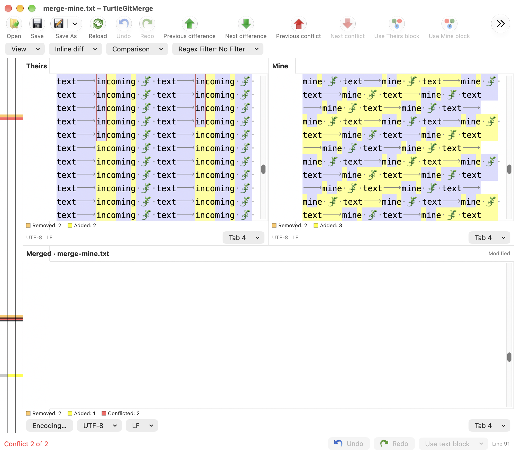
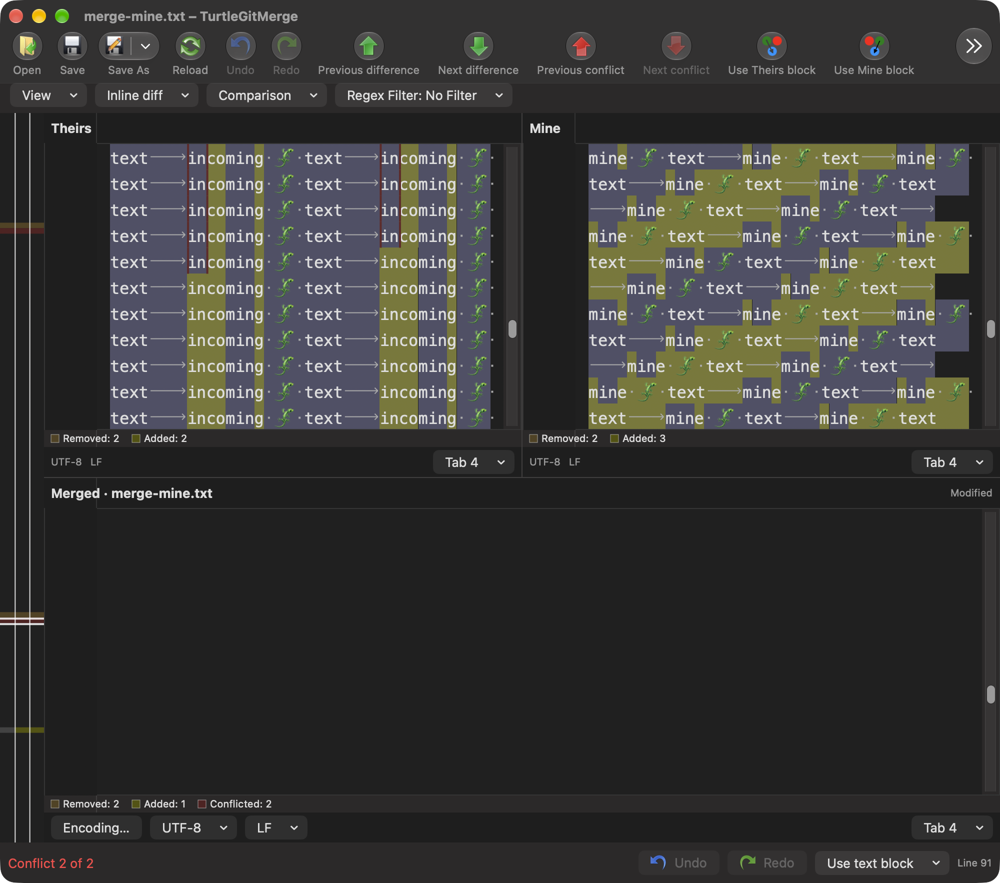

# Wrap long lines

Source baseline: `7338078f8ddd924b8cddee35f512f2286072136d`,
`MainFrm.cpp::OnViewWraplonglines`, `BaseView.cpp::WrapChanged` and
`BuildScreen2ViewVector/CountMultiLines`.

Both native text viewers now offer **View → Wrap long lines**, saved as
`TurtleGitMerge.WrapLines` with the source false default. Wrapping uses the
pane's actual width, font and tab settings. Horizontal scrolling is disabled
while wrapped and restored when unwrapped; horizontal offsets reset as upstream
does. Window/split resizing schedules a bounded layout update.

Aligned two-pane rows use the maximum intrinsic wrapped height across their
panes. Extra paragraph spacing fills the shorter side without inserting text,
so subsequent corresponding rows keep the same vertical position. The same
logic aligns the two source panes of a three-file merge. Combined and single-file
views wrap independently. The current three-pane result/marker layout wraps
independently: complete source-to-result row alignment remains separate open
work, as it did before this feature.

TextKit keeps logical UTF-16 selection, clipboard, Find, edit and Undo offsets;
wrapping does not change file text, comparison ranges, source line numbers or
encodings. The existing ruler labels logical lines once, and the locator derives
visible logical rows from glyph geometry. Owned frame/storage observers and
queued layout work retire with their viewer.

Native checks compare actual wrapped geometry, matching paired-row positions,
resize reflow and horizontal-scroll gates, plus text/selection/history/alignment
and saved-byte invariants. They cover one-pane and three-pane mode changes and
retired preference refusal. Source CString word wrapping and TextKit Unicode
word boundaries are not certified equivalent. Full continuation/background
styling, active-caret visibility, long-scroll anchoring, unchanged-section
collapse, high contrast, large-file performance, physical light/dark/keyboard
and signed/minimum-OS acceptance remain open.

## Evidence

Unsigned Debug builds passed. One fixture compilation linked the existing app
objects; all sixteen Merge receiver families passed in one process. The wrapping
receiver measured actual glyph-row geometry across differing source lengths
and after resizing, with text/selection/history/comparison/saved-byte invariants
retained. See [the batch record](qa/merge-wrapping-2026-10-12.json).
All test-owned windows/helpers closed. Full hosted and physical/signed
acceptance remain unproven.

## Ruler viewport follow-up — October 15, 2026

The conflict identity visual review found initial characters hidden under the
line ruler. The shared wrapping adapter now uses clip-view insets for leading
horizontal position and available wrapping width, retaining user offset when
ruler geometry changes. See [the connected family](CONFLICT-IDENTITIES.md).

[Grouped validation and visual review](qa/conflict-identities-2026-10-15.json)
record actual coverage and remaining limits; no dialog is newly certified.

## Wrapped navigation and viewport reflow — October 16, 2026

The current aligned result projection already supplies result cells to the shared
wrapping controller. All three aligned panes therefore participate in row-height
measurement; the earlier independent-marker-result description above is historical.
This continuation adds actual TextKit screen-fragment entry positions and owned
viewport reflow across both editor families.

Reverse difference/conflict entry uses the last actual wrapped fragment of its
logical entry row. Forward entry uses the first; two-pane inline advancement
still follows entry as upstream. A newly selected context block retains the clicked subline,
clamping the corresponding peer entry when that pane has fewer fragments. A context click inside an existing block retains its caret and block, as upstream. Source
and result block ranges remain logical UTF-16 selections independent of the caret.
Only the active pane centers linked scrolling, so different peer wrap counts
cannot race to recenter the group.

The wrapping owner caches settled row geometry and the visible row/fraction from
explicit wheel, key, mouse and native scroller input, and completed block, locator,
Find and Go to Line navigation. Automatic TextKit caret visibility during reflow
does not replace that reading intent. Pending reflow drains before new input. Width, font and wrap changes restore that reading position after all
shared heights settle. A text replacement invalidates the aligned group's saved
anchors; hidden fold rows refuse an obsolete anchor. Paragraph padding is included
in the reading fraction, so short-side alignment gaps do not select the next row.
Frame/storage/bounds observers share retirement, and pending geometry cannot
replace a captured anchor using partially reflowed layout. TextKit extents are
updated before scroll clamping. A real scroller-width change schedules a bounded
follow-up layout pass.

The source's screen-row state walk and no-wrap boundaries remain the baseline
(`BaseView::SelectNextBlock`, `SetupAllSelection`, `CountMultiLines`). TextKit
word boundaries and a native insertion caret inside a short pane's virtual
padding are not certified identical to Windows. Arbitrary multi-font/custom
paragraphs, extreme sizes, physical gestures, VoiceOver, minimum OS, signed scopes
and complete editor/application parity remain open.

The locator waits for settled shared geometry, and unchanged selection/viewport
values no longer republish the editor model or reschedule identical peer scrolling.
This avoids a native layout feedback loop when long wrapped rows reflow.

[Grouped validation](qa/merge-wrapped-navigation-2026-10-16.json) records seven
passing native cases after the repairs, including retained navigation, initial
entry, folding and Find. No Core changes or Core rerun were required. All owned
receivers were reaped and independently absent. These are local unsigned checks;
no complete hosted or physical/signed acceptance is claimed.

Actual three-pane captures show the wrapped sources at an unresolved conflict
whose aligned result cells are empty. They document this state, not complete
Windows visual parity.

