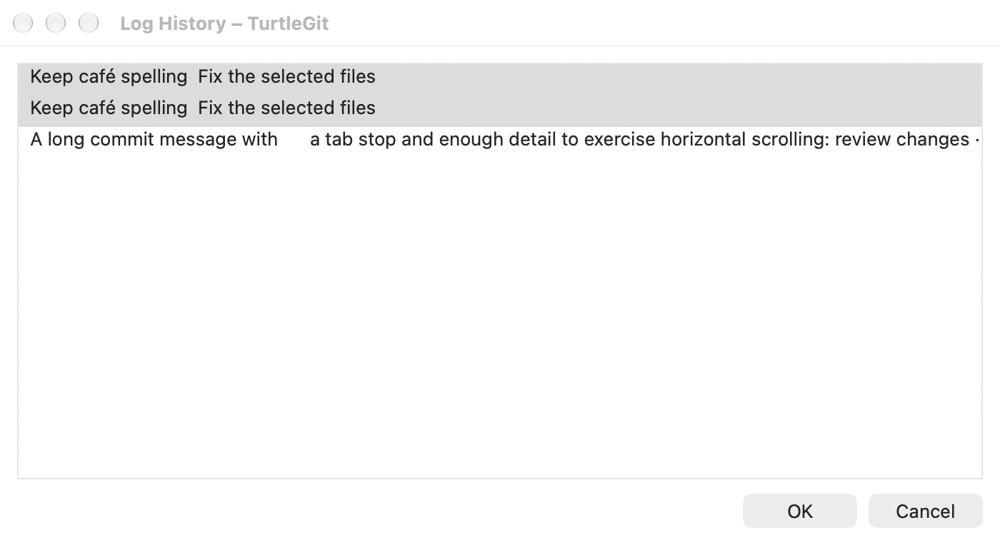
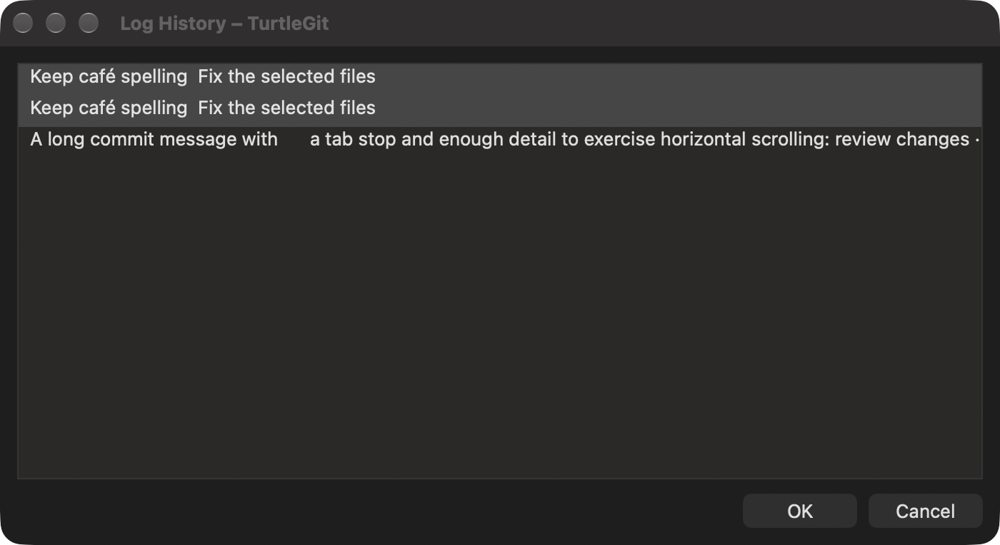

# Shared Commit and Merge message history

The reference is `HistoryDlg.cpp`, `IDD_HISTORYDLG` and `RegHistory.cpp` at
TortoiseGit `7338078f8ddd924b8cddee35f512f2286072136d`. The shared picker retains
the source's single scrolling list above OK and Cancel. Commit stores history per
repository; Merge retains its separate global history and existing source limit
rules. Both production consumers now host the full native AppKit surface directly.

| Source behavior | Native implementation |
| --- | --- |
| `IDC_HISTORYLIST`, extended selection, horizontal/vertical scrolling | Headerless native table; row identities are indexes; the column retains the full flattened message extent. |
| Display removes CR and replaces LF with spaces | One-line native labels retain full original messages in tooltips/accessibility labels. |
| OK joins selected rows in list order with two newlines | Selected raw strings are joined in displayed order; no selection returns an empty string. |
| Double-click accepts only the current row | The clicked native row supplies its original message. |
| Delete removes one entry and saves immediately | Removal preserves exact message identity, reloads current history storage and selects the next available row. Cancel does not undo deletion. |
| Initial list focus, Return/Cancel and `HistoryDlg` geometry | Native table focus/default and cancel buttons; existing owned sheets and shared geometry remain. |

## Exact messages and callback ownership

Commit deduplication now compares raw string identities, matching the source's
`wcscmp` behavior. Commit and Merge expose exact multi-message removal without
first inserting messages into a canonically comparing Swift String set. Existing
storage and public legacy removal calls remain compatible. Interleaved dialog
mutations still reload storage, preserving messages added by another dialog.

Native commands capture their picker, displayed generation and selection. Foreign,
retired and selection-away-and-back commands cannot delete or accept messages.
OK/Cancel complete once; closing or detaching the native owner retires its model.
The compatibility embedded host renders the same AppKit controls as production.

Commit's template replacement, unedited-template checks, cancel/amend draft
retention, asynchronous history issue extraction and message styling guards now
preserve exact message identities. Merge's message editor also updates when only
the raw Unicode spelling changes. These changes avoid treating two distinct Git
messages as an unchanged draft.

## Evidence and limits

[The checkpoint](qa/message-history-source-2026-10-17.json) records the Core and
grouped native checks, initial build repair, original captures and owned cleanup.
These checks do not certify physical pointer/key gestures, VoiceOver, every
platform input method, all history limits under concurrent process writers or
signed App Store behavior. The Cocoa table's selection/caret conventions still
need physical acceptance against the Windows listbox for extended selections.
Complete Commit, Merge and all upstream dialogs remain partial.

The images below are unaltered compositor captures of the native shared picker,
shown as a standalone owned QA window. Production Commit/Merge present the same
surface as a sheet; these images do not certify physical parent/sheet placement.

