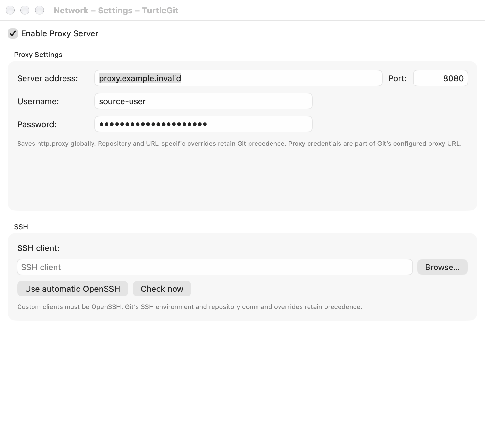

# Network settings — implementation in progress

Reference: pinned SetProxyPage.cpp/.h and IDD_SETTINGSPROXY at
7338078f8ddd924b8cddee35f512f2286072136d.

The native Settings tree now includes Network with the original proxy.ico.
The layout follows the source Enable Proxy Server checkbox, Proxy Settings group
(address/port/username/password), spacing, and lower SSH group with editable
client path and Browse. Native additions provide automatic-client reset and a
version check so an executable file can be checked before it is saved. Shared
property-sheet Apply/Cancel owns the draft; cached hidden pages apply through the
owning Settings window. Repository changes unregister the old Network model.

Proxy configuration loads Git's effective http.proxy, including existing local
precedence. Apply writes only the global http.proxy key; disabling removes that
global key, preserving repository/URL-specific settings and includes. Address
parsing handles supported HTTP/HTTPS/SOCKS schemes, optional embedded ports,
userinfo escaping and IPv6 syntax through URLComponents. Separate port values
must be 1–65535, or blank/zero for an unspecified port. Username/password remain
separate native fields; malformed effective URLs allow entry of a replacement
rather than silently rewriting the imported value. Git keeps the configured
proxy URL, including its authentication fields, in its ordinary configuration.
Write failures suppress command arguments and Git diagnostics that might expose
proxy credentials and report the key instead.

Source registry draft retention is adapted to nonsecret preferences plus a
Keychain password cache. Disabling a proxy retains address/port/username and the
password for later re-enabling. Passwords are not duplicated into UserDefaults.
Cache/preferences precede the global Git write, matching source-ordered partial
save behavior; a later failure can leave earlier draft retention saved. Ordinary
Cancel restores only unsaved UI fields. Proxy saves precede SSH preference saves.

Custom SSH selection uses executable-file security bookmarks, retained grants,
OpenSSH -V validation, an absolute executable path and a ten-second bounded
check. No shell parses that path. Empty selection means automatic OpenSSH.
GitRepository injects the selected client through GIT_SSH/GIT_SSH_VARIANT only
when process GIT_SSH/GIT_SSH_COMMAND are absent; Git's core.sshCommand and per-
operation overrides retain precedence. An unavailable saved client fails SSH
rather than falling back to a different client; ordinary Git configuration
commands remain able to repair it. General's environment viewer reflects the
same selection. App Store builds ignore custom clients and retain bundled
OpenSSH, with custom selection/check/browse disabled.

Owned global/XDG authorization and Browse panels use cancellation/generation
fences and one-shot permission responses. Hiding or retiring the page cancels
pending reads/checks and closes its panels. Already-authorized save sequences
can finish after forced closure. Active saves guard page switches, window
closure and application termination. Normal version checks are canceled on
retirement; Apply checks are bounded even if the chosen client hangs.

This substantial backend/UI/runtime batch is **uncompiled and untested**.
Validation remains deferred to the combined Network/Finder-settings section
boundary. The preceding authentication checkpoint does not cover it. Outstanding
checks include escaping/scheme/IPv6/port edge cases, live scoped proxy writes,
Keychain retention/failures, SSH precedence and unavailable/moved bookmarks,
version timeout/cancellation, cached Apply/Cancel/partial failures, native layout/
keyboard/theme and owned panels, Finder runtime boundaries and signed sandbox
execution. Source PuTTY/plink client behavior is replaced by native OpenSSH;
non-OpenSSH executable variants and key conversion remain open. No dialog is
newly certified and the whole port remains incomplete.

## Grouped Network/Finder checkpoint — 2026-10-11

Debug arm64 native build exited 0. The focused NetworkFinderSettingsBatchTests,
FinderSubmoduleMetadataTests, FinderMenuSettingsTests, FinderSubmoduleScanTests
and GitRuntimeSSHTests group passed: 22 tests, zero failures, 7.692 seconds.
Proxy parsing/credential escaping/IPv6 and invalid inputs, live global writes
with local/URL-specific preservation, sanitized lock failures, SSH precedence/
App Store selection and real version check/cancellation are covered. Finder
policy tests cover rule precedence, propagation, handlers, None mode, persistence
and snapshot compatibility; existing cache/child scans also passed. No app
was launched. Native UI/Keychain/Finder, timeout/moved bookmark, mount/case and
signed sandbox acceptance remain open. Xcode emitted existing warnings and seven
unusual exit-zero SwiftCompile diagnostics. This supersedes the uncompiled/
untested statements above; see `qa/network-finder-settings-batch-2026-10-11.json`.

## Native lifecycle and configuration batch — 2026-10-12

Network settings now accept isolated preference and password-store dependencies,
with production still using the same app-private Keychain adapter. Native checks
can exercise reads, writes and SSH responses without reading the user's Keychain
or editing global user preferences. The page loads/saves SSH and retained proxy
drafts from its supplied preference domain.

Apply no longer restores an obsolete active-page flag after forced deactivation.
An already-authorized save may finish, but cannot reactivate a closed/hidden page.
A late proxy read is fenced before accessing the retained-password cache. Source
ordered partial-save behavior (cache/preferences before Git, proxy before SSH)
is retained and explicitly checked rather than changed into a different policy.

The native receiver uses real Git against a private global config, private
preferences and a mock password actor. It covers escaped proxy Apply, disabling
with URL-scoped override preservation, retained password boundaries, cache/write
failure ordering, sanitized diagnostics, Settings validation/Cancel, light/dark
host construction, captured SSH Apply completion after close and late read/cache
fencing. It joins the existing app-object reference receiver cache; no separate
whole-app compilation or live network/Keychain access is needed.

Remaining: actual production Keychain API/grants and signed sandbox acceptance,
physical controls/keyboard/panels and full light/dark screenshots, moved SSH
bookmarks/version timeouts, non-OpenSSH source clients and full application
parity. The inventory remains partial, not certified.

The new focused Core group passed eight tests, and the unsigned Debug build
passed. The Network receiver passed with both system and bundled Git, using one
fixture compilation against existing app objects and two private processes.
All owned windows/processes were closed/reaped. See
[the native record](qa/network-settings-native-2026-10-12.json).
The complete ten-family reference group was not rerun locally; hosted/signed
acceptance remains unproven.

## Source layout and SSH read/picker family — October 17, 2026

Network now retains visible Server address, Port, Username and Password labels
when values are entered, following `IDD_SETTINGSPROXY` rather than using labels
only as placeholders. Proxy Settings retains its larger source group and SSH
follows beneath it. Enable Proxy controls the entire proxy field group. The SSH
client label, path and Browse remain independent of that proxy checkbox.

The SSH path uses the shared native path-entry control with completion, ordinary
file URL input, source-path editing and private preference injection. Its typed
path remains subject to the existing absolute executable/OpenSSH validation;
completion does not authorize a custom Store client. Store builds retain bundled
OpenSSH and disable custom client controls. Automatic reset and version checks
remain explicit macOS additions to the source page.

Browse owns one captured request. Duplicate invocation, changed SSH draft,
deactivation/closure and late duplicate replies cannot overwrite another client
or save a bookmark. Accepted files must be existing executable files; directories
are refused before bookmarking. Cancel keeps the prior client. A pending chooser
blocks Settings Apply/close/page selection and application Quit independently of
a real attached sheet, including injected presenters.

Loading and Check now have independent read/drain accounting, keeping their
repository access and application Quit ownership after forced page retirement.
Cancel check requests the current version-process cancellation and retains the
busy state until actual drain. Old/cancelled replies and replies describing a
changed client cannot publish a version/error. Hiding or closing the page cancels
its read and dismisses its owned picker; already-authorized Apply saves keep the
existing source-ordered completion policy. This supersedes the previous lack of
independent read/chooser accounting; actual signed Keychain/scopes and physical
controls/keyboard/minimum-OS acceptance remain open.

All fourteen `IDD_SETTINGSPROXY` controls have explicit partial native mappings:
Enable; server/port/username/password labels and fields; SSH label/path/Browse;
and Proxy Settings/SSH group boxes. No full-dialog certification is implied.

[Grouped evidence](qa/network-source-family-2026-10-17.json) records four distinct
passing case/engine combinations: source owners/layout and retained private Git
configuration/Apply behavior, each with system and bundled Git. The source group
was repeated after the recorded layout/host and cached-page reactivation repairs;
unaffected configuration checks and Core were not repeated. All eight owned
receivers were reaped and independently absent; actual SSH version helpers are
asserted absent inside each source case.

The final private page host uses the same bounded Settings viewport as production.
Both passive captures were individually reviewed: permanent labels, complete
proxy/SSH groups, masked sample password and all SSH buttons fit without clipping.
Inactive titles preserve user focus. These are page-host captures, not a new
standalone production Network window or signed/physical acceptance.

[Network Settings page, dark](site/assets/network-settings-dark.png).
