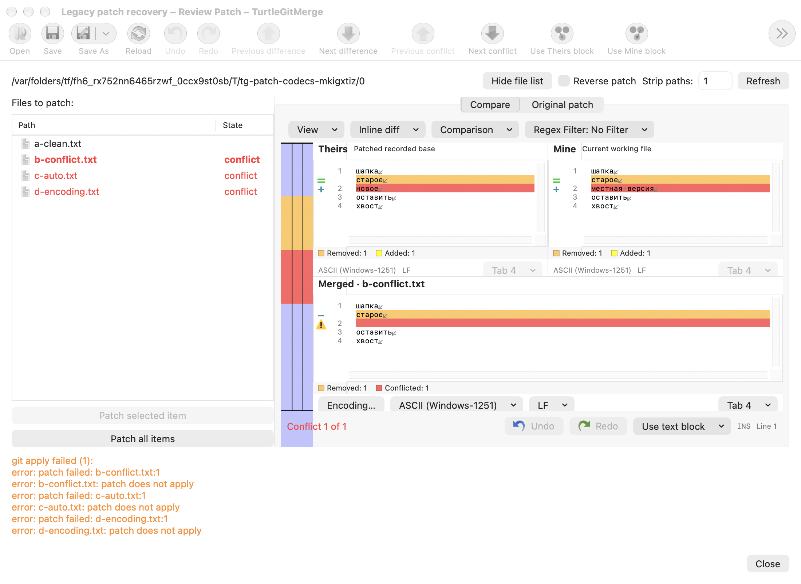
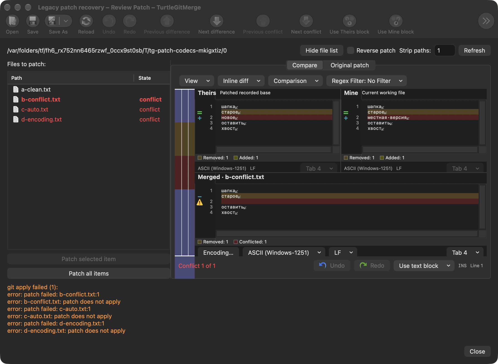

# Patch file encoding and recovery

The pinned source is TortoiseGit `7338078f8ddd924b8cddee35f512f2286072136d`,
`Git/GitPatch.cpp::PatchFile` and TortoiseMerge's recorded-base `PatchFile` path.
Git patch application retains the original patch bytes. File panes decode the
recorded base, working file and patched file before comparison/merging, as the
source's file loaders do.

The native review captures **Use UTF-8** and **Legacy text encoding** when it
loads. The same immutable policy now reaches initial row inspection, clean file
preview, recorded-base recovery, embedded three-way merge and automatic per-file
recovery. Changing preferences while that review is open does not reinterpret its
captured files. Explicit Refresh captures a new policy. Ordinary automatic refresh
and post-save bookkeeping retain the accepted review's policy.

## Connected behavior

Legacy text no longer reaches the binary chooser merely because the generic
Unicode-only decoder could not read it. Source/current/patched panes retain their
individual codecs; valid Unicode input still takes precedence over a legacy
fallback. Direct patch application keeps its raw-byte behavior, while automatic
three-way recovery writes the working pane's retained codec.

An unrepresentable automatic merge stops before writing and reports that manual
preview is required. **Preview** stays available, opening the combined text with
its original output codec. Choosing a representable output format, such as UTF-8,
allows an explicit Save. File bytes, mode, stale-file checks, index and HEAD guards
remain separate from display decoding.

The legacy fallback retains the existing binary boundary for NUL-containing
payloads unless the prior Unicode detector recognizes them. The source detector's
permissive BOM-less UTF-16 guess cannot by itself promote those patch payloads
into editable text. Binary, symbolic-link and deletion choices retain their
existing explicit recovery flows.

## Evidence and remaining work

[The checkpoint](qa/patch-codec-family-2026-10-17.json) records 35 distinct focused
Core cases across retained and affected checks. New real-Git cases cover
Windows-1251 and Shift-JIS recorded-base previews and saves, automatic recovery
that preserves an independent local edit, an unrepresentable mixed-encoding
result resolved through UTF-8, and preservation of binary classification.

Eight grouped native workflows passed with system and bundled Git: the new codec
family and retained recovery, special-file and native file-panel families. They
exercise the production embedded editor, direct/manual/automatic application,
changed preferences, error-to-Preview continuation, explicit UTF-8 Save and exact
working bytes, modes, HEAD and raw index preservation. Both unaltered native
captures below were inspected. They show the existing inactive-toolbar fading;
complete toolbar/physical appearance acceptance remains open.

The **Original patch** text tab and serial-import/unified-diff legacy display
now have a [separate connected migration](RAW-PATCH-CODECS.md). The original
file-pane/recovery checkpoint does not certify that raw-patch presentation. Wider filename alias handling,
all codepage mappings, physical gestures/accessibility and signed sandbox/App Store
acceptance also remain open. No whole-app or complete hosted CI claim follows.

