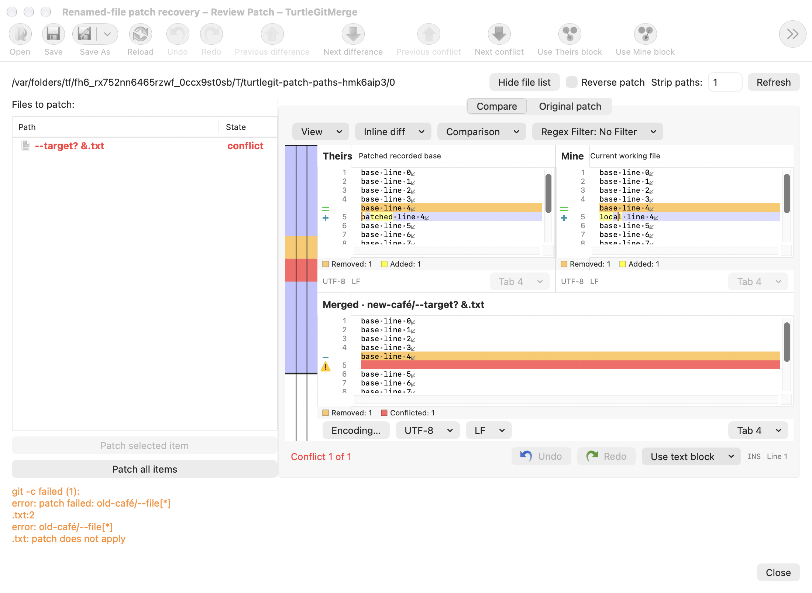
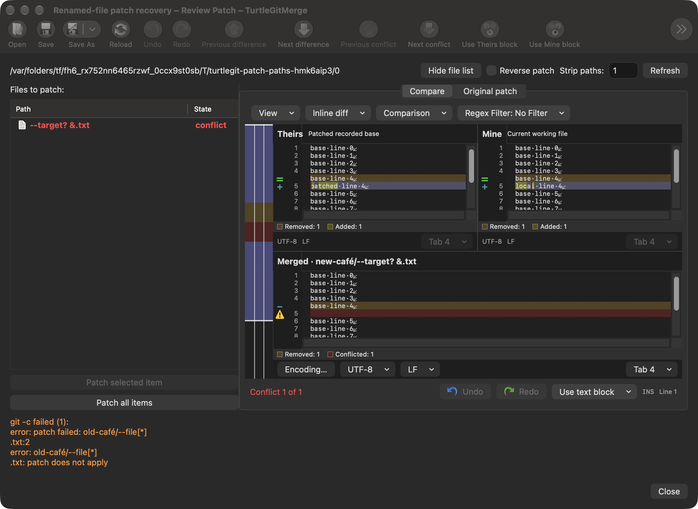

# Patch filenames, renames and recovery

Per-file patch review keeps Git's exact UTF-8 filename spelling through its input
and output snapshots, copied preview workspace, recorded-base recovery and edited
or special-file saves. Composed and decomposed Unicode strings do not share a
Swift dictionary entry. Source/destination matching and recovery seeding use the
same exact identity. Save-tree construction orders the raw UTF-8 names.

Patch paths still pass the existing working-tree location and parent/symlink
guards. After validation, file URLs are constructed without Foundation's filename
normalization. Both the source and destination of a rename remain in the captured
input set, so an external edit to either side invalidates Save. The original patch
bytes, selected-file include patterns and raw Git path arguments are retained.
Patch commands override `core.precomposeunicode=false` for that invocation,
including disposable preview/save repositories. The user configuration is not
changed. Include filters escape only wildcard bytes, preserving Unicode payloads.
Text saves keep the existing empty-result deletion policy; binary, symlink and
deletion recovery retain their explicit Current/Patched choices.

## Serial import drops

Dropped file URLs append in provider order, skipping directory providers and
byte-identical lexical paths already present or already seen in that drop. Unicode
spelling peers remain distinct rows with independent UUIDs. Direct Add retains
its existing ability to append duplicate rows, matching the separate source
routes; this change does not silently deduplicate a deliberately repeated import.
Existing pending-drop, stale-catalog and owner-retirement gates remain in force.
Preview and import still use the captured original file, not a regenerated patch
from displayed text.

The pinned source references are `GitPatch::PatchFile`, `FilePatchesDlg.cpp`, and
`CPatchListCtrl::OnDropFiles` at
`7338078f8ddd924b8cddee35f512f2286072136d`. Git's NUL-delimited forward/opposite
numstat provides the path identities; the port does not parse quoted UI captions
to decide where a rename writes.

## Evidence and limits

The [dated checkpoint](qa/patch-path-family-2026-10-17.json) records the focused
Core and grouped native cases and any failures. Coverage includes real renamed
text/binary previews and saves, reverse patches, source-staleness refusal,
executable permissions, unchanged HEAD/raw index, exact canonical-peer review
selection, provider order and drop duplicate rules. The native recovery window
uses the production three-pane editor and save path.

A byte-exact metadata model does not make the filesystem capable of storing two
locally aliasing filenames. Simultaneous canonical peers, case-only/alias renames,
all physical drag and signed folder-grant behavior still require platform-specific
acceptance. Per-file editing still requires valid UTF-8 paths; whole-patch Git
application retains the original bytes. Complete dialog parity and App Store
acceptance remain open.

