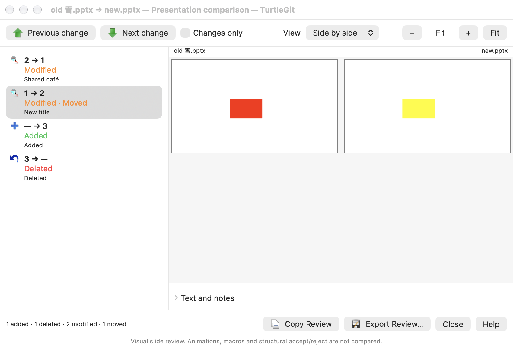
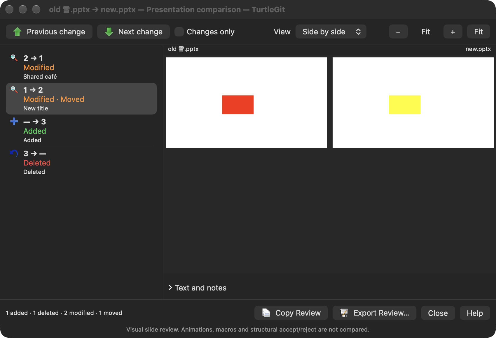
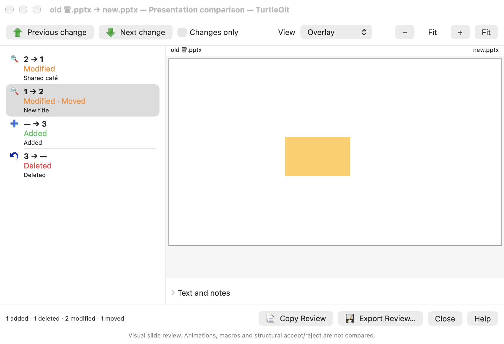
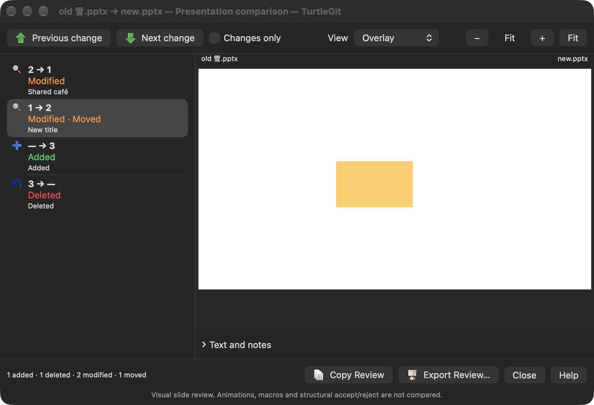
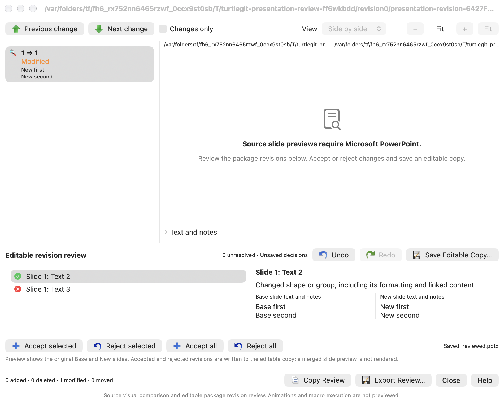
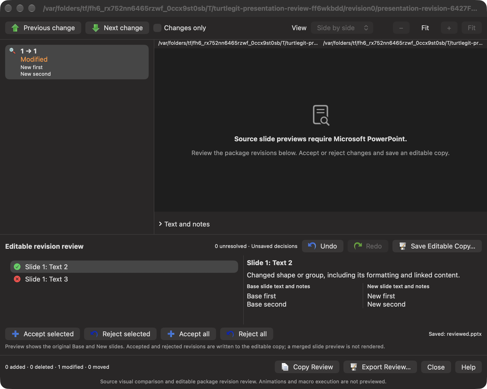
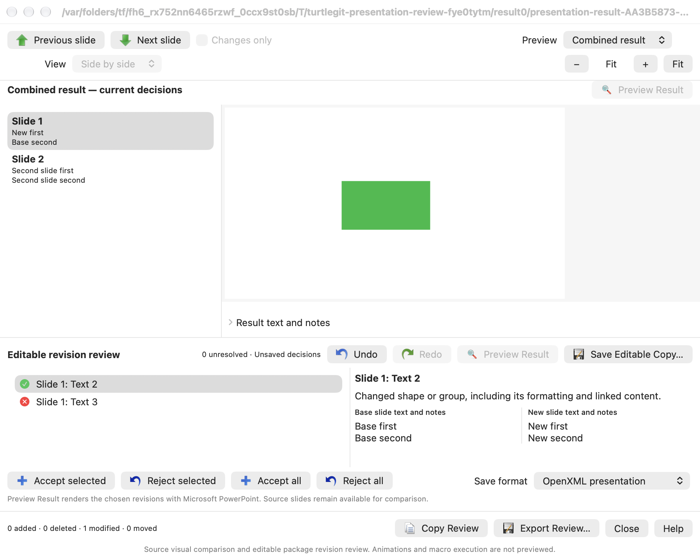
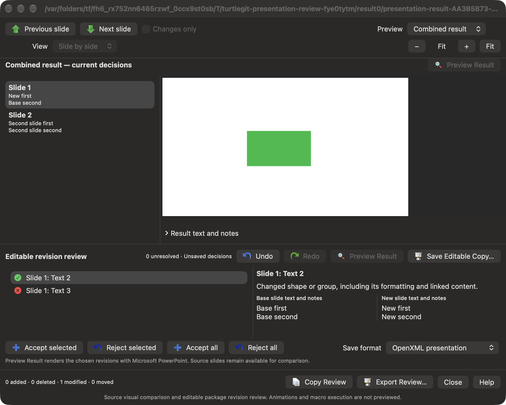
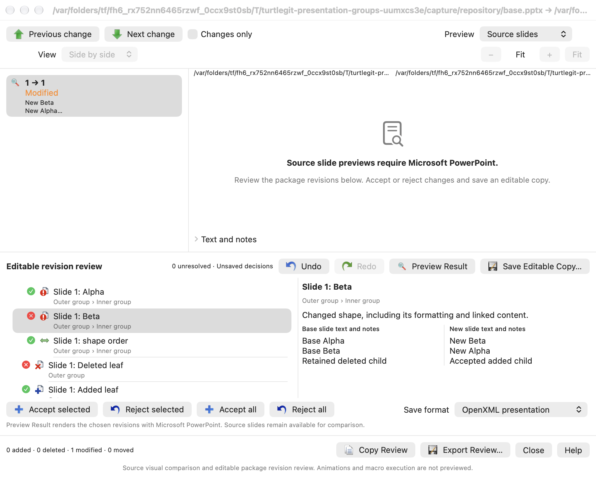
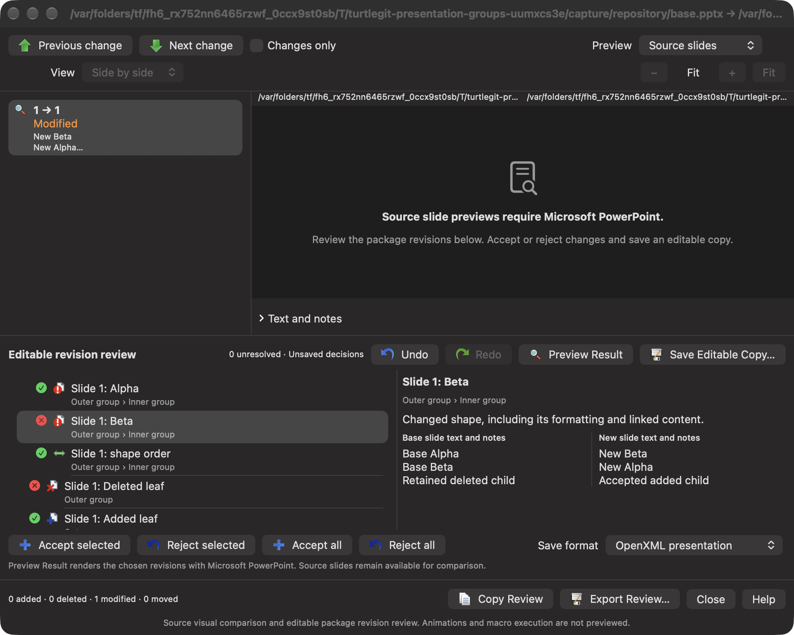

# PowerPoint comparison source family

Pinned TortoiseGit: `7338078f8ddd924b8cddee35f512f2286072136d`.
Source adapter: `contrib/diff-scripts/diff-ppt.js`.

## Source contract and Mac capability

The script registers `ppt;pptx;pptm`, requires two existing inputs and installed
PowerPoint, disables macros, checks the unsupported Office 2007 branch, opens
the base presentation and merges the new presentation into its review interface.
It marks the review saved to suppress an incidental Save As prompt. The Windows
PowerPoint review engine provides change highlighting and accept/reject behavior.

The inspected Mac `PowerPoint.sdef` exposes slide/shape/notes metadata, macro
security, PDF Save As and exact presentation close. It exposes no presentation
Compare/Merge command. Its `merge` command operates on table cells. Microsoft
also [documents the unavailable Mac Compare/Merge feature](https://support.microsoft.com/en-us/office/track-changes-in-your-presentation-35dad781-50f7-4c4f-9b15-cf418f03c279).
LibreOffice's documented tracked-review merge supports
[text and spreadsheet documents](https://help.libreoffice.org/latest/en-US/text/shared/guide/redlining_docmerge.html);
its existing Writer/Calc adapter cannot provide an Impress revision engine.

## Implemented connected family

The built-in tool and `.ppt`, `.pptx`, `.pptm` associations participate in the
existing selection, alternate-tool inversion, Advanced association editor and
Restore Defaults behavior. Source bytes, revision titles, caller preferences and
folder leases are captured through the shared file-comparison route. A caller
close cancels pending export; a completed independent review owns its own lifetime.

Core preparation copies exact bytes into a private directory and read-only input
files. The native export adapter sends literal Apple-event arguments to fixed
script code. It serializes its own exports around PowerPoint's global macro
policy, disables macros before opening, captures the exact private presentations,
exports all slides and hidden slides, closes those presentations, and restores
and checks the prior macro policy. It never selects an active document for
cleanup or terminates the user's PowerPoint instance. A completion receipt must
confirm cleanup; uncertain completion retains its captured files. Event timeouts
and cooperative cancellation preserve that distinction.

Slide metadata has bounded, versioned manifests and contiguous exported indices.
The PDF reader requires all manifest pages. It owns readers on worker threads,
checks size/page/pixel budgets, and computes deterministic raster fingerprints
rather than comparing variable PDF serialization bytes. Core pairs stable slide
identities and exact visual/content anchors, detects reorder through an increasing
subsequence, and preserves every input slide exactly once. Metadata text and
notes retain literal UTF-8 identity. Refused or oversized output fails explicitly.

The native review window contains source action icons, colored slide actions,
move markers, changes filtering, change/slide navigation, paired/overlay/pixel
difference views, shared fit/zoom and selectable text/notes. It persists display
preferences, copies or exports a review report, offers cancellation/retry and
contextual offline Help. Closing, refused presentation, sheets, retirement and
application Quit retain/cancel/drain the actual owned work before removing files.
The connected Open XML revision engine now adds editable-copy output, described
below. It does not stage repository changes or resolve a Git conflict.

## Validation and explicit gaps

The grouped checkpoint passed 29 relevant Core methods, the final Debug app,
bundle layout/configuration and four native cases: automation contracts, review,
routing and lifecycle. The installed PowerPoint script dictionary compiled;
execution replies and slide PDFs were injected. No live Office export was run.
The [dated evidence](qa/powerpoint-comparison-2026-10-20.json) records the initial
build/fixture failures, a repaired recursive control observer, and only the
affected rechecks. These passes do not establish a complete hosted CI pass.

That original checkpoint established native slide review, before editable
package revision decisions were added. It did not establish shape review or
merged-deck output. The connected package family below extends that scope;
Complete Windows review/comment/animation/transition/macro behavior and
embedded-object runtime acceptance remain open. The subsequent binary/result
family below adds private legacy conversion and combined-result preview.
Finite raster fingerprints can miss sub-resolution visual changes. Mac standard
Open lacks a `with window false` parameter; exact owned windows are hidden after
open, so a live Office acceptance run must account for possible initial exposure.

Injected exporter/receiver checks do not establish actual Office rendering,
protected/password prompts, every hidden-slide/text-shape combination, external
application sandbox grants, TCC or App Store approval. The targeted PowerPoint
Apple-event entitlement is distribution preparation requiring separate review.
The broader port remains incomplete.

## Native captures

Actual offscreen native windows with private generated slide PDFs, captured on
October 20, 2026. These show review controls and rendering, not live PowerPoint
conversion or full Windows revision-engine parity. All four were visually
reviewed after replacing an incomplete component-cache capture.

## Open XML revision decisions and editable output

`PresentationPackage` reads bounded ZIP32 stored/DEFLATE members with checksum,
local/central header, path, duplicate and aggregate-size checks. It writes a
deterministic stored ZIP package while preserving opaque member bytes. ZIP64,
encrypted archives and unsupported compression are refused explicitly.

`PresentationRevisionReview` follows PresentationML slide IDs and per-slide
nonvisual shape IDs, compares shape XML and linked content, and records explicit
New/Base decisions. Added/deleted slides, slide ordering, shape/group changes and
stacking order are reviewable. Inseparable slide environment/reference changes
are a complete-slide decision. A shared presentation decision chooses the anchor
metadata/settings; dependency import allocates identities before traversing
cycles and rewrites part relationships/content types for the selected graph.
Changed group shells remain atomic. The recursive continuation below adds child
decisions inside equivalent shells. Unsafe mixed decisions fail with a reason.

The native window connects selected/all accept/reject, undo/redo, unresolved and
unsaved state, a native Save Editable Copy panel, original/alias protection,
cancellation/draining and Discard/Cancel closure. Missing PowerPoint falls back
to package metadata review for `.pptx`/`.pptm`; an uncertain Office export does not
transfer its files into a disposable review. Base/New visual previews remain source previews; the separate explicit
combined-result rendering workflow is described below. Macro parts are preserved without
execution and require macro-enabled output. Invalidated package signatures are
removed and disclosed.

This advances the source revision workflow without claiming full Windows engine
parity. The recursive continuation below provides independent group-child
decisions. Complete comment/animation/presentation-wide reference combinations
and physical Office reopening remain explicit gaps. Signed sandbox,
TCC/file grants, minimum-OS acceptance and App Store review remain unverified.

The package structure and separate slide/layout/master/theme/notes relationships
follow Microsoft's [PresentationML structure](https://learn.microsoft.com/en-us/office/open-xml/presentation/structure-of-a-presentationml-document)
and [slide document model](https://learn.microsoft.com/en-us/office/open-xml/presentation/working-with-presentation-slides).

Nonvisual slide/shape identities are matched first. The binary/result family
below extends matching when an editor regenerates those IDs. Source raster review
retains its separate visual anchors.

### Editable revision captures

Actual native light/dark windows with private synthetic Open XML packages,
accepted/rejected shape decisions and unavailable source previews. The saved
outputs were checked independently with ZIP/XML readers. These captures do not
show live Office rendering or a synthesized merged-slide preview.

[Revision-family evidence](qa/presentation-revision-family-2026-10-20.json) records
28 distinct focused Core methods, passing native workflows and independent ZIP/XML
output checks after the actual save-identity and retired-Quit repairs. These checks
do not establish live Office reopening or complete source parity.

## Legacy inputs, combined-result rendering and identity matching

Binary `.ppt` source export also saves a private macro-enabled Open XML package,
using the installed Mac dictionary's named Save As enumerators. Revision review
reads those normalized packages. It never replaces the captured binary sources.
The same serialized automation worker renders resolved result snapshots or
converts them to private legacy `.ppt` output. The native Save As workflow alone
publishes output to the user-selected destination after confirmed Office closure.

The native window has explicit Source slides / Combined result modes, Preview
Result, result slide navigation/text and current/stale decision tracking. Editing
decisions invalidates the existing preview and cancels obsolete work. A new
render requires an explicit action; stale callbacks cannot publish over newer
decisions. Previewing does not clear unsaved decisions. Binary inputs default to
legacy output; Open XML output remains available. Cancellation, retirement and
uncertain Office ownership retain the existing captured-input lifetime rules.

Matching uses stable IDs, mutually unique normalized content/dependency anchors,
then bounded similarity with a uniqueness margin. Ambiguous duplicate content
remains separate additions/deletions. Output slide/shape IDs and connector/group
references are remapped for selected mixed sources. Classic comment authors and
comment indexes are merged consistently; equivalent notes-master graphs can be
reused. Modern threaded-comment/person combinations remain explicitly unsupported
for independent mixed choices. The recursive continuation below replaces the
earlier atomic-group restriction; animation/reference changes can still require
a whole-slide decision. Exact whole-revision choices
preserve the selected source package entries when no security/format rewrite is
required.

Actual PowerPoint normalization, rendering and legacy format fidelity still need
live acceptance, including hidden slides, macros, embedded content, Automation
prompts and signed file access. Injected conversion replies and a CFB header are
transport checks; they do not prove a real legacy deck can be reopened. The
existing editable/source captures above predate this result-preview family.

### Result-preview captures and grouped checkpoint

The following are actual offscreen native windows with a private generated PDF
from the exported mixed-decision snapshot. The green rectangle is a fixture
rendering, not a live PowerPoint conversion. The slide list records New first /
Base second, while the revision panel retains separate accepted/rejected shape
decisions and unsaved state. Both appearances were inspected; navigation and
format controls retain full captions after the layout repair.

[Result-family evidence](qa/presentation-result-family-2026-10-20.json) records the
19 focused revision-engine tests, Debug build and grouped native adapter, routing,
review, lifecycle, editable revision and result cases. Real private repositories
under Apple Git and bundled Git retain their HEAD, raw index and tracked source
bytes. Independent ZIP/XML checks validate the mixed Open XML output in addition
to the existing complete-New PPTX/PPTM cases. Apple-event execution and result
PDFs were injected; the installed PowerPoint terminology compiled. These checks
do not establish live Office fidelity, a complete CI pass or App Store acceptance.

## Recursive group decisions — October 20, 2026

The connected continuation replaces flat, atomic group review with recursive
sibling-scoped matching and decisions. Children are matched only inside the same
matched parent; a move across group boundaries remains a deletion/addition.
A matched group's shell is compared without its direct shape children. Equivalent
shells permit independent child changes and local stacking-order decisions;
changed transforms, nonvisual properties, effects or other shell content require
one explicit whole-group choice. Opaque group children also remain atomic;
recognized markup-compatibility/extension guards can require the whole slide.
Added/deleted groups remain atomic. Existing
animation and unknown-reference whole-slide guards remain in force.

Export must first resolve the complete selected tree, then allocate slide-wide
unique shape IDs before remapping any connector. Both source identity maps must
resolve matched counterparts to the selected output object. Only selected
subtrees and group shells contribute imported dependencies. Missing or ambiguous
connector targets are refused. Complete-revision choices retain the existing
opaque package preservation path.

The native list shows ancestor breadcrumbs, bounded indentation, original action
artwork and complete tooltip/accessibility paths. Copy/Export Review carries the
same ancestor path to distinguish repeated object names. Titles and group names retain
the source text; they are not interpreted as decision identities or translated
application captions. Existing session Undo/Redo, Save As, cancellation and
captured-input ownership remain connected to the recursive decisions.

This is a native replacement for the Windows script's call to PowerPoint's opaque
Merge engine. The pinned script does not expose that engine's individual group
matching rules, so passing package/native checks cannot establish identical
Microsoft revision granularity or live Office rendering fidelity.

The grouped checkpoint passed 28 distinct focused Core methods (nine new and
nineteen existing) across the initial group and focused endpoint/opaque-content
checks. The Debug app built, and both native review/save and lifecycle cases
passed. Python independently verified the saved ZIP CRCs, nested group structure,
chosen child text/order, unique IDs and every internal relationship target.
[The dated record](qa/presentation-group-family-2026-10-20.json) retains the actual
failures, semantic assertion repair, opaque-content repair, affected builds and
capture-only checks. Functional cases were not repeated after passing.

Minimum-size captures caught a clipped footer. The revision pane now shrinks
while retaining a scrollable change list, and the complete caption/buttons were
inspected in both appearances. The following are exact offscreen owned-window
compositor captures, with no image postprocessing. No Office app was launched;
these show the metadata fallback and mixed nested decisions, not live PowerPoint
rendering or physical input acceptance.

All six launched native receivers, including failed fixture and capture attempts,
were reaped and independently absent afterward. Modern threaded-comment/person
combinations, incompatible presentation-wide masters, namespace conflicts,
unsafe references, live Office fidelity and physical/signed/App Store acceptance
remain open. Changed/opaque groups stay atomic and cross-group moves remain
separate deletion/addition choices. This completes the scoped continuation, not
the full application port.
