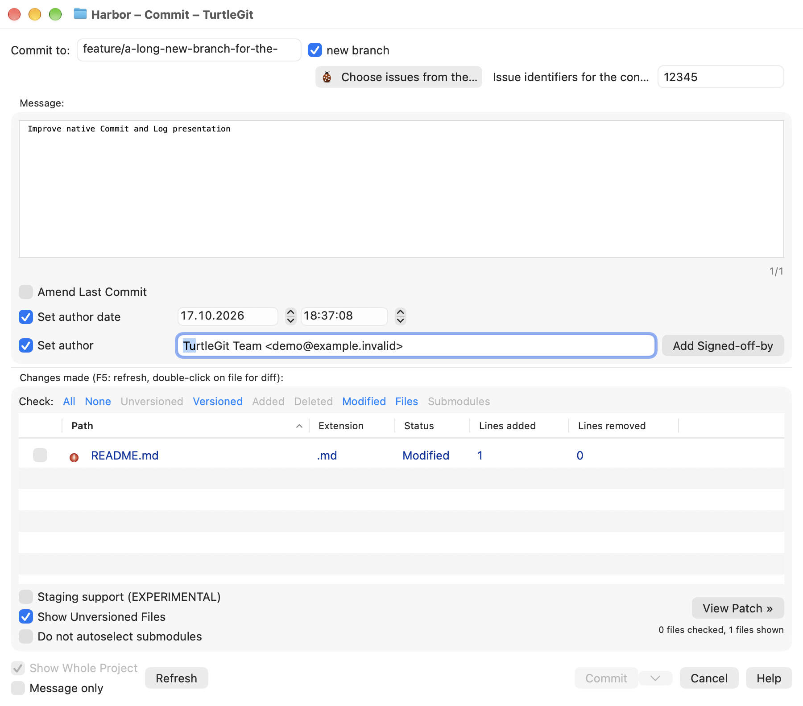
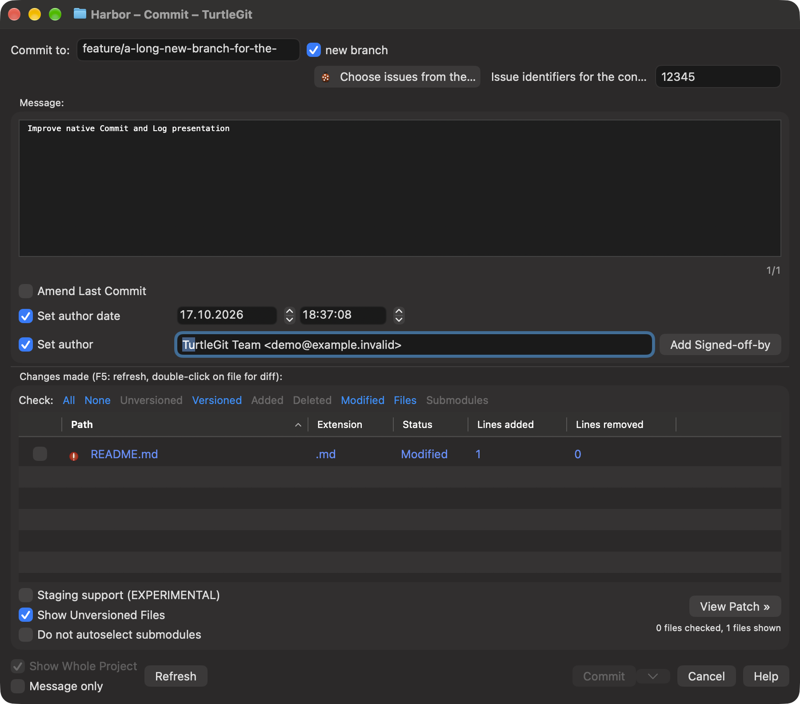
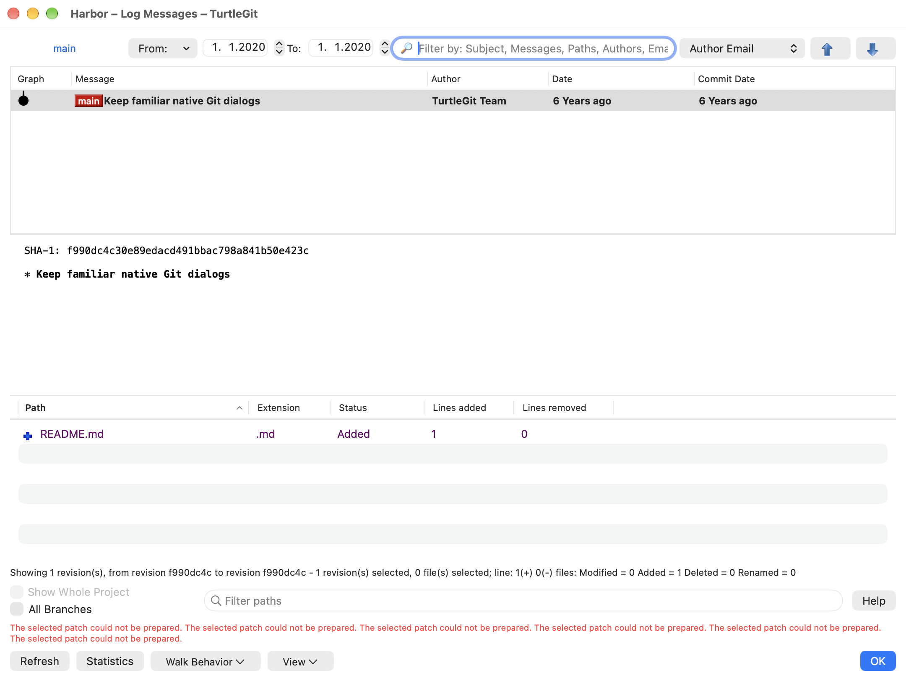
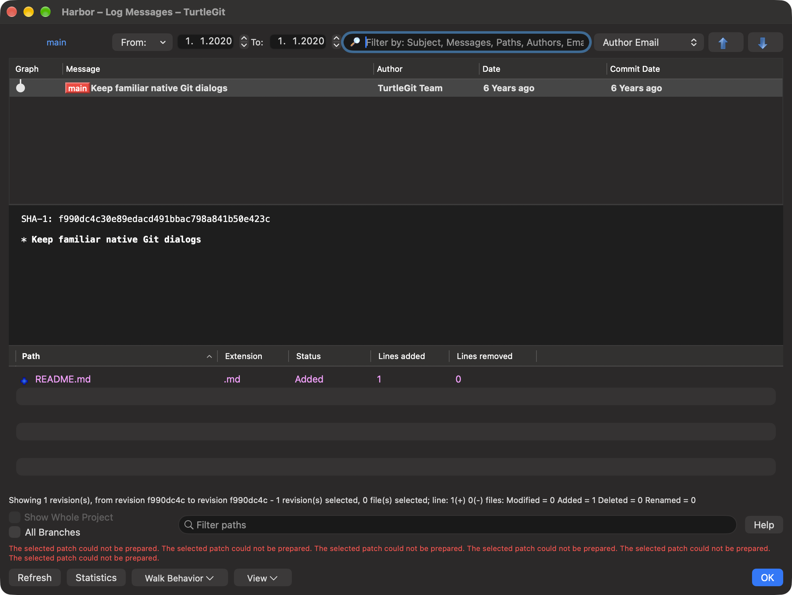
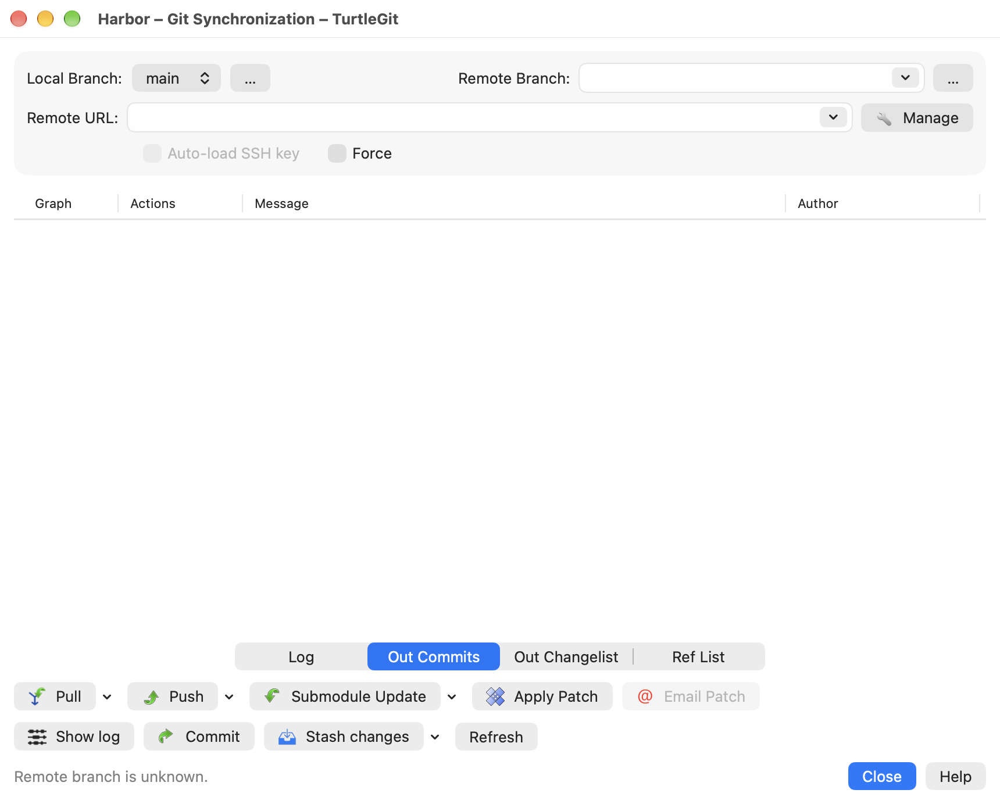
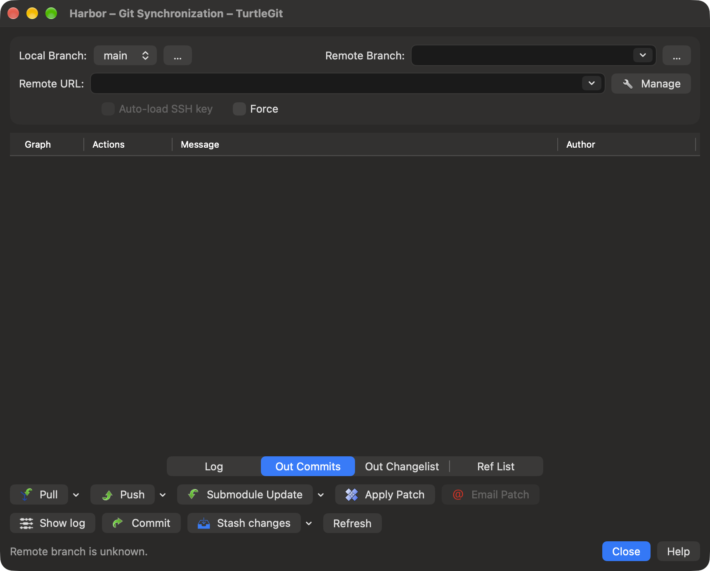

# Primary dialog command bands

Commit, Log and Synchronization keep the pinned source's control order and
recognizable bands. Native controls now reflow when a band cannot fit, instead
of forcing its entire window wider. No control is recreated as an alternate
compact form: native editors retain their focus, selection and field identity.

Commit reflows Amend options, author/date controls and the Check filters.
The author field shares spare horizontal room. Log reflows the reference,
history/date, search and Jump groups; the Jump picker and direction buttons stay
together. Pending work and failure details appear above Log's footer commands,
so a long error cannot push OK or the source Walk/View menus outside the window.
Synchronization reflows local/remote branch groups, URL/Manage, SSH/Force and
both source action bands. Each action and its dropdown remain together.

This adapts `IDD_COMMITDLG`, `IDD_LOGMESSAGE` and `IDD_SYNC` at pinned revision
`7338078f8ddd924b8cddee35f512f2286072136d`. The unchanged source resource order,
icons, callbacks and command gates remain authoritative. The official bundled
Commit and GitSync images supply visual context; this is not pixel-for-pixel
Windows typography or complete dialog certification.

Native checks cover actual controller windows, minimum/default/expanded widths,
focused editor retention and repository invariants, plus the retained source Log
menu/layout checks. The shared layout also exercises a genuine two-row to
one-row transition without rebuilding the field. Full translated catalogs,
physical keyboard/VoiceOver, unusual display scaling and signed Finder/App Store
acceptance remain open. These checks do not certify all dialogs.

[Batch evidence](qa/primary-command-bands-2026-10-17.json) records five distinct
native cases, sizing/diagnostic repairs, the hosted Merge lifecycle failure and
local correction, and ownership checks. Core code was unchanged.

