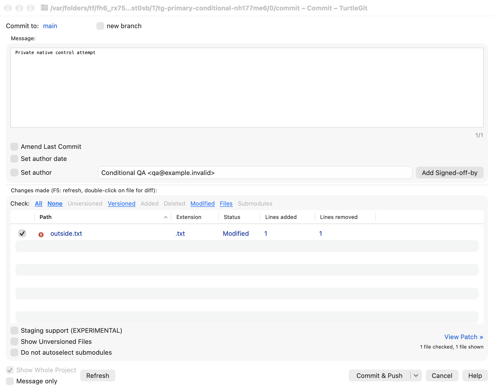
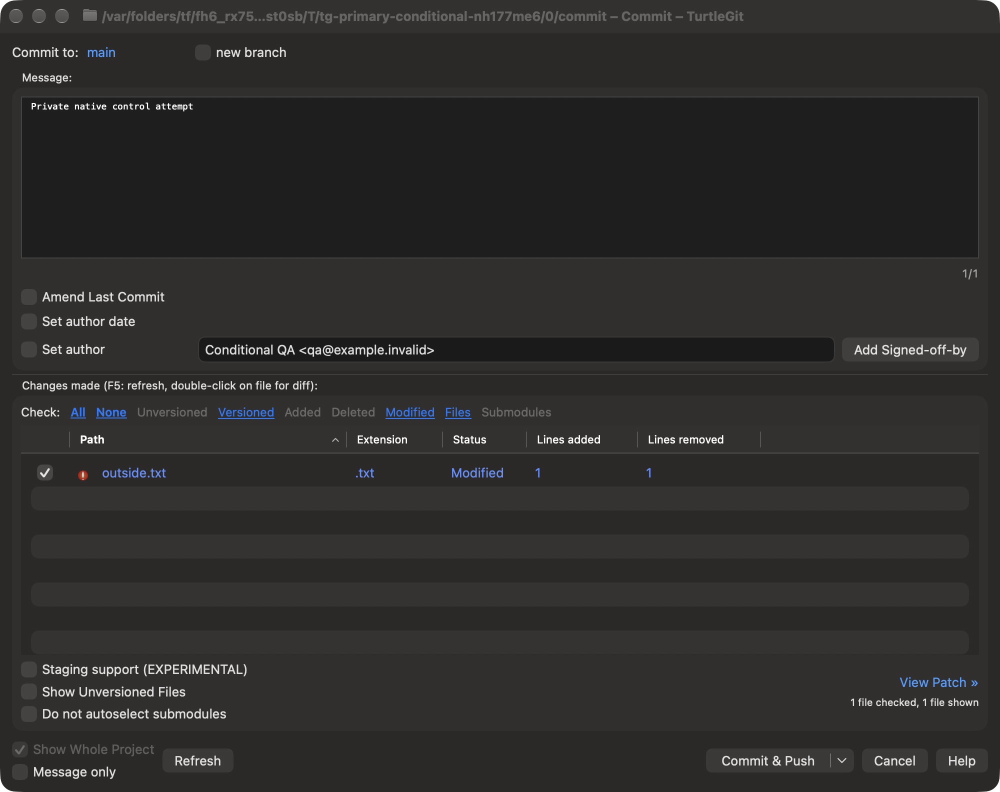
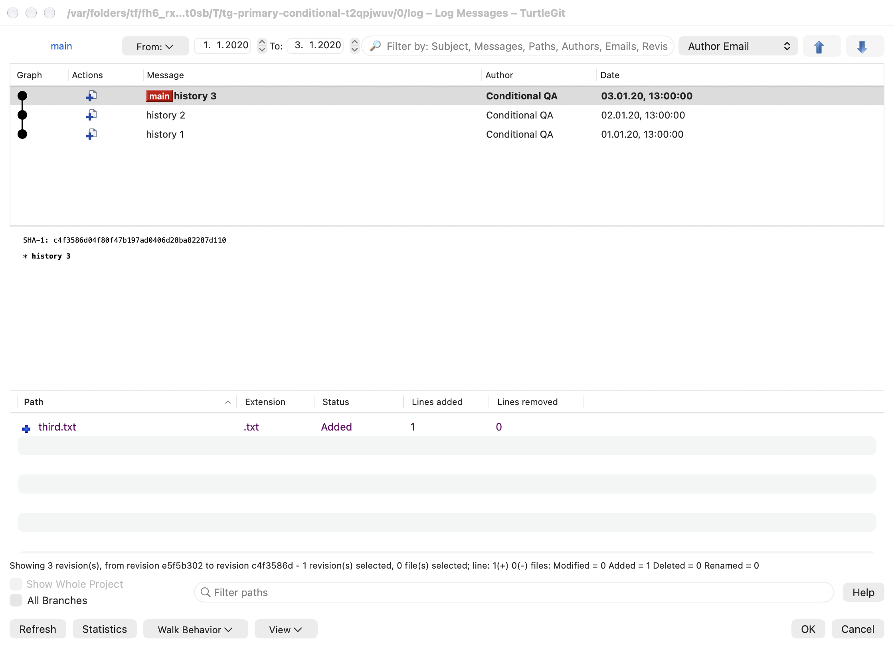
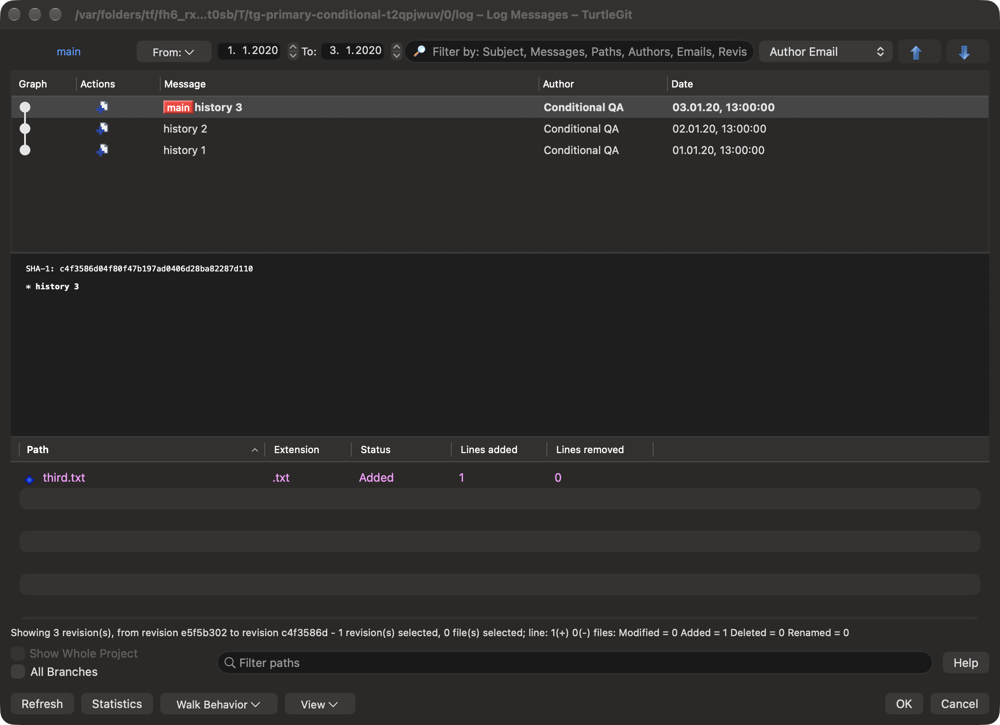
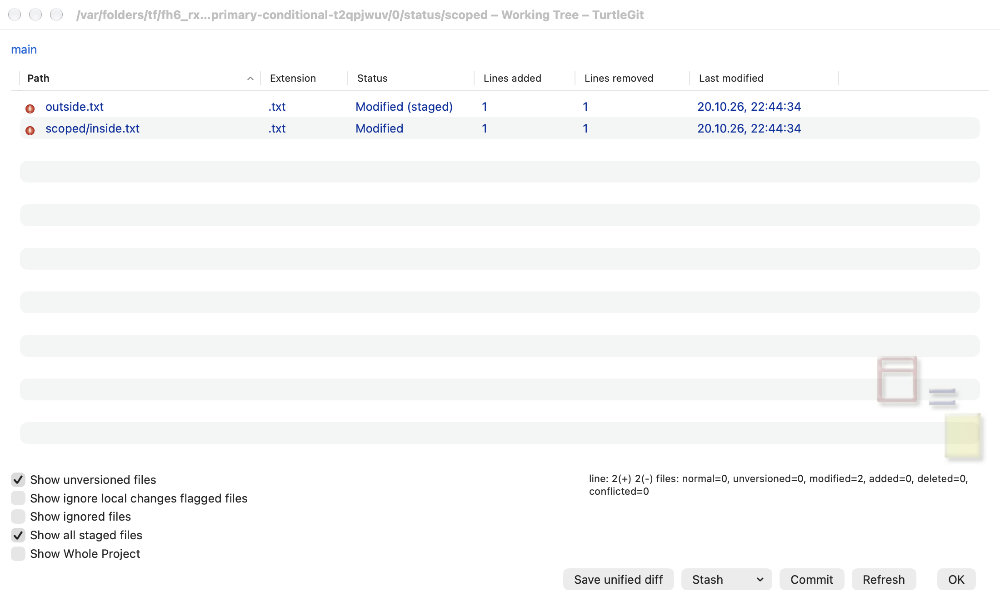
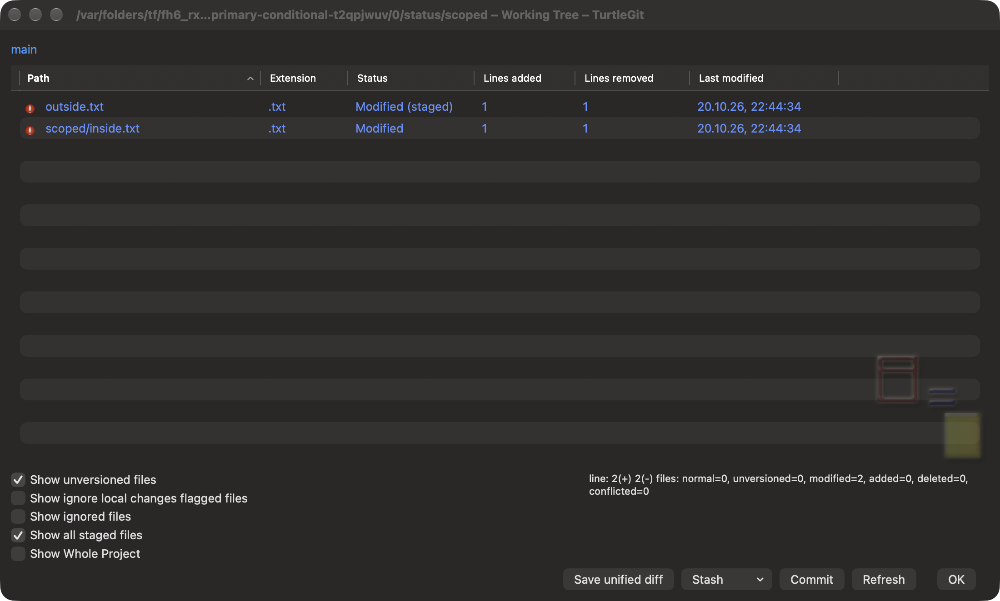
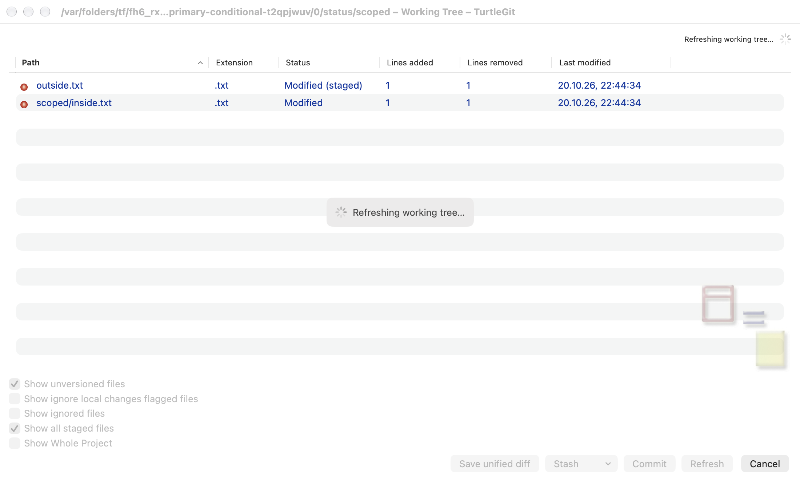
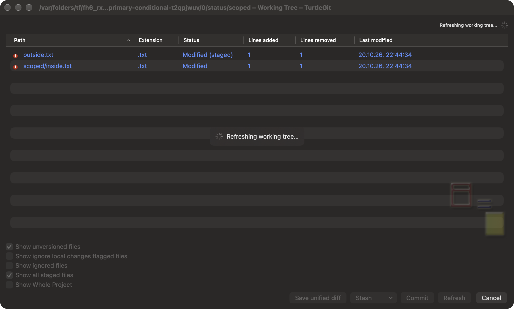

# Primary dialog conditional controls

This partial family audit compares Commit, Log and Check for Modifications with
TortoiseGit commit `7338078f8ddd924b8cddee35f512f2286072136d`. It supplements the
existing family audits; it does not certify complete dialog or port parity.

## Commit

The footer uses one native segmented split control, preserving the source Commit,
ReCommit and Commit & Push order and remembered primary action. Split/combine
workflows expose a single action. Menu items use the existing source artwork and
icon preferences, with the current action checked. Captured menu actions expire
on model changes, owner closure or invocation. F4, Option-Down, Shift-F10 and the
accessibility Show Menu action expose the menu. Return/Space activates the focused
control; existing Command/Control-Return commands remain available from the
editor/list. An unmodified Return in the multiline message remains text input.

Focus file list joins the existing focus message command, with Command-Option-F/M
macOS shortcuts and source-style Option-F/M aliases outside editable text. The
operation indicator sits in the lower command band. Check categories and patch
links use source-style emphasis and link colors. Existing checkbox semantics and
Git commit transactions are retained.

Source references: `CommitDlg.cpp`, `CommitDlg.h`, `IDD_COMMITDLG` in
`src/Resources/TortoiseProcENG.rc`, and the source split-button implementation.

## Log

The From label/menu and native From date control share the limitation menu. Date
edits use the source epoch-to-2100 bounds, clamp crossing endpoints and avoid a
second read for an unchanged effective day. Captured menu and native date actions
respect owner, sheet, modal, Quit and operation state.

History loading replaces Statistics/Walk/View with progress. Statistics excludes
the synthetic working-tree entry and requires a real commit. Navigation kinds and
directions follow model availability. Ordinary Log now includes Cancel as well
as OK. The existing graph-first revision table, colored references, filtering and
saved panes are retained.

Source references: `LogDlg.cpp` `OnLogListLoading`, `OnContextMenu(IDC_DATEFROM)`,
`OnBnClickedStatbutton`, date change handlers, and `IDD_LOGMESSAGE`.

## Working Tree

Whole Project and Show all staged changes acquire a fresh Git snapshot instead of
repainting cached rows. Other category toggles retain the already acquired native
snapshot. Existing preference and selection/position policies are retained.
During a read, the primary default button becomes Cancel; other actions are
blocked. Branch and statistics wait for the completed snapshot. Loading, empty,
failed and cancelled refreshes have distinct presentation; a cancelled/failed
refresh can retain the last complete result. Detached and unborn captions differ.
The list uses unchanged `CFMBackground.ico` through the existing viewport backdrop
and `ShowListBackgroundImage` preference.

Source references: `ChangedDlg.cpp` lines 151–194, 266–314 and 451–464,
`IDD_CHANGEDFILES`, and `IDI_CFM_BKG`. The source-hidden Show unmodified control
remains hidden. No extra remote-status checkbox is invented.

## Validation and remaining acceptance

The [grouped checkpoint](qa/primary-conditional-2026-10-20.json) records seven
focused Core methods, six native dialog/engine pairs, the final app build and
all failed attempts/repairs. Older screenshots in related family guides predate these changes.
Physical popup tracking, accessibility navigation, all light/dark conditional
variants, large repositories and signed Finder/App Store execution remain
unproven by focused receivers. Complete upstream dialog acceptance is still open.

The same batch separates the native metafile pixel evaluator from nested Data
borrowing closures to address the hosted Xcode 16.4 type-check timeout. Pixel
formulas, malformed-input refusals and work limits are preserved. A successful
local build does not establish a successful hosted Xcode 16.4 run.

## Captured native windows

These controlled fixtures show the completed surfaces in light and dark mode.
The Commit capture uses a remembered Commit & Push primary action, Log has three
linear commits, and Working Tree uses a scoped selection with outside staged
changes. They do not represent every conditional state or physical acceptance.

Hidden SwiftUI hosts returned an empty virtual accessibility child array in the
focused receiver. The final Cancel checks dispatch the actual window Escape
(Log) and default Return (Working Tree), then assert closure or cancellation,
retained results and worker drainage. They do not prove a VoiceOver button press.

