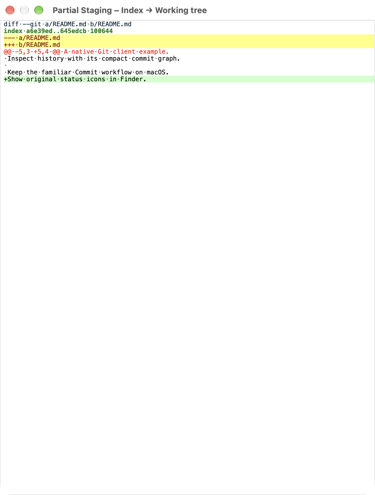
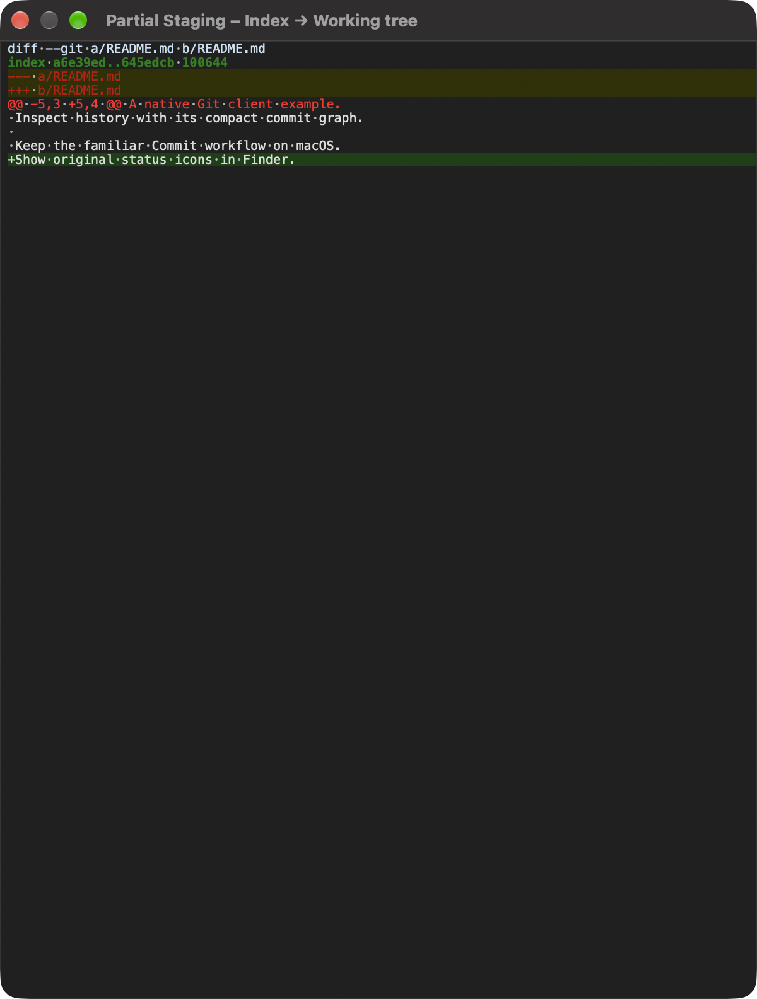
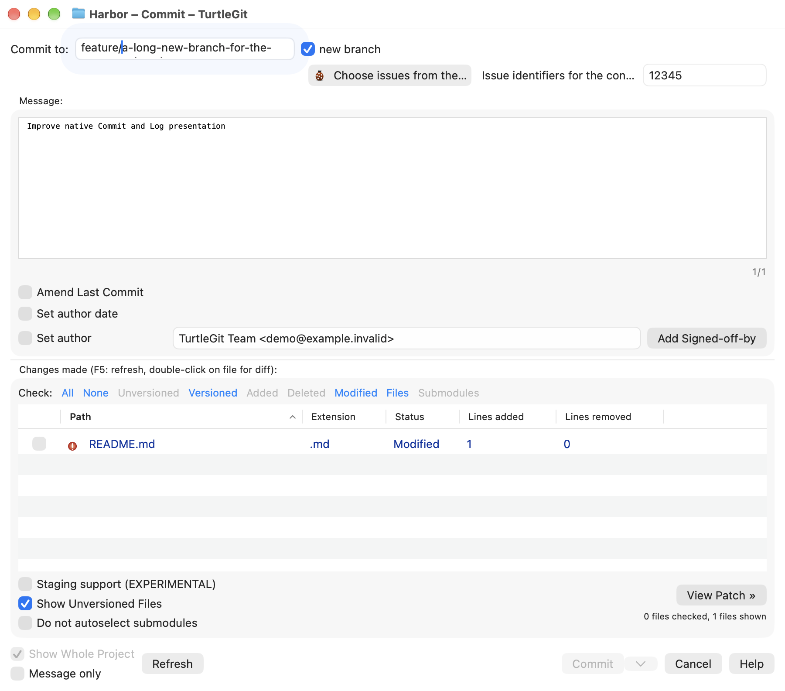
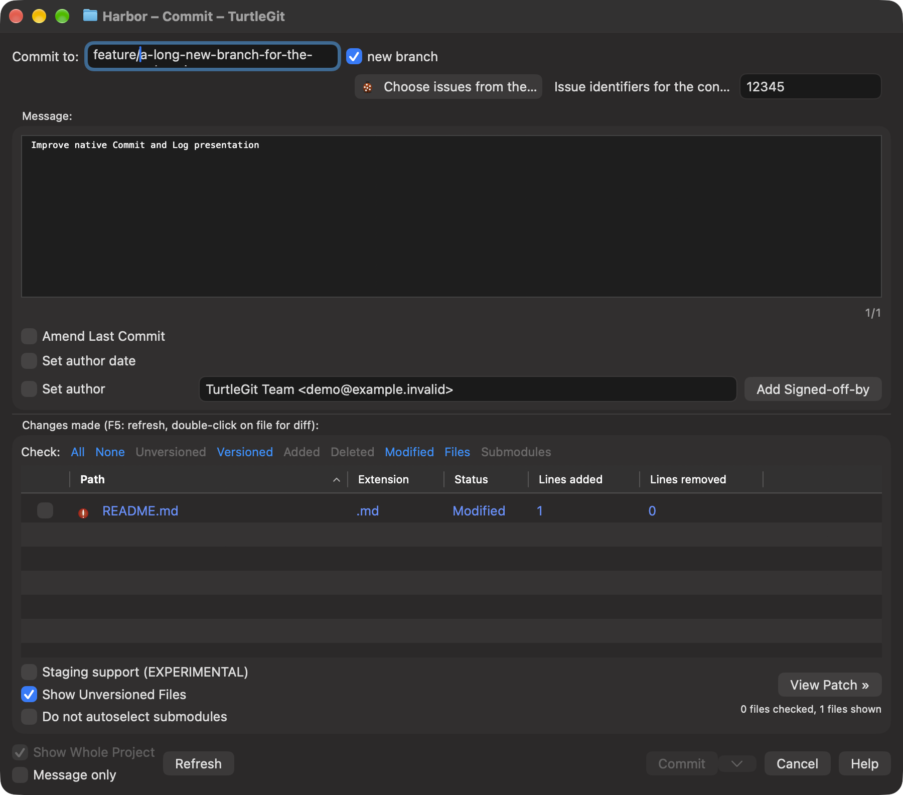
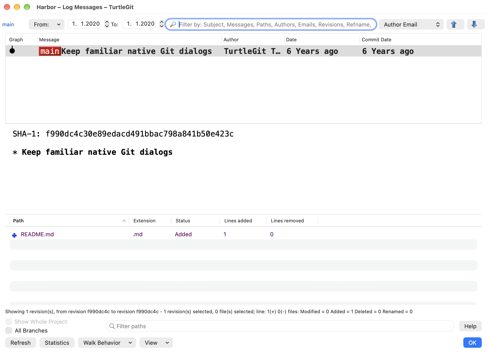
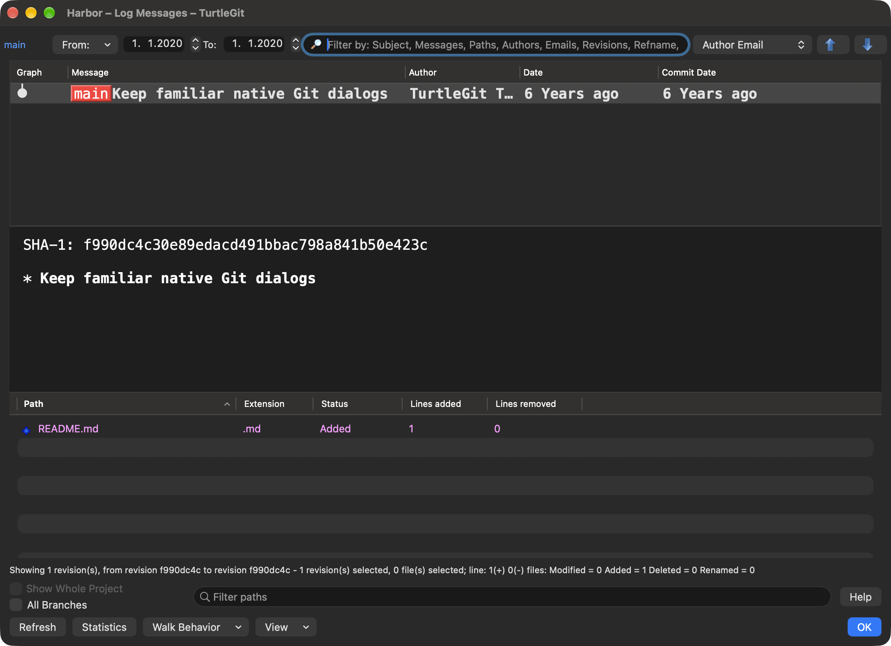
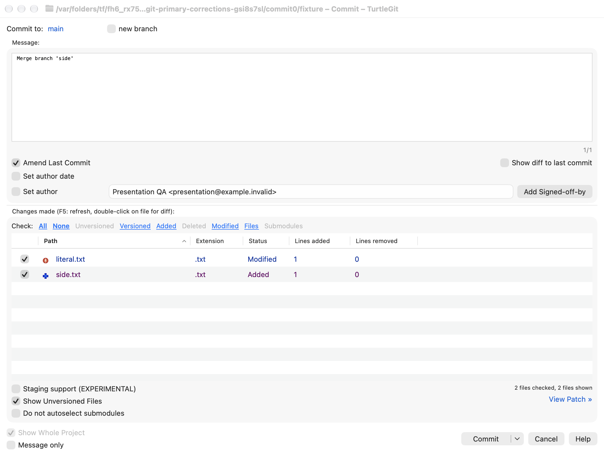
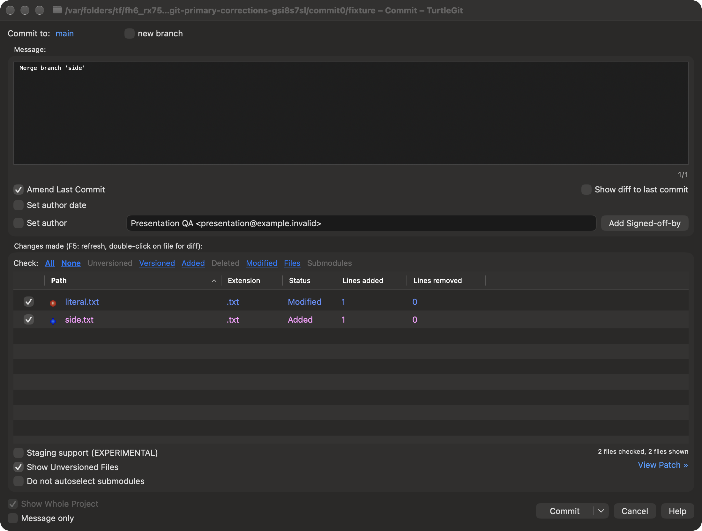
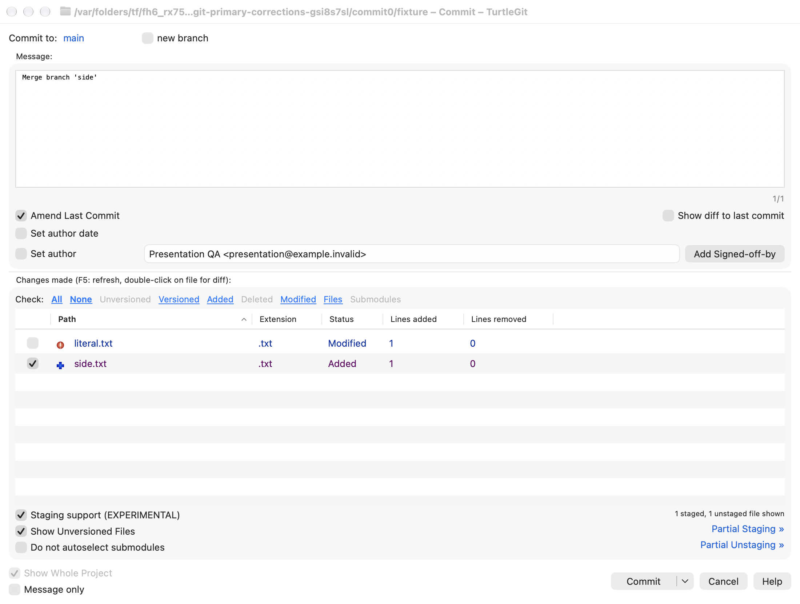
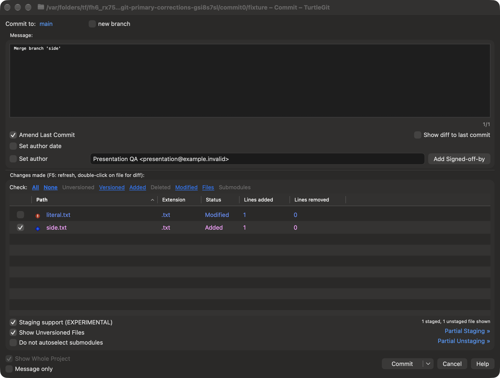

# Primary dialog visual review — 14 October 2026

The current native Commit, staging-mode Commit, Log and Working Tree windows
were captured in light and dark appearance from a private repository. These are
unaltered macOS compositor captures, including window chrome. The reference is
TortoiseGit commit `7338078f8ddd924b8cddee35f512f2286072136d`, its
`doc/images/en/Commit.png` and `LogMessages.png`, and the `IDD_COMMITDLG`,
Log and `IDD_CHANGEDFILES` resources in `src/Resources/TortoiseProcENG.rc`.

| Window | Source arrangement retained | Differences and remaining review |
| --- | --- | --- |
| Commit | Branch destination, message above changes, amend/date/author options, category links, lower checkbox groups and Commit split actions | Native title bar, rounded controls and fonts differ. All conditional states, minimum sizes, keyboard and VoiceOver still need acceptance. |
| Staging | Same file list with three-state checkboxes; separate partial staging/unstaging controls | This capture shows an existing mixed index/worktree state; it does not exercise applying lines or hunks. Physical attached-window placement remains open. |
| Log | Small graph before revision text, colored references, message pane, changed files grouped by merge parent, five changed-file columns | Fixed All Branches checkbox intrinsic sizing so the footer stays compact. All graph topologies, filter combinations and physical resizing remain open. |
| Working Tree | Branch destination, colored file rows, status/changelist groups, lower filters and Save unified diff/Stash/Commit/Refresh/OK actions | Native row spacing and controls differ. Complete conditional menus, physical input and signed scope behavior remain open. |

Eight main-window captures replace the current general gallery views. The older
partial-staging and operation-specific captures remain with their existing
acceptance descriptions. Two new partial-staging diagnostics were excluded:
the compositor produced inconsistent parent/child grouping and activation. They
do not establish a production alignment defect or certify right-hand placement.

The fixture preserved HEAD, logical index tree and porcelain working-tree status,
closed its windows and reaped its receiver. Four grouped native Log regression
cases passed with system and bundled Git. Core was unchanged and was not retested.
An initial fixture compile failure was repaired; a first visual pass found the
footer sizing defect, which was corrected before final capture. No additional
validation is warranted by the documentation-only changes after those passes.

[Recorded results and image hashes](qa/primary-dialog-visual-2026-10-14.json).
The whole port, complete hosted CI, signed Finder integration and full physical
visual/accessibility parity remain incomplete.

The connected preview/viewport follow-up supplies current unaltered Partial
Staging captures in both appearances. The preview is a controller-owned modeless
companion, with native screen placement and sticky edges, so its own compositor
capture no longer contains the preceding parent/child gap. Both images show the
complete colored patch. Independent captures do not certify physical adjacent
placement or all scrolling/keyboard behavior. Six unique native workflow cases
passed; see [results and remaining work](qa/preview-viewport-2026-10-14.json).

The October 15 [Log filter/layout batch](LOG-FILTER-PARITY.md) supersedes the
older Log header/footer captures with an integrated native filter menu and source
command rows. Its light/dark compositor captures were reviewed after correcting
From compression and ordinary/selector footer differences. Complete source and
physical/signed acceptance remain open.

The later October 15 [scope/information batch](LOG-FOOTER-PARITY.md) adds the
permanent Whole Project checkbox and full source information line. Its current
light/dark captures retain the earlier filter/header arrangement. Dark rename-row
contrast remains open and is not certified by these captures.

The [native status-text continuation](STATUS-TEXT-APPEARANCE.md) adds current
Commit/Working Tree/Log source light and adapted dark captures, plus actual
custom-color Apply pixels. It addresses the rename-text issue recorded in the
preceding footer captures. Physical/selected-row and full appearance certification
remain open.

## Adaptive primary presentation — October 16, 2026

The pinned Commit resource places destination and issue controls in a shared
header. Native Commit now retains one field instance for each value and places
its issue controls on a second line only when both bands cannot fit. Long provider
and issue labels are constrained with full tooltips; the current branch is a
selectable native read-only field with full-name tooltip. New-branch editing keeps
its field editor and caret while resizing between ordinary and minimum widths.
The normal header order, original provider icon and conditional issue controls
remain tied to the source dialog.

Log author/committer relative dates now refresh their existing visible cells on
an owned one-second native timer. It performs no Git read, graph rebuild or
selection change, skips hidden/minimized/busy windows and stops when relative
formatting is off or the owner closes. Absolute tooltips and the existing source
threshold/wording formatter remain in use. Copied commit details now capture the
owning Log's date preferences rather than the global defaults.

The prior primary screenshots above document earlier source-layout checkpoints.
The connected fixture checks current header containment/focus and real timer,
font, private-copy preferences and retirement; current captures are recorded with
its dated evidence. This is partial primary-dialog acceptance, not certification
of every conditional layout, VoiceOver, graph topology or signed deployment.

See [dated native evidence](qa/primary-live-presentation-2026-10-16.json). Commit captures show the narrow header with long issue labels. Log captures intentionally use a private 18pt Menlo font, hidden Actions and visible Commit Date columns.

## Commit source option bands — October 23, 2026

Four actual complete-window captures show the corrected Amend comparison option
at the right, statistics above patch links, top-aligned lower columns and the
source Commit/Cancel/Help footer. Ordinary and staging views use the same private
amended merge draft. The receiver briefly displayed each owned window for this
deliberate visual check, then immediately restored invisible/offscreen placement.
Inactive native chrome and controls are visible because the receiver did not
activate itself. These images do not certify active focus, physical keyboard or
all conditional states.

The [grouped checkpoint](qa/primary-layout-patch-encoding-2026-10-23.json) records
45 affected Core checks and four native case/engine pairs passing once, with
receiver cleanup. The Debug build exited zero and produced current binaries but
emitted five contradictory command-failed-with-exit-code-zero diagnostics, which
remain recorded rather than treated as a clean build.

