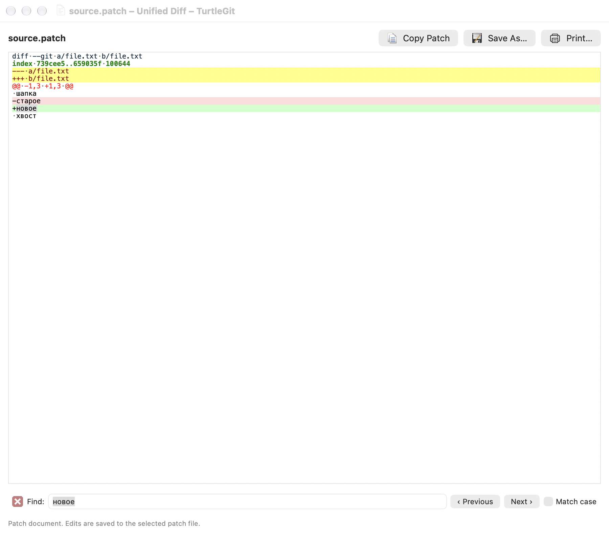
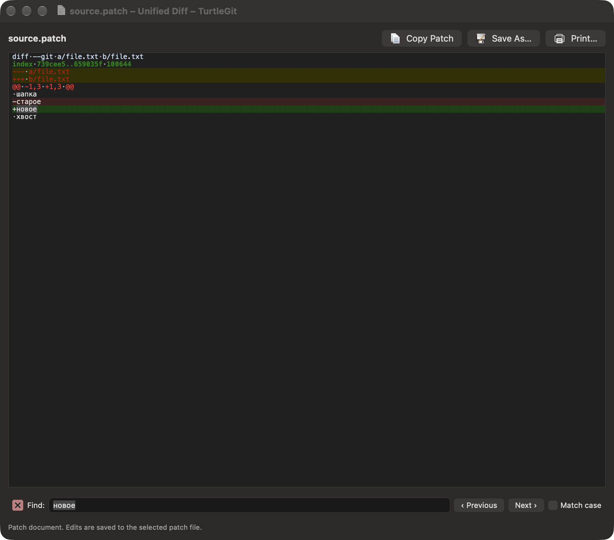

# Regional text in patch windows

Original Patch, serial-import previews, repository unified diffs and partial
staging use the legacy code page selected in Merge settings. Each read captures
that choice before asynchronous work starts. Changing settings affects a new
read; it does not reinterpret a loaded document or an accepted import preview.
UTF-8 lines remain readable inside patches containing regional text.

The displayed text is separate from Git's byte packets. Partial Stage/Unstage,
unchanged exports and the private clipboard patch format retain original bytes.
The ordinary clipboard text flavor contains the decoded display text. Original
Patch and serial previews remain read-only.

## Editable patch documents

Open captures the legacy code page before reading the file. A BOM takes
precedence. Save and Save As encode edits using the captured source codec,
retaining BOM, line endings and a real leading U+FEFF text character. A saved
regional document keeps its codec even if its new bytes also happen to form valid
UTF-8. Copy Patch uses the same encoding rule for unsaved edits.

Changing only the Unicode spelling of text, such as composed é to e plus a
combining accent, counts as an edit. Styling and replacement approval use exact
text as well. The native renderer preserves a final CRLF instead of treating
its LF as absent. An unrepresentable edit reports an error and leaves the file and
dirty document intact. Unchanged malformed/opaque data can still be exported
without decoding and re-encoding it.

TortoiseUDiff uses Scintilla's byte buffer, UTF-8 or Windows `GetACP()`, and writes
that byte buffer on Save. The Mac uses native Unicode text controls and an
explicit legacy preference in place of `GetACP()`. It is not yet a complete
byte-editor port: editing a mixed-codec document that cannot fit its captured
source codec is rejected. There is no standalone conversion picker, and dirty
text containing NUL is not supported by the strict text encoder. These limits do
not prevent unchanged exact-byte export or partial staging of supported patches.

## Validation

The [dated checkpoint](qa/raw-patch-codec-family-2026-10-17.json) records focused
Core and grouped native evidence, failures and limitations. It covers regional
patch selection, original bytes, mixed UTF-8/legacy display, BOM edits, ambiguous
regional save bytes and exact Unicode spelling changes. Native workflows exercise
partial staging, Original Patch, serial preview, captured Open, Save As and both
clipboard representations using system and bundled Git, followed by retained
standalone-document and partial-staging workflows.

Complete visual matching, all codepage byte mappings, physical print/Finder and
signed sandbox acceptance remain open. This checkpoint does not certify full
TortoiseUDiff parity or a complete hosted CI pass.

[Patch path identity](PATCH-PATH-IDENTITY.md) covers the separate connected
filename/rename recovery and serial-provider migration. Exact metadata does not
certify simultaneous filesystem aliases.
