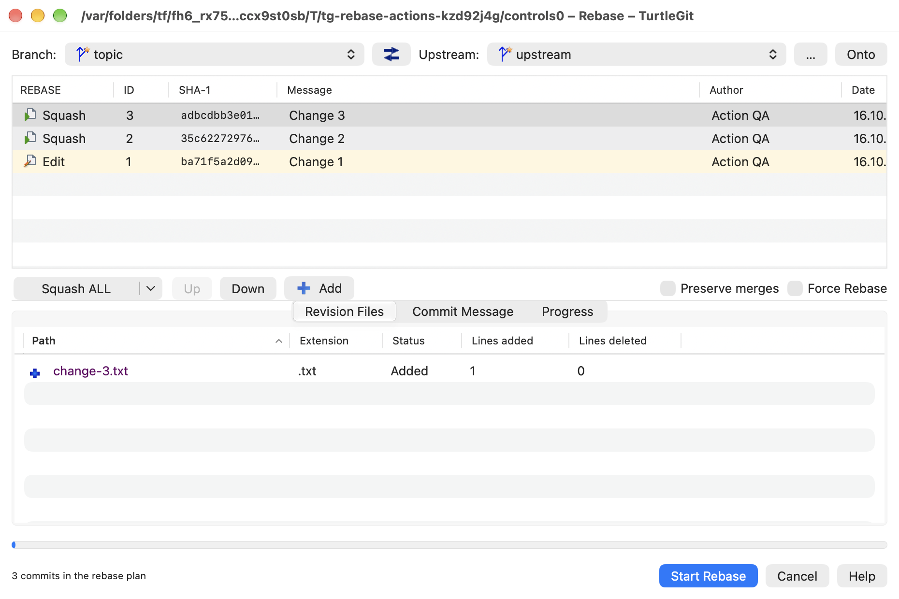
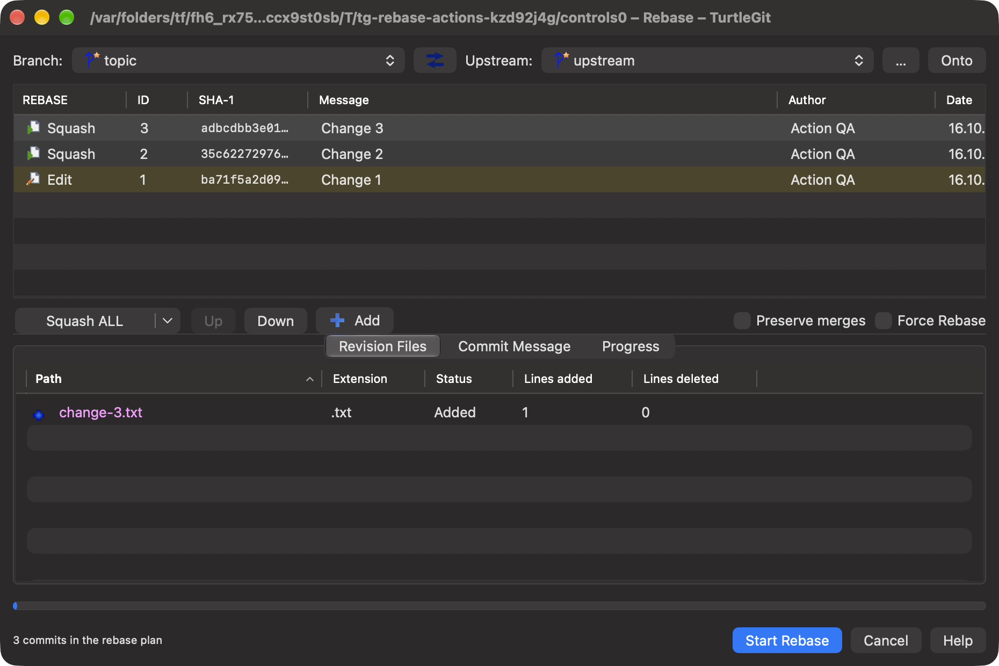
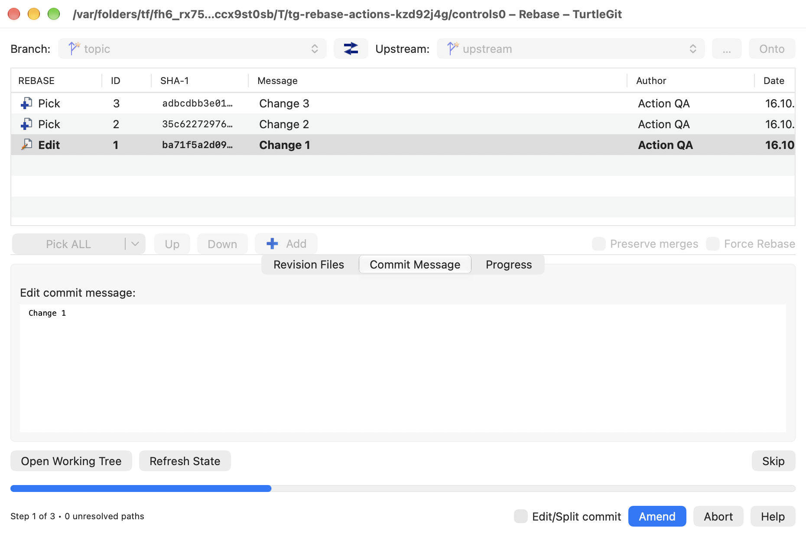
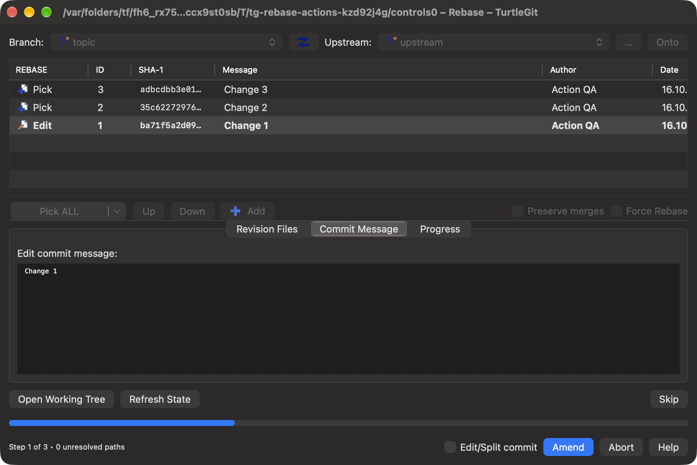

# Rebase action controls

This connected native control family follows `IDD_REBASE`,
`RebaseDlg.cpp::OnBnClickedSplitAllOptions`, `SetAllRebaseAction`,
`AddBranchToolTips`, `SetControlEnable`, `GitLogListAction.cpp`'s selected and
unselected action setters, and `Utils/MiscUI/MenuButton.cpp` at pinned commit
`7338078f8ddd924b8cddee35f512f2286072136d`.

## Bulk actions

The action row now has one native split control, replacing the separate Pick ALL
and Options buttons. Its source-ordered menu contains Pick ALL, Squash ALL,
Edit ALL, Skip unselected, Squash unselected and Edit unselected. Choosing an item
executes it and remembers its label for the main segment's next click. This is
window-local state, not a new preference. Menus retain the original action icons.

Squash ALL and Squash unselected leave the oldest replay occurrence unchanged.
In ordinary Rebase they also leave non-single-parent commits unchanged. The
selected-row Squash command likewise skips the oldest occurrence and ordinary
merge commits. Cherry Pick retains its different merge rules. A skipped oldest
commit can still leave an invalid first retained Squash; the existing Start
validation continues to reject that plan.

Unselected actions preserve the highlighted occurrences. The menu captures the
plan/control generation, occurrence order/actions, selection and branch/upstream/onto
options, and can apply once. A replaced plan, changed selection, modal child,
loading operation, busy or retired owner refuses a late callback. Selection or
option changes invalidate the generation even if their old values are restored. The main
segment repeats the current command against the current editable plan.

## Reference information and footer

Branch and Upstream now expose full revision, author/email, long date and commit
message tooltips. Metadata is read using the already captured canonical plan
hashes, so a same-named tag does not redirect a branch tooltip. The reads share
the plan's cancellation and access/Quit lifetime and publish only with the
current plan. Tooltip length follows the source's 8,000 UTF-16-unit bound without
splitting a surrogate pair. A metadata failure leaves its diagnostic in the
tooltip rather than changing the plan's target. Incomplete/replaced references
show the entered reference until their current metadata is ready.

The Edit/Split commit checkbox now sits beside Continue in the footer at an
eligible Edit/Squash pause. Existing split recovery and native Commit selection
remain in use. Force, Preserve merges and Abort expose explanatory help.

Successful Rebase completion uses the same native split control. Its command
sets remain direct Show log/Restart rebase or after-Fetch Show log/Push/Send Mail/
Rebase. A menu choice becomes the remembered primary action; successful new
completion resets it to Show log. Captured completion callbacks are one-use and
refuse replaced phases/targets. Existing repository/access and mail handoffs
remain unchanged. Cherry Pick and Rebase launched from Log retain the source's
absence of these post buttons.

## Native captures

The native split control keeps the chosen bulk action in its main segment.
Squash ALL leaves an existing Edit action on the oldest occurrence unchanged.

At an actual Edit pause, Edit/Split commit appears beside the continuation button.

## Evidence and remaining acceptance

See [dated build/native evidence](qa/rebase-action-controls-2026-10-16.json).
The connected receiver uses actual native segmented controls and menus and real
Edit/Abort/Squash replay. Structural row-action/drag recovery and reference
picker/cancellation receivers are retained in the same grouped checkpoint.

Full physical menu/key/VoiceOver interaction, all minimum-size combinations,
selected-row contrast, signed sandbox/Finder and complete Rebase parity remain
open. The Preserve merges help describes the native structural engine rather
than repeating the Windows engine's obsolete reordering limitation verbatim.

The [revision menu family](REBASE-REVISION-MENU-PARITY.md) adds source-ordered
row-action visibility, merge-parent and unified mode menus, exact captured menu
receipts and native keyboard/AX entry. The connected
[durable pending action family](REBASE-PENDING-ACTIONS-PARITY.md) now handles
paused reproducible native sessions; older/custom structural conversion remains
explicit.
